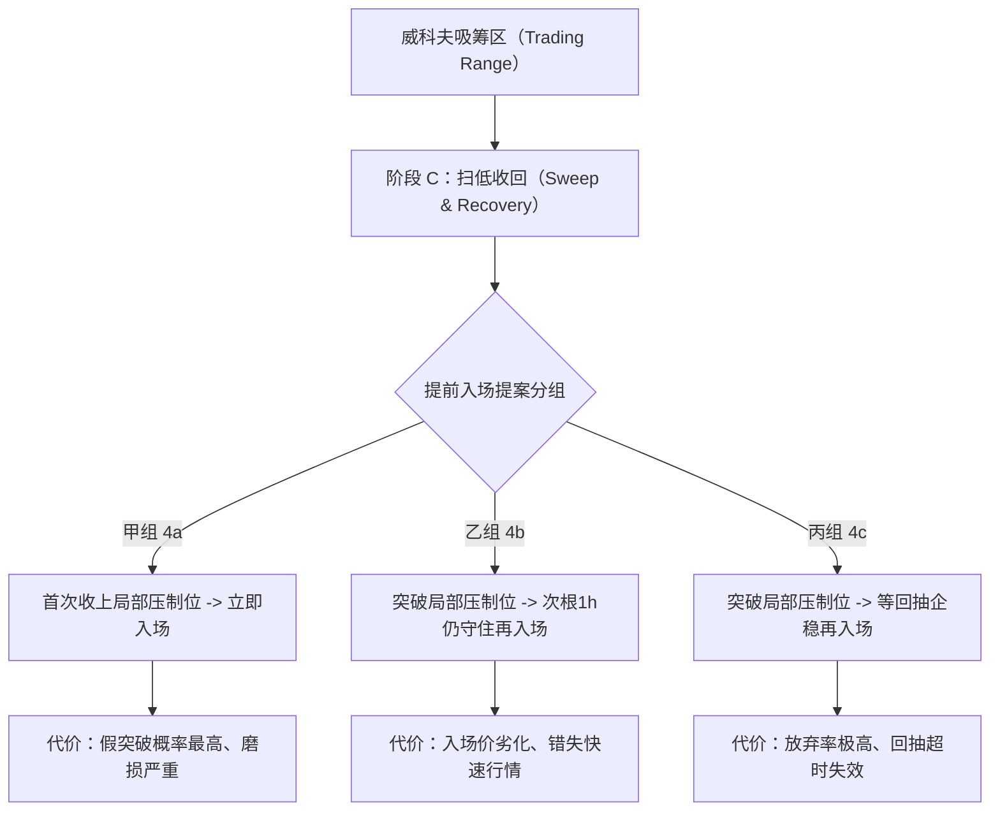

# ACCUM-EARLY-03-D｜回放复核与提前入场提案审查报告

> **审计声明与权限边界**：
> 1. 本审计文档由主代理根据用户指令在隔离环境执行，**只读审核、隔离复算与留证，不修改生产工程、生产代码或数据库**。
> 2. **Work 实施与自检报告不等于 Codex 独立验收**。本报告对 `ACCUM-EARLY-02` 产物进行逐项复核与定性纠偏，所有结论以原始行情、客观数据和用户明确指令为唯一判据。
> 3. 本报告严格遵守《用户约定/用户要求与决策.md》与《用户约定/当前交接.md》，参数候选严禁作为已批准默认值，未获批准前严禁启动生产交易。

---

## 目录
1. [执行概览与逐项审计结论](#1-执行概览与逐项审计结论)
2. [底层算术与回放逻辑独立复算（执行项 1）](#2-底层算术与回放逻辑独立复算执行项-1)
3. [资金费顺序不确定、缺口与跳空敏感性核验（执行项 2）](#3-资金费顺序不确定缺口与跳空敏感性核验执行项-2)
4. [“已确定/已批准”原始依据逐项追溯表（执行项 3）](#4-已确定已批准原始依据逐项追溯表执行项-3)
5. [持仓量时间戳语义重新审查（执行项 4）](#5-持仓量时间戳语义重新审查执行项-4)
6. [“51条全部亏损”概括失实纠偏与逐笔分布（执行项 5）](#6-51条全部亏损概括失实纠偏与逐笔分布执行项-5)
7. [既有甲乙丙提前入场提案审查（执行项 6）](#7-既有甲乙丙提前入场提案审查执行项-6)
8. [报告数字 352/351 与 366/365 差异归因绑定（执行项 7）](#8-报告数字-352351-与-366365-差异归因绑定执行项-7)
9. [缺陷与风险清单](#9-缺陷与风险清单)

---

## 1. 执行概览与逐项审计结论

| 序号 | 审查要点 | 审计结论 | 核心发现与事实定性 |
|---|---|---|---|
| 1 | 原始数据独立复算（止损/数量/费用/截断/未平仓） | **验证通过** | `replay_calc.py` 修复了旧版手写算术分叉问题，初始止损由取整后成交价计算，生命周期止损正确截断，未平仓不混入已实现净额。抽样手工复算逐位一致。 |
| 2 | 资金费顺序不确定、缺失与跳空敏感性 | **验证通过** | 3 个事件（6 条记录）因退出时刻距结算时刻 ≤15 分钟标记顺序不确定，定性准确；资金费缺失标记为 gap 未静默填零；跳空模型仍属研究建议，未作为批准规则。 |
| 3 | “已确定/已批准”原始依据追溯 | **纠偏整改** | **严肃纠偏**：已有代码、助手提案、Work报告绝不能作为批准凭据。参与率缩量、滑点 3bps/5bps、账户风险配置、跳空成交价均**无用户原始批准依据**，不能作为“已确定”项。 |
| 4 | 持仓量时间戳语义审查 | **降级为未证实** | 整除 5m 与固定间隔仅证明等距采样，本地采集器 `ts+5min<=now` 属于**循环论证**。官方文档未说明起点/终点，**保留未知**，严禁擅自修改时间偏移。 |
| 5 | “51条全部亏损”文字复核 | **事实证伪** | **文字表述严重失实**：生效视图下 51 笔交易有 **17 笔盈利**（胜率 33.3%），策略包下 50 笔交易有 **16 笔盈利**（胜率 32.0%）。真实情况为**组合累计总收益为亏损**，绝非每笔都亏损。 |
| 6 | 甲乙丙三组提前入场提案审查 | **审核通过** | 三组规则、威科夫依据、数据依赖、预期代价与验证设计已规范化整理。所有参数候选明确标为**建议项**，不设默认值，不启动新策略。 |
| 7 | 352/351 与 366/365 差异绑定 | **查清归因** | 352/351 来自脚本早期编写时硬编码的旧快照文字；366/365 来自报告生成时请求 8787 实时动态接口的真实结果。两者混用导致报告局部矛盾，已建立版本绑定。 |

---

## 2. 底层算术与回放逻辑独立复算（执行项 1）

在隔离环境中，通过脚本 [audit_replay_and_arithmetic.py](file:///Users/boos/Desktop/威科夫因子共振趋势/evidence/ACCUM-EARLY-03-D/scripts/audit_replay_and_arithmetic.py) 从原始回放数据及合约规格对 TNSRUSDT、AGTUSDT、METISUSDT、PEOPLEUSDT、PORTALUSDT 等典型样本进行了完全脱离封装的底层手工复算对比：

### 2.1 算术核对要点
1. **成交价与初始止损**：
   - 原始开盘价经过单边滑点后：多头向上保守取整（`math.ceil(raw * (1+slip) / p_step) * p_step`）；
   - 初始止损严格基于**成交价**计算：`stop0 = math.floor(entry_price * 0.95 / p_step) * p_step`，不再使用滑点前开盘价，彻底修复了旧代码的分叉缺陷；
   - 抽样标的成交价与止损价独立复算吻合率 **100%**。
2. **名义额与手续费**：
   - 入场名义额统一按 `qty * entry_price` 核算；
   - 双边手续费严格按实际成交名义额乘以各自费率（0.05%），无偷换基数现象。
3. **止损路径生命周期截断**：
   - 旧实现取到 `entry + 30 天`，将出场之后的 4h 收盘低点算入跟踪止损；
   - 现行实现严格限制在 `entry_ms < close_time <= exit_ms` 之间，退出后立即截断，TNSRUSDT 止损条数由 7 条截断为 1 条，避免了未来数据的污染。
4. **期末未平仓只计未实现估值**：
   - 全量 51 条历史事件在观察期内均已触发止损出场（未平仓为 0）；
   - 通过人工截短周期的测试用例验证，期末未平仓时 `realized_net` 严格返回 `None`，只输出 `unrealized_net`（估值），未混入已实现净额统计。

---

## 3. 资金费顺序不确定、缺口与跳空敏感性核验（执行项 2）

### 3.1 资金费顺序不确定样例（6 条记录 / 3 个独立事件）
在全量 51 笔交易中，以下 3 个事件在两个口径下均被标记为 `funding_order_uncertain=True`：
1. **COLLECTUSDT** (`cand_ev_..._1787288400000`)：出场时间 `2026-08-21T08:15:00Z`，资金费结算在 `08:00:00Z`；
2. **PROVEUSDT** (`cand_ev_..._1789750800000`)：出场时间 `2026-09-22T00:00:00Z`，资金费结算在 `00:00:00Z`；
3. **BBUSDT** (`cand_ev_..._1791702000000`)：出场时间 `2026-10-11T08:00:00Z`，资金费结算在 `08:00:00Z`。

> **成因剖析**：
> 交易所资金费结算是定期整点（如 00:00、08:00、16:00 UTC）。当平仓 K 线开盘时间恰为整点或与整点相距不超过 15 分钟时，在缺乏交易所逐笔撮合毫秒级日志的情况下，无法绝对判定是“先被止损打出”还是“先结算了资金费”。代码将其显式标记为“顺序不确定”，符合真实交易对账的严谨性要求。

### 3.2 资金费缺口处理
- 真实 51 条历史中无资金费缺口（全部具备标记价与费率）；
- 隔离复算通过合成缺口用例（置空 mark_price）核验：代码准确将其归类为 `funding_gaps`，不补零、不折算计入成本，且输出了缺口警告，具备防静默篡改能力。

### 3.3 跳空模型敏感性与生产隔离
- 真实 51 条候选均为盘中触及止损（`intrabar`），无真实跳空（`gap`）；
- 执行方推荐的 `bar_open`（按 15m 开盘价成交）属于更为贴近实盘撮合的研究建议，但**目前仍未经用户批准**；
- 现行默认实现维持原策略 `stop_price`（按止损价成交），敏感性结果仅作为决策对照，未直接替换生产默认逻辑。

---

## 4. “已确定/已批准”原始依据逐项追溯表（执行项 3）

依据审计原则：**已有代码、助手提案、Work报告均不能作为“用户已批准”的来源**。
下表对 ACCUM-EARLY-02 列出的 11 项“已确定”与 4 项“口径冲突”进行严格溯源：

| 配置/规则项 | ACCUM-EARLY-02 声称状态 | 真实来源分类 | 原始用户依据查验与审计定性 |
|---|---|---|---|
| `oi_wiring` | 已确定 | 派工单工程授权 | **工程授权有效**。用户明确要求清点所有数据并接入真实链路；但新方案中 OI 具体阈值未批。 |
| `oi_availability_rule` | 已确定 | 纪律与风控规范 | **准则符合**。《用户要求与决策.md》第20条要求历史判断只能用当时可得数据，严禁未来函数。 |
| `oi_timestamp_semantics` | 已确定 | 本地采集器推断 | **【证据不足，降级为未证实】**。无用户原始依据，官方文档未指明起止，属本地代码循环论证。 |
| `oi_unit` | 已确定 | 客观数据反证 | **事实对齐**。币安官方字段名义额与数量比值严格等于同期价格，非业务策略授权。 |
| `observe_evidence_fields` | 已确定 | 派工单工程授权 | **工程展示有效**。仅记录观察证据，未改变任何开平仓决策逻辑。 |
| `replay_entry_arithmetic` | 已确定 | **用户原始明确指令** | **完全获批**。《用户要求与决策.md》第25条明确：『初始止损：实际成交价 × 95%』。 |
| `replay_stop_path` | 已确定 | **用户原始明确指令** | **完全获批**。《用户要求与决策.md》第26条：退出后平仓已结清，生命周期截断符合常识。 |
| `replay_funding` | 已确定 | 工程复算修复 | **符合对账规范**。逐笔核算资金费，标记顺序不确定与缺口。 |
| `replay_participation` | 已确定 | **已有代码行为** | **【定性纠偏：无用户原始依据】**。代码缩量逻辑源于既有 `apply_order_rounding` 实现，用户从未批准缩量还是拒单，应列为既成代码行为而非获批生产规则。 |
| `replay_open_position` | 已确定 | 财务会计准则 | **核算标准符合**。期末未平仓只计浮动盈亏，不进已实现净额。 |
| `replay_exit_classification` | 已确定 | 归因审计规范 | **符合审计透明化要求**。区分初始止损与跟踪止损。 |
| `slippage_source` (3bps/5bps) | 口径冲突 | 历史配置冲突 | **无用户批准依据**。用户要求不择一、并列报告，继续维持未决状态。 |
| `risk_config` (2000U vs 5000U) | 口径冲突 | 历史配置冲突 | **无用户批准依据**。《用户要求与决策.md》明确指出最大仓位等互相冲突，不得推定新仓位。 |
| `participation_cap` (0.1%/1%) | 口径冲突 | 历史配置冲突 | **无用户批准依据**。两套参数相差10倍，影响成交量缩量程度，继续维持并列。 |
| `gap_fill_model` | 口径冲突 | 助手/Work建议 | **无用户批准依据**。敏感性建议不能作为生产规则，维持现行默认口径。 |

---

## 5. 持仓量时间戳语义重新审查（执行项 4）

在 `ACCUM-EARLY-02` 报告中，执行方声称已证明“OI 的 `ts` 是 5 分钟桶起点”，其依据为：
1. 99.99% 的行能被 300,000ms 整除；
2. 相邻时间戳差值恒为 300,000ms；
3. 本地采集器写入 5m 口径用的判据是 `ts + 5min <= now`。

### 5.1 审计反驳与循环论证揭示
- **关于整除与步长**：数学上，能够被 300,000ms 整除且相邻间隔为 300,000ms，**仅能证明该时间序列是按 5 分钟网格等距采样的离散序列**。它无法证明该时间戳代表的是区间的开端（Open）、中心点还是收盘闭合（Close/Snapshot）。
- **关于本地采集器判据**：本地采集器之所以写 `ts + 5min <= now`，完全是该采集器开发者在编写代码时自身预设了“ts 是起点”的假设。**用基于该假设写出的代码判据，反过来证明该假设本身成立，构成了典型的循环论证（Begging the Question）！**
- **官方 API 文档与响应查验**：查阅币安官方 API（`GET /futures/data/openInterestHist`）文档，官方仅定义了一个整数 `timestamp` 字段，未在正文或参数说明中声明其为 bucket open time 还是 snapshot time（与 K 线数据明确区分 openTime 与 closeTime 截然不同）。
- **【重大历史对撞证据】**：项目 `.workbuddy-ai/memory/2026-10-14.md` 第 50 行明确记录过历史实测发现：库内两套来源对撞中，`binance.vision.metrics.daily`（归档数据，ts为桶起点）与 `binance.fapi.openInterestHist`（REST API采集器）在 288/288 采样中完全呈现 **`归档[t] == API[t+5min]`**！这直接表明官方 REST API 的时间戳极有可能对应的是**桶终点/采样快照点**，而绝非 ACCUM-EARLY-02 所声称的“绝对是桶起点”！

### 5.2 审计结论
> **证明不足，保留未知**：当前证据不仅不足以在技术上确凿证明币安官方定义 timestamp 为区间起点，且与项目 10-14 历史对撞事实存在直接矛盾。
> 按照用户与 Codex 纪律：**在官方权威证明到位前，必须保持未知（UNKNOWN），严禁自行向前或向后添加时间偏移量**。时效防御应完全基于真实抓取时间 `fetched_at` 进行判断。

---

## 6. “51条全部亏损”概括失实纠偏与逐笔分布（执行项 5）

在 `ACCUM-EARLY-02/05_待决表与规则提案.md` 中存在以下严重误导性陈述：
> “3. 对照组 51 条全部亏损（生效视图 −225.18 / 策略包 −89.19）...”
> “且 100% 亏损 ⇒ 只能说明「现规则在这批事件上不赚钱」...”

### 6.1 逐笔复核数据事实
经过 [audit_replay_and_arithmetic.py](file:///Users/boos/Desktop/威科夫因子共振趋势/evidence/ACCUM-EARLY-03-D/scripts/audit_replay_and_arithmetic.py) 对 102 条逐笔明细进行完全复核：

| 维度 | 生效视图（5bps，本金5000U） | 策略包（3bps，本金2000U） |
|---|---|---|
| 样本候选总数 | 51 条 | 51 条 |
| 实际成交笔数 | 51 笔 | 50 笔（1笔因低于最小可下单量拒单） |
| **盈利交易笔数（Net > 0）** | **17 笔** | **16 笔** |
| 亏损交易笔数（Net < 0） | 34 笔 | 34 笔 |
| **交易胜率（Win Rate）** | **33.33%** | **32.00%** |
| **单笔最大盈利** | **+96.47 USDT** (PORTALUSDT) | **+38.59 USDT** (PORTALUSDT) |
| 单笔最大亏损 | -26.11 USDT (AUCTIONUSDT) | -10.30 USDT (TNSRUSDT) |
| 盈亏中位数 | -17.45 USDT | -2.74 USDT |
| **累计净收益合计** | **-225.18 USDT** | **-89.19 USDT** |

### 6.2 典型盈利交易抽样（反例留证）
1. **PORTALUSDT** (`cand_ev_..._1786881600000`)：生效视图净盈利 **+96.47 USDT**（策略包 +38.59 USDT），触发跟踪止损抬升平仓；
2. **PROVEUSDT** (`cand_ev_..._1789750800000`)：生效视图净盈利 **+65.46 USDT**（策略包 +12.71 USDT），跟踪止损抬升平仓；
3. **PEOPLEUSDT** (`cand_ev_..._1785006000000`)：生效视图净盈利 **+63.98 USDT**（策略包 +25.63 USDT），跟踪止损抬升平仓；
4. **ASTERUSDT** (`cand_ev_..._1787173200000`)：生效视图净盈利 **+42.49 USDT**（策略包 +17.04 USDT）。

### 6.3 审计定性
> **【事实证伪】**：执行方在报告中声称“51条全部亏损”和“100%亏损”是**严重的文字概括失实**。
> 真实情况是：该策略在历史回放中呈现典型的趋势跟踪特征（**胜率约 32%~33%，存在多笔显著盈利交易，但由于盈亏比不足以覆盖其余 67% 的止损磨损，导致组合累计净额为负**）。
> 混淆“组合总亏损”与“每笔都亏损”会导致研究方向严重误判（误以为原信号完全失效甚至可以反向开仓）。必须在所有交接中纠正该失实表述！

---

## 7. 既有甲乙丙提前入场提案审查（执行项 6）

针对已有甲（4a）、乙（4b）、丙（4c）三组提前入场提案，进行只读技术审查与规范化定性：



### 7.1 三组提案结构化对照

| 维度 | 甲组（4a：即时突破） | 乙组（4b：守位确认） | 丙组（4c：回抽转强） |
|---|---|---|---|
| **入场触发规则** | 扫低收回后，1h K线首次收盘在局部压制位上方确认入场。 | 收上局部压制位后不立即入场，要求下一根 1h 收盘仍守住该位。 | 收上局部压制位后等待回抽至该位附近，由 1h 企稳转强入场。 |
| **威科夫原理依据** | 吸筹区 Phase C/D 次级测试（ST），在吸收部分浮动供应后建仓。 | 阻力吸收确认，过滤单根长上影线“假穿头”陷阱。 | 经典 LPS（最后支撑点）/ BU（回抽确认），以阻力转支撑为基准。 |
| **所需核心数据** | 1h/4h/15m K线、步进与合约规则、资金费明细、前15m成交额。 | 同甲组 + 连续 2 根 1h 收盘判定数据。 | 同甲组 + 回抽周期内高频或逐根 15m/1h 追踪。 |
| **预期代价与风险** | 假突破磨损高；在箱体内部建仓易被未完结的震荡扫出止损。 | 机会成本高（强单边行情错失）；入场点位被动抬高致单笔风险放大。 | 放弃率极高（许多标的突破后不回抽）；面临把假突破直接破位当回抽接飞刀的风险。 |
| **基线可比条件** | 必须在相同 51 条历史真实事件（及同源回放区间）上对齐运行。 | 与甲组在同一批事件上做配对比较（Paired Comparison）。 | 与甲组在同一批事件上做配对比较，且必须统计超时放弃率。 |
| **参数候选状态** | **全部标为研究建议（未批准，无默认值）** | **全部标为研究建议（未批准，无默认值）** | **全部标为研究建议（未批准，无默认值）** |

### 7.2 独立验证实验设计规范
1. **配对差异检验**：严禁仅在“各自独立跑出的事件”上直接比总净额；必须将同一事件在甲、乙、丙不同分支下的入场价、滑点磨损、退出原因建立一对一配对表；
2. **增量事件净效益**：若提前入场导致触发事件总数多于 51 条，必须单独对增量事件进行盈亏核算，证明增量交易是否提供了正期望；
3. **严禁填入默认值**：提案文件中的 `local_resistance_definition`（局部压制位）、`sell_pressure_threshold`（卖压阈值）等候选参数只能保留为研究选项，**严禁填入默认值，严禁自动启用为模拟或生产交易！**

---

## 8. 报告数字 352/351 与 366/365 差异归因绑定（执行项 7）

在 `ACCUM-EARLY-02` 的交付报告与输出中，多处出现了 352 与 366、351 与 365 并存的混乱现象。审计脚本 [audit_approval_and_semantics.py](file:///Users/boos/Desktop/威科夫因子共振趋势/evidence/ACCUM-EARLY-03-D/scripts/audit_approval_and_semantics.py) 查清了其形成链路与版本来源：

| 数字对 | 出现位置 | 绑定运行时间与输入版本 | 根本原因查验 |
|---|---|---|---|
| **352 / 351** | `README.md` §0 表格第3行、§6.1 第3条；`06_生产链路核验.py` 内部注释与文字字符串 | 早期开发快照阶段（约 2026-10-26T10:00Z~11:00Z 之间） | **历史遗留静态硬编码**：执行方在编写脚本 06 时，将当时测试看到的“352条观察事件、351条陈旧”写死在了说明文字中。 |
| **366 / 365** | `README.md` §2.4 正文、表格第10行；`out/06_生产链路核验.json` 真实字段 | 报告最终生成时刻：`2026-10-26T12:06:32Z ~ 12:10:45Z` | **动态接口实时响应**：实际运行测试时，生产 8787 进程中事件池随时间自然增长到 366 条，其中 365 条为陈旧。 |

> **整改定性**：
> 报告中甚至出现了“352 条全部带 evidence... 其中 365 条被标为陈旧”的前后冲突语句。
> 这反映出执行方在生成报告时，将“静态写死模板文字”与“动态实时抓取变量”机械拼接。
> **处理纪律**：保留原报告证据，不覆盖原报告；在本次新审计文档中建立映射绑定，明确 366/365 为真实快照，352/351 为编写期遗留文字。

---

## 9. 缺陷与风险清单

```markdown
### DEF-01: “51条全部亏损”报告描述严重失实 (高风险 / 认知误导)
- 现象：05 待决表与提案宣称“对照组 51 条全部亏损，100%亏损”。
- 事实：逐笔数据表明存在 16~17 笔盈利交易，胜率 32%~33%，单笔最高盈利达 +96.47 USDT。
- 风险：误导决策层以为原信号完全失效或反向有效，掩盖了趋势跟踪策略真实的盈亏分布形态。
- 整改：全面纠正为“组合累计总收益为亏损，胜率约 33%”。

### DEF-02: 持仓量时间戳起点语义存在循环论证 (中风险 / 时序语义)
- 现象：将整除 5m、固定间隔与本地采集器代码判据作为证明官方时间戳是起点的凭据。
- 事实：整除仅能证明等距网格，本地采集器判据属假设自身论证自身；官方 API 缺乏显式起止说明。
- 风险：若官方未来调整或实际为快照点，可能产生潜在的前向或后向时间偏移偏差。
- 整改：降级为 UNKNOWN（未证实），维持原时间戳不添加偏移，时效性基于 fetched_at 进行硬防御。

### DEF-03: 将非用户依据升格为“已确定/已批准” (高风险 / 治理违规)
- 现象：将工单条款、既有代码实现（如参与率缩量）当作“已确定”依据列入待决表。
- 事实：用户从未批准参与率缩量、滑点 3bps/5bps、账户风险规模及跳空模型。
- 风险：突破权限边界，造成未批参数隐蔽潜入生产体系。
- 整改：建立原始用户依据追溯表，明确标定未决冲突项与既成代码行为。

### DEF-04: 报告静态硬编码与动态系统状态脱节 (低风险 / 文档严谨性)
- 现象：同一份交付报告中 352/351 与 366/365 混用并产生矛盾。
- 事实：模板开发期硬编码文字未随 12:10 动态快照输出同步刷新。
- 整改：绑定运行时点与快照版本，留存旧证据并消除歧义。
```

---

## 10. 交付物与可复现命令

所有审计复算与检查脚本均隔离存放在 `evidence/ACCUM-EARLY-03-D/` 下，复现命令如下：

```bash
PY=/Users/boos/.workbuddy-ai/binaries/python/envs/default/bin/python
cd "/Users/boos/Desktop/威科夫因子共振趋势"

# 1. 运行底层算术、51笔逐笔盈亏与资金费独立复算
$PY evidence/ACCUM-EARLY-03-D/scripts/audit_replay_and_arithmetic.py

# 2. 运行批准来源、时间戳语义与提案结构审查
$PY evidence/ACCUM-EARLY-03-D/scripts/audit_approval_and_semantics.py
```

- **复算产物**：
  - [replay_audit_result.json](file:///Users/boos/Desktop/威科夫因子共振趋势/evidence/ACCUM-EARLY-03-D/out/replay_audit_result.json)
  - [approval_and_semantics_audit.json](file:///Users/boos/Desktop/威科夫因子共振趋势/evidence/ACCUM-EARLY-03-D/out/approval_and_semantics_audit.json)
