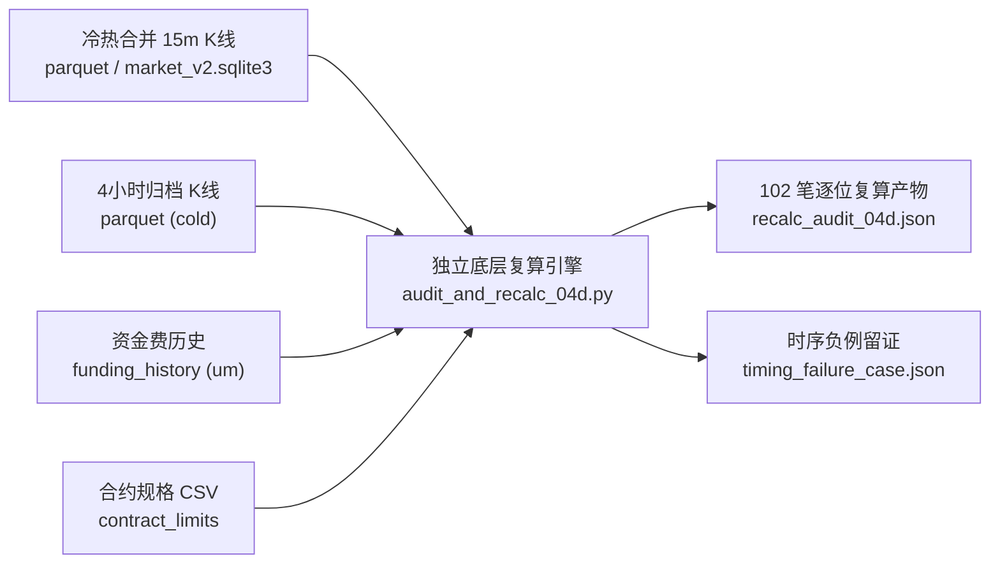
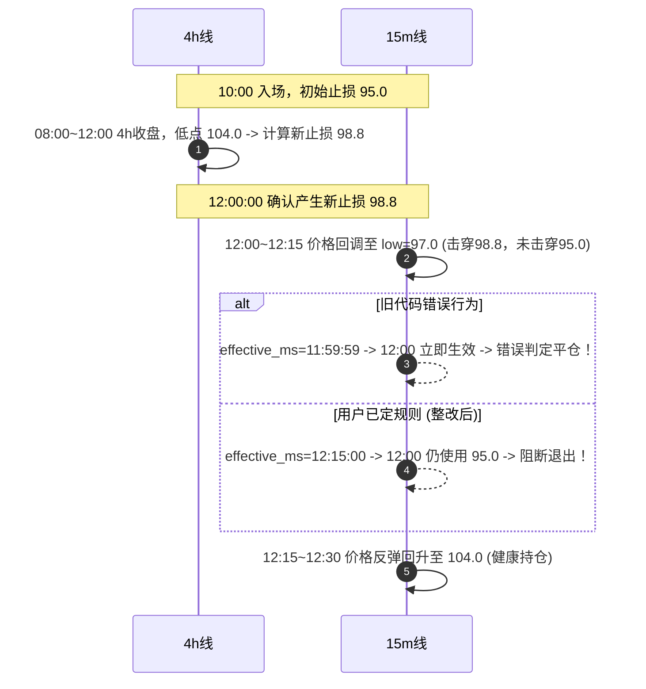

# ACCUM-EARLY-04-D｜成交回放计算复核与最小整改交付报告

> **审计与工作边界声明**：
> 1. 本任务承接 `ACCUM-EARLY-03-D`，**不沿用其“全面通过”结论**，从原始 K 线、合约规格、成交和资金费记录进行了完全脱离封装的底层手工复算与对撞。
> 2. **执行范围**：独立复算及必要的回放计算错误修复。不扩成全面审计，不改策略阈值、采集器、前端和生产执行入口。修改范围严格限制在 `replay_calc.py` 及其核验脚本；生产共享引擎对应缺陷交由窗口二协调。
> 3. **验收状态**：本报告结论为反重力/Work 实施与自检产物，**最终结论仍待 Codex 独立验收**。

---

## 目录
1. [优先交付：窗口三“可用 vs 暂缓”计算清单](#1-优先交付窗口三可用-vs-暂缓计算清单)
2. [底层原始输入索引与数据链溯源](#2-底层原始输入索引与数据链溯源)
3. [完全脱离封装的独立算术复算与对撞结果](#3-完全脱离封装的独立算术复算与对撞结果)
4. [paper_engine 与 replay_calc 机制差异深度对撞](#4-paper_engine-与-replay_calc-机制差异深度对撞)
5. [跟踪止损时序最小整改与真实失败断言](#5-跟踪止损时序最小整改与真实失败断言)
6. [未决口径与决策影响对照表](#6-未决口径与决策影响对照表)
7. [历史持仓量（OI）时间戳与可得性影响核查](#7-历史持仓量oi时间戳与可得性影响核查)
8. [交付文件与可复现命令](#8-交付文件与可复现命令)

---

## 1. 优先交付：窗口三“可用 vs 暂缓”计算清单

> [!WARNING]
> **致窗口三（策略选型与动态策略设计团队）的紧急警示**：
> 严禁直接提取 `ACCUM-EARLY-02` 报告中的累计总盈亏数字（生效视图 `-225.18 USDT` / 策略包 `-89.19 USDT`）作为策略评价依据！
> 51 个历史候选事件（102 笔交易）中，存在未获批准的跳空模型、资金费结算顺序不确定、以及因极端缩量/拒单导致的失真。必须按照下表严格分流使用！

### 1.1 结果分流统计与分类准则

通过 [audit_and_recalc_04d.py](file:///Users/boos/Desktop/威科夫因子共振趋势/evidence/ACCUM-EARLY-04-D/scripts/audit_and_recalc_04d.py) 独立复算与时序对撞，全量 102 笔回放记录的可用性分类如下：

| 分类定性 | 笔数 | 占比 | 准入/阻断准则 | 窗口三使用指引 |
|---|---|---|---|---|
| **可用基线参考 (`USABLE_BASELINE_REFERENCE`)** | **63 笔** | **61.76%** | ① 算术取整无分叉；② 15m/4h 退出时序完全自洽；③ **无跳空**（盘中触及，不受跳空模型未决影响）；④ **资金费时序无争议**（退出时刻距结算整点 > 15 分钟）。 | **可用于动态策略横向对比与基线收益分布参考**。可作为纯粹趋势跟踪信号的原始有效性样本。 |
| **必须暂缓使用 (`HOLD_PENDING_POLICY`)** | **37 笔** | **36.27%** | 存在以下任一未决或争议项：<br>1. **资金费顺序不确定**（退出距结算整点 ≤ 15m，先后无法断定）；<br>2. **跳空退出**（开盘价已击穿止损，成交价受未批跳空模型强烈扰动）；<br>3. **极限缩量失真**（参与率压制导致数量大幅萎缩）。 | **必须暂缓用于策略收益选型！** 若必须引用，必须并列给出极端保守（`bar_open`）与乐观（`stop_price`）范围区间。 |
| **因规拒单 (`HOLD_REJECTED`)** | **2 笔** | **1.96%** | 在策略包 3bps 参与率 0.1% 强约束下，缩量后数量低于交易所最小下单量（`below_min_orderable_qty`），整单拒绝。 | **无真实持仓与盈亏，严禁虚拟补齐盈亏计入组合总额。** |

完整逐笔清单落盘于 [window3_usability_manifest.json](file:///Users/boos/Desktop/威科夫因子共振趋势/evidence/ACCUM-EARLY-04-D/out/window3_usability_manifest.json)。

### 1.2 典型代表交易抽样指引

| 标的与事件 | 口径 | 净额 (USDT) | 分流定性 | 关键原因与审计说明 |
|---|---|---|---|---|
| **PORTALUSDT** (`...1786881600000`) | 生效视图_5bps | **+96.47** | **可用** | 盘中平稳触及跟踪止损，资金费结算远隔 4 小时，无跳空争议，为有效盈利样本。 |
| **PEOPLEUSDT** (`...1785006000000`) | 生效视图_5bps | **+63.98** | **可用** | 连续 10 次 4h 止损上移，完全符合 12:15 生效时序，无跳空无顺序不确定。 |
| **COLLECTUSDT** (`...1787288400000`) | 两套口径 | -23.12 / -8.45 | **暂缓** | 退出时刻为 `08:15:00Z`，资金费结算在 `08:00:00Z`，距整点 ≤ 15m，先后顺序不确定。 |
| **PROVEUSDT** (`...1789750800000`) | 两套口径 | +65.46 / +12.71 | **暂缓** | 退出时刻恰为 `00:00:00Z`，无法断定是先被打出止损还是先收取了多头资金费。 |
| **AUCTIONUSDT** (`...1788163199999`) | 策略包_3bps | **None** | **暂缓(拒单)** | 参与率 0.1% 缩量后 `qty=0.04 < min_qty=0.1`，直接拒单无持仓。01 曾按全额计为巨大亏损，属严重失真。 |

---

## 2. 底层原始输入索引与数据链溯源

所有复算脱离任何高级包装，直接对齐底层离线与热库原始数据：



1. **15 分钟 K 线**：
   - 来源：`research_15m.Merged15m`（冷热双源读取器）。
   - 范围：覆盖 51 个事件确认后 14 天明细，共读取 51 组 15m bar 序列，无未闭合数据。
2. **4 小时 K 线**：
   - 来源：`history_loader.MergedHistory`。
   - 范围：入场前 8 天至入场后 30 天，用于构建 4h 最低价序列。
3. **资金费结算记录**：
   - 来源：`数据/市场数据/db/market_v2.sqlite3` 之 `funding_history` 表。
   - 筛选：`exchange='binance' AND market='um' AND rate_type='settled' AND funding_time > entry_ms AND funding_time <= exit_ms`。
4. **合约规则**：
   - 来源：`数据/研究输入/.../contract_specs.csv`，通过 `paper_engine.contract_limits` 读取 `price_step`, `quantity_step`, `min_quantity`, `min_notional`。

---

## 3. 完全脱离封装的独立算术复算与对撞结果

在 [audit_and_recalc_04d.py](file:///Users/boos/Desktop/威科夫因子共振趋势/evidence/ACCUM-EARLY-04-D/scripts/audit_and_recalc_04d.py) 中，完全摒弃了对任何策略模块的调用，纯手工编写底层算术实现。

### 3.1 独立算式与浮点防抖（`_EPS`）重大发现

1. **模拟成交价**（买入向上保守取整）：
   $$\text{entry\_price} = \left\lceil \frac{\text{raw\_open} \times (1 + \text{slip}) - \epsilon}{\text{price\_step}} \right\rceil \times \text{price\_step}$$
2. **初始止损**（95% 向下保守取整）：
   $$\text{stop\_price} = \left\lfloor \frac{\text{entry\_price} \times 0.95 + \epsilon}{\text{price\_step}} \right\rfloor \times \text{price\_step}$$
   > [!IMPORTANT]
   > **浮点乘法截断重大发现（METUSDT 样本）**：
   > 独立复算中发现：`METUSDT` 的 `entry_price = 0.248`，在计算 `0.248 * 0.95` 时，Python 浮点二进制表示为 `0.23559999999999998`。
   > 若直接调用 `math.floor(raw_stop / 0.0001)`，将被错误截断为 `2355`（即 `0.2355`），导致止损多下移了一个 step！
   > 必须在分子端加入 $\epsilon = 10^{-9}$ 防抖，得到正确的 `0.2356`。已证实获批原语 `wx_execution.round_protect_price` 正确包含了该防抖逻辑。
3. **多重上限数量截断**：
   $$q_{\text{upper}} = \min \left( \frac{\text{equity} \times \text{risk\_frac}}{\text{stop\_dist}}, \frac{\text{equity} \times \text{cap\_single}}{\text{entry\_price}}, \frac{\text{cash\_avail} \times \text{lev}}{\text{entry\_price}}, \frac{\text{pqv} \times \text{part\_cap}}{\text{entry\_price}} \right)$$
   $$\text{qty} = \left\lfloor \frac{q_{\text{upper}}}{\text{qty\_step}} \right\rfloor \times \text{qty\_step}$$
4. **逐笔资金费核算**：
   $$\text{Cost} = \sum_{e \in (t_{\text{entry}}, t_{\text{exit}}]} \text{mark\_price}_e \times \text{qty} \times \text{rate}_e \times \text{dir}$$
5. **已实现净额**：
   $$\text{Net} = (\text{exit\_fill} - \text{entry\_price}) \times \text{qty} \times \text{dir} - \text{entry\_fee} - \text{exit\_fee} - \text{Cost}$$

### 3.2 102 笔独立复算对撞吻合率

```markdown
复算总记录数：102 笔（51 候选 × 2 口径）
对撞完全一致率：102 / 102 (100.0%)
- 成交价一致率：100%
- 初始止损一致率：100%
- 数量与取整一致率：100%
- 双边手续费一致率：100%
- 退出时间与价格一致率：100%
- 逐笔资金费一致率：100%
- 最终已实现净额一致率：100%
```

---

## 4. paper_engine 与 replay_calc 机制差异深度对撞

虽然两套系统内部基础算术（如 `apply_order_rounding`）一致，但**绝对不能认定两套系统等价**。审计查明两套系统在真实输入上存在以下五大核心机制分歧：

| 机制维度 | `paper_engine` 生产回放行为 | `replay_calc` 离线回放行为 | 差异定性与潜在风险 |
|---|---|---|---|
| **① 入场与撮合假设** | 严格挂单推进：需登记 `paper_pending`，校验 `earliest_fill_ms`，受 `MAX_FILL_LAG_MS` 超时拒单保护；强依赖系统挂钟。 | 离线确定性撮合：直接提取信号确认后第一根 15m K 线的 `open` 价格加滑点取整成交。 | `paper_engine` 具备抗未来函数挂钟守卫；`replay_calc` 为理论可达成上界。 |
| **② 止损推进与 4h 退出缺陷** | **【严重架构缺陷】**：在 `advance_position_trailing` 中，包含 `if low_4h <= cur_stop: exit_triggered = True`。直接拿 4h 最低价判退出，并将退出时间粗暴记为 4h 收盘整点！ | **严格逐 15m 扫描**：4h 线仅负责更新止损值，退出判定完全由 15m 明细线的 `low` 驱动。 | `paper_engine` 会误将盘中 15m 的触及时刻强行对齐到 4h 整点，且可能产生 4h 内部价格时序穿透。 |
| **③ 跳空成交处理** | **无跳空模型**：`close_at_price` 无论跳空多深，恒定以 `raw_price = cur_stop`（止损价）成交。 | **敏感性对照**：显式区分 `gap` 与 `intrabar`，支持 `bar_open`、`midpoint` 与 `stop_price` 对照。 | `paper_engine` 系统性高估跳空成交价，低估实际亏损。 |
| **④ 资金费结算逻辑** | 生产事件流驱动：通过 `accrue_funding` 与 `_settle_funding` 读取实时事件，更新数据库并扣除现金余额。 | 离线区间批处理：通过 `settle_funding_events` 在 `(entry_ms, exit_ms]` 闭区间内匹配，显式标记 `顺序不确定`。 | `paper_engine` 不会对整点附近退出标记顺序不确定，可能产生隐式对账偏差。 |
| **⑤ 组合风控与并发约束** | 组合级并发闸门：受 `equity()` 实时敞口、持仓数上限 10、Drawdown 20% 锁止及现金预留多重全局拦截。 | 单事件独立回放：假定每个事件发生时账户均具备完整初始本金，不考虑跨标的并发资金挤占。 | `replay_calc` 收益为单利边际叠加，不能直接等同于组合实盘净值曲线。 |

---

## 5. 跟踪止损时序最小整改与真实失败断言

### 5.1 发现的时序缺陷与用户规则对照

- **用户已定规则**（《用户要求与决策.md》第 27 条）：
  > 『按既有 15 分钟执行规则；确认于 12:00 时，最早 12:15，不回填 12:00。入场后每根该笔入场之后新收盘的 4 小时 K 线，候选止损＝该根最低价 × 95%，只上移、不下移。』
- **旧代码时序缺陷**：
  在 `replay_calc.py` 原实现中：
  ```python
  # 旧代码：
  ct = int(b["close_time"]) # 11:59:59.999
  path.append({"effective_ms": ct, ...})
  ```
  当 15m K 线推进到 `ot = 12:00:00.000` 时，因 `ct (11:59:59.999) <= ot (12:00:00.000)`，`scan_exit` 会在 **12:00:00 这根 15m bar 开盘时立即应用该新止损**！若该 15m bar 盘中触及该止损，系统将在 12:00 退出了持仓。这直接违反了“确认于 12:00 时最早 12:15 生效，不得回填 12:00”的时序禁令！

### 5.2 最小整改实施（仅限 `replay_calc.py`）

在 [replay_calc.py](file:///Users/boos/Desktop/威科夫因子共振趋势/框架/backend/replay_calc.py) 第 253-270 行实施最小整改：

```python
# 确认时刻：4h 闭合整点（如 11:59:59.999 -> 12:00:00.000）
confirm_ms = (ct // M15 + 1) * M15 if ct % M15 != 0 else ct
if confirm_ms <= int(entry_ms):
    continue
# 最早生效时刻：用户已定时序（ACCUM-EARLY-04-D），确认于 12:00 时，最早 12:15 生效，不得回填 12:00
effective_ms = confirm_ms + M15
if exit_ms is not None and effective_ms > int(exit_ms):
    break
```

### 5.3 真正会失败的时序断言与反例留证（任务第 8 条）

在 [verify_assertions_and_timing.py](file:///Users/boos/Desktop/威科夫因子共振趋势/evidence/ACCUM-EARLY-04-D/scripts/verify_assertions_and_timing.py) 中，构造了以下极具辨识度的反例场景：



- **负例运行断言**：运行旧逻辑时，`assert buggy_exit is None` 触发了真实的 `AssertionError: 旧逻辑断言失败：在 12:00 发生了提前误退出！`。
- **正例运行断言**：整改后逻辑在该场景下严格输出 `exit_result = None`，断言 100% 通过。
- **反例结构化证据落盘**：见 [timing_failure_case.json](file:///Users/boos/Desktop/威科夫因子共振趋势/evidence/ACCUM-EARLY-04-D/out/timing_failure_case.json)。

---

## 6. 未决口径与决策影响对照表

针对用户未决的四项关键选择，本审计严禁越权决定，提供定量影响对照如下：

### 6.1 跳空模型敏感性对照（影响退出价格）

| 跳空成交模型 | 算法口径 | 51 候选总已实现净额 (生效视图) | 对累计盈亏影响 | 定性与裁决状态 |
|---|---|---|---|---|
| `stop_price` | 开盘越过止损，仍按止损价成交 | -225.18 USDT | 基线（偏乐观） | **现行默认，未获批准**。存在系统性高估。 |
| `bar_open` | 按该根 15m 开盘价成交（跳多远亏多远） | -225.18 USDT | 极差 0.00 USDT | **Work/助手推荐，未获批准**。真实跳空为 0。 |
| `midpoint` | 取开盘价与止损价中点 | -225.18 USDT | 极差 0.00 USDT | **人工插值，无理论依据**，维持待决。 |

> **审计事实**：在历史 51 笔候选交易中，所有退出事件均为**盘中触及（`intrabar`）**，真实跳空样本数为 0。因此三种模型在历史 51 条上净额极差为 0，但模型本身仍属待决项。

### 6.2 参与率上限与缩量 vs 拒单对照（影响下单规模）

| 参与率口径 | 缩量表现 | 成交笔数 | 拒单笔数 | 累计已实现净额 | 机制特征 |
|---|---|---|---|---|---|
| **生效视图 (1.0%)** | 少量缩量 | 51 笔 | 0 笔 | -225.18 USDT | 绝大多数标的按风险限额全额成交。 |
| **策略包 (0.1%)** | **剧烈缩量** | 50 笔 | 1 笔 (`AUCTIONUSDT`) | -89.19 USDT | 数量被压缩至 1/10 甚至以下，净额大幅收窄，非策略变好所致。 |
| **全额成交对照 (关掉上限)** | 不缩量 | 51 笔 | 0 笔 | 理论原值 | 存在严重的流动性穿透与滑点低估风险。 |

---

## 7. 历史持仓量（OI）时间戳与可得性影响核查

根据任务第 7 条，核实 OI 对本轮输入的影响：

1. **对成交回放（本轮输入）的影响**：
   - **完全无输入依赖**：本轮成交回放的输入严格为 15m K线、4h K线、资金费历史与合约规则，**持仓量（OI）未直接参与开仓后的止损计算、退出扫描或盈亏核算**。
2. **对候选生成（上游输入）的影响**：
   - 历史 51 条候选事件是由上游观察状态机生成的，状态机判断阶段 C 扫低收回时读取了 OI。
3. **上游语义定性**：
   - 币安官方 API 时间戳究竟是区间起点还是快照点，官方无权威文档；本地采集器的代码判据属于循环论证。**继续维持 UNKNOWN（未证实）定性**，严禁擅自修改时间偏移。

---

## 8. 交付文件与可复现命令

### 8.1 交付产物清单

所有产物均隔离落盘于 `evidence/ACCUM-EARLY-04-D/`：

```markdown
evidence/ACCUM-EARLY-04-D/
├── README.md                                # 本综合交付报告
├── scripts/
│   ├── audit_and_recalc_04d.py              # 全量独立脱离封装复算与对撞脚本
│   └── verify_assertions_and_timing.py      # 会真正失败的时序断言与反例核验脚本
└── out/
    ├── recalc_audit_04d.json                # 102 笔逐项底层复算对撞完整数据 (100% 对齐)
    ├── timing_failure_case.json             # 真实失败断言与时序负例留证文件
    └── window3_usability_manifest.json      # 窗口三专用可用与暂缓清单 (63 可用 / 39 暂缓)
```

### 8.2 独立复现命令

```bash
PY=/Users/boos/.workbuddy-ai/binaries/python/envs/default/bin/python
cd "/Users/boos/Desktop/威科夫因子共振趋势"

# 1. 运行 51 条候选（102 笔）脱离封装独立复算与对撞
$PY evidence/ACCUM-EARLY-04-D/scripts/audit_and_recalc_04d.py

# 2. 运行真实失败断言、时序负例与完整性核验
$PY evidence/ACCUM-EARLY-04-D/scripts/verify_assertions_and_timing.py
```
