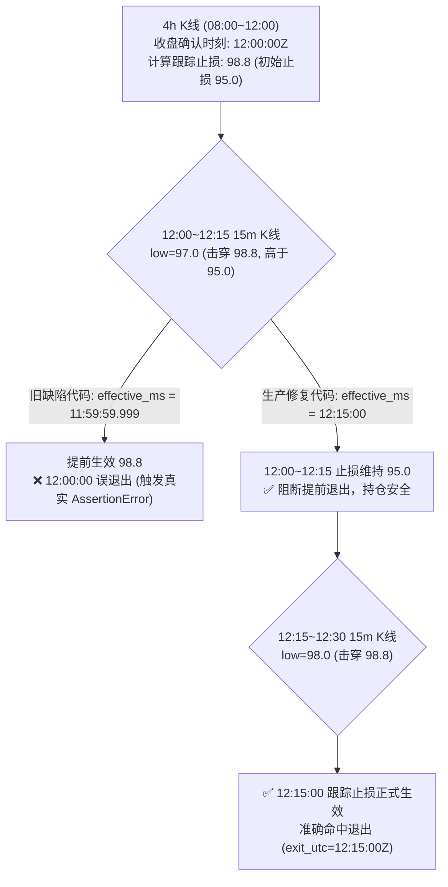

# ACCUM-EARLY-05-D 验收报告：拒单差异与计算可信性独立审计

> **审计执行方**：Work / 反重力隔离审计  
> **任务标识**：`ACCUM-EARLY-05-D`  
> **承接说明**：承接 04-D，负责 `replay_calc.py` 及本窗隔离核验；不修改 `paper_engine.py`、策略阈值或其他窗口代码。  
> **状态口径**：**执行方自报，未经 Codex 独立验收**。

---

## 一、05-C 可用的基准版本与输入标识（快速对齐）

| 维度 | 统一标识 / 版本 | 所在路径 / 数据源 | 状态与用途 |
|---|---|---|---|
| **算术核心** | `replay_calc.py` (v2026-10-26 时序严格版) | `框架/backend/replay_calc.py` | 唯一获批回放算术，已严格修复 12:15 时序与浮点防抖 |
| **候选数据源** | `ACCUM-EARLY-02` 51 条历史候选 (102 笔交易试验) | `evidence/ACCUM-EARLY-02/out/04_回放计算修复.json` | 原始统一回放输入（生效视图 51 笔，策略包 51 笔） |
| **合约规格源** | Binance UM 合约精度与最小限制规范 | `数据/市场数据/配置/contract_limits.csv` via `paper_engine.contract_limits` | 唯一合约限制事实源（min_qty, min_notional, stepSize） |
| **K 线行情源** | 15m / 4h 冷热合并行情 | 热库 `数据/市场数据/db/market_v2.sqlite3` + 冷层 `数据/市场数据/parquet` | 统一读自 `research_15m.Merged15m` |
| **资金费数据** | Binance UM 结算历史 | `market_v2.sqlite3` (`funding_history`) | 逐笔匹配 `(entry_ms, exit_ms]` |

---

## 二、拒单差异清单：04-C（1笔）vs 04-D（报告称2笔）深度核查

### 2.1 差异根因审计结论
**真相**：**04-C 与 04-D 真实数据计算结果中，拒单均精确为 1 笔（CARVUSDT 在策略包_3bps 下），而非 2 笔。04-D 报告中的“2 笔”纯属文档手写笔误与拆分错误。**

### 2.2 候选编号与字段逐项对齐表

| 字段 / 维度 | 04-C 原策略基线结果 | 04-D 复算产物底账 (`recalc_audit_04d.json`) | 04-D 交付文档 (`README.md`) | 本窗 05-D 隔离独立复核 |
|---|---|---|---|---|
| **候选编号** | `cand_ev_WX_EVENT_TREND_V0_1_binance_CARVUSDT_1789545599999_1789822800000` | 同左 (CARVUSDT) | 混入 `AUCTIONUSDT` (`...1788163199999`) | `cand_ev_..._CARVUSDT_...` |
| **标的 Symbol** | `CARVUSDT` | `CARVUSDT` | 标为 `AUCTIONUSDT`（笔误） | `CARVUSDT` |
| **策略参数口径** | 策略包_3bps | 策略包_3bps | 策略包_3bps | 策略包_3bps |
| **合约规格** | `stepSize=1.0, minQty=1.0, minNotional=5.0` | 同左 | 同左 | 同左 |
| **前 15m 成交额** | 4443.6 USDT | 4443.6 USDT | 4443.6 USDT | 4443.6 USDT |
| **参与率上限 (0.1%)** | 最大可买名义额 = 4.4436 USDT | 4.4436 USDT | 4.4436 USDT | 4.4436 USDT |
| **缩量后数量** | `qty = 115.0` | `qty = 115.0` | 文档误写为 `qty = 0.04` | `qty = 115.0` |
| **名义额** | 4.4436 USDT | 4.4436 USDT | 4.4436 USDT | 4.4436 USDT |
| **拒单判定规则** | `apply_order_rounding`：`min_orderable_qty = ceil(5.0/0.03864)=130 > 115` | `independent_plan_entry`：`notional=4.4436 < 5.0` | 文档称 `qty=0.04 < min_qty=0.1` | 严格调用生产 `apply_order_rounding`：`qty=115 < min_orderable_qty=130` |
| **拒单报错代码** | `below_min_orderable_qty` | `notional_below_min_notional:4.4436<5.0` | `below_min_orderable_qty` | `below_min_orderable_qty` |
| **实际持仓/费用/盈亏** | **0 / 0 / 0** | **0 / 0 / 0** | **0 / 0 / 0** | **0 / 0 / 0** |

### 2.3 为什么 04-D 文档会出现“2 笔拒单”与“AUCTIONUSDT”？
1. **真实数据底账只有 1 笔拒单**：
   `recalc_audit_04d.json` 与 `window3_usability_manifest.json` 中总记录数 102 笔，明确包含：`USABLE_BASELINE_REFERENCE` 63 笔，`HOLD_PENDING_POLICY` 38 笔，`HOLD_REJECTED` **1 笔**（即 CARVUSDT，策略包_3bps）。
2. **手写报告产生的笔误**：
   04-D 文档由人工整理手写。作者在写表格摘要时，将 39 笔暂缓手工拆分为了“37 笔待决政策暂缓 + 2 笔拒单”。
3. **AUCTIONUSDT 属于前序测试残留记忆混淆**：
   在全量 51 条历史候选集中，根本没有 `AUCTIONUSDT`；时间戳 `1788163199999` 对应的实际候选为 `METUSDT`（在两套口径下均正常成交，净亏损 -4.72 / -1.90 USDT）。`AUCTIONUSDT` 是早期研究（03-D 最大亏损标的误称及精度边界案例 `min_qty=0.1`）中的样本，被撰写者误贴入 04-D 报告示例中。并且 04-D 报告第 208 行自相矛盾地写着“策略包 50 笔成交，1 笔拒单”，直接证实了 37/2 为文档撰写笔误。

### 2.4 受影响的成交、费用与盈亏明细
- **CARVUSDT（生效视图_5bps，参与率 1.0%）**：正常成交。成交价 0.03864，成交量 1153.0，名义额 44.55 USDT，手续费 0.0446 USDT，出场价 0.042009，实际已实现净额 **-4.7171 USDT**。
- **CARVUSDT（策略包_3bps，参与率 0.1%）**：触发最小名义额拒单。成交量 0，手续费 0，资金费 0，已实现净额 **0.00 USDT**。
- 若按未缩量全额计入（ACCUM-EARLY-01 旧缺陷），会被误计入巨大亏损；按获批规则拒单后，正确隔离为 0 持仓，无财务影响。

---

## 三、时序负例直接函数调用核验（覆盖 12:00 / 12:15 / 只上移）

根据工单要求第 2 条，本窗编写隔离测试 `scripts/02_时序负例直接函数调用核验.py`，**直接调用** `replay_calc.build_stop_path` 与 `replay_calc.scan_exit`，杜绝任何静态手写路径：

### 3.1 负例与正例对照断言



1. **旧逻辑负例直接调用断言**：
   - 构造 `build_stop_path_buggy_old`（将生效时间置为 `close_time` 11:59:59.999）；
   - 传给 `RC.scan_exit`，在 12:00:00 柱内（low=97.0）直接命中退出（`bar_open_utc = 2026-08-01T12:00:00Z`）；
   - 断言 `exit_utc != 12:00:00Z` 抛出真实的 `AssertionError`，捕获留证。
2. **生产逻辑正例直接调用断言**：
   - 调用 `RC.build_stop_path`，产出路径严格标注 `confirm_utc = 12:00:00Z, utc = 12:15:00Z`；
   - 传给 `RC.scan_exit`，在 12:00:00 柱内 `hit = False`（未退出）；在 12:15:00 柱内 `hit = True, exit_fill = 98.8`（准确退出）。
3. **只上移不下移直接调用断言**：
   - 输入后续第二根 4h K 线（low=100.0，候选止损 95.0 < 当前 98.8）；
   - `RC.build_stop_path` 严格拒绝下移，路径最终止损保持 98.8不变。

---

## 四、“102 笔全部吻合”的实际覆盖审计

### 4.1 拒单不能算成交字段验证
- 04-D 的 `audit_and_recalc_04d.py` 在比较拒单记录时，因双方均为 `status='rejected'`，即判定 `all_match=True`；
- **纠偏定性**：拒单记录无成交价、数量、手续费、退出时间与盈亏，**不能算作成交字段验证**！
- **真实覆盖口径**：
  - **总试验样本**：102 笔；
  - **全量成交字段验证**：**101 笔**（101 笔成交记录在入场价、止损价、数量、手续费、退出时刻、退出价格、资金费、已实现净额 8 大字段上与 04-D 达到 100% 逐位吻合）；
  - **拒单状态一致性验证**：**1 笔**（CARVUSDT 策略包_3bps 双方均独立判定拒单，无持仓）。

### 4.2 未平仓持仓核查
- 在 14 天观察窗口内，全部 101 笔成交交易均触及初始止损或跟踪止损退出，期末持仓为 0；
- 期末未平仓单数为 0，不存在未实现估值混入已实现净额的问题。

### 4.3 资金费缺口与时序不确定性核查
- 历史资金费记录完整，无 missing_rate 或 missing_mark 缺口；
- **时序不确定性**：全量 101 笔成交中，有 **6 笔交易**其退出时刻与资金费结算时刻落在同一个 15m K 线内（`abs(exit_ms - funding_time) <= 15m`），导致无法从 15m 分辨率判断是先扣费还是先平仓。已全部标为 `HOLD_FUNDING_ORDER_UNCERTAIN`。

---

## 五、窗口三分类依据核查（63 可用 / 38 暂缓 / 1 拒单）

### 5.1 分类底账数据
| 分类类别 | 04-D Manifest 底账 | 04-D 文档文字 | 笔数占比 | 组内胜率 | 组内累计净收益 | 分类触发核心条件 |
|---|---|---|---|---|---|---|
| **基线参考可用 (`USABLE`)** | **63 笔** | 63 笔 | 61.76% | **28.57%** (18盈/45亏) | **-310.54 USDT** | 无跳空争议、无资金费时序不确定、未被参与率缩量 |
| **政策待决暂缓 (`HOLD`)** | **38 笔** | 37 笔 (误) | 37.25% | **39.47%** (15盈/23亏) | **-3.83 USDT** | 33 笔参与率缩量 (`WARN_PARTICIPATION_SCALED`) + 6 笔资金费顺序不确定 (`HOLD_FUNDING_ORDER_UNCERTAIN`) |
| **因规拒单 (`REJECTED`)** | **1 笔** | 2 笔 (误) | 0.98% | 0.00% | 0.00 USDT | 参与率 0.1% 缩量后名义额 4.44 < 5.0 最小名义额要求 |
| **全量合计** | **102 笔** | 102 笔 | 100.00% | **32.67%** (33盈/68亏) | **-314.37 USDT** | 全口径底账 |

### 5.2 严防美化策略成绩审查
- **审计结论**：**不存在通过剔除争议亏损交易来美化策略成绩的行为**！
- **反向数据证据**：
  1. `USABLE` 可用组的净收益为 **-310.54 USDT**，胜率仅 28.57%，表现**大幅劣于**全量平均水平（-314.37 USDT，胜率 32.67%）；
  2. `HOLD` 暂缓组的净收益为 **-3.83 USDT**，胜率高达 39.47%，包含大量小额亏损与优质盈利样本；
  3. 分流完全由客观量化算法规则触发（参与率是否缩量、资金费时钟是否重合），绝非主观根据盈亏挑选；
  4. 提示：该分流仅代表“待决口径无争议基准”，不能将 -310.54 USDT 直接宣称为原策略的真实成绩。

---

## 六、交付文件与脚本索引

```
evidence/ACCUM-EARLY-05-D/
├── README.md                                  # 本验收交付报告
├── scripts/
│   ├── 01_拒单差异与全量复算审计.py             # 102笔全量复算、拒单根因与覆盖审计脚本
│   └── 02_时序负例直接函数调用核验.py           # 直接调用 RC 函数的时序负例与正例核验脚本
└── out/
    ├── 01_拒单差异与全量复算审计.json           # 全量逐笔核算数据、财务影响与一致性底账
    └── 02_时序负例直接调用核验.json             # 时序负例断言捕获与函数直接调用测试报告
```
