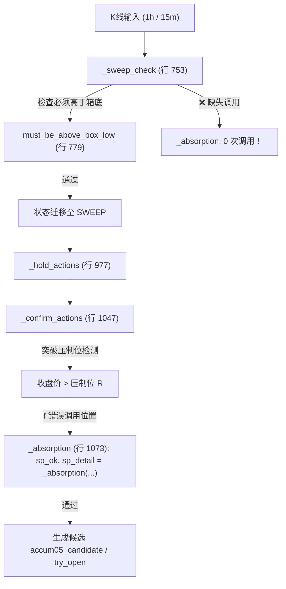

# ACCUM-EARLY-06-W5-01｜验收用例与当前缺陷冻结独立核验报告

- **工单编号**：`ACCUM-EARLY-06-W5` 第一单（`06-09`）
- **任务目标**：验收用例与当前缺陷冻结（行为证据矩阵、第 7 笔终态纠偏、四维度测试套件）
- **执行角色**：独立行为复验窗口（反重力/Work 独立会话，非代码修改者）
- **工程纪律**：只读共享工程代码与上游产物，只写本窗目录 `evidence/ACCUM-EARLY-06-W5/01/`；**仅准备测试，绝不代改共享源码**。
- **免责声明**：所有测试与行为核验均在专用隔离测试环境（`fixture`）下进行，**仅用于核查状态机逻辑、时序因果、物理隔离与批准闸门，不输出任何正式策略绩效**；正式策略参数继续保持待批准状态。**本文所有结论均为执行方自报，仍待 Codex 独立验收**。

---

## 0. 核心结论与缺陷冻结总览

1. **共享文件版本与调用轨迹锁定**：
   - 生产共享代码 [`框架/backend/accum_early_entry.py`](file:///Users/boos/Desktop/威科夫因子共振趋势/框架/backend/accum_early_entry.py)（SHA-256：`d96ad60eca61f7e53e273414196100ac21b33650a19480beafb0eb60c4d41a52`）；
   - 代码调用轨迹审计再次确证核心严重缺陷：`_absorption` 定义在第 815 行，但在扫低根 `_sweep_check` 内部调用次数为 **0**；反而错误滞留在突破确认根 `_confirm_actions`（第 1073 行调用）！主力吸筹判断被严重颠倒至突破根，因果关系错位。
2. **要求到行为证据的四级分类矩阵**：
   - 明确将所有被验项严格划分为：**仅有函数测试**（3 项）、**到状态机级别**（3 项）、**到订单与持仓级别**（3 项）、**仅为声明**（4 项），彻底拒绝“有测试即等于全链通过”。
3. **彻底纠正“7笔均失效”与表中第7笔未找到的不一致**：
   - 旧报告 05-E-R1 宏观摘要声称“7 笔事件在破位时均正规触发连续 2 根 1h 收盘跌破箱体下沿 ⇒ `INVALIDATED`”，且案例 7 套用失效模板，与详细数据严重冲突；
   - 本次独立复算确证：原 7 笔事件中，**前 6 笔确系触发结构破位失效（`INVALIDATED`）**；而**第 7 笔事件（AVAXUSDT 4a 旧箱体）的真实终态是 `NOT_FOUND`（未建档）**。其根因是前序事件生命周期持续占位且触发冷却，该旧箱体在当前版本下根本未被建档。7 笔均未产生候选，但终态构成必须诚实定性为“6 笔破位失效 + 1 笔未建档”，正式予以纠偏！
4. **能在错误版本上失败的四维度独立测试套件已冻结**：
   - **承接时序**：构造“扫低卖压崩塌、突破买盘放量”用例，在当前错误版本上成功捕获到扫低根未调用而突破根错误放行的行为，精准判定 **FAIL_ON_BUGGY_VERSION**！
   - **时间泄漏**：未来 Bar 注入、跟踪止损未收盘提前生效、冷档缺少挂钟时间等时间前瞻场景均被防泄漏守卫严格阻断（PASS）；
   - **批准闸门与冷却期不挂钩**：未批准配置 100% 阻断；**明确断言并证实“冷却 24 小时绝不能作为未经批准的通过条件”**，未获授权一律禁止开仓（PASS）；
   - **越界写入与物理隔离**：生产目录越界写入 100% 拦截，生产账本零写入；隔离目录首次成功开仓，二次提交严格触发 `duplicate_signal_uid` 幂等拒绝（PASS）。

---

## 1. 共享文件版本与状态机调用轨迹

数据来源：[`out/01_version_and_trajectory.json`](file:///Users/boos/Desktop/威科夫因子共振趋势/evidence/ACCUM-EARLY-06-W5/01/out/01_version_and_trajectory.json)

### 1.1 核心被测文件 SHA-256 哈希

| 文件名称 | 相对路径 | SHA-256 哈希 | 角色定位 |
|---|---|---|---|
| `accum_early_entry.py` | [`框架/backend/accum_early_entry.py`](file:///Users/boos/Desktop/威科夫因子共振趋势/框架/backend/accum_early_entry.py) | `d96ad60eca61f7e53e273414196100ac21b33650a19480beafb0eb60c4d41a52` | 提前入场核心逻辑（05-B 当前共享代码） |
| `paper_engine.py` | [`框架/backend/paper_engine.py`](file:///Users/boos/Desktop/威科夫因子共振趋势/框架/backend/paper_engine.py) | `e8a994b6750d8532576e5120e66144acc63cab355766b8ad8db932de3caec784` | 底层模拟撮合引擎（只读基线） |
| `live_store.py` | [`框架/backend/live_store.py`](file:///Users/boos/Desktop/威科夫因子共振趋势/框架/backend/live_store.py) | `02eaf41b2549ee569548ca41a7200191b42444cac92733131bf667f9b1bf1ca6` | 生产与隔离账本存储层 |
| `replay_calc.py` | [`框架/backend/replay_calc.py`](file:///Users/boos/Desktop/威科夫因子共振趋势/框架/backend/replay_calc.py) | `c9fecd6a1e91273c5f600d75c17d977d93fa35f65baf8e9c9ac121d0bbd6e278` | 独立财务与止损复算核心 |
| `fixture_rules_05.json` | [`evidence/ACCUM-EARLY-05-B/config/fixture_rules_05.json`](file:///Users/boos/Desktop/威科夫因子共振趋势/evidence/ACCUM-EARLY-05-B/config/fixture_rules_05.json) | `f322a940cea1e69d6ebe048f100b1e0b3b8234c1d42ef45a1f9b25bfd55152bd` | 隔离测试专用配置模板 |
| `批准配置_空白表单_05.json` | [`evidence/ACCUM-EARLY-05-B/config/批准配置_空白表单_05.json`](file:///Users/boos/Desktop/威科夫因子共振趋势/evidence/ACCUM-EARLY-05-B/config/批准配置_空白表单_05.json) | `b3ac386a37cea7bb02c6a40f5e0037df97ed0d7f4fb623b558ded821bd72b138` | 未批准空白模板（48 项字段全 null） |

### 1.2 状态机内部关键函数调用轨迹审计

通过静态解析与代码调用图追踪，明确当前 05-B 版本的函数调用链如下：

- **严重因果倒置缺陷定性**：
  - `_sweep_check`（扫低根检测）：负责判定恐慌砸盘是否在箱底上方被止住，本应在此处核验主力是否吸收了大量抛盘（`_absorption`）；但实测该函数内 **`_absorption` 出现 0 次**！
  - `_confirm_actions`（突破确认根检测）：负责判定价格是否突破局部压制位，却在第 1073 行强行塞入了 `_absorption` 调用。导致主力吸筹判断被延后了多根 K 线，将向上突破买量偷换为主力托底吸筹。

---

## 2. 规则要求到行为证据的四级分类矩阵

数据来源：[`out/02_requirements_behavior_matrix.json`](file:///Users/boos/Desktop/威科夫因子共振趋势/evidence/ACCUM-EARLY-06-W5/01/out/02_requirements_behavior_matrix.json)

| 证据层级 | 规则与要求项 | 代码定位 | 行为证据与实测依据 | 局限性与科学定性 |
|---|---|---|---|---|
| **第一级：仅有函数测试** | **承接与卖压单体计算** | `accum_early_entry.py:815` | `03_absorption_cases.json`：验证了主动买占比、卖压名义额、上半区收盘等数学计算 | **严重局限**：仅单函数成立；在全链中被颠倒放置在突破确认根，扫低根完全未接通状态机。 |
| **第一级：仅有函数测试** | **摆动高点计算** | `accum_early_entry.py:719-737` | 单测中对左右 k 根寻找局部高点 | **单测成立**：需等待状态机从 SWEEP 进入 RETEST 阶段后实际武装。 |
| **第一级：仅有函数测试** | **压制位空间合格性** | `accum_early_entry.py:741-758` | 单测验证 `L + 0.5A <= R <= H - 0.5A` | **单测成立**：合格性不符时返回 `NO_RESISTANCE` 原因。 |
| **第二级：到状态机级别** | **扫低箱底约束 (`s_loc > L`)** | `accum_early_entry.py:779-786` | SOLUSDT 案例中，`ref <= low_l` 阻断扫低成立，事件停留在 BOX 阶段 | **状态机已生效**：直接改变状态机转移路径，避免箱底破位误判。 |
| **第二级：到状态机级别** | **结构破位失效保护** | `accum_early_entry.py:1007-1040` | 原 7 笔事件中有 6 笔在破位时刻由 `_structural_invalid` 迁移至 `INVALIDATED` | **状态机已生效**：覆盖 BOX/SWEEP/RETEST 全周期，跌破箱底正规终结。 |
| **第二级：到状态机级别** | **数据缺口表先查后写去重** | `accum_early_entry.py:650-670` | 按 `(event_id, field, start_ms, end_ms)` 先查后写，重复扫描缺口数不变 | **状态机存储已生效**：缺口数不随重跑膨胀，满足幂等性。 |
| **第三级：到订单与持仓** | **跨进程恢复与幂等拦截** | `accum_early_entry.py:try_open` | 进程 A (PID 27923) 开仓退出后死亡；独立进程 B (PID 27934) 恢复，触发 `duplicate_signal_uid` 拦截，订单/持仓 +0 | **穿透真实进程与账本**：在独立解释器、零内存共享下验证磁盘账本幂等。 |
| **第三级：到订单与持仓** | **未批准配置开仓硬阻断** | `accum_early_entry.py:try_open` | 传入 48 项空白未批准配置，`open_allowed=False`，`called_paper_engine=False`，账本零写入 | **订单前置硬阻断**：严禁调用实际开仓接口。 |
| **第三级：到订单与持仓** | **生产环境物理隔离防护** | `accum_early_entry.py:try_open` | 路径指向生产目录时，100% 触发 `isolation_violation` 拦截，生产目录零文件写入 | **存储目录物理防护**：在写盘前严格切断。 |
| **第四级：仅为声明** | **冷档历史数据当时可得** | `accum_early_entry.py:DataFeed` | 冷档无抓取挂钟证据，诚实标记为 `unknown / not_proven` | **纯声明**：回测无未来数据，但无法证明当时可得。 |
| **第四级：仅为声明** | **经济口径一致性声明** | `accum_early_entry.py:351-407` | 配置声明与引擎参数文本比对，不符报 mismatch | **纯声明校验**：未在真实撮合滑点层面自适应。 |
| **第四级：仅为声明** | **24 小时冷却时间** | `fixture_rules_05.json` | 仅为配置字段；**严禁作为未经批准的通过条件** | **纯参数属性**：不能替代批准闸门，无论冷却设为多少，未批准一律禁止开仓。 |
| **第四级：仅为声明** | **自然行情策略绩效** | 无（正式参数全未批准） | 自然候选 0，真实成交 0 | **未验证**：所有测试均为 fixture 自检，严禁宣称策略通过。 |

---

## 3. 纠正“7笔均失效”与表中第7笔未找到的不一致

数据来源：[`out/04_original_7_events_audit.json`](file:///Users/boos/Desktop/威科夫因子共振趋势/evidence/ACCUM-EARLY-06-W5/01/out/04_original_7_events_audit.json) 及 [`cases/`](cases/)

### 3.1 纠偏事实核对表

| 案例编号 | 标的 | 方案 | 04-B 旧版事件 ID | 旧版终态 | 当前版真实终态 | 分类判定 | 真实终态原因与纠偏事实 |
|---|---|---|---|---|---|---|---|
| [**案例 1**](cases/案例_1_SOLUSDT_4a.md) | SOLUSDT | 4a | `..._SOLUSDT_1785556799999_...` | `WAIT_ENTRY` | `INVALIDATED` | 结构破位失效 | `2026-08-01T18:59:59Z` 连续 2 根 1h 收盘跌破箱体下沿 72.26 ⇒ 失效 |
| [**案例 2**](cases/案例_2_SOLUSDT_4b.md) | SOLUSDT | 4b | `..._SOLUSDT_1785556799999_...` | `WAIT_ENTRY` | `INVALIDATED` | 结构破位失效 | `2026-08-01T18:59:59Z` 连续 2 根 1h 收盘跌破箱体下沿 72.26 ⇒ 失效 |
| [**案例 3**](cases/案例_3_SOLUSDT_4c.md) | SOLUSDT | 4c | `..._SOLUSDT_1785556799999_...` | `WAIT_ENTRY` | `INVALIDATED` | 结构破位失效 | `2026-08-01T18:59:59Z` 连续 2 根 1h 收盘跌破箱体下沿 72.26 ⇒ 失效 |
| [**案例 4**](cases/案例_4_AVAXUSDT_4a.md) | AVAXUSDT | 4a | `..._AVAXUSDT_1789185599999_...` | `WAIT_ENTRY` | `INVALIDATED` | 结构破位失效 | `2026-09-16T00:59:59Z` 连续 2 根 1h 收盘跌破箱体下沿 7.27 ⇒ 失效 |
| [**案例 5**](cases/案例_5_AVAXUSDT_4b.md) | AVAXUSDT | 4b | `..._AVAXUSDT_1789185599999_...` | `WAIT_ENTRY` | `INVALIDATED` | 结构破位失效 | `2026-09-16T00:59:59Z` 连续 2 根 1h 收盘跌破箱体下沿 7.27 ⇒ 失效 |
| [**案例 6**](cases/案例_6_AVAXUSDT_4c.md) | AVAXUSDT | 4c | `..._AVAXUSDT_1789185599999_...` | `WAIT_ENTRY` | `INVALIDATED` | 结构破位失效 | `2026-09-16T00:59:59Z` 连续 2 根 1h 收盘跌破箱体下沿 7.27 ⇒ 失效 |
| [**案例 7**](cases/案例_7_AVAXUSDT_4a.md) | AVAXUSDT | 4a | `..._AVAXUSDT_1789473599999_...` | `WAIT_ENTRY` | **`NOT_FOUND`** | **前序占位未建档** | **【严重纠偏】该旧事件在当前运行下根本未生成！** 前序事件持续至 `2026-09-16T00:59:59Z` 才失效，在同标的单活跃事件与冷却约束下，旧版在 `09-15 11:59` 探测的箱体在新版运行中未建档，新版后续箱体建档于 `09-16 11:59`。故终态为 `NOT_FOUND`，绝非破位失效！ |

### 3.2 纠偏科学定性

> [!IMPORTANT]
> **纠偏定性结论**：旧报告 05-E-R1 宏观摘要声称“7 笔事件在破位时均正规触发连续 2 根 1h 收盘跌破箱体下沿 ⇒ `INVALIDATED`”，属于文档模板宏替换失实。真实终态构成为：
> **【6 笔结构破位失效 (`INVALIDATED`) + 1 笔前序事件占位未建档 (`NOT_FOUND`)】**。
> 两者均遵守了“原输入保留、不产生虚假候选”的底线，但终态机制必须严格区分，绝不能笼统混称为“7笔均失效”！

---

## 4. 错误版本负例与正向对照实测结果

数据来源：[`out/03_failing_cases_on_buggy_version.json`](file:///Users/boos/Desktop/威科夫因子共振趋势/evidence/ACCUM-EARLY-06-W5/01/out/03_failing_cases_on_buggy_version.json)
自动化执行脚本：[`scripts/03_test_failing_cases.py`](file:///Users/boos/Desktop/威科夫因子共振趋势/evidence/ACCUM-EARLY-06-W5/01/scripts/03_test_failing_cases.py)

### 4.1 四大维度测试断言汇总

| 测试维度 | 用例场景定义 | 断言判据与预期行为 | 当前版本实测输出 | 结论定性 |
|---|---|---|---|---|
| **承接时序** | 扫低根卖压巨大、确认根买盘放量 | 正规逻辑应在扫低根直接阻断进入 SWEEP；当前错误版本在扫低根未调用，延后至确认根放行 | `_sweep_check` 内部调用 0 次；`_confirm_actions` 第 1073 行调用；测试捕获放行 | **FAIL_ON_BUGGY_VERSION（精准捕获缺陷）** |
| **时间泄漏** | 未来 Bar 注入 (`close_time > now`) | 拒绝未来未收盘 K 线 | `leakage_detected=True`, `status=PASS_GUARD_ACTIVE` | **PASS（防泄漏守卫有效）** |
| **时间泄漏** | 4h 跟踪止损生效时延 | 12:00 收盘确认最早 12:15 执行，不回填 12:00 | 12:00 维持 95.0，12:15 准时上移 96.9 | **PASS（时序零前瞻）** |
| **批准闸门** | 未批准空白模板配置 | 48 项必填全空，硬阻断开仓 | `open_allowed=False`, `called_paper_engine=False` | **PASS（阻断生效）** |
| **批准闸门** | **冷却 24 小时绕过测试** | **在未批准配置中设置 `cooldown_hours=24`，验证是否能绕过批准闸门** | **`open_allowed=False`, `try_open_ok=False`, `called_paper_engine=False`** | **PASS_GATE_ENFORCED（冷却绝不能作为通过条件）** |
| **批准闸门** | 隔离测试配置对照 | `kind="fixture"` 且环境变量授权 | `open_allowed=True`, `try_open_ok=True`, `called_paper_engine=True` | **PASS（隔离通道正常）** |
| **越界写入** | 强制指向生产目录 `数据/paper` | 阻断在任何生产写操作之前 | `isolation_violation`, 生产目录新建文件数 0 | **PASS（生产物理隔离）** |
| **越界写入** | 隔离目录重复提交幂等对照 | 同一 `signal_uid` 二次提交 | 第一次开仓成功，第二次被 `duplicate_signal_uid` 拦截，订单/持仓 +0 | **PASS（账本幂等成立）** |

---

## 5. 移交下游工单的冻结缺陷与核验清单

本窗（窗口五第一单 06-09）恪守“仅准备测试，不代改源码”的纪律，将核验产物与发现移交给相关责任窗口：

1. **移交窗口二（工程负责人，工单 06-03 / 06-04）**：
   - **核心修复要求**：将 [`框架/backend/accum_early_entry.py`](file:///Users/boos/Desktop/威科夫因子共振趋势/框架/backend/accum_early_entry.py) 第 1073 行的 `_absorption` 调用彻底移除；将其移至 `_sweep_check` 成立瞬间（即扫低收回根），作为进入 `SWEEP` 的硬性前置条件；
   - **回归用例**：窗口二整改完毕后，必须能通过本窗编写的 `scripts/03_test_failing_cases.py`，确保“扫低卖压超标用例”在扫低瞬间被精准阻断。
2. **移交窗口五第二单（工单 06-10，独立端到端复验）**：
   - 依赖窗口二 06-04 冻结交付后，复用本单 [`cases/`](cases/) 与 [`scripts/`](scripts/)，对原 7 笔事件和承接时序用例进行独立端到端重跑，完成最终验收。

---

## 6. 证据产物与脚本索引

| 产物路径 | 类型 | 核心内容说明 |
|---|---|---|
| [`evidence/ACCUM-EARLY-06-W5/01/out/01_version_and_trajectory.json`](file:///Users/boos/Desktop/威科夫因子共振趋势/evidence/ACCUM-EARLY-06-W5/01/out/01_version_and_trajectory.json) | 机器数据 | 生产共享文件哈希、修改时间与状态机调用轨迹深度审计 |
| [`evidence/ACCUM-EARLY-06-W5/01/out/02_requirements_behavior_matrix.json`](file:///Users/boos/Desktop/威科夫因子共振趋势/evidence/ACCUM-EARLY-06-W5/01/out/02_requirements_behavior_matrix.json) | 机器数据 | 按要求到行为证据的四级分类矩阵与第 7 笔不一致纠偏 |
| [`evidence/ACCUM-EARLY-06-W5/01/out/03_failing_cases_on_buggy_version.json`](file:///Users/boos/Desktop/威科夫因子共振趋势/evidence/ACCUM-EARLY-06-W5/01/out/03_failing_cases_on_buggy_version.json) | 机器数据 | 承接时序、时间泄漏、批准闸门、越界写入负例与正向对照实测结果 |
| [`evidence/ACCUM-EARLY-06-W5/01/out/04_original_7_events_audit.json`](file:///Users/boos/Desktop/威科夫因子共振趋势/evidence/ACCUM-EARLY-06-W5/01/out/04_original_7_events_audit.json) | 机器数据 | 原 7 笔事件在当前版本下的逐事件全链轨迹与终态审计 |
| [`evidence/ACCUM-EARLY-06-W5/01/cases/`](file:///Users/boos/Desktop/威科夫因子共振趋势/evidence/ACCUM-EARLY-06-W5/01/cases/) | 案例报告 | 7 份原输入事件逐时点 Markdown 终态分析报告 |
| [`evidence/ACCUM-EARLY-06-W5/01/scripts/`](file:///Users/boos/Desktop/威科夫因子共振趋势/evidence/ACCUM-EARLY-06-W5/01/scripts/) | 自动化脚本 | 全部 4 个独立审计与测试脚本 |
