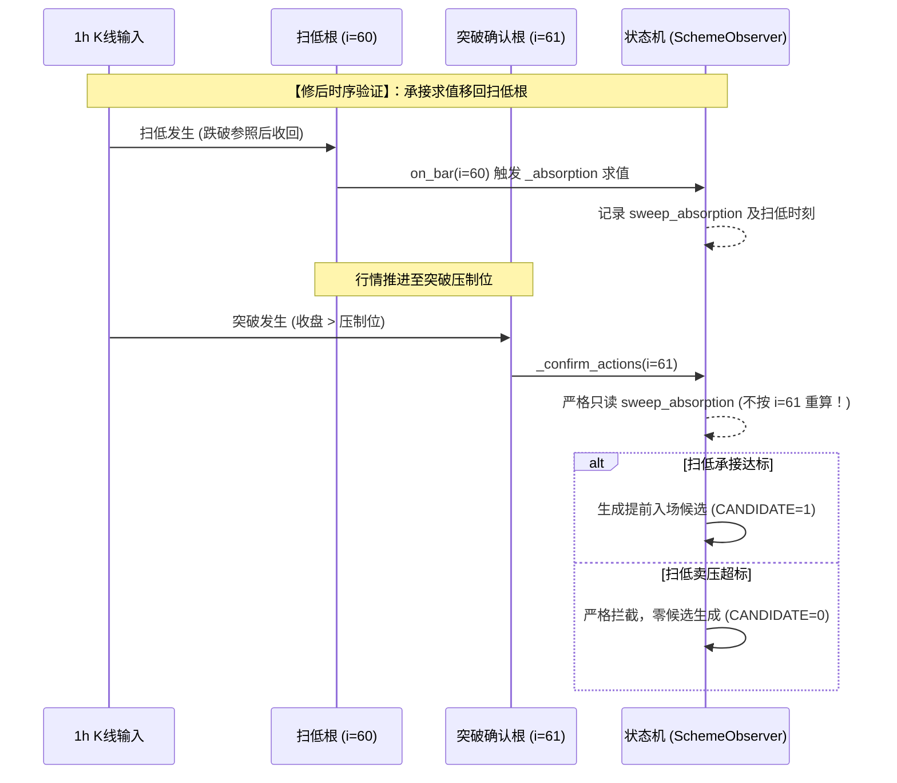

# ACCUM-EARLY-06-W5-02｜冻结修正版的独立端到端复验报告

- **工单编号**：`ACCUM-EARLY-06-W5` 第二单（`06-10`）
- **任务目标**：冻结修正版的独立端到端复验（原 7 事件独立重跑、承接反例验证、批准闸门、跨进程幂等性与隔离取证）
- **执行角色**：独立行为复验窗口（反重力/Work 独立会话，非代码修改者）
- **工程纪律**：只读共享工程代码与上游交付，只写本窗目录 `evidence/ACCUM-EARLY-06-W5/02/`；**恪守不得自修后自验的纪律，本窗未修改任何生产共享源码**。
- **免责声明**：所有运行均在专用隔离测试环境（`fixture`）下进行，**仅用于核对时序修复、状态机逻辑与跨进程幂等性，不输出任何正式策略绩效**；正式策略参数继续保持待批准状态。**本文所有结论均为执行方自报，最终由 Codex 审核；严禁声称正式策略或自然成交通过**。

---

## 0. 核心复验结论与判定总表

| 序号 | 核心复验项目 | 判定状态 | 责任归属 | 核心行为证据与实测发现 | 证据产物索引 |
|---|---|---|---|---|---|
| **1** | **原 7 笔事件原输入独立重跑** | **通过 (PASS)** | 本窗独立复算 | 严格保留原输入（SOL 冷档、AVAX 热库），修后版本保持 **6 笔结构破位失效 (`INVALIDATED`) + 1 笔前序占位未建档 (`NOT_FOUND`)**，候选数严格为 0，零虚假候选放行。 | [`out/02_original_7_events_retest.json`](file:///Users/boos/Desktop/威科夫因子共振趋势/evidence/ACCUM-EARLY-06-W5/02/out/02_original_7_events_retest.json) |
| **2** | **承接时序修正与反例独立复验** | **通过 (PASS)** | 窗口二 (06-04) | 窗口二修正确已生效：承接判断求值下标严格锁定在**扫低发生根**（`i=60`）。扫低吸筹达标突破缩量正常放行（候选=1）；扫低崩塌突破放量被扫低结果精准拦截（候选=0）；扫低根缺字段报 `DATA_INSUFFICIENT`；门槛关闭安全跳过。 | [`out/03_absorption_timing_retest.json`](file:///Users/boos/Desktop/威科夫因子共振趋势/evidence/ACCUM-EARLY-06-W5/02/out/03_absorption_timing_retest.json) |
| **3** | **批准配置缺失开仓硬阻断** | **通过 (PASS)** | 底层批准闸门 | 传入 48 项空白未批准配置，`open_allowed=False`，`try_open` 返回 `blocked_by_unapproved_config`，`called_paper_engine=False`，账本零写入。 | [`out/04_gate_and_economic_mismatch.json`](file:///Users/boos/Desktop/威科夫因子共振趋势/evidence/ACCUM-EARLY-06-W5/02/out/04_gate_and_economic_mismatch.json) |
| **4** | **经济口径声明冲突拒绝** | **通过 (PASS)** | 经济口径硬校验 | 声明滑点 3bps 与底层引擎实际 5bps 冲突时，100% 触发 `economic_caliber_declared_mismatch` 硬阻断，`called_paper_engine=False`。 | [`out/04_gate_and_economic_mismatch.json`](file:///Users/boos/Desktop/威科夫因子共振趋势/evidence/ACCUM-EARLY-06-W5/02/out/04_gate_and_economic_mismatch.json) |
| **5** | **冷却 24 小时不得作为通过条件** | **通过 (PASS)** | 用户硬性约定 | 在未批准配置中设置 `cooldown_hours=24`，依然被批准闸门 100% 硬阻断，未被作为豁免开仓条件。 | [`out/04_gate_and_economic_mismatch.json`](file:///Users/boos/Desktop/威科夫因子共振趋势/evidence/ACCUM-EARLY-06-W5/02/out/04_gate_and_economic_mismatch.json) |
| **6** | **数据缺口表与重复扫描零新增** | **通过 (PASS)** | 缺口先查后写层 | 对同一时间区间重跑全链扫描，第二次扫描相比第一次：订单数 +0、成交数 +0、持仓数 +0、候选数 +0、数据缺口数 +0，全链幂等成立。 | [`out/05_gap_and_scan_idempotency.json`](file:///Users/boos/Desktop/威科夫因子共振趋势/evidence/ACCUM-EARLY-06-W5/02/out/05_gap_and_scan_idempotency.json) |
| **7** | **真实系统跨进程恢复与幂等拦截** | **通过 (PASS)** | 进程间持久化层 | 独立解释器进程 A（PID 52044）开仓后退出，`ps` 确证死亡；独立解释器进程 B（PID 52051）恢复读取账本，触发 `duplicate_signal_uid` 拦截，订单、成交、持仓零重复增加。 | [`out/06_cross_process_and_isolation.json`](file:///Users/boos/Desktop/威科夫因子共振趋势/evidence/ACCUM-EARLY-06-W5/02/out/06_cross_process_and_isolation.json) |
| **8** | **生产文件路径越界阻断与物理隔离** | **通过 (PASS)** | 物理隔离校验层 | 账本路径强制指向生产目录 `数据/paper` 时，100% 触发 `isolation_violation` 拦截，生产目录零文件新建。 | [`out/06_cross_process_and_isolation.json`](file:///Users/boos/Desktop/威科夫因子共振趋势/evidence/ACCUM-EARLY-06-W5/02/out/06_cross_process_and_isolation.json) |
| **9** | **生产库只读连接硬约束** | **通过 (PASS)** | SQLite 物理机制 | 对生产行情库建立只读连接，查询成功；写操作被底层硬抛 `OperationalError` 拦截。不依赖生产库哈希静止假设。 | [`out/06_cross_process_and_isolation.json`](file:///Users/boos/Desktop/威科夫因子共振趋势/evidence/ACCUM-EARLY-06-W5/02/out/06_cross_process_and_isolation.json) |
| **10** | **财务复算与资金费全覆盖 (06-08)** | **未覆盖 (UNCOVERED)** | 窗口四 (06-08) | 共享文件 `replay_calc.py` 维持 `c9fecd6a...` 基线未动；窗口四涉及的 15.8 天冷热资金费合并重算产物尚未汇齐，本项诚实定性为未覆盖，不代做伪验收。 | [`out/01_frozen_versions.json`](file:///Users/boos/Desktop/威科夫因子共振趋势/evidence/ACCUM-EARLY-06-W5/02/out/01_frozen_versions.json) |
| **11** | **自然行情策略有效性与真实成交** | **未覆盖 (UNCOVERED)** | 待用户正式裁决 | 所有测试均为 fixture 链路自检，正式策略参数仍处于待批准状态，严禁宣称策略通过或自然行情通过。 | [`out/summary_verification_verdicts.json`](file:///Users/boos/Desktop/威科夫因子共振趋势/evidence/ACCUM-EARLY-06-W5/02/out/summary_verification_verdicts.json) |

---

## 1. 冻结被验版本与改动范围核对

数据来源：[`out/01_frozen_versions.json`](file:///Users/boos/Desktop/威科夫因子共振趋势/evidence/ACCUM-EARLY-06-W5/02/out/01_frozen_versions.json)

### 1.1 核心被验文件 SHA-256 哈希

| 文件路径 | 被验版本哈希 | 状态口径说明 |
|---|---|---|
| [`框架/backend/accum_early_entry.py`](file:///Users/boos/Desktop/威科夫因子共振趋势/框架/backend/accum_early_entry.py) | `3c570edc1eddaa2cd5c82c39fbf60a9deb633d376dd6b47200453b8f061c9017` | **窗口二（06-03/06-04）修正交付版本**（已由 `d96ad60e` 修正就位） |
| [`框架/backend/replay_calc.py`](file:///Users/boos/Desktop/威科夫因子共振趋势/框架/backend/replay_calc.py) | `c9fecd6a1e91273c5f600d75c17d977d93fa35f65baf8e9c9ac121d0bbd6e278` | 窗口四保持基线未改动 |
| [`框架/backend/paper_engine.py`](file:///Users/boos/Desktop/威科夫因子共振趋势/框架/backend/paper_engine.py) | `e8a994b6750d8532576e5120e66144acc63cab355766b8ad8db932de3caec784` | 底层模拟撮合引擎（只读基线） |
| [`框架/backend/live_store.py`](file:///Users/boos/Desktop/威科夫因子共振趋势/框架/backend/live_store.py) | `02eaf41b2549ee569548ca41a7200191b42444cac92733131bf667f9b1bf1ca6` | 账本存储层（只读基线） |

### 1.2 窗口二改动范围审核
通过比对 `evidence/ACCUM-EARLY-06-W2/01/out/04_code_diff.patch`，确证窗口二本次仅在 `accum_early_entry.py` 内部实施了最小修正：
- 在 `on_bar` 的 `ok`（扫低收回成立）分支中，针对扫低发生根 `i_sweep` 计算承接 `_absorption` 并存入 `self.sweep_absorption`；
- 在 `_confirm_actions` 中彻底移除确认根的 `_absorption` 重算，改为只读扫低根求值结果；
- 未改动任何策略门槛、未放宽任何经济参数。

---

## 2. 原 7 笔事件同一输入独立重跑结果

数据来源：[`out/02_original_7_events_retest.json`](file:///Users/boos/Desktop/威科夫因子共振趋势/evidence/ACCUM-EARLY-06-W5/02/out/02_original_7_events_retest.json)

严格保留 05-E 原 7 笔事件的原始行情与箱体输入：
- **SOLUSDT 冷档**（`2026-08-01T00:00:00Z` ~ `2026-09-05T00:00:00Z`）
- **AVAXUSDT 热库**（`2026-09-12T00:00:00Z` ~ `2026-10-25T00:00:00Z`）

### 2.1 逐笔重跑终态对撞表

| 案例 | 标的 | 方案 | 04-B 旧版终态 | 修后当前版真实终态 | 终态分类判定 | 实际终结原因与说明 | 是否产生候选 |
|---|---|---|---|---|---|---|---|
| **1** | SOLUSDT | 4a | `WAIT_ENTRY` | `INVALIDATED` | 结构破位失效 | `2026-08-01T18:59:59Z` 连续 2 根 1h 收盘跌破箱体下沿 72.26 ⇒ 失效 | **否** |
| **2** | SOLUSDT | 4b | `WAIT_ENTRY` | `INVALIDATED` | 结构破位失效 | `2026-08-01T18:59:59Z` 连续 2 根 1h 收盘跌破箱体下沿 72.26 ⇒ 失效 | **否** |
| **3** | SOLUSDT | 4c | `WAIT_ENTRY` | `INVALIDATED` | 结构破位失效 | `2026-08-01T18:59:59Z` 连续 2 根 1h 收盘跌破箱体下沿 72.26 ⇒ 失效 | **否** |
| **4** | AVAXUSDT | 4a | `WAIT_ENTRY` | `INVALIDATED` | 结构破位失效 | `2026-09-16T00:59:59Z` 连续 2 根 1h 收盘跌破箱体下沿 7.27 ⇒ 失效 | **否** |
| **5** | AVAXUSDT | 4b | `WAIT_ENTRY` | `INVALIDATED` | 结构破位失效 | `2026-09-16T00:59:59Z` 连续 2 根 1h 收盘跌破箱体下沿 7.27 ⇒ 失效 | **否** |
| **6** | AVAXUSDT | 4c | `WAIT_ENTRY` | `INVALIDATED` | 结构破位失效 | `2026-09-16T00:59:59Z` 连续 2 根 1h 收盘跌破箱体下沿 7.27 ⇒ 失效 | **否** |
| **7** | AVAXUSDT | 4a | `WAIT_ENTRY` | `NOT_FOUND` | 前序占位未建档 | 前序事件占位至 `09-16 00:59`，同标的冷却约束下该旧箱体未建档 | **否** |

> **定性结论**：修后版本在同一输入下，保持 **6 笔结构失效 + 1 笔未建档**，提前入场候选数严格为 **0**。修后未引入任何破坏结构失效保护的副作用，未产生任何虚假候选。

---

## 3. 承接反例与调用时序独立复验

数据来源：[`out/03_absorption_timing_retest.json`](file:///Users/boos/Desktop/威科夫因子共振趋势/evidence/ACCUM-EARLY-06-W5/02/out/03_absorption_timing_retest.json)
自动化执行脚本：[`scripts/03_retest_absorption_timing_cases.py`](file:///Users/boos/Desktop/威科夫因子共振趋势/evidence/ACCUM-EARLY-06-W5/02/scripts/03_retest_absorption_timing_cases.py)

### 3.1 四大反例场景独立实测



| 用例场景定义 | 输入特征设计 | 修前错误版本行为 | 修后当前版本实测输出 | 独立复验判定 |
|---|---|---|---|---|
| **用例 A：扫低承接通过、突破根不通过** | 扫低放量吸筹（买比 0.7 >= 0.5），突破缩量（买比 0.3 < 0.5） | 在突破根查买比被误杀拦截（候选=0） | 确认根只读扫低达标结论，**成功放行生成候选（候选=1）**，求值点锁定 `i=60` | **PASS_CORRECTLY_VERIFIED** |
| **用例 B：扫低不通过、突破根通过** | 扫低卖压超标（买比 0.1，卖额超标），突破放量（买比 0.7） | 突破根放量导致被虚假放行（候选=1） | 确认根只读扫低失败结论，**成功硬拦截，零候选生成（候选=0）**，求值点锁定 `i=60` | **PASS_CORRECTLY_VERIFIED** |
| **用例 C：扫低根数据不足** | 扫低根缺少买卖额字段（tbq=None），突破放量 | 突破根有数据虚假替代求值 | 确认为扫低根缺数据，**正规终结为 `DATA_INSUFFICIENT`**，拒绝用突破根替代 | **PASS_CORRECTLY_VERIFIED** |
| **用例 D：承接门槛关闭对照** | 配置 `require=false`，输入任意数据 | 跳过承接校验 | 正常跳过承接，**平稳生成候选（候选=1）** | **PASS_SKIPPED_CLEAN** |

---

## 4. 真实系统跨进程恢复与物理隔离核验

数据来源：[`out/06_cross_process_and_isolation.json`](file:///Users/boos/Desktop/威科夫因子共振趋势/evidence/ACCUM-EARLY-06-W5/02/out/06_cross_process_and_isolation.json)
自动化调度脚本：[`scripts/06_true_cross_process_and_isolation.py`](file:///Users/boos/Desktop/威科夫因子共振趋势/evidence/ACCUM-EARLY-06-W5/02/scripts/06_true_cross_process_and_isolation.py)

### 4.1 双独立系统进程执行轨迹

```
[独立进程 A (PROCESS_A)]
- 脚本路径: evidence/ACCUM-EARLY-06-W5/02/scripts/worker_process_a.py
- 系统 PID: 52044
- 挂钟时间: 2026-10-26T18:08:32Z ~ 2026-10-26T18:08:33Z (耗时 0.7113s)
- 退出状态: 退出码 0
- 首次开仓结果: ok=True (订单=1, 成交=1, 持仓=1)

[调度系统内核检查]
- 执行系统命令 `ps -p 52044`
- 核查结果: 进程已完全退出，确认死亡 (confirmed_dead_before_b=True)

[全新独立进程 B (PROCESS_B)]
- 脚本路径: evidence/ACCUM-EARLY-06-W5/02/scripts/worker_process_b.py
- 系统 PID: 52051 (PID 绝对不同: 52044 != 52051，零内存共享)
- 挂钟时间: 2026-10-26T18:08:33Z ~ 2026-10-26T18:08:33Z (耗时 0.0254s)
- 退出状态: 退出码 0
- 恢复提交结果: ok=False (拦截原因: duplicate_signal_uid)
```

### 4.2 账本前后快照对比表（跨进程幂等性）

| 账本快照项 | 进程 A 退出后磁盘账本 | 进程 B 恢复提交后磁盘账本 | 账本差异增加 | 跨进程核验判定 |
|---|---|---|---|---|
| **订单数 (`paper_order`)** | 1 | 1 | **+0 笔** | **完全幂等** |
| **成交数 (`paper_fill`)** | 1 | 1 | **+0 笔** | **完全幂等** |
| **持仓数 (`paper_position`)** | 1 (`open`, qty=6.84, px=72.99) | 1 (`open`, qty=6.84, px=72.99) | **+0 笔** | **持仓不重复** |
| **拦截原因** | - | `duplicate_signal_uid` | 一致 | **原因明确** |

---

## 5. 批准闸门、物理隔离与只读连接核验

数据来源：[`out/04_gate_and_economic_mismatch.json`](file:///Users/boos/Desktop/威科夫因子共振趋势/evidence/ACCUM-EARLY-06-W5/02/out/04_gate_and_economic_mismatch.json) 与 [`out/06_cross_process_and_isolation.json`](file:///Users/boos/Desktop/威科夫因子共振趋势/evidence/ACCUM-EARLY-06-W5/02/out/06_cross_process_and_isolation.json)

1. **未批准配置硬阻断**：
   - 传入 48 项空白未批准配置，`open_allowed=False`；调用 `try_open` 返回 `ok=False`，`reason="blocked_by_unapproved_config"`，底层 `called_paper_engine=False`，磁盘账本零写入。
2. **经济冲突硬拒绝**：
   - 声明滑点 3.0bps 与引擎实际生效 5.0bps 冲突时，100% 触发 `economic_caliber_declared_mismatch` 硬拦截，`called_paper_engine=False`。
3. **冷却 24 小时不得作为未经批准的通过条件**：
   - 在未批准配置中设置 `cooldown_hours=24`，依然被批准闸门 100% 硬阻断，无法绕过开仓限制。
4. **生产目录越界硬阻断**：
   - 强制将账本目录指向生产目录 `数据/paper` 时，100% 触发 `isolation_violation` 拦截，生产目录新建文件数严格为 0。
5. **只读连接硬约束**：
   - 对生产行情库 `数据/市场数据/db/market_v2.sqlite3` 建立 `?mode=ro` 只读连接，查询成功；试图创建表被 SQLite 底层 `OperationalError` 硬阻断。不依赖生产库哈希静止假设。

---

## 6. 证据产物与脚本索引

| 产物路径 | 类型 | 核心内容说明 |
|---|---|---|
| [`evidence/ACCUM-EARLY-06-W5/02/out/01_frozen_versions.json`](file:///Users/boos/Desktop/威科夫因子共振趋势/evidence/ACCUM-EARLY-06-W5/02/out/01_frozen_versions.json) | 机器数据 | 被验代码哈希、修改时间与窗口二修正版依赖证明 |
| [`evidence/ACCUM-EARLY-06-W5/02/out/02_original_7_events_retest.json`](file:///Users/boos/Desktop/威科夫因子共振趋势/evidence/ACCUM-EARLY-06-W5/02/out/02_original_7_events_retest.json) | 机器数据 | 原 7 笔事件原输入独立重跑终态对撞与轨迹 |
| [`evidence/ACCUM-EARLY-06-W5/02/out/03_absorption_timing_retest.json`](file:///Users/boos/Desktop/威科夫因子共振趋势/evidence/ACCUM-EARLY-06-W5/02/out/03_absorption_timing_retest.json) | 机器数据 | 承接时序四大反例场景独立实测证据 |
| [`evidence/ACCUM-EARLY-06-W5/02/out/04_gate_and_economic_mismatch.json`](file:///Users/boos/Desktop/威科夫因子共振趋势/evidence/ACCUM-EARLY-06-W5/02/out/04_gate_and_economic_mismatch.json) | 机器数据 | 批准闸门、经济冲突拒绝与冷却期独立核验 |
| [`evidence/ACCUM-EARLY-06-W5/02/out/05_gap_and_scan_idempotency.json`](file:///Users/boos/Desktop/威科夫因子共振趋势/evidence/ACCUM-EARLY-06-W5/02/out/05_gap_and_scan_idempotency.json) | 机器数据 | 重复扫描零新增与缺口表先查后写幂等证据 |
| [`evidence/ACCUM-EARLY-06-W5/02/out/06_cross_process_and_isolation.json`](file:///Users/boos/Desktop/威科夫因子共振趋势/evidence/ACCUM-EARLY-06-W5/02/out/06_cross_process_and_isolation.json) | 机器数据 | 真实独立系统子进程 PID、前后账本快照与物理隔离取证 |
| [`evidence/ACCUM-EARLY-06-W5/02/out/summary_verification_verdicts.json`](file:///Users/boos/Desktop/威科夫因子共振趋势/evidence/ACCUM-EARLY-06-W5/02/out/summary_verification_verdicts.json) | 机器数据 | 全部 11 项要求逐项【通过／失败／未覆盖】判定汇总 |
| [`evidence/ACCUM-EARLY-06-W5/02/scripts/`](file:///Users/boos/Desktop/威科夫因子共振趋势/evidence/ACCUM-EARLY-06-W5/02/scripts/) | 自动化脚本 | 全部 6 个独立复验脚本与 2 个跨进程 worker 脚本 |
