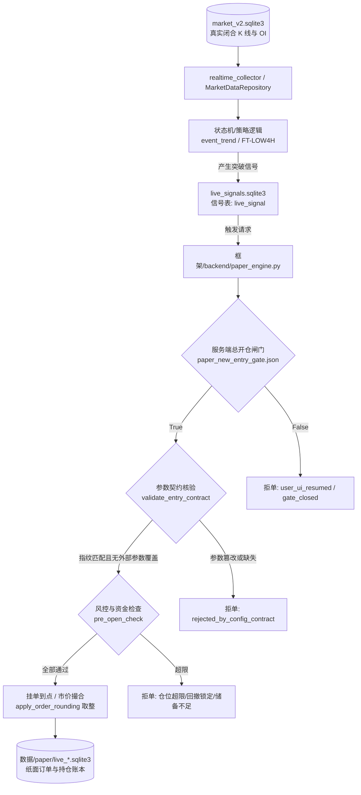

# 01 现状核查与 AI 调用链审计报告 (R1 纠偏版)

> **工单代号**：AI-DYNAMIC-DESIGN-01-R1  
> **审计时点**：2026-10-26  
> **审计原则**：事实优先、代码即证据、数据引用 Work 最新事实清单。所有“已经接入人工智能”的判断，必须以“存在实际调用且其输出被交易决策程序实际使用”为唯一证据标准；尚未收到或存在冲突的标为待核实，绝不自行假设。

---

## 一、代码库与生产环境 AI 接口核查结论

经对代码库全部生产文件（`框架/backend/`）、策略文件（`策略/WyckoffMaster/`）、前端界面（`UI界面/web/`）以及执行脚本的全面静态扫描与调用链排查，得出以下确定性审计结论：

> [!CAUTION]
> **核心审计结论**：当前系统**完全没有接入任何人工智能（AI / 大语言模型 / 机器学习决策模型）**，既不存在模型 API 调用，也不存在模型输出被决策程序使用的任何代码路径。
> 
> **“当前系统已接入人工智能进行动态决策”的说法纯属虚构，在当前代码中证据为 0。**

### 1. 依赖库与外部 SDK 静态排查

使用语法扫描对项目代码中常见的 AI / LLM SDK 导入进行排查：
- `openai` / `anthropic` / `google.generativeai` / `langchain` / `transformers` / `ollama` 等主流 AI 库：**0 处导入**。
- `requirements.txt` / 环境依赖：无任何 LLM 或模型推理运行时依赖。
- 本地权重文件：无任何 `.pt`、`.bin`、`.onnx`、`.safetensors` 或 `gguf` 格式的本地权重或神经网络模型。

### 2. 歧义词项澄清与溯源证据

在排查中发现若干带有“AI”、“Gemini”、“Prompt”字样的文件与代码，逐项溯源核实如下，均与实际交易决策中的 AI 无关：

| 发现位置 | 代码/文本内容 | 真实含义与溯源证据 | 是否构成 AI 决策证据 |
|---|---|---|:---:|
| `框架/backend/live_signal_engine.py:19` | `提示装配：_接入43.make_prompts` | 传统交易系统的**入场信号提示（Trading Alert / Hint）**装配函数，负责把威科夫/唐奇安突破事件转为前端可展示的结构体，**与大模型 Prompt 无关**。 | **否** |
| `框架/backend/tests/test_funding_audit_counterexamples.py:3` | `# 与 Gemini 版逐字一致，仅传参口径改为生产` | 历史开发过程中，开发人员曾使用 Gemini 对话辅助编写了测试夹具代码，注释仅为标注代码来源。 | **否** |
| `框架/backend/验收证据/scope_crypto_v1/Codex审核包...md` | `执行窗口：Work 接续窗口（DeepSeek-V4.1-Flash）` | 开发者在开发日志中记录的当时人机协同开发辅助工具型号，属于工程操作人代号，非系统运行代码。 | **否** |
| `UI界面/web/src/design/tokens.css` 等 | 包含大量带有 `ai` 的样式选择器（如 `.ds-card`、`crosshair`、`tailwind`） | CSS 样式表中的英文字符串（如 `crosshair` 十字光标、`tailwind` 工具类），属于误报。 | **否** |

---

## 二、现有策略、指标及决策调用链现状盘点

当前系统是一个完全由**确定性硬编码逻辑与有限状态机（FSM）**驱动的量化回测与模拟交易系统。

### 1. 现有策略清单与止损规则状态盘点

依据最新核实与用户确认，严格区分现有代码状态与最新确认规则（**严禁混淆旧规则与当前规则**）：

| 策略标识 | 策略版本/家族 | 代码位置 | 核心原理 | 决策机制与当前生效止损规则 |
|---|---|---|---|---|
| **`WX_EVENT_TREND_V0_1`** | `F_WX_EVENT_TREND` | [`策略/WyckoffMaster/event_trend_v0_1/`](file:///Users/boos/Desktop/威科夫因子共振趋势/策略/WyckoffMaster/event_trend_v0_1/) | 低频威科夫箱体突破 + 真实持仓量（OI）增幅确认 | 纯规则有限状态机（BOX → SWEEP → RETEST → BREAKOUT）。 **用户最新确认止损规则**：初始止损为实际入场价下方 5%；入场后以实际入场后新收盘 4h K 线最低价下方 5% 计算候选止损；生效止损取初始止损、此前止损、候选止损最高值，只上移不下移；**彻底取消 10 天强平、取消 2R 启动门槛、取消旧十根最低点规则**；15 分钟粒度执行且不得追溯。 |
| **`FT-LOW4H`** | `FT-LOW4H-EXP-V2.2` | [`框架/backend/strategies/wx_execution.py`](file:///Users/boos/Desktop/威科夫因子共振趋势/框架/backend/strategies/wx_execution.py) | 唐奇安 4h 低频突破跟踪策略 | 纯指标突破比对。固定止损比例 `stoploss_s=0.05`，跟踪参数 `trail_d=0.05`，同样遵照用户最新确认规则执行单向棘轮上移。 |
| **`OI_RESONANCE_V1`** | `OI_RESONANCE` | [`策略/WyckoffMaster/oi_resonance_v1/`](file:///Users/boos/Desktop/威科夫因子共振趋势/策略/WyckoffMaster/oi_resonance_v1/) | 合约持仓量（OI）激增与多空比异常共振 | 阈值规则计算（OI 变化率与基准比对）。 |
| **旧退役策略** | `3a / 3b / 3c / 3d` | `_legacy_archive_v31/` | 旧版高频多臂原型 | **已在 WORK-04 彻底退役**，硬编码拦截禁止开仓。 |

### 2. 现有指标计算层（纯确定性计算能力已存在）

所有的量价特征、统计指标和衍生特征全部由纯数学/统计函数在本地计算，具体包括：
- **Wilder ATR(14)**：首 14 个 TR 算术平均，随后按照 $\text{ATR}_t = (\text{ATR}_{t-1}\times 13 + \text{TR}_t)/14$ 严格递推（`features.py:compute_wilder_atr_series`）。
- **箱体几何与效率比（ER）**：最近 42 根 4h K 线 $|\text{last} - \text{first}| / \sum |\text{diff}|$，固定建档，无未来函数重画（`features.py:compute_efficiency_ratio`）。
- **成交量基准 $V_{20}$**：前 20 根 1h K 线成交量中位数（`features.py:compute_v20_median_volume`）。
- **真实合约持仓量（OI）增幅**：直接读取币安衍生品合约张数/数量序列，严格排除名义价值（USD），并且强制核对 $|t - T| \le 15\text{m}$，缺失或超距直接报 `oi_unavailable`（`features.py:extract_real_oi_growth`）。

### 3. 现有调用链（现状 As-Is）

目前模拟盘运行链路如下：

在现有链路中，**没有任何一个节点调用了外部人工智能服务，也没有接收任何外部模型的推理文本或 JSON 输入**。

---

## 三、数据覆盖引用 Work 最新事实清单

严格遵循整改要求：“*数据覆盖引用 Work 最新事实清单；尚未收到或存在冲突的标为待核实，不自行假设*”。引用 `evidence/DATA-AUDIT-01/01_数据资产清单.md`（实测时刻 2026-10-25 17:2x UTC）客观事实：

### 1. 磁盘与数据库实测规模

| 层级 | 物理位置 | 盘上实测规模 | 核心表 / 分片事实 | 状态定性 |
|---|---|---|---|:---:|
| **热库** | `数据/市场数据/db/market_v2.sqlite3` | **12.68 GB** | 26 张表 + 1 视图；实际存数据 9 张表；K 线头版本 `candle_heads` 8,783,582 行（551 标的）；全版本 `candle_versions` 9,027,502 行；`funding_history` 2,120,838 行（814 标的）；`oi_history` 5m 6,136,534 行（528 标的）；`coverage_cache` 4,385 条。 | **已核实实测** |
| **冷档** | `数据/市场数据/parquet/` | **约 20 GB** (42,482 文件) | 6 类数据（`candles`、`candle_heads`、`metrics`、`oi`、`funding`、`sources`），按年分片。 | **已核实实测** |
| **原始与遗留** | `数据/raw/`、`数据/raw_oi_metrics/`、`数据/研究输入/` | **约 33.5 GB** | 官方原始压缩包或旧版研究集，**当前生产业务代码无读取**。 | **已核实实测** |
| **契约与账本** | `数据/contracts/旧标的池/`、`数据/paper/` | **< 120 MB** | 币池与规格快照、纸面交易账本。 | **已核实实测** |

### 2. 标的池口径严格核查（禁止混淆）

| 统计口径 | 数量 | 统计含义与依据 | 核实结论 |
|---|---|---|---|
| **批准币池** (`scope_crypto.json`) | **526** | 正式生效的加密货币衍生品标的池，**明确排除 `ALLUSDT` 与 `BTCDOMUSDT`**。 | **唯一批准基准** |
| `symbol_pool` (binance/um) | **528** | 交易所全量合约列表，包含 `ALLUSDT`、`BTCDOMUSDT` 2 个非交易指数。 | 严禁当作批准币池 |
| `candle_heads` 有 1h 的标的 | **551** | 包含币安 528 标的 + 23 个 OKX 合约（`AEON-USDT-SWAP` 等）。 | 严禁当作批准币池 |

> [!IMPORTANT]
> **红线原则**：严禁用 528 或 551 当作“批准币数”。动态策略设计第一阶段仅允许在已批准的 526 标的范围内筛选，严禁越界引入未获批准的 OKX 标的或指数标的。

### 3. 数据覆盖异常与冲突项清单（必须标为待核实，绝不脑补）

根据 Work 最新实测事实，以下数据项存在断档、异常或冲突，在动态策略设计中必须明确标记为**【待核实 / 待修复】**，严禁擅自假定齐备：

1. **`realtime_quotes` 单点停滞异常**：
   - 实测事实：热库中 `realtime_quotes` 共 814 行，**记录全部停在 2026-10-05 04:44 单点**，此后 20 天未再更新写入。
   - 待核实影响：`adapter.py:1214` 仍读取该表作为“当前价”与市值来源。动态决策模型检索严禁依赖该过期表，必须以真实闭合 Bar 为准。
2. **冷档 `available_at` 全字段为空**：
   - 实测事实：冷档 `candles` 的 18 列中，`available_at` 在实测抽样中**全为 null**（非空计数 = 0）。
   - 待核实影响：无法通过冷档直接反推历史落库物理时钟，回测因果时钟必须以 `close_time` 为刚性不可逾越上界。
3. **`metrics` 与 `oi` 字段缺失**：
   - 实测事实：冷档 `metrics`（526 标的）无 `exchange`/`market` 列，且无 `fetched_at`；冷档 `oi` 的 `fetched_at` 均为 null。
   - 待核实影响：采集时刻无法溯源，因果防御中仅能使用闭合时间戳 `ts`，超出 15 分钟窗口统一阻断。
4. **`EFFECTIVE_VIEW` 冻结参数生效视图丢失**：
   - 实测事实：环境变量 `EFFECTIVE_VIEW` 默认指向的路径全盘无副本，已被证实丢失。
   - 待核实影响：系统当前参数依赖代码内嵌默认值，参数依据必须逐项比对，不得假设外部视图存在。
5. **标的覆盖不均衡事实**：
   - 只有主流币种（如 BTC、ETH、SOL 等）在历史长周期（2020 至今）具备连续 5m OI 与费率；其余大量小币种历史 OI 在 2024 年前存在断档，或仅在近期有热库数据。尚未收到完整历史数据的标的一律标为待核实。

---

## 四、本章核查总结

1. **客观现实**：系统当前处于“纯手工与传统量化规则”阶段，“人工智能”尚未在生产、回测或模拟盘决策程序中有任何代码落地。
2. **整改起点**：动态策略与人工智能权限设计必须在尊重上述数据真实缺陷的前提下展开，明确现有能力与拟建能力的边界，绝不能在沙滩上建高楼。
