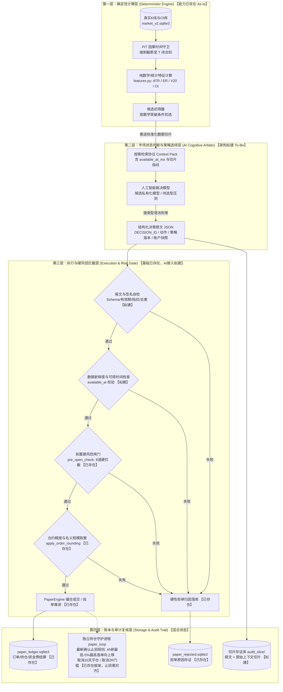
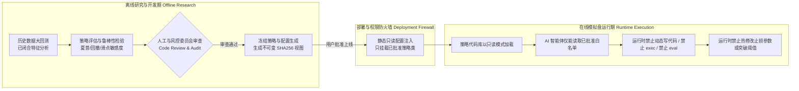

# 03 系统整体架构与四层解耦设计 (R1 纠偏版)

> **工单代号**：AI-DYNAMIC-DESIGN-01-R1  
> **核心架构理念**：四层边界严格解耦，计算归程序，风控归闸门，决策受拘束，持仓保护独立运行。  
> **整改纪律**：
> 1. 彻底删除架构、流程图与说明中旧十天退出、两倍风险启动及旧十根四小时最低点规则，全面贯彻用户已再次确认的最新止损规则。
> 2. 清楚标注哪些能力已存在（As-Is）、哪些能力属于拟建（To-Be），严禁将设计意图误写为“代码已落实”。

---

## 一、系统四层解耦架构全景图

系统划分为四个物理边界分明、依赖单向流动的层级。每一层均明确标注其当前工程实现状态：

---

## 二、四大层级职责、边界与状态定义

### 第一层：确定性计算层（Deterministic Engine）
- **工程实现状态**：**【核心能力已存在 As-Is】**（实现于 `框架/backend/features.py` 等模块）。
- **主体职责**：
  1. **数据准备与 PIT 截断**：仅读取请求时刻 $T$ 之前已闭合的 K 线与 $\le 15\text{m}$ 真实的合约持仓数量（OI），绝不使用未来数据；
  2. **数学统计特征计算**：精确计算 Wilder ATR(14)、箱体几何高度与方向效率比 ER、前 20 根成交量中位数 $V_{20}$、6 小时真实 OI 增长率 $\Delta\text{OI}_{6\text{h}}$；
  3. **初筛候选生成**：只有在客观突破事件触发且 OI 增幅达到阈值时，才组装为标准化特征包推送到第二层。
- **权限边界**：纯确定性数学运算，不包含任何大模型推理，不负责开仓决策。

### 第二层：市场状态判断与策略选择层（AI Cognitive Arbiter）
- **工程实现状态**：**【架构拟建 To-Be】**（当前代码库未安装模型、无调用路径，仅作为本次设计规范）。
- **主体职责**：
  1. **市场状态定性**：基于输入切片评估当前突破的客观微观结构（如蓄势突破 vs 假突破洗盘）；
  2. **白名单策略选择**：在**已批准的策略白名单**（如 `WX_EVENT_TREND_V0_1`、`FT-LOW4H`）中指定运行策略分支，或选择弃权；
  3. **输出受限决策报文**：输出满足强类型 JSON Schema 的报文，动作仅限合法枚举。
- **权限边界**：
  - **严禁编写或修改代码**；
  - **严禁直接向撮合引擎或交易所提交订单**；
  - **严禁指定买入数量、杠杆倍数或成交价格**；
  - **输出内容仅为“待审意向（Proposal）”，绝不等于最终成交指令**。

### 第三层：执行与硬风控拦截层（Execution & Risk Gate）
- **工程实现状态**：**【部分已存在 As-Is / 校验协议拟建 To-Be】**（风控闸门已存在于 `paper_engine.py`；针对 AI 报文的 Schema 与指纹校验协议为拟建）。
- **主体职责**：
  1. **报文合法性审查（拟建）**：核验报文唯一编号（UUID）、有效期（`valid_until_ms` 是否超时）、数据可得时间（`available_at_ms`）、策略配置指纹；
  2. **风控闸门重算（已存在）**：
     - 单币与总多头名义敞口上限检查；
     - 现金储备比例检查（$\ge 20\%$）；
     - 最大并发持仓数量限制（$\le 10$ 仓）；
     - 组合单笔风险预算上限（$\le 0.5\%$）；
     - 账户累计回撤熔断锁定（$20\%$）；
     - 严格仅限做多限制（`short_enabled = False`）；
     - 前 15m 成交额参与率限制（$\le 1\%$）。
  3. **数量与价格精度取整（已存在）**：由程序调用 `apply_order_rounding` 按交易所规则重新计算步长与面值。
- **权限边界**：**拥有最高一票否决权**。任何一项风控或格式校验不通过，立刻原地拒单并记录归因。

### 第四层：账本与审计复核层（Storage & Audit Trail）
- **工程实现状态**：**【部分已存在 As-Is / 切片存证拟建 To-Be】**。
- **主体职责**：
  1. **账本记录（已存在）**：订单明细、持仓更新、资金费结算分别持久化在本地 SQLite 纸面账本；
  2. **切片存证（拟建）**：归档每次决策输入的原始切片 SHA-256 哈希与报文正文；
  3. **独立持仓保护（框架已存在，规则需严格对齐）**：独立于模型常驻运行，严格执行用户最新确认的止损规则。

---

## 三、用户最新确认止损规则与保护机制

在系统生命周期中，**持仓的保护逻辑与新仓位开立决策彻底物理解耦**。无论模型是否异常，持仓保护均由独立守护机制全权接管，并无条件贯彻用户已再次确认的当前止损规则：

> [!IMPORTANT]
> **用户已再次确认的当前止损规则**：
> 1. **初始止损**：实际入场价下方 5%（即 $\text{InitialStop} = \text{EntryPrice} \times (1 - 0.05)$）。
> 2. **跟踪止损**：入场后，以该笔实际入场之后新收盘的四小时 K 线最低价下方 5% 计算候选止损（即 $\text{CandidateStop} = \text{NewClosed4hLow} \times (1 - 0.05)$）。
> 3. **生效止损取值**：生效止损取初始止损、此前止损、本次候选止损中的**最高值**，**只上移、不下移**（单向棘轮机制）：
>    $$\text{EffectiveStop}_t = \max(\text{InitialStop}, \text{EffectiveStop}_{t-1}, \text{CandidateStop}_t)$$
> 4. **取消持仓十天自动平仓**：彻底删除历史文档与代码中持仓满 240 小时（10天）强平的逻辑。
> 5. **取消盈利达到两倍初始风险（2R）才启动跟踪止损的门槛**：只要入场后产生新收盘的 4h K 线，立即计算候选止损并参与最高值比较，无浮盈门槛限制。
> 6. **十五分钟执行粒度不变**：持仓监控按 15 分钟粒度轮询市场价格，一旦跌破当前生效止损立即触发市价平仓；**严禁使用新止损追溯判断此前行情**。

---

## 四、研究期与运行期物理隔离机制

系统设计严格区隔“离线研究与参数审查”与“在线运行与模拟执行”两阶段，杜绝运行时污染：

### 防火墙铁律：
1. **策略只读注入**：运行期引擎只允许加载在 `strategy_contracts.py` 中预先登记的策略派生类。
2. **禁止运行时修改代码**：AI 进程与任何外部接口绝对无权访问文件系统的写接口，无法修改策略代码或风控规则。
3. **禁止动态放宽止损**：运行期生效止损严格执行单向棘轮公式，任何低于当前生效止损的提议均被底层物理阻断。
