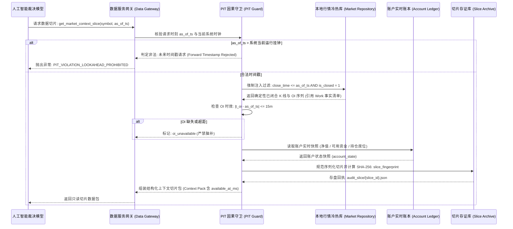

# 06 按需检索与因果防御协议 (R1 纠偏版)

> **工单代号**：AI-DYNAMIC-DESIGN-01-R1  
> **核心机制**：严格 PIT（Point-in-Time）因果时钟、沙箱数据网关、实际可得时间防御、切片规范化哈希存证。  
> **整改纪律**：
> 1. 数据覆盖严格引用 Work 最新事实清单；对冷档 `available_at` 为 null、`realtime_quotes` 单点停滞、小币种历史 OI 缺失等真实冲突项标为待核实，不自行假设齐备。
> 2. 检索协议补全实际可得时间、账户状态快照、策略版本候选及规范切片指纹。

---

## 一、按需检索服务的沙箱隔离设计

为了彻底杜绝任何形式的**前视偏差（Lookahead Bias）**与**数据越权泄漏**，模型严禁直接连接底层的 SQLite 数据库文件（`market_v2.sqlite3` 等），也严禁发起任意外部网络 HTTP 请求。

所有市场上下文检索必须经过受限的**数据服务网关（Market Data Retrieval Service）**：



---

## 二、PIT 因果时钟四大强制防御铁律

### 铁律 1：物理强制闭合（Only Closed Bars）
- 数据服务在组装 4h / 1h / 15m K 线时，SQL 查询条件由网关强制拼接，**模型无法通过入参篡改 SQL**：
  ```sql
  SELECT open_time, open, high, low, close, volume, close_time
  FROM klines_1h
  WHERE symbol = ? AND close_time <= ? AND is_closed = 1
  ORDER BY open_time DESC
  LIMIT ?
  ```
- 任何当前正在跳动、尚未收盘的未闭合 Bar（Unclosed Bar）被物理排除。模型只能看到过去已收盘的客观现实。

### 铁律 2：真实持仓量（OI）15 分钟窗口校验（引用 Work 最新事实）
- 依据 Work 最新事实清单（`evidence/DATA-AUDIT-01/01_数据资产清单.md`）：
  - 真实持仓量必须使用合约张数/数量 `open_interest`，严禁使用名义价值（USD）；
  - 观察时间戳 $t_{\text{oi}}$ 必须满足：$t_{\text{oi}} \le T$ 且 $|t_{\text{oi}} - T| \le 15\text{ 分钟}$；
  - 6 小时前基准时点 $T_{-6\text{h}}$ 同理需满足 15 分钟窗口；
  - **冲突与缺失处理**：热库中仅 528 标的有 5m OI 序列，冷档仅支持到 2026-10-18，且大量小币种 2024 年前无数据。凡超出 15 分钟窗口或数据缺失者，数据服务**强制填入 `oi_status: "oi_unavailable"`，禁止模型自行均值插值或脑补填充**。

### 铁律 3：数据实际可得时间约束（Available-At Defense）
- 依据 Work 最新事实，冷档 `available_at` 字段当前全为空（待核实修复），但在实时热库中存在采集入库延迟：
  - 网关必须提供 `available_at_ms`（物理落库可得时刻）；
  - 因果守卫强制验证：$\text{available\_at\_ms} \le \text{evaluated\_at\_ms}$；
  - 任何试图使用物理上尚未落库的数据进行决策的行为，均被视为未来函数泄漏直接拦截。

### 铁律 4：切片指纹规范哈希与可复查存证（Reproducibility Hash）
- 数据服务在向模型提供上下文切片（Context Pack）的同时，调用规范化 JSON 序列化函数（`sort_keys=True, separators=(',', ':')`）生成规范字节流，计算 SHA-256 哈希值：
  $$\text{slice\_fingerprint} = \text{SHA-256}(\text{CanonicalJSON}(\text{ContextPack}))$$
- 该哈希值连同切片内容完整落盘至 `evidence/AI-DYNAMIC-DESIGN-01-R1/audit_slice/`。
- 模型在决策报文的 `data_slice` 中必须如实回传该指纹，执行层在复核时重新验证指纹一致性。

---

## 三、上下文切片包（Context Pack）数据协议完整规范

数据服务网关输出给模型的只读上下文包结构如下：

```json
{
  "slice_id": "slice_SOLUSDT_1792753200000_v1",
  "symbol": "SOLUSDT",
  "evaluated_at_ms": 1792753202000,
  "available_at_ms": 1792753201500,
  "as_of_iso": "2026-10-26T01:00:00Z",
  "slice_fingerprint": "e3b0c44298fc1c149afbf4c8996fb92427ae41e4649b934ca495991b7852b855",
  "account_state": {
    "account_id": "paper_ai_arbiter_01",
    "current_equity": 5000.0,
    "free_margin": 4500.0,
    "open_positions_count": 1,
    "account_drawdown_pct": 0.012
  },
  "market_features": {
    "wilder_atr_14_4h": 4.12,
    "box_high_42_4h": 145.20,
    "box_low_42_4h": 128.50,
    "efficiency_ratio_42": 0.185,
    "volume_median_20_1h": 28450.0,
    "breakout_volume_1h": 51200.0,
    "volume_ratio": 1.80
  },
  "open_interest_evidence": {
    "current_oi": 1824500.0,
    "current_oi_ts_ms": 1792753140000,
    "current_oi_lag_seconds": 60,
    "baseline_oi_6h_ago": 1751000.0,
    "baseline_oi_ts_ms": 1792731540000,
    "baseline_oi_lag_seconds": 60,
    "growth_pct": 0.042,
    "status": "valid"
  },
  "market_structure": {
    "event_stage": "BREAKOUT_ATTEMPT",
    "sweep_detected": true,
    "retest_confirmed": true,
    "retest_low_lr": 133.20
  },
  "approved_strategy_candidates": [
    {
      "strategy_id": "WX_EVENT_TREND_V0_1",
      "strategy_version": "WX_EVENT_TREND_V0.1",
      "config_fingerprint": "1f1167de3541abcd",
      "eligible": true
    },
    {
      "strategy_id": "FT-LOW4H",
      "strategy_version": "FT-LOW4H-EXP-V2.2",
      "config_fingerprint": "7b1ae9f68eff1234",
      "eligible": false,
      "ineligible_reason": "not_at_donchian_breakout"
    }
  ]
}
```

---

## 四、数据覆盖冲突与异常处理规范

结合 Work 最新事实清单，网关在处理异常标的时执行以下确定性阻断策略：

1. **标的池越界拦截**：若请求标的非已批准的 526 标的之一（如指数 `ALLUSDT`、`BTCDOMUSDT` 或 OKX 专属标的），直接抛出 `SYMBOL_NOT_IN_APPROVED_SCOPE` 并阻断；
2. **实时价格源异常拦截**：由于 `realtime_quotes` 单点停滞在 2026-10-05 04:44，网关严禁向切片填入该表的过时快照价格，必须以最新闭合 K 线 `close` 作为基准参考价；
3. **OI 缺失或超距阻断**：若请求时点该标的 OI 缺失或与基准时点距离 $> 15\text{m}$，网关返回 `status: "oi_unavailable"`，上层初筛器直接跳过该标的，禁止提交给模型。
