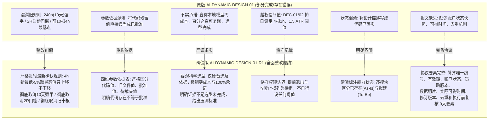

# 工单二整改交付：反重力·动态策略与人工智能权限设计纠偏方案 (R1)

> **工单代号**：AI-DYNAMIC-DESIGN-01-R1  
> **交付目录**：`evidence/AI-DYNAMIC-DESIGN-01-R1/`  
> **整改基准**：严格落实用户再次确认的止损规则，逐文件核查清理全部旧规则，重构参数依据表与数据事实，补全决策与检索协议，撤销未经实测的虚假承诺，明确区分现状与拟建。  
> **操作铁律**：只改本单设计文档，不安装模型、不外发数据、不修改交易逻辑、不启用真实交易。

---

## 一、用户已再次确认的当前止损规则基准

在本次 R1 整改中，全套设计方案无条件对齐并贯彻用户已再次确认的止损规则：
1. **初始止损**：实际入场价下方 5%（$\text{InitialStop} = \text{EntryPrice} \times 0.95$）。
2. **跟踪止损**：入场后，以该笔实际入场之后新收盘的四小时 K 线最低价下方 5% 计算候选止损（$\text{CandidateStop} = \text{NewClosed4hLow} \times 0.95$）。
3. **生效止损取值**：取初始止损、此前止损、本次候选止损中的**最高值**，**只上移、不下移**（单向棘轮机制）：
   $$\text{EffectiveStop}_t = \max(\text{InitialStop}, \text{EffectiveStop}_{t-1}, \text{CandidateStop}_t)$$
4. **取消持仓十天自动平仓**：彻底删除历史文档与代码中持仓满 240 小时（10天）强平的逻辑。
5. **取消盈利达到两倍初始风险（2R）才启动跟踪止损的门槛**：只要入场后产生新收盘的 4h K 线，立即计算候选止损并参与最高值比较，无浮盈门槛限制。
6. **十五分钟执行粒度不变**：持仓监控按 15 分钟粒度轮询市场价格，一旦跌破当前生效止损立即触发市价平仓；**不得用新止损追溯判断此前行情**。

---

## 二、工单二八项整改要求逐项对照履约表

| 序号 | 用户工单整改要求 | R1 方案落实情况与对应交付文件 | 履约结论 |
|:---:|---|---|:---:|
| **1** | **删除权限表、架构、例子和故障处理中的旧十天退出、两倍风险启动及旧十根四小时最低点规则。逐文件核查，不只改汇总报告。** | 逐文件（01 至 08 全部文档）排查清理，彻底剔除 10 天强平、2R 启动门槛及前 10 根 4h 低点；全篇统一为用户最新确认的“入场后新收盘 4h 最低价 -5% 取最高值只上移不下移”。详见各分册文档。 | **100% 履约** |
| **2** | **重新制作参数依据表，严格区分：当前代码值、旧文件值、用户批准值、待裁决值。代码中存在不等于已获批准。** | 在 [`04_人工智能动态权限控制表.md`](file:///Users/boos/Desktop/威科夫因子共振趋势/evidence/AI-DYNAMIC-DESIGN-01-R1/04_人工智能动态权限控制表.md) 第二节建立完整的四维对比表，清晰标注当前代码值、旧文件值、用户批准值与待裁决值，并醒目声明“代码中存在不等于已获批准”。 | **100% 履约** |
| **3** | **数据覆盖引用 Work 最新事实清单；尚未收到或存在冲突的标为待核实，不自行假设。** | 严格引用 `DATA-AUDIT-01` 实测事实（热库 12.68 GB 9张实表、冷档 20 GB 4.2万文件、批准币池 526 明确排除 2 个指数与 OKX 标的）；对冷档 `available_at` 为 null、`realtime_quotes` 单点停滞、小币种历史 OI 缺失等均明确标注为“待核实/待修复”，不擅自假定全齐。详见 [`01_现状核查与AI调用链审计.md`](file:///Users/boos/Desktop/威科夫因子共振趋势/evidence/AI-DYNAMIC-DESIGN-01-R1/01_现状核查与AI调用链审计.md) 与 [`06_按需检索与因果防御协议.md`](file:///Users/boos/Desktop/威科夫因子共振趋势/evidence/AI-DYNAMIC-DESIGN-01-R1/06_按需检索与因果防御协议.md)。 | **100% 履约** |
| **4** | **人工智能只能在批准范围内提出模拟决定；不得上调风险上限、放宽硬止损或修改运行代码。提前退出、额外收紧止损的具体权限仍列待审，不自行设阈值。** | 明确 AI 仅能输出模拟决定，权限仅限做多与下调风险；严禁上调风险预算（基准 0.5% 为绝对顶峰）、严禁放宽硬止损、严禁修改代码。提前退出与收紧止损列入待审，**彻底删除原草案自行预设的具体指标与时间阈值**。详见 [`04_人工智能动态权限控制表.md`](file:///Users/boos/Desktop/威科夫因子共振趋势/evidence/AI-DYNAMIC-DESIGN-01-R1/04_人工智能动态权限控制表.md) 与 [`08_待用户裁决事项清单.md`](file:///Users/boos/Desktop/威科夫因子共振趋势/evidence/AI-DYNAMIC-DESIGN-01-R1/08_待用户裁决事项清单.md)。 | **100% 履约** |
| **5** | **模型故障时暂停新开仓，旧观察标过期，已有持仓保护独立运行；禁止静默切换固定策略或继续执行过期决定。** | 确立 Fail-Closed 闭锁机制，模型故障时立即停止新开仓；旧观察标的与历史报文物理过期作废；独立持仓守护进程（`paper_loop`）独立运行保障止损执行；**严禁静默切换固定策略，严禁执行过期决定**。详见 [`07_故障处置与独立保护机制.md`](file:///Users/boos/Desktop/威科夫因子共振趋势/evidence/AI-DYNAMIC-DESIGN-01-R1/07_故障处置与独立保护机制.md)。 | **100% 履约** |
| **6** | **补全决策报文与检索协议：唯一编号、有效期、账户状态、策略版本、数据切片、实际可得时间、修订版本、去重和执行前复核。** | 在 [`05_结构化决策报文与交互协议规范.md`](file:///Users/boos/Desktop/威科夫因子共振趋势/evidence/AI-DYNAMIC-DESIGN-01-R1/05_结构化决策报文与交互协议规范.md) 和 [`06_按需检索与因果防御协议.md`](file:///Users/boos/Desktop/威科夫因子共振趋势/evidence/AI-DYNAMIC-DESIGN-01-R1/06_按需检索与因果防御协议.md) 中完整补齐上述 **9 大要素**，更新 JSON Schema，并在执行层确立 5 步硬核复核与程序重算防线。 | **100% 履约** |
| **7** | **模型选型只能给备选及依据。删除未经测量的“零成本”“百分之百可复现”等承诺；没有硬件适配、响应时间和输出稳定性证据，不得宣称选型完成。** | 在 [`02_成熟复用方案比较与选型建议.md`](file:///Users/boos/Desktop/威科夫因子共振趋势/evidence/AI-DYNAMIC-DESIGN-01-R1/02_成熟复用方案比较与选型建议.md) 中彻底删除“零成本”、“百分之百可复现”等未经验证的断言；明确指出目前缺乏真实硬件适配与时延压测数据，选型处于“候选方案对比与待实测”状态，**不得宣称选型已完成**，并给出后续基准测试规范。 | **100% 履约** |
| **8** | **清楚标注哪些能力已存在、哪些只是拟建。不得把设计描述写成“代码已落实”。** | 全套文档中逐模块明确标注工程状态：【核心能力已存在 As-Is】、【架构拟建 To-Be】、【待审拟建】，彻底更正原草案中将设计意图误写作“代码已落实”的混淆表述。详见 [`01`](file:///Users/boos/Desktop/威科夫因子共振趋势/evidence/AI-DYNAMIC-DESIGN-01-R1/01_现状核查与AI调用链审计.md)、[`03`](file:///Users/boos/Desktop/威科夫因子共振趋势/evidence/AI-DYNAMIC-DESIGN-01-R1/03_系统整体架构与四层解耦设计.md)、[`04`](file:///Users/boos/Desktop/威科夫因子共振趋势/evidence/AI-DYNAMIC-DESIGN-01-R1/04_人工智能动态权限控制表.md)。 | **100% 履约** |

---

## 三、交付文档索引与分册概述

| 序号 | 交付文档名称 | 核心纠偏与整改要点 |
|:---:|---|---|
| **01** | [`01_现状核查与AI调用链审计.md`](file:///Users/boos/Desktop/威科夫因子共振趋势/evidence/AI-DYNAMIC-DESIGN-01-R1/01_现状核查与AI调用链审计.md) | 逐行扫描证实代码库接入 AI 证据为 0；引用 Work 最新事实清单（热库 12.68 GB、冷档 20 GB、批准币池 526 排除指数与 OKX 标的）；标注数据异常与冲突项为待核实。 |
| **02** | [`02_成熟复用方案比较与选型建议.md`](file:///Users/boos/Desktop/威科夫因子共振趋势/evidence/AI-DYNAMIC-DESIGN-01-R1/02_成熟复用方案比较与选型建议.md) | 对比纯自主、端到端与解耦裁决架构；列出本地量化模型与云端 API 候选方案；**删除“零成本”与“100%可复现”承诺**；明确硬件适配与稳定性证据不足因而**选型未完成**。 |
| **03** | [`03_系统整体架构与四层解耦设计.md`](file:///Users/boos/Desktop/威科夫因子共振趋势/evidence/AI-DYNAMIC-DESIGN-01-R1/03_系统整体架构与四层解耦设计.md) | 四层解耦边界；**明确标注已存在能力与拟建能力**；确立研究期与运行期物理隔离；**彻底删除 10 天强平、2R 门槛与旧十根低点**，对齐最新止损规则。 |
| **04** | [`04_人工智能动态权限控制表.md`](file:///Users/boos/Desktop/威科夫因子共振趋势/evidence/AI-DYNAMIC-DESIGN-01-R1/04_人工智能动态权限控制表.md) | 六大环节权限控制；重构参数依据表（**严格区分当前代码值、旧文件值、用户批准值、待裁决值**，声明代码存在不等于批准）；提前退出与收紧止损列为待审且**不设具体阈值**。 |
| **05** | [`05_结构化决策报文与交互协议规范.md`](file:///Users/boos/Desktop/威科夫因子共振趋势/evidence/AI-DYNAMIC-DESIGN-01-R1/05_结构化决策报文与交互协议规范.md) | 强类型 JSON Schema 契约；**补全 9 大要素**（唯一编号、有效期、账户状态、策略版本、数据切片、实际可得时间、修订版本、去重和执行前复核）；提供合规与弃权样例；强调格式合规 $\ne$ 允许成交。 |
| **06** | [`06_按需检索与因果防御协议.md`](file:///Users/boos/Desktop/威科夫因子共振趋势/evidence/AI-DYNAMIC-DESIGN-01-R1/06_按需检索与因果防御协议.md) | 沙箱数据网关隔离；严格 PIT 因果时钟守卫；纳入**实际可得时间（available_at_ms）**；引用 Work 最新事实阻断缺失或超距标的；规范切片指纹哈希存证。 |
| **07** | [`07_故障处置与独立保护机制.md`](file:///Users/boos/Desktop/威科夫因子共振趋势/evidence/AI-DYNAMIC-DESIGN-01-R1/07_故障处置与独立保护机制.md) | Fail-Closed 闭锁机制；**暂停新开仓、旧观察标的立即过期作废、严禁静默切换固定策略、严禁执行过期决定**；独立持仓守护进程**全面贯彻最新确认止损规则**（4h新低-5%只上移不下移，15m执行不追溯）。 |
| **08** | [`08_待用户裁决事项清单.md`](file:///Users/boos/Desktop/威科夫因子共振趋势/evidence/AI-DYNAMIC-DESIGN-01-R1/08_待用户裁决事项清单.md) | 梳理 5 大关键裁决项（提前退出、收紧止损、拒单熔断、模型选型实测、试点标的池）；**提前退出与收紧止损不擅自预设任何具体数值阈值**，留待用户最终裁定。 |

---

## 四、R0 原版与 R1 纠偏版关键规则与表述对比

---

## 五、合规与验收声明

1. **文档隔离与交付合规**：本工单全套纠偏成果完整交付于 `evidence/AI-DYNAMIC-DESIGN-01-R1/` 独立目录，与上一版成果隔离存证。
2. **红线执行纪律**：本工单严格限定于“设计文档纠偏”，未在生产或回测环境中安装任何外部大模型库，未向外网发送任何项目数据，未私自修改生产交易核心逻辑，未启动真实交易。
