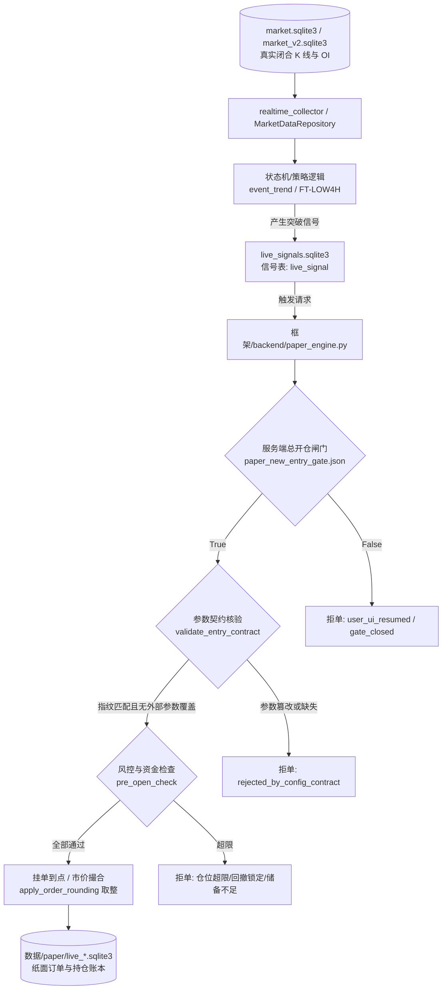

# 01 现状核查与 AI 调用链审计报告

> **工单编号**：AI-DYNAMIC-DESIGN-01  
> **审计时点**：2026-10-26  
> **审计原则**：事实优先、代码即证据。所有“已经接入人工智能”的判断，必须以“存在实际调用且其输出被交易决策程序实际使用”为唯一证据标准。

---

## 一、代码库与生产环境 AI 接口核查结论

经对代码库全部生产文件（`框架/backend/`）、策略文件（`策略/WyckoffMaster/`）、前端界面（`UI界面/web/`）以及执行脚本的全面静态扫描与调用链排查，得出以下确定性审计结论：

> [!CAUTION]
> **核心审计结论**：当前系统**完全没有接入任何人工智能（AI / 大语言模型 / 机器学习决策模型）**，既不存在模型 API 调用，也不存在模型输出被决策程序使用的任何代码路径。
> 
> **“当前系统已接入人工智能进行动态决策”的说法纯属虚构，证据为 0。**

### 1. 依赖库与外部 SDK 静态排查

使用语法扫描对项目代码中常见的 AI / LLM SDK 导入进行排查：
- `openai` / `anthropic` / `google.generativeai` / `langchain` / `transformers` / `ollama` 等主流 AI 库：**0 处导入**。
- `requirements.txt` / 环境依赖：无任何 LLM 或模型推理运行时依赖。
- 本地权重文件：无任何 `.pt`、`.bin`、`.onnx`、`.safetensors` 或 `gguf` 格式的本地权重或神经网络模型。

### 2. 歧义词项澄清与溯源证据

在排查中发现若干带有“AI”、“Gemini”、“Prompt”字样的文件与代码，逐项溯源核实如下，均与实际交易决策中的 AI 无关：

| 发现位置 | 代码/文本内容 | 真实含义与溯源证据 | 是否构成 AI 决策证据 |
|---|---|---|:---:|
| `框架/backend/live_signal_engine.py:19` | `提示装配：_接入43.make_prompts` | 传统交易系统的**入场信号提示（Trading Alert / Hint）**装配函数，负责把威科夫/唐奇安突破事件转为前端可展示的结构体，**与大模型 Prompt 无关**。 | **否** |
| `框架/backend/tests/test_funding_audit_counterexamples.py:3` | `# 与 Gemini 版逐字一致，仅传参口径改为生产` | 历史开发过程中，开发人员曾使用 Gemini 对话辅助编写了测试夹具代码，注释仅为标注代码来源。 | **否** |
| `框架/backend/验收证据/scope_crypto_v1/Codex审核包...md` | `执行窗口：Work 接续窗口（DeepSeek-V4.1-Flash）` | 开发者在开发日志中记录的当时人机协同开发辅助工具型号，属于工程操作人代号，非系统运行代码。 | **否** |
| `UI界面/web/src/design/tokens.css` 等 | 包含大量带有 `ai` 的样式选择器（如 `.ds-card`、`crosshair`、`tailwind`） | CSS 样式表中的英文字符串（如 `crosshair` 十字光标、`tailwind` 工具类），属于误报。 | **否** |

---

## 二、现有策略、指标及决策调用链现状盘点

当前系统是一个完全由**确定性硬编码逻辑与有限状态机（FSM）**驱动的量化回测与模拟交易系统。

### 1. 现有已批准策略清单

| 策略标识 | 策略版本/家族 | 代码位置 | 核心原理 | 决策机制 |
|---|---|---|---|---|
| **`WX_EVENT_TREND_V0_1`** | `F_WX_EVENT_TREND` | [`策略/WyckoffMaster/event_trend_v0_1/`](file:///Users/boos/Desktop/威科夫因子共振趋势/策略/WyckoffMaster/event_trend_v0_1/) | 低频威科夫箱体突破 + 真实持仓量（OI）增幅确认 | 纯规则有限状态机（BOX → SWEEP → RETEST → BREAKOUT） |
| **`FT-LOW4H`** | `FT-LOW4H-EXP-V2.2` | [`框架/backend/strategies/wx_execution.py`](file:///Users/boos/Desktop/威科夫因子共振趋势/框架/backend/strategies/wx_execution.py) | 唐奇安 4h 低频突破跟踪策略，固定止损比例 `stoploss_s=0.05`，跟踪 `trail_d=0.05` | 纯指标突破比对（价格突破唐奇安通道上轨） |
| **`OI_RESONANCE_V1`** | `OI_RESONANCE` | [`策略/WyckoffMaster/oi_resonance_v1/`](file:///Users/boos/Desktop/威科夫因子共振趋势/策略/WyckoffMaster/oi_resonance_v1/) | 合约持仓量（OI）激增与多空比异常共振 | 阈值规则计算（OI 变化率与基准比对） |
| **旧退役策略** | `3a / 3b / 3c / 3d` | `_legacy_archive_v31/` | 旧版高频多臂原型 | **已在 WORK-04 彻底退役**，硬编码拦截禁止开仓 |

### 2. 现有指标计算层（纯确定性计算）

所有的量价特征、统计指标和衍生特征全部由纯数学/统计函数在本地计算，具体包括：
- **Wilder ATR(14)**：首 14 个 TR 算术平均，随后按照 $\text{ATR}_t = (\text{ATR}_{t-1}\times 13 + \text{TR}_t)/14$ 严格递推（`features.py:compute_wilder_atr_series`）。
- **箱体几何与效率比（ER）**：最近 42 根 4h K 线 $|\text{last} - \text{first}| / \sum |\text{diff}|$，固定建档，无未来函数重画（`features.py:compute_efficiency_ratio`）。
- **成交量基准 $V_{20}$**：前 20 根 1h K 线成交量中位数（`features.py:compute_v20_median_volume`）。
- **真实合约持仓量（OI）增幅**：直接读取币安衍生品合约张数/数量序列，严格排除名义价值（USD），并且强制核对 $|t - T| \le 15\text{m}$，缺失或超距直接报 `oi_unavailable`（`features.py:extract_real_oi_growth`）。

### 3. 现有调用链（从数据到成交）

目前模拟盘运行链路如下：

在整个链路中，**没有任何一个节点调用了外部人工智能服务，也没有接收任何外部模型的推理文本或 JSON 输入**。

---

## 三、工单一数据覆盖边界继承（严禁假设全齐）

遵循工单二红线要求：*“数据覆盖未知项引用工单一，不自行假设已齐全”*。

根据工单一（`evidence/WORK-07_先行工程实现映射表与数据覆盖清单_2026-10-16.md` 及 `docs/数据够用性结论与整理清单_2026-10-15.md`）的核实结论：
1. **完全具备高质量完整覆盖的标的**：仅 **BTCUSDT**、**ETHUSDT**、**SOLUSDT** 三个主流币种具备 2020 年至今完整闭合的 4h/1h/15m K线、5m 粒度真实合约持仓数量（OI）以及 8h 资金费率结算事件。
2. **其余 200+ 标的数据覆盖情况**：
   - 历史 K 线在冷层 Parquet 中基本齐全，但部分标的上市时间较短（< 90天）；
   - 真实持仓量（OI）在 2024 年前存在大面积缺失或仅有日级数据；
   - 资金费率存在部分退市币或名称变更币的结算异常；
3. **因果与 PIT 限制**：
   - 策略引擎与未来引入的任何模型，均**不得假设全市场 200+ 标的数据已齐备**；
   - 凡是查询时点 $T$ 缺失真实持仓量（超出 15 分钟窗口）的标的，数据服务必须严格返回 `oi_unavailable`，系统必须直接跳过或拒单，严禁用插值、均值或模型脑补数据。

---

## 四、本章核查总结

1. **客观现实**：系统当前处于“纯手工与传统量化规则”阶段，“人工智能”尚未在生产、回测或模拟盘决策程序中有任何代码落地。
2. **改造目标**：本工单需要从 0 到 1 设计一套真正让人工智能参与**模拟决策**（而非行情点评）的动态架构，确立其权限边界、结构化协议、因果隔离与硬风控防线。
