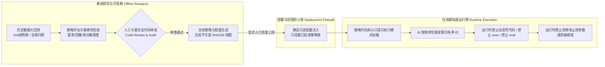

# 03 系统整体架构与四层解耦设计

> **工单编号**：AI-DYNAMIC-DESIGN-01  
> **核心架构理念**：职责彻底解耦，计算归程序，风控归闸门，决策受拘束，研究与执行严格物理隔离。

---

## 一、系统四层解耦架构全景图

系统划分为四个边界分明、单向依赖的层级，严禁跨层篡权或反向控制：

```mermaid
flowchart TD
    subgraph L1["第一层：确定性计算层 (Deterministic Engine) - 纯程序"]
        MKT[(K线/真实OI/费率库\nmarket.sqlite3)] --> PIT_FILTER[PIT 因果时间守卫\n强制截断至 T 闭合刻]
        PIT_FILTER --> CALC[纯数学/统计特征计算\nWilder ATR / ER / V20 / OI增长率]
        CALC --> DET_CAND[候选初筛器\n仅输出符合数学形态的标的]
    end

    subgraph L2["第二层：市场状态判断与策略选择层 (AI Cognitive Arbiter) - 受限模型"]
        DET_CAND -->|推送结构化数据切片| CTX[按需检索协议 Context Pack\n严格锁定当时可见切片]
        CTX --> LLM[人工智能裁决模型\nQwen2.5-14B (本地) / 规则受控]
        LLM -->|GBNF 约束输出| DECISION_MSG[结构化决策报文 JSON\nDECISION_ID / 动作 / 策略ID / 理由]
    end

    subgraph L3["第三层：执行与硬风控拦截层 (Execution & Risk Gate) - 纯程序"]
        DECISION_MSG --> V1{报文与签名自检\nSchema/时效/指纹}
        V1 -->|通过| V2{数据新鲜度与重复指令检查\n幂等键防重 / 滞后拒单}
        V2 -->|通过| V3{前置风控硬闸门\npre_open_check}
        V3 -->|通过| V4{合约精度与名义规模取整\napply_order_rounding}
        V4 -->|通过| EXEC[PaperEngine 撮合成交 / 挂单推进]
        V1 -- 失败 --> REJ[硬性拒单落库]
        V2 -- 失败 --> REJ
        V3 -- 失败 --> REJ
        V4 -- 失败 --> REJ
    end

    subgraph L4["第四层：账本与审计复核层 (Storage & Audit Trail) - 真实落盘"]
        EXEC --> LEDGER[(paper_ledger.sqlite3\n订单/持仓/资金费结算)]
        REJ --> REJ_LOG[(paper_rejected.sqlite3\n全部拒单原因归因)]
        DECISION_MSG --> AUDIT_SLICE[(切片存证库 audit_slice/\n报文 + 原始特征输入)]
        EXEC -.-> IND_GUARD[独立持仓守护进程\n超时强平 / 跟踪止损独立上移]
    end
```

---

## 二、四大层级职责与边界定义

### 第一层：确定性计算层（Deterministic Engine）
- **主体**：纯 Python / Cython / NumPy 纯函数。
- **职责**：
  1. **数据准备与 PIT 截断**：保证只使用请求时刻 $T$ 之前已闭合的 K 线与 $\le 15\text{m}$ 真实的合约持仓量（OI），严禁使用未来数据。
  2. **技术特征计算**：精确计算 Wilder ATR(14)、箱体几何高度与方向效率比 ER、前 20 根成交量中位数 $V_{20}$、6 小时真实 OI 增长率 $\Delta\text{OI}_{6\text{h}}$。
  3. **初筛候选生成**：只有在数学条件完全满足（例如已触发突破、OI 增幅 $\ge 2\%$）时，才组装为候选特征包，推送到第二层。
- **权限边界**：不含任何模糊推理，不决定是否交易，仅提供绝对准确的客观市场切片。

### 第二层：市场状态判断与策略选择层（AI Cognitive Arbiter）
- **主体**：受本地 GBNF 语法拘束的语言模型（如 Qwen2.5-14B）或状态裁决器。
- **职责**：
  1. **市场状态定性**：评估当前市场处于“大级别蓄势突破”、“震荡中假突破诱多”、“流动性枯竭陷阱”还是“单边超买竭尽”。
  2. **策略选择**：在**已批准的策略白名单**（如 `WX_EVENT_TREND_V0_1`、`FT-LOW4H`）中，选择最适应当前市场微观结构的策略分支，或选择弃权。
  3. **输出裁决报文**：输出只包含预定义枚举字段的结构化 JSON 报文（动作仅限：`APPROVE_ENTRY`、`ABSTAIN_NO_TRADE`、`REQUEST_TIGHTEN_STOP`、`REQUEST_EARLY_EXIT`）。
- **权限边界**：
  - **严禁编写或修改代码**；
  - **严禁直接向交易所或撮合引擎提交订单**；
  - **严禁指定买入数量、价格数值或止损金额**；
  - **输出报文仅为“待审意向（Proposal）”，绝不等于最终成交指令**。

### 第三层：执行与硬风控拦截层（Execution & Risk Gate）
- **主体**：`框架/backend/paper_engine.py` 与 `strategy_contracts.py`。
- **职责**：
  1. **报文合法性审查**：核验报文有效期（`valid_until_ms` 是否超时）、策略指纹（`config_fingerprint` 是否匹配已批准视图）、幂等性（防重复指令）。
  2. **风控闸门重算（8 道拦截）**：
     - 持仓数量上限（`max_positions`，默认 $\le 10$）；
     - 账户最大名义敞口（`gross_long_notional_equity_cap`，默认 $\le 80\%$）；
     - 单币最大名义敞口（`single_name_notional_equity_cap`，默认 $\le 10\%$）；
     - 现金储备比例（`cash_or_free_margin_reserve_fraction`，默认 $\ge 20\%$）；
     - 组合初始止损风险占比（`portfolio_initial_stop_risk_cap`，默认 $\le 5\%$）；
     - 账户累计回撤熔断锁定（`maximum_account_drawdown_fraction`，默认 $20\%$）；
     - 仅允许做多限制（`short_enabled = False`）；
     - 开仓参与率限制（`entry_participation_previous_15m_quote_cap`，默认 $\le 1\%$）。
  3. **价格与数量取整**：调用 `_apply_order_rounding` 根据币安合约规则计算最小步长和杠杆保证。
- **权限边界**：拥有**最高一票否决权**。哪怕模型裁决是 `APPROVE_ENTRY`，只要触发任何一条风控拦截，立刻原地拒单并记录归因。

### 第四层：账本与审计复核层（Storage & Audit Trail）
- **主体**：本地 SQLite 纸面账本（`data/paper/`）与独立守护进程。
- **职责**：
  1. **账本记录**：真实持久化成交订单（`paper_orders`）、持仓明细（`paper_positions`）、出入金与资金费结算（`paper_funding`）。
  2. **独立持仓保护**：独立于模型运行，在模型发生崩溃、断网、超时甚至关闭时，后台常驻线程仍严格按照策略冻结规则执行 4h 跟踪止损上移、10 天到期强平与保本止损。
  3. **可复查存证**：将每一次 AI 决策时的报文连同当时的原始输入数据切片哈希完整归档，任何人可在任何时间使用离线工具 1:1 复现该次裁决上下文。

---

## 三、研究期与运行期物理隔离机制

系统建立严格的“研究期（Research Phase）”与“运行期（Runtime Execution）”生命周期防火墙：



### 防火墙铁律：
1. **策略只读注入**：运行期引擎只允许加载经过版本控制、并在 `strategy_contracts.py` 中静态登记的策略派生类。
2. **禁止动态解释与热加载**：严禁在运行期使用 `eval()`、`exec()`、动态编译或接收模型生成的 Python 代码片段。
3. **参数不可被请求覆盖**：请求体中携带的任何 `stoploss_s`、`trail_d` 均不被信任，引擎强制覆盖为冻结视图中的已批准参数（`allow_payload_override=False`）。
