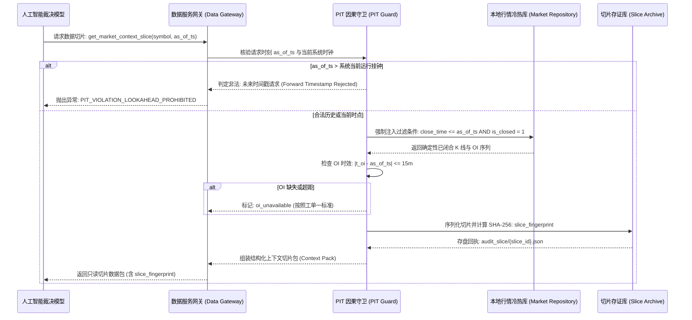

# 06 按需检索与因果防御协议 (Point-in-Time Retrieval Protocol)

> **工单编号**：AI-DYNAMIC-DESIGN-01  
> **核心防御机制**：严格 PIT（Point-in-Time）因果时钟、沙箱数据网关、未来数据物理屏蔽、切片指纹存证。

---

## 一、按需检索服务的沙箱隔离设计

为了彻底杜绝任何形式的**前视偏差（Lookahead Bias）**与**数据越权泄漏**，模型严禁直接连接底层的 SQLite 数据库文件（`market.sqlite3` / `market_v2.sqlite3`），也严禁发起任意外部网络 HTTP 请求。

所有市场上下文检索必须经过受限的**数据服务网关（Market Data Retrieval Service）**：



---

## 二、PIT 因果时钟三大强制防御铁律

### 铁律 1：物理强制闭合（Only Closed Bars）
- 数据服务在组装 4h / 1h / 15m K 线时，SQL 查询条件由网关强制拼接，**模型无法通过入参篡改 SQL**：
  ```sql
  SELECT open_time, open, high, low, close, volume, close_time
  FROM klines_1h
  WHERE symbol = ? AND close_time <= ? AND is_closed = 1
  ORDER BY open_time DESC
  LIMIT ?
  ```
- 任何当前正在跳动、尚未收盘的未闭合 Bar（Unclosed Bar）被物理排除。模型只能看到过去已收盘的客观现实。

### 铁律 2：真实持仓量（OI）15 分钟窗口校验（遵守工单一）
- 依据工单一验收结论（`WORK-07_先行工程实现映射表与数据覆盖清单.md:§2.5`）：
  - 真实持仓量必须使用合约数量 `open_interest`，严禁使用美元名义价值；
  - 观察时间戳 $t_{\text{oi}}$ 必须满足：$t_{\text{oi}} \le T$ 且 $|t_{\text{oi}} - T| \le 15\text{ 分钟}$；
  - 6 小时前基准时点 $T_{-6\text{h}}$ 同理需满足 15 分钟窗口；
  - 凡超出 15 分钟窗口或数据缺失者，数据服务**强制填入 `oi_status: "oi_unavailable"`，禁止模型自行均值插值或脑补填充**。

### 铁律 3：切片数据完全可复查存证（Reproducibility Hash）
- 数据服务在向模型提供上下文切片（Context Pack）的同时，调用规范化 JSON 序列化函数（`sort_keys=True, separators=(',', ':')`）生成规范字节流，计算 SHA-256 哈希值：
  $$\text{slice\_fingerprint} = \text{SHA-256}(\text{CanonicalJSON}(\text{ContextPack}))$$
- 该哈希值连同切片内容完整落盘至 `evidence/AI-DYNAMIC-DESIGN-01/audit_slice/`。
- 模型在决策报文的 `data_evidence` 中必须如实回传该指纹。
- **事后审计机制**：任何审计员只要输入当时该指纹，即可调出完全一致的切片输入，离线验证当时模型输入的客观性与因果合规性。

---

## 三、上下文切片包（Context Pack）数据协议示例

数据服务网关输出给模型的只读上下文格式如下：

```json
{
  "slice_id": "slice_SOLUSDT_1792753200000",
  "symbol": "SOLUSDT",
  "as_of_time_ms": 1792753200000,
  "as_of_iso": "2026-10-26T01:00:00Z",
  "slice_fingerprint": "e3b0c44298fc1c149afbf4c8996fb92427ae41e4649b934ca495991b7852b855",
  "indicators": {
    "wilder_atr_14_4h": 4.12,
    "box_high_42_4h": 145.20,
    "box_low_42_4h": 128.50,
    "efficiency_ratio_42": 0.185,
    "volume_median_20_1h": 28450.0,
    "breakout_volume_1h": 51200.0,
    "volume_ratio": 1.80
  },
  "open_interest": {
    "current_oi": 1824500.0,
    "current_oi_ts_ms": 1792753140000,
    "current_oi_lag_seconds": 60,
    "baseline_oi_6h_ago": 1751000.0,
    "baseline_oi_ts_ms": 1792731540000,
    "baseline_oi_lag_seconds": 60,
    "growth_pct": 0.042,
    "status": "valid"
  },
  "market_structure": {
    "event_stage": "BREAKOUT_ATTEMPT",
    "sweep_detected": true,
    "retest_confirmed": true,
    "retest_low_lr": 133.20
  },
  "approved_strategy_candidates": [
    {
      "strategy_id": "WX_EVENT_TREND_V0_1",
      "strategy_version": "WX_EVENT_TREND_V0.1",
      "config_fingerprint": "1f1167de3541",
      "eligible": true
    },
    {
      "strategy_id": "FT-LOW4H",
      "strategy_version": "FT-LOW4H-EXP-V2.2",
      "config_fingerprint": "7b1ae9f68eff",
      "eligible": false,
      "ineligible_reason": "not_at_donchian_high"
    }
  ]
}
```

通过这一严格的按需检索协议，人工智能模型在决策时：
1. **只能看到客观已发生的市场特征**；
2. **无法提前偷看未来 K 线走势**；
3. **其所依赖的每项数据均有精确的指纹凭证供人类回溯复查**。
