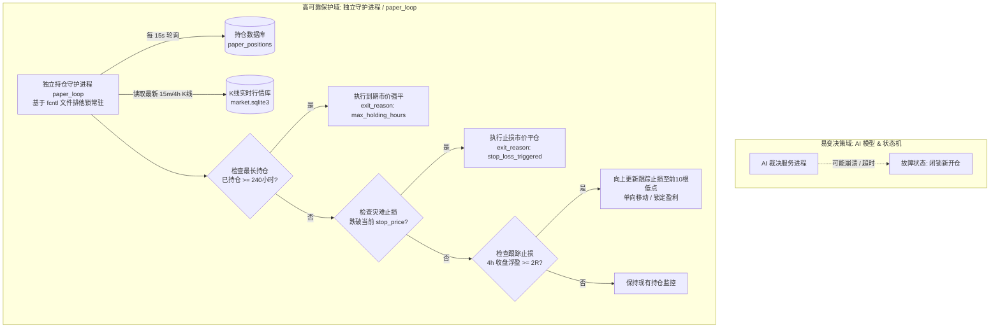

# 07 故障处置与独立保护机制 (Fail-Safe & Independent Protection)

> **工单编号**：AI-DYNAMIC-DESIGN-01  
> **核心原则**：失效应急闭合（Fail-Closed）、持仓独立守护（Decoupled Watchdog）、零静默降级（No Silent Fallback）、过期即作废（Zero Stale Re-use）。

---

## 一、故障类型与应急处置状态机

在人工智能模型参与决策的运行过程中，任何软件异常、网络中断或输出违规均被严格限制在“局部拦截”范围内，绝不允许波及已有持仓安全。

系统针对四大典型故障场景的处理矩阵如下：

| 故障场景 | 判定标准 | 系统应急响应动作 | 新开仓闸门状态 | 已有持仓处置 |
|---|---|---|:---:|:---:|
| **1. 推理超时 (Timeout)** | 模型未能在 5000ms 窗口内返回完整报文 | 1. 强制终止本次推理任务； 2. 登记超时警报； 3. 放弃本次候选机会。 | **立即闭锁 (停止新开仓)** | 独立守护进程照常监控，不受影响 |
| **2. 输出非法格式 (Malformed Output)** | 输出无法通过 JSON 解析或违反 GBNF / JSON Schema | 1. 丢弃非法报文； 2. 记录原始错误文本至审计库； 3. 将当期观察标记为失效。 | **立即闭锁 (停止新开仓)** | 独立守护进程照常监控，不受影响 |
| **3. 模型越权请求 (Permission Breach)** | 试图输出做空 (`short`)、调大风险预算、或随意指定开仓点位 | 1. 触发安全违规审计拦截； 2. 产生 `security_violation` 报警； 3. 自动隔离该模型决策通道。 | **紧急冻结 (需人工复查解除)**| 独立守护进程照常监控，不受影响 |
| **4. 本地服务崩溃 (Process Crash)** | 本地推理服务（Ollama / vLLM）进程退出或 OOM 崩溃 | 1. 自动触发服务守护进程报警； 2. 挂单推进器跳过 AI 审批； 3. 将全部在途观察置为过期。 | **持续闭锁 (等待服务健康恢复)**| 独立守护进程照常监控，不受影响 |

---

## 二、Fail-Closed 与零静默切换铁律

### 铁律 1：严禁静默切换策略（No Silent Fallback）
- **常见量化陷阱**：部分系统在 AI 故障时，会自动切换回“传统硬编码策略”继续开仓。这是极端危险的，因为策略组合的风险预算与回撤模型是针对整体设计的，静默切换会导致非预期的仓位叠加与风格漂移。
- **系统强制规则**：
  $$\text{AI 服务异常} \implies \text{直接终止新开仓决策 (ABSTAIN\_ALL)}$$
  **系统坚决不尝试“猜你想怎么开”，绝不静默降级到未授权的备用规则，必须等待人工干预或服务健康检查完全恢复**。

### 铁律 2：旧观察彻底过期（No Stale Signal Re-use）
- 市场微观结构稍纵即逝。若在 $T=12:00$ 产生的决策因模型崩溃未及时成交，到 $12:30$ 模型重启后，**严禁沿用 $12:00$ 的旧决策补开仓位**。
- `valid_until_ms` 是物理硬防线：
  $$\text{if } \text{now\_ms} > \text{valid\_until\_ms} \implies \text{标记为 } \texttt{EXPIRED\_DUE\_TO\_AI\_FAILURE} \text{ 并彻底废弃}$$

---

## 三、独立持仓保护机制（Decoupled Position Watchdog）

在架构设计中，**“已有持仓的生命周期保护”与“新仓位开立决策”在进程与线程级别彻底隔离**：

### 独立守护进程的工程保证：
1. **零外部网络与 AI 依赖**：持仓守护逻辑（`paper_loop.py`）只包含纯粹的价格与时间比对数学逻辑，不调用任何大模型，不依赖任何第三方云端 API，保证 $99.999\%$ 的物理高可用性。
2. **进程锁与自愈能力**：守护进程绑定操作系统的 `fcntl` 文件锁，避免重复执行；如果被异常终止，由系统的 `service_manager.py` 或 macOS `launchd` / Linux `systemd` 在 3 秒内自动拉起。
3. **单向棘轮只上不下**：更新止损时严格执行 $P_{\text{new}} \ge P_{\text{old}}$。就算数据库发生瞬时读取错误，也绝不会把既有止损下调。
