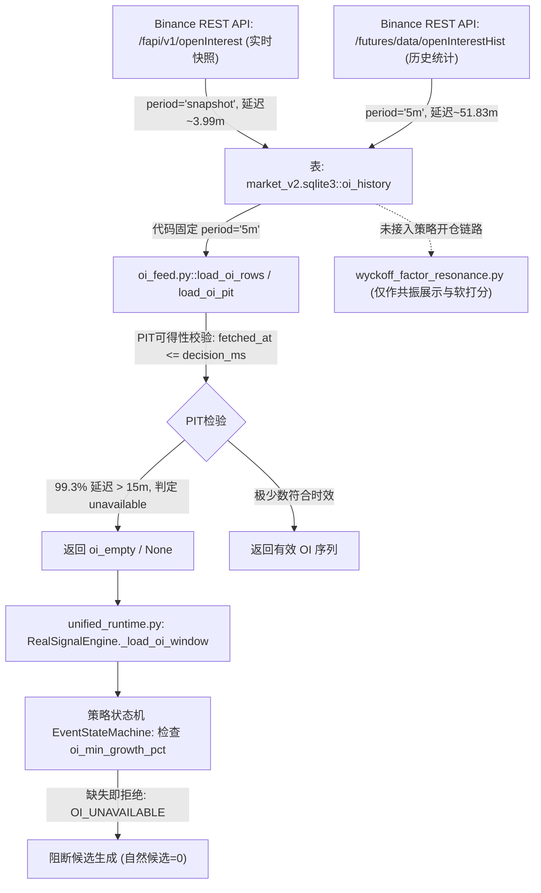

# ANTIGRAVITY-OI-01 调用链、门槛与保护机制审查

- **审查对象**：`框架/backend/oi_feed.py`、`框架/backend/unified_runtime.py`、`框架/backend/wyckoff_factor_resonance.py`、`框架/backend/paper_engine.py`
- **核查日期**：2026-10-28
- **执行角色**：反重力（独立只读复核）

---

## 一、 持仓量从采集到决策的实际调用链

### 1. 采集链路
- `框架/backend/realtime_collector.py`：同时抓取 `openInterest`（写为 `period='snapshot'`）和 `openInterestHist`（写为 `period='5m'`）。
- 两者均存入 `market_v2.sqlite3` 的 `oi_history` 表。

### 2. 读取链路
- `框架/backend/oi_feed.py`：
  - `load_oi_rows(symbol, from_ms, to_ms, period="5m")`：默认形参写死为 `period="5m"`。
  - `load_oi_pit(symbol, decision_ms, lookback_ms=6h, period="5m", ...)`：基于 `period="5m"` 过滤数据，并在第 238 行调用 `judge_row` 执行严苛的 PIT 判定。
  - PIT 判定规则：要求 `fetched_at <= decision_ms` 且桶已收盘。若数据晚到则标为 `AVAIL_UNPROVEN` 或 `AVAIL_LATE`，不作为可用数据。

### 3. 策略决策入口
- `框架/backend/unified_runtime.py`：
  - `RealSignalEngine.process_1h_bar` 调用 `self._load_oi_window(_lo, _hi)`。
  - 内部调用 `OF.load_oi_rows(self.symbol, int(from_ms), int(to_ms))`（默认传入 `5m`）。
  - 若读取结果为空或不合规，向状态机传递空数组或标记，状态机判定为 `OI_UNAVAILABLE`，拒绝生成突破候选。

---

## 二、 门槛性质与保护机制

1. **硬门槛事实**：
   - 官方主策略（3a）将 OI 增长（`oi_min_growth_pct`）作为硬性过滤门槛（`enable_oi_filter = True`）。
   - 并非软性扣分，而是前置防御性硬门槛：无有效 OI 则直接阻断。
2. **`approved=false` 隔离与仓位保护**：
   - 在 `框架/backend/paper_engine.py:1226` 中，严格增加了 `_pm_src.get("position_multiplier_approved") is True` 校验；
   - 未经用户正式批准的动态仓位倍数（0.5x ~ 1.3x）被硬性锁死在 `pos_mult = 1.0`（基准风险 0.5%），并未对实际下单风控造成侵入。

---

## 三、 归因判定与最小修复建议

### 1. 归因判定
- **既是客观延迟，也是读取错配**：
  1. **客观数据源延迟**：币安官方历史聚合接口（`openInterestHist`，`period='5m'`）天然存在约 52 分钟的官方生成滞后（实测 P50 为 51.83 分钟，99.30% 超过 15 分钟），这是交易所侧的客观事实。
  2. **系统读取路径错配**：采集器本地已经实时采集并存储了新鲜度极高的 `snapshot` 数据（实测 P50 延迟仅 3.99 分钟，100% $\le 15$ 分钟），但 `oi_feed.py` 写死了 `period='5m'`，未对接已有且更实时的 `snapshot`。

### 2. 给 Work 的最小建议
- 若主策略需要实时持仓量参与判定，且需满足 15 分钟时效，建议由 Work 在 `oi_feed.py` 中支持 `period in ('5m', 'snapshot')` 的降级或合并读取策略（优先读实时快照，回测读历史 5m），无需重新开发采集器。
