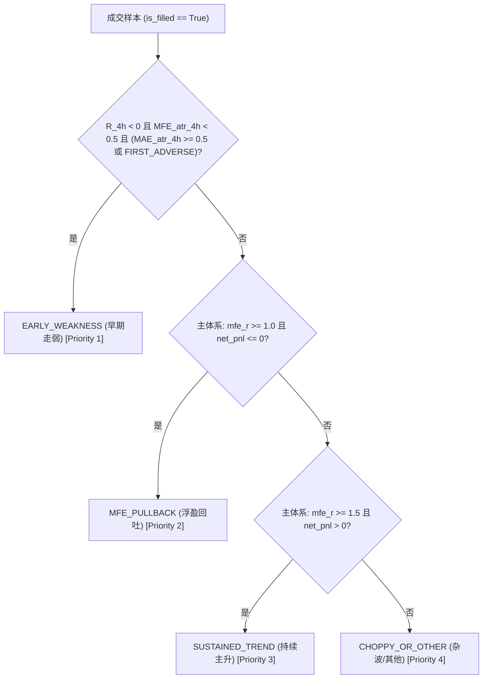

# FACTOR-ENTRY-06｜分类契约与数据口径冻结规范

**工单编号**：FACTOR-ENTRY-06  
**工程路径**：`/Users/boos/Desktop/威科夫因子共振趋势`  
**生效范围**：`evidence/FACTOR-ENTRY-06/` 及其衍生研究产物  
**冻结性质**：研究分类标准契约（只修分类契约与产物，不调参数、不修改正式策略或撮合）

---

## 一、双评价体系与标尺物理隔离契约

在量化评估中，**价格波动的自然尺度（波动率 ATR）**与**交易账户承担的下行风险暴露（初始止损距离 R）**属于不同物理维度的度量衡，严禁互换、代用或混淆。

### 1.1 两个标尺的定义与物理隔离

| 标尺类型 | 字段名 | 数学定义 | 统计中位比例 (占入场价) | 核心业务用途 | 严禁行为 |
| :--- | :--- | :--- | :---: | :--- | :--- |
| **真实波动尺度** | `signal_atr_snapshot` | 入场时刻 $t_{\text{entry}}$ 当时**已闭合的最晚一根 4h K 线**的 Wilder ATR(14) | **2.60%** (区间 0.43% ~ 8.12%) | 微观路径极值（MAE/MFE）归一化、$\pm 0.3 \text{ ATR}$ 首触震荡门槛判定 | **严禁**用止损距离代替；**严禁**与箱体形成时 ATR 混淆 |
| **初始风险暴露** | `initial_risk_r` | $|P_{\text{entry}} - P_{\text{stop\_initial}}|$（初始止损价格距离） | **16.86%** (区间 3.82% ~ 48.60%) | 交易全周期盈亏比、出场收益率归一化倍数（R-Multiple） | **严禁**用作微观波动路径的除数 |
| **箱体形成尺度** | `box_atr_formation` | 箱体 42 根 4h 窗口闭合时刻的 Wilder ATR(14) | 仅 163 笔具备有效快照 | 检验箱体宽度是否落在 $2A \sim 8A$ 的入选门槛内 | **严禁**捏造或填充 42 笔旧成交的空值；与信号 ATR 偏差中位达 14.68% |

> [!IMPORTANT]
> **标尺放大失真教训**：  
> 逐笔比值 `initial_risk_r / signal_atr_snapshot` 的真实中位数为 **5.54 倍**（区间 **3.27 ~ 10.81 倍**）。若将止损距离误作 ATR，除数将被系统性放大 3 ~ 11 倍，导致微观下杀深度被严重掩盖、$\pm 0.3 \text{ ATR}$ 首触门槛非正常拓宽。

---

## 二、评价指标公式、窗口与首触契约

### 2.1 观察窗口与微观路径公式

1. **4 小时微观观察窗口**：
   - 窗口起点：实际成交入场时刻 $t_{\text{entry}}$ 所在的 15m K 线；
   - 窗口跨度：向后连续 16 根 15 分钟 K 线（共 4 小时）。
   - **有利推进（归一化 ATR）**：
     $$\text{MFE}_{\text{atr}, 4\text{h}} = \frac{\max(H_{1\dots 16}) - P_{\text{entry}}}{\text{signal\_atr\_snapshot}}$$
   - **不利回撤（归一化 ATR）**：
     $$\text{MAE}_{\text{atr}, 4\text{h}} = \frac{P_{\text{entry}} - \min(L_{1\dots 16})}{\text{signal\_atr\_snapshot}}$$
   - **4h 收益率**：$R_{4\text{h}} = \frac{C_{16} - P_{\text{entry}}}{P_{\text{entry}}}$

2. **交易全周期观察窗口**：
   - 窗口跨度：从入场时刻到交易最终平仓出场。
   - **全周期风险收益倍数**：
     $$mfe\_r = \frac{\text{trade\_mfe\_pct}}{(\text{initial\_risk\_r} / P_{\text{entry}})} = \frac{\max(P_{\text{high}}) - P_{\text{entry}}}{\text{initial\_risk\_r}}$$
   - **交易净盈亏**：$net\_pnl$（USDT 计价）

### 2.2 首触方向判定规则（$\pm 0.3 \times \text{signal\_atr\_snapshot}$）

门槛定义：
- 有利门槛：$P_{\text{fav}} = P_{\text{entry}} + 0.3 \times \text{signal\_atr\_snapshot}$
- 不利门槛：$P_{\text{adv}} = P_{\text{entry}} - 0.3 \times \text{signal\_atr\_snapshot}$

判定优先级与分支：
1. 若 4h 窗口内不利门槛触及时间早于有利门槛（$t_{\text{adv}} < t_{\text{fav}}$）：判定为 `FIRST_ADVERSE`（先不利）。
2. 若有利门槛触及时间早于不利门槛（$t_{\text{fav}} < t_{\text{adv}}$）：判定为 `FIRST_FAVORABLE`（先有利）。
3. **同根双向触及（$t_{\text{adv}} == t_{\text{fav}}$）**：**必须显式判定为 `UNKNOWN_SAME_BAR`（同根先后不明）**。由于 15m K 线内部撮合时序不可知，**严禁强行指定先后**！
4. 4h 窗口内两者皆未触及：判定为 `NEITHER_REACHED_0.3ATR`。

---

## 三、两套评价分类体系（主体系 vs 对比体系）

为了兼顾原研究口径的历史可比性与纯 ATR 体系的学术严密性，本契约规范并独立命名两套评价分类，分别在特征表与分析中独立出列：

### 3.1 主体系：标准混合度量体系 (`category_standard_mixed` / `entry_quality_category`)

这是 FACTOR-ENTRY-03/04/05 原研究正文采用的分类标准：
- **设计哲学**：入场初期的微观走弱由**资产自然波动（ATR）**定义；全周期的主升与回吐由**资金风险暴露（初始止损距离 R）**定义。
- **优先级与分类规则**：
  1. **`EARLY_WEAKNESS`（早期走弱，Priority 1）**：
     $$R_{4\text{h}} < 0 \quad \land \quad \text{MFE}_{\text{atr}, 4\text{h}} < 0.5 \quad \land \quad (\text{MAE}_{\text{atr}, 4\text{h}} \ge 0.5 \lor \text{first\_move\_4h} == \text{'FIRST\_ADVERSE'})$$
  2. **`MFE_PULLBACK`（浮盈回吐，Priority 2）**：
     $$mfe\_r \ge 1.0 \quad \land \quad net\_pnl \le 0$$
  3. **`SUSTAINED_TREND`（持续主升，Priority 3）**：
     $$mfe\_r \ge 1.5 \quad \land \quad net\_pnl > 0$$
  4. **`CHOPPY_OR_OTHER`（杂波/其他，Priority 4）**：
     其余所有已成交样本。
  5. **`UNFILLED`（未成交）**：
     未成交候选记录（22 条）。

### 3.2 对比体系：纯 ATR 4h 窗口体系 (`category_pure_atr_4h`)

此体系作为独立变体出表，供灵敏度对比：
- **设计哲学**：全部判定局限在微观 4h 观察期内，除数统一使用 `signal_atr_snapshot`。
- **分类规则**：
  1. `EARLY_WEAKNESS`：同主体系 Priority 1（67 笔）；
  2. `MFE_PULLBACK`：$\text{MFE}_{\text{atr}, 4\text{h}} \ge 1.0 \quad \land \quad net\_pnl \le 0$（39 笔）；
  3. `SUSTAINED_TREND`：$\text{MFE}_{\text{atr}, 4\text{h}} \ge 1.5 \quad \land \quad net\_pnl > 0$（20 笔）；
  4. `CHOPPY_OR_OTHER`：其余成交样本（79 笔）。

### 3.3 扩展体系：全周期纯 ATR 体系 (`category_pure_atr_full`)
- 计算全周期 ATR 倍数：$mfe_{\text{atr, full}} = \frac{P_{\text{entry}} \times \text{trade\_mfe\_pct}}{\text{signal\_atr\_snapshot}}$
- 回吐与主升分别以 $mfe_{\text{atr, full}} \ge 2.0$ 与 $\ge 3.0$ 评估，供独立研究列示。

---

## 四、缺失输入与异常处理硬性契约

为杜绝 FACTOR-ENTRY-05 中 `mfe_r` 缺失被默认取 0 导致 44 条标签塌缩的事故，制定以下铁律：

1. **缺必需输入列立即中止**：
   - 生成脚本启动前必须进行结构断言，检查输入 DataFrame 是否包含必须的列名（如 `mfe_r`, `signal_atr_snapshot`, `fwd_ret_4h`, `mae_r_4h`, `mfe_r_4h`, `first_move_4h`, `net_pnl` 等）。
   - 若缺失任何一列，**直接抛出 `AssertionError` 或 `KeyError` 终止运行，严禁静默 fallback 或默认赋 0**。

2. **单行空值显式标注未知**：
   - 对于已成交记录，若关键评价指标为 NaN 或 Inf，分类必须赋值为 `UNKNOWN_MISSING_INPUT`，严禁归入 `CHOPPY_OR_OTHER`。
   - 未成交记录统一赋值为 `UNFILLED`。

3. **四表一文强一致性校验**：
   - 特征总表（CSV/Parquet）、逐笔差异表（CSV）、机器可读摘要（JSON）和分析报告（Markdown）必须由同一脚本的同一次内存计算直接序列化输出，严禁不同步手动维护。

---

## 五、样本空间与计算分母规范

任何比率必须严格指明分母，严禁使用“样本”模糊表述：

| 样本分母口径 | 数值 | 包含范围与定义 | 适用比率场景 |
| :--- | :---: | :--- | :--- |
| **特征记录总行数** | **227** | 全量特征表物理行数（含 205 成交 + 22 未成交） | 行级覆盖率、缺失率 |
| **唯一候选信号数** | **226** | 按 `(symbol, snapshot_time_ms)` 唯一去重后的信号数（COTI 重复 1 组） | 信号级别通过率、拒单率 |
| **总成交交易数** | **205** | 按 `(symbol, entry_time)` 唯一成交记录数 | **入场质量分类的主分母**（早期走弱 67/205 = 32.68%） |
| **连续回放代际成交数** | **163** | `cand_ev_*` 来源，连续回放（2021-12-01 ~ 2026-10-18） | 连续运行环境下的纯净统计 |
| **窗口回放代际成交数** | **42** | `old_cand_*` 来源，365天切片窗口回放（ATR 曾缺失回退） | 代际纠偏验证 |
| **未成交记录行数** | **22** | 13 笔开盘跳空高开 + 9 笔开盘跌回箱体 | 拒单原因分析（对应 21 个唯一未成交信号） |
