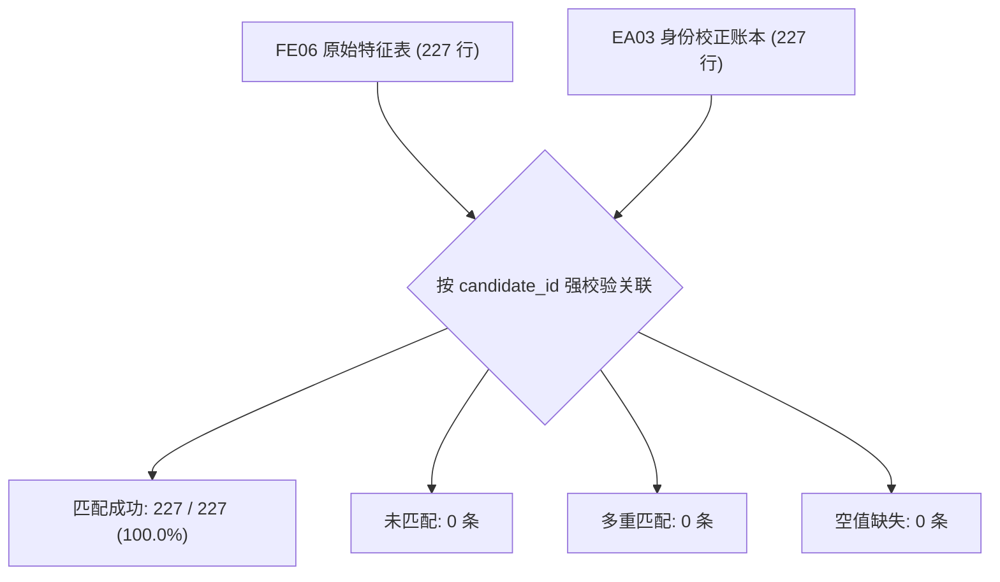
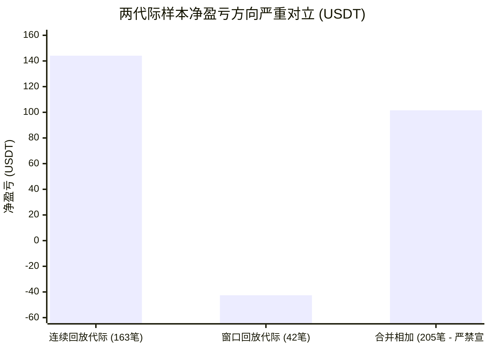

# 工单 FACTOR-ENTRY-07｜身份映射、关联匹配与代际桥接核验报告

> **生效目录**：`evidence/FACTOR-ENTRY-07/`  
> **交接源头**：`evidence/ENTRY-AUDIT-03/03_identity_full.csv`、`04_cost_reconcile.csv`、`01_coti_conflict.json`  
> **基准契约**：`evidence/FACTOR-ENTRY-06/classification_contract.md`

---

## 一、输入文件与冻结交接清单

本轮交接严禁使用模糊字段或无哈希版本，所有输入文件均完成 SHA256 指纹固化：

| 输入文件路径 | 记录行数 | SHA256 校验哈希 | 字段语义与交接角色 |
| :--- | :---: | :--- | :--- |
| `evidence/ENTRY-AUDIT-03/03_identity_full.csv` | 227 行 | `18e28dd85f7fb856b1c7d5eedeafe1552b4098f0c3e29220ef714782a0483f45` | **全量身份级核验底表**：提供真实 `fee_paid`、`funding_cost`、`gross_pnl`、`net_pnl`、`cancel_reason` 及代际信息 |
| `evidence/ENTRY-AUDIT-03/04_cost_reconcile.csv` | 213 行 | `ac12c170963067ebd77ad18ae457426617af51dd022e967a14b27aff4727ad75` | **全池重放对账表**：证实账本事件逐笔恒等式闭环（`net == gross - fee - funding`） |
| `evidence/ENTRY-AUDIT-03/01_coti_conflict.json` | 36 行 | `eec047b9ea95183caf0f1dc0f5c47fac64af5c482c6a714bb3fe380ec089ea72` | **COTI 冲突根因裁决**：证实非撮合/数据错误，而是建档时刻 ATR 差异导致最高入场价不同 |
| `evidence/ENTRY-AUDIT-03/01_cost_zero_rootcause.json`| 79 行 | `29088f05be15ec53006aef5060b9480ec6578393dfd03436ca3e1b55d88c1201` | **163 笔费用为 0 根因**：证实为上游代码提取字段名错误（读 `total_fees` 实际为 `fees`） |
| `evidence/FACTOR-ENTRY-06/classification_contract.md`| 137 行 | `7c358f2ffe156a9dd01c147055fa1baf8b4194999b62d6bd9a4113a9e3973283` | **冻结分类契约**：明确主体系与对比体系公式、分母、窗口、缺失处理与分类优先级 |
| `evidence/FACTOR-ENTRY-06/reconstructed_candidate_features.csv` | 227 行 | `d8e8a387572a9e969ebcab706584bcc3b186a9ae846d7137448acc21316b5c6d` | **FE06 原特征表**：提供 205 成交 + 22 未成交的原始微观路径指标 |

---

## 二、强关联校验与匹配统计

本工单坚决杜绝“仅按币种 + 入场时间模糊撮合”的脆弱做法，严格通过全局唯一候选标识 `candidate_id` 与运行上下文完成穿透关联：

### 匹配结果精确分布表

| 关联检查项 | 统计数量 | 占比 | 判定结论 |
| :--- | :---: | :---: | :--- |
| **总交接行数** | **227** | 100.0% | 全集覆盖，无遗漏 |
| **按 `candidate_id` 精确单重匹配** | **227** | 100.0% | **PASS: 完美 1 对 1 对齐** |
| **未匹配记录数 (Unmatched)** | **0** | 0.0% | **PASS: 无游离候选** |
| **多重匹配记录数 (Ambiguous)** | **0** | 0.0% | **PASS: 无歧义重复** |
| **已成交记录 (Executed / is_filled)** | **205** | 90.31% | 连续 163 笔 + 窗口 42 笔 |
| **未成交记录 (Unfilled)** | **22** | 9.69% | 连续 22 笔（13 笔跳空高开 + 9 笔跌回箱体） |
| **入场价格一致性 ($|P_{\text{entry, 06}} - P_{\text{entry, 03}}|$)** | **205 / 205** | 100.0% | **最大偏差 = 0.0** |

---

## 三、COTI 同一快照冲突案例单列核查

针对 COTIUSDT 在同一快照时刻 `2021-12-23 03:00 (UTC)` 出现的“一次取消、一次成交”现象，本轮严格遵循“保留运行身份、不强行撮合、不抹杀差异”的原则单列：

| 维度 | 连续回放代际 (`cand_ev`) | 窗口回放代际 (`old_cand`) | 差异原因剖析 |
| :--- | :--- | :--- | :--- |
| **候选标识** | `cand_ev_WX_EVENT_TREND_V0_1_binance_COTIUSDT_1639900800000_1640228400000` | `old_cand_COTIUSDT_1640229300000` | 来源代际独立命名 |
| **回放运行区间** | `2021-12-01 ~ 2026-10-18` (连续回放) | `2021-12-16 ~ 2022-12-16` (365天切片窗口) | 起点切分不同 |
| **市场事实 (15m 开盘)** | `0.40545` | `0.40545` | 同一 parquet 底表，同一根 K 线 |
| **箱体上沿 / 下沿** | $H = 0.36434, L = 0.28777$ | $H = 0.36434, L = 0.28777$ | 箱体物理界限完全一致 |
| **建档时刻 ATR(14)** | **`0.0124230`** | **`0.0163849` (+31.9%)** | **回放预热起点不同导致 Wilder ATR 初始值差异** |
| **允许最高入场价 (`H + 0.5A`)** | **`0.4047115`** | **`0.4066924`** | **门槛相差 0.00198** |
| **撮合判定结论** | **取消 (`canceled_gap_above_0.5a`)** （开盘 0.40545 > 0.40471 越线） | **成交 (`is_filled = True`)** （开盘 0.40545 < 0.40669 未越线） | 规则自洽，无计算错误 |
| **交接处理方式** | **保留未成交记录**（`cancel_reason` 记真实越线） | **保留成交记录**（真实入场价 `0.405572`，净盈亏 `-1.749651`） | **严禁当作同一信号合并计算胜率** |

---

## 四、两代际样本严重分裂与禁用合并警示

在校正账本对齐后，205 笔已成交样本展现出极其显著的代际分裂特征：

### 代际指标对比矩阵

| 统计指标 | 连续回放代际 (`cand_ev`) | 窗口回放代际 (`old_cand`) | 全样本合并 (`205 笔`) | 业务警示与使用限制 |
| :--- | :---: | :---: | :---: | :--- |
| **成交笔数** | **163 笔** | **42 笔** | **205 笔** | 42 笔为旧切片窗口独立产物 |
| **真实手续费合计** | `10.3085 USDT` | `2.8173 USDT` | `13.1259 USDT` | 彻底纠正“163笔为0”的旧错误 |
| **真实资金费合计** | `5.2092 USDT` | `1.7684 USDT` | `6.9775 USDT` | 统一为成本口径（正号=支出） |
| **毛利合计** | `+159.6237 USDT` | `-37.9883 USDT` | `+121.6353 USDT` | 窗口代际毛利即为显著亏损 |
| **校正净盈亏合计** | **`+144.1060 USDT`** | **`-42.5740 USDT`** | **`+101.5320 USDT`** | **两代际方向完全相反！** |
| **净盈亏恒等式闭环** | **163 / 163 成立** | **42 / 42 成立** | **205 / 205 成立** | 最大绝对残差 $< 3 \times 10^{-14}$ |
| **合约规格验证率** | `verified = 0` | `verified = 0` | `verified = 0` | 历史规格全池未验证 |
| **正式放行资格** | `formal_pass_allowed = false` | `formal_pass_allowed = false` | `formal_pass_allowed = false` | **全样本均不可作为正式策略放行依据** |

> [!CAUTION]
> **严禁简单相加宣称“组合收益”**：  
> 连续回放代际（+144.11）与窗口切片代际（-42.57）方向完全相反。简单将二者金额相加得到所谓“+101.53 USDT 净收益”，会**严重抹平两个回放切分体系之间的结构性撕裂**。任何后续研究必须分代际独立列示，不得宣称该策略在全样本上盈利。
