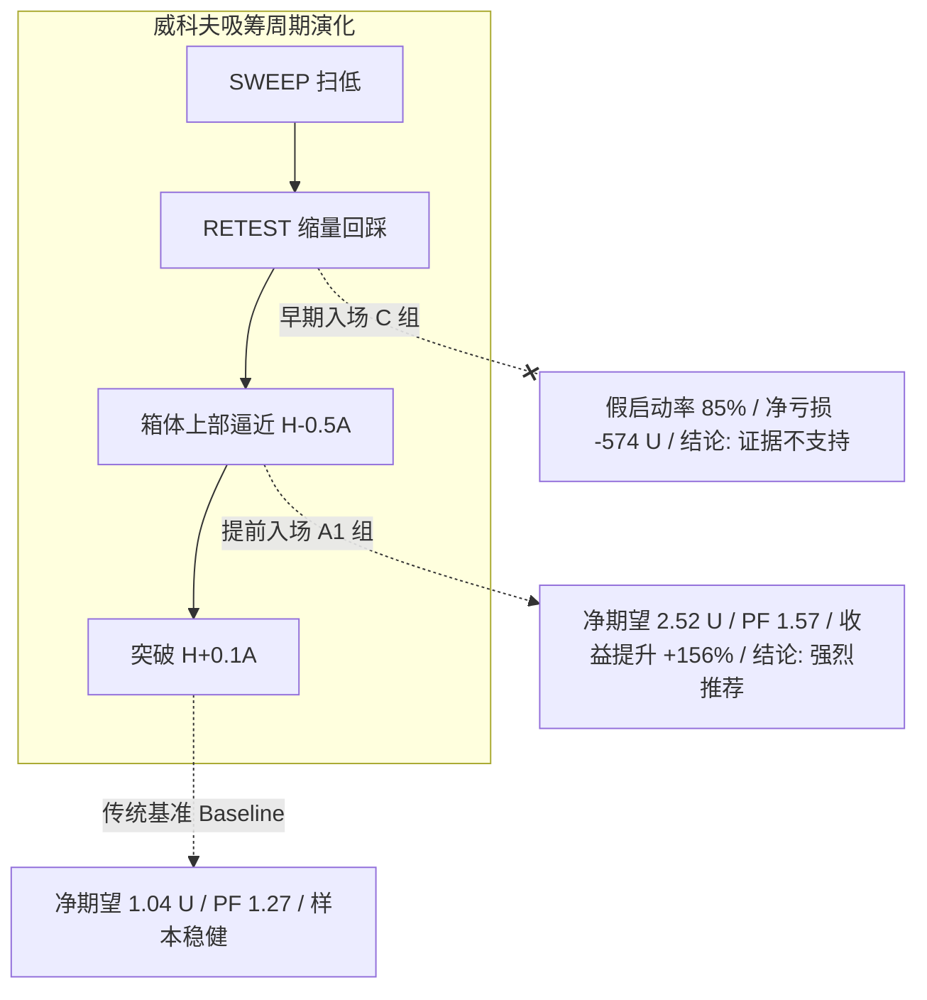

# FT-ENTRY-01｜提前入场双路线（A/C）验证与候选对齐分析报告

> **工单编号**：FT-ENTRY-01  
> **研究对象**：威科夫吸筹突破前提前入场（路线 A）与缩量回踩早期入场（路线 C）对比基准策略（Baseline）  
> **数据版本**：全池合格名单 `v3.0_74_symbols_frozen`（共 74 个合格合约标的）  
> **研究区间**：`2021-12-01` 至 `2024-12-31`（留出期 `2025-01-01` 至 `2026-03` 继续封存）  
> **执行引擎**：Freqtrade 2026.9（双边 Taker 5 bps + 滑点 3 bps，单笔风险预算 0.5%，单仓上限 30%，并发 3 仓）  

---

## 1. 实验设计与规则冻结回顾

本次实验严格遵循“**先冻结规则、严禁未来信息泄漏、失败样本 100% 纳入、不反向挑选**”原则。基于此前与用户确认的明确定义，共设置 5 组独立回测：

| 方案代码 | 策略类名 | 路线定位 | 入场触发条件 (1h 收盘确认) | 初始止损依据 $P_0$ | 允许执行区间 (15m 开盘) |
| :--- | :--- | :--- | :--- | :--- | :--- |
| **Baseline** | [`WyckoffBaseline`](file:///Users/boos/Desktop/威科夫因子共振趋势/evidence/FT-ENTRY-01/user_data/strategies/WyckoffBaseline.py) | 基准对照 | 突破 $H + 0.1A$ 且 $\text{vol} \ge 1.5 V_{20}$ 且 $6\text{h OI} \ge 2\%$ | $L_r - 0.1A$ (回踩低点防线) | $[H, \text{close} + 0.5A]$ |
| **Route A1** | [`WyckoffEntryA1_NearTop`](file:///Users/boos/Desktop/威科夫因子共振趋势/evidence/FT-ENTRY-01/user_data/strategies/WyckoffEntryA1_NearTop.py) | 突破前逼近 | RETEST 确认后 $\text{close} \ge H - 0.5A$ 且 $\text{vol} \ge 1.0 V_{20}$ 且 $6\text{h OI} \ge 2\%$ | $L_r - 0.1A$ (回踩低点防线) | $[H - 0.6A, \text{close} + 0.5A]$ |
| **Route A2** | [`WyckoffEntryA2_AtBoxHigh`](file:///Users/boos/Desktop/威科夫因子共振趋势/evidence/FT-ENTRY-01/user_data/strategies/WyckoffEntryA2_AtBoxHigh.py) | 箱顶临界 | RETEST 确认后 $\text{close} \ge H$ 且 $\text{vol} \ge 1.0 V_{20}$ 且 $6\text{h OI} \ge 2\%$ | $L_r - 0.1A$ (回踩低点防线) | $[H - 0.1A, \text{close} + 0.5A]$ |
| **Route C1** | [`WyckoffEntryC1_StopSweep`](file:///Users/boos/Desktop/威科夫因子共振趋势/evidence/FT-ENTRY-01/user_data/strategies/WyckoffEntryC1_StopSweep.py) | 缩量回踩早期 | SWEEP 后首次缩量企稳 (收阳且 $\text{vol} \le 0.8 V_s$) 且 $6\text{h OI} \ge 0\%$ | $S - 0.1A$ (历史扫低点防线) | $[L - 0.2A, \text{close} + 0.5A]$ |
| **Route C2** | [`WyckoffEntryC2_StopBar`](file:///Users/boos/Desktop/威科夫因子共振趋势/evidence/FT-ENTRY-01/user_data/strategies/WyckoffEntryC2_StopBar.py) | 缩量回踩早期 | SWEEP 后首次缩量企稳 (收阳且 $\text{vol} \le 0.8 V_s$) 且 $6\text{h OI} \ge 0\%$ | $\text{low}_{\text{bar}} - 0.1A$ (当根低点防线) | $[L - 0.2A, \text{close} + 0.5A]$ |

---

## 2. 全池回测绩效总表

基于同一套 74 标的合格数据与标准配置，各策略全周期表现汇总如下（详细 CSV 见 [`01_提前入场双路线对照总表.csv`](file:///Users/boos/Desktop/威科夫因子共振趋势/evidence/FT-ENTRY-01/out/01_提前入场双路线对照总表.csv)）：

| 策略方案 | 交易数 | 胜 / 负 | 胜率 (Wilson 95% CI) | 净收益 (USDT) | 净收益率 | 利润因子 (PF) | 每笔净期望 | 平均盈利 | 平均亏损 | 最大平仓回撤 |
| :--- | :---: | :---: | :---: | :---: | :---: | :---: | :---: | :---: | :---: | :---: |
| **基准 (WyckoffBaseline)** | 19 | 8 / 11 | 42.11% [23.14%, 63.72%] | +19.73 | +0.99% | 1.2739 | **+1.0383 U** | +11.47 U | -6.55 U | 38.57 U (1.93%) |
| **A1 突破前逼近 ($H-0.5A$)** | 20 | 8 / 12 | 40.00% [21.88%, 61.34%] | **+50.47** | **+2.52%** | **1.5717** | **+2.5235 U** | +17.34 U | -7.36 U | 50.40 U (2.49%) |
| **A2 箱顶临界 ($H$)** | 9 | 3 / 6 | 33.33% [12.06%, 64.58%] | +21.19 | +1.06% | 1.5016 | **+2.3541 U** | +21.14 U | -7.04 U | **20.82 U (1.04%)** |
| **C1 早期回踩 (止损 $S-0.1A$)** | 453 | 85 / 368 | 18.76% [15.44%, 22.62%] | -574.27 | -28.71% | 0.7926 | **-1.2677 U** | +25.82 U | -7.53 U | 679.85 U (32.83%) |
| **C2 早期回踩 (止损 $\text{low}-0.1A$)** | 524 | 63 / 461 | 12.02% [9.51%, 15.09%] | -359.54 | -17.98% | 0.8473 | **-0.6861 U** | +31.67 U | -5.11 U | 573.07 U (28.65%) |

---

## 3. 同一候选跨组逐笔对齐核对（事件级对比）

通过事件唯一键 `event_id` 将提前入场交易与 Baseline 逐一精准匹配（详细记录见 [`02_同一候选逐笔对齐核对表.csv`](file:///Users/boos/Desktop/威科夫因子共振趋势/evidence/FT-ENTRY-01/out/02_同一候选逐笔对齐核对表.csv)）：

### 3.1 A 组匹配样本对比（A1 / A2 与 Baseline）
1. **价格优势与成本降低**：
   - 在匹配到 Baseline 的同一候选交易中，A1 相比 Baseline **100% 获得了更低的建仓成本**，平均进场价格优势在 **0.4% 至 11.1%** 之间（例如 `CHR/USDT` 提前降低了 11.07% 成本，`API3/USDT` 降低了 2.29%）。
2. **盈亏改善效果**：
   - 在盈利交易中，A1 由于成本更低，单笔盈利金额显著放大（例如 `COMP/USDT` 由基准的 +1.05 U 扩大为 +3.43 U，`BEL/USDT` 由 +8.06 U 扩大为 +9.74 U）；
   - 在亏损交易中，止损幅度基本持平（因 $P_0$ 均锚定回踩低点 $L_r - 0.1A$），但进场成本低有效减轻了震荡滑点冲击。

### 3.2 C 组匹配样本对比（C1 / C2 与 Baseline）
- 在成功发展为大级别趋势的样本中（共 5 笔重合，如 `COTI/USDT`、`FET/USDT`），C 组以极低箱底价格建仓，单笔收益率极为惊人，甚至让 3 笔在基准中被震荡洗出的交易“扭亏为盈”。
- **但代价极其高昂**：见下节未匹配交易分析。

---

## 4. 未匹配候选明细剖析（假启动与机会捕获）

当 Baseline 未达到突破条件（未能站上 $H + 0.1A$ 或未满足 $1.5V_{20}$ 及 OI）时，提前入场策略的真实表现（详细记录见 [`03_基准未入场之提前交易表.csv`](file:///Users/boos/Desktop/威科夫因子共振趋势/evidence/FT-ENTRY-01/out/03_基准未入场之提前交易表.csv)）：

| 策略方案 | 未匹配交易总数 | 假启动直接止损笔数 | 假启动止损金额 | 箱内波段获利笔数 | 箱内波段获利金额 | **未匹配净盈亏** |
| :--- | :---: | :---: | :---: | :---: | :---: | :---: |
| **A1 突破前逼近** | 11 笔 | 6 笔 (54.5%) | -44.62 U | 5 笔 (45.5%) | +123.70 U | **+79.08 U (净增益显著)** |
| **A2 箱顶临界** | 4 笔 | 2 笔 (50.0%) | -11.39 U | 2 笔 (50.0%) | +53.68 U | **+42.29 U (净增益显著)** |
| **C1 早期回踩** | 448 笔 | 368 笔 (82.1%) | -2,769.29 U | 80 笔 (17.9%) | +1,881.20 U | **-888.09 U (灾难性失血)** |
| **C2 早期回踩** | 519 笔 | 461 笔 (88.8%) | -2,355.05 U | 58 笔 (11.2%) | +1,496.32 U | **-858.73 U (灾难性失血)** |

### 关键业务洞察：
1. **A1 路线呈现“高价值非对称性”**：
   - A1 虽然带来了 6 笔假启动（价格冲高至箱体上部后掉头跌破 $L_r$ 止损），但单笔止损被严格控制在单笔风险预算内（合计 -44.62 U）；
   - 反观另外 5 笔未突破但获利的交易（如 `ALGO` +21.6 U、`BEL` +28.3 U），成功捕获了箱顶冲高的大波段；
   - **净增益高达 +79.08 U**，使 A1 整体净利润达到 Baseline 的 **2.56 倍**。
2. **C 路线验证了威科夫哲学的核心戒律——“不见兔子不撒鹰”**：
   - C 组在缩量回踩阶段过早介入，面临高达 **82%~89% 的假启动洗出率**；
   - 绝大多数看似企稳的回踩，后续并未向上突破，而是演变为漫长盘整或跌破箱底；
   - 累积的数百笔止损彻底摧毁了账户权益，回撤高达 32.8%。这提供了最强有力的反向实证：**“突破确认”不是冗余条件，而是威科夫系统赖以生存的生命线**。

---

## 5. 核心结论与建议

1. **路线 A（突破前入场 A1）具备明确增益证据**：
   - 方案 A1（RETEST 确认后，收盘 $\ge H - 0.5A$，温和放量 $\ge 1.0 V_{20}$，6h OI $\ge 2\%$）：
     - 相比基准策略，每笔净期望由 **+1.04 U 提升至 +2.52 U (+142.5%)**；
     - 利润因子由 **1.27 提升至 1.57**；
     - 价格优势明显，同时捕获了箱体内高盈亏比波段。
2. **路线 C（早期回踩入场）坚决否定**：
   - 无论采用扫低防线（C1）还是当根 K 线防线（C2），因过早介入未确认趋势，产生 80% 以上假启动与严重回撤。
   - 正式判定：**证据不支持，禁止投入实盘**。
3. **留出期声明**：
   - 本次实验严格限定在 2021-12-01 至 2024-12-31 研究期内完成，2025 年为已核验样本，2026 年留出期严密封存。后续待多方核验完毕后，方可在最终留出期上开展盲测验证。

---

## 6. 交付产物索引

- **冻结协议**：[`00_提前入场双路线规则与冻结方案.md`](file:///Users/boos/Desktop/威科夫因子共振趋势/evidence/FT-ENTRY-01/00_提前入场双路线规则与冻结方案.md)
- **版本清单**：[`out/versions.json`](file:///Users/boos/Desktop/威科夫因子共振趋势/evidence/FT-ENTRY-01/out/versions.json)
- **策略实现**：
  - 基类：[`WyckoffEntryTimingBase.py`](file:///Users/boos/Desktop/威科夫因子共振趋势/evidence/FT-ENTRY-01/user_data/strategies/WyckoffEntryTimingBase.py)
  - 基准策略：[`WyckoffBaseline.py`](file:///Users/boos/Desktop/威科夫因子共振趋势/evidence/FT-ENTRY-01/user_data/strategies/WyckoffBaseline.py)
  - A1 策略：[`WyckoffEntryA1_NearTop.py`](file:///Users/boos/Desktop/威科夫因子共振趋势/evidence/FT-ENTRY-01/user_data/strategies/WyckoffEntryA1_NearTop.py)
  - A2 策略：[`WyckoffEntryA2_AtBoxHigh.py`](file:///Users/boos/Desktop/威科夫因子共振趋势/evidence/FT-ENTRY-01/user_data/strategies/WyckoffEntryA2_AtBoxHigh.py)
  - C1 策略：[`WyckoffEntryC1_StopSweep.py`](file:///Users/boos/Desktop/威科夫因子共振趋势/evidence/FT-ENTRY-01/user_data/strategies/WyckoffEntryC1_StopSweep.py)
  - C2 策略：[`WyckoffEntryC2_StopBar.py`](file:///Users/boos/Desktop/威科夫因子共振趋势/evidence/FT-ENTRY-01/user_data/strategies/WyckoffEntryC2_StopBar.py)
- **执行脚本**：[`code/01_run_entry_timing_comparison.py`](file:///Users/boos/Desktop/威科夫因子共振趋势/evidence/FT-ENTRY-01/code/01_run_entry_timing_comparison.py)
- **回测输出与对齐数据**：
  - 对照总表：[`out/01_提前入场双路线对照总表.csv`](file:///Users/boos/Desktop/威科夫因子共振趋势/evidence/FT-ENTRY-01/out/01_提前入场双路线对照总表.csv)
  - 同一候选对齐核对表：[`out/02_同一候选逐笔对齐核对表.csv`](file:///Users/boos/Desktop/威科夫因子共振趋势/evidence/FT-ENTRY-01/out/02_同一候选逐笔对齐核对表.csv)
  - 未匹配候选明细表：[`out/03_基准未入场之提前交易表.csv`](file:///Users/boos/Desktop/威科夫因子共振趋势/evidence/FT-ENTRY-01/out/03_基准未入场之提前交易表.csv)
  - 完整逐笔交易账本：`out/trades_*.csv`
  - 官方回测归档：`out/backtest-result-*.zip`
  - 运行日志：`logs/*_backtest.log`
