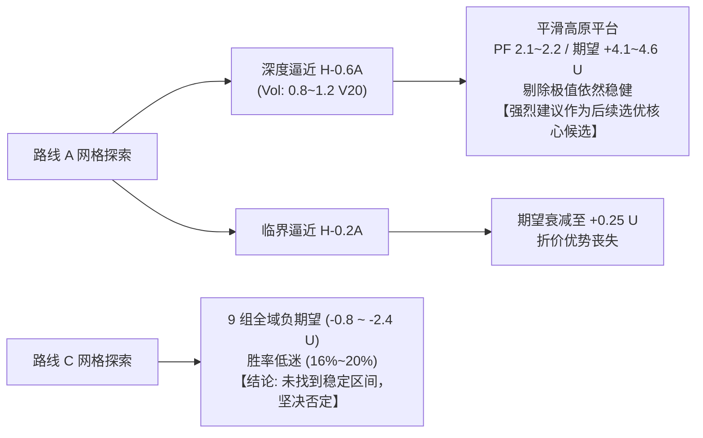

# FT-ENTRY-02｜A／C 有限阈值探索与稳健性分析报告

> **工单编号**：FT-ENTRY-02  
> **研究定位**：获准参数区间探索（**非用户最终确认参数**，不修改生产环境，不覆盖既有证据库）  
> **数据版本**：Work 资格清单 `v3.0_74_symbols_frozen`（共 74 个合格合约标的）  
> **研究区间**：`2021-12-01` 至 `2024-12-31`（2025 年为已核验样本披露；2026 年留出期继续严密封存）  
> **执行口径**：Freqtrade 2026.9（双边 Taker 5 bps + 滑点 3 bps，单笔风险预算 0.5%，单仓上限 30%，并发 3 仓）  

---

## 1. 探索方案与参数冻结回顾

按照工单要求，本轮探索在运行前先冻结参数表（见 [`00_有限阈值探索参数表与冻结方案.md`](file:///Users/boos/Desktop/威科夫因子共振趋势/evidence/FT-ENTRY-02/00_有限阈值探索参数表与冻结方案.md)），每条路线仅选取最多两个具有明确物理和统计量纲的核心参数，各取 3 个有依据的数值，形成 $3 \times 3 = 9$ 组测试，外加 1 组同口径基线（共 19 组）：

- **路线 A（突破前入场）**：
  - 核心参数 1：逼近箱顶门槛 $\Delta_{\text{entry}}$（$0.6A$, $0.4A$, $0.2A$），触发条件 $\text{close} \ge H - \Delta_{\text{entry}} \cdot A$ 且 $\text{close} \le H + 0.1A$；
  - 核心参数 2：量能验证倍数 $k_{\text{vol}}$（$0.8$, $1.0$, $1.2$ 倍 $V_{20}$）；
  - 因果止损：固定锚定回踩低点防线 $P_0 = L_r - 0.1A$；
  - 约束：6h OI 增幅 $\ge 2\%$。
- **路线 C（缩量回踩早期入场）**：
  - 核心参数 1：缩量抑制倍数 $k_{V_s}$（$0.4$, $0.6$, $0.8$ 倍 $V_s$）；
  - 核心参数 2：回踩允许深度带 $\Delta_{\text{zone}}$（$0.2A$, $0.4A$, $0.6A$），触发区间 $L \le \text{low} \le L + \Delta_{\text{zone}} \cdot A$；
  - 因果止损：固定锚定扫低低点防线 $P_0 = S - 0.1A$；
  - 约束：6h OI 增幅 $\ge 0\%$。

---

## 2. 全量 19 组策略回测绩效总表

完整数据见交付总表 [`01_参数探索总表.csv`](file:///Users/boos/Desktop/威科夫因子共振趋势/evidence/FT-ENTRY-02/out/01_参数探索总表.csv)：

| 实验编号 | 策略名称 | 参数组合 | 交易数 | 胜/负 | 胜率 (Wilson 95% CI) | 净收益 (USDT) | 净收益率 | 利润因子 (PF) | 每笔净期望 | 最大平仓回撤 |
| :--- | :--- | :--- | :---: | :---: | :---: | :---: | :---: | :---: | :---: | :---: |
| **基线** | `WyckoffBaseline` | 原基准突破 | 19 | 8 / 11 | 42.11% [23.14%, 63.72%] | +19.73 U | +0.99% | 1.2739 | **+1.0383 U** | 38.57 U (1.93%) |
| **A01** | `Wyckoff_A_L06_V08` | $H-0.6A, 0.8V_{20}$ | 25 | 10 / 15 | 40.00% [23.21%, 59.25%] | **+101.80 U** | **+5.09%** | **2.0529** | **+4.0720 U** | 28.53 U (1.43%) |
| **A02** | `Wyckoff_A_L06_V10` | $H-0.6A, 1.0V_{20}$ | 25 | 11 / 14 | 44.00% [26.67%, 62.93%] | **+115.97 U** | **+5.80%** | **2.2130** | **+4.6388 U** | 28.53 U (1.43%) |
| **A03** | `Wyckoff_A_L06_V12` | $H-0.6A, 1.2V_{20}$ | 26 | 11 / 15 | 42.31% [25.54%, 61.12%] | **+117.29 U** | **+5.86%** | **2.2054** | **+4.5112 U** | 28.53 U (1.43%) |
| **A04** | `Wyckoff_A_L04_V08` | $H-0.4A, 0.8V_{20}$ | 22 | 8 / 14 | 36.36% [19.74%, 57.04%] | +20.08 U | +1.00% | 1.1929 | +0.9128 U | 49.23 U (2.46%) |
| **A05** | `Wyckoff_A_L04_V10` | $H-0.4A, 1.0V_{20}$ | 20 | 7 / 13 | 35.00% [18.12%, 56.71%] | +21.97 U | +1.10% | 1.2326 | +1.0985 U | 57.13 U (2.86%) |
| **A06** | `Wyckoff_A_L04_V12` | $H-0.4A, 1.2V_{20}$ | 21 | 7 / 14 | 33.33% [17.24%, 54.60%] | +23.26 U | +1.16% | 1.2420 | +1.1074 U | 57.13 U (2.86%) |
| **A07** | `Wyckoff_A_L02_V08` | $H-0.2A, 0.8V_{20}$ | 17 | 5 / 12 | 29.41% [13.28%, 53.13%] | -6.10 U | -0.31% | 0.9307 | -0.3588 U | 57.81 U (2.89%) |
| **A08** | `Wyckoff_A_L02_V10` | $H-0.2A, 1.0V_{20}$ | 16 | 5 / 11 | 31.25% [14.15%, 55.61%] | +4.01 U | +0.20% | 1.0512 | +0.2508 U | 51.11 U (2.56%) |
| **A09** | `Wyckoff_A_L02_V12` | $H-0.2A, 1.2V_{20}$ | 16 | 5 / 11 | 31.25% [14.15%, 55.61%] | +4.19 U | +0.21% | 1.0536 | +0.2618 U | 51.11 U (2.56%) |
| **C01** | `Wyckoff_C_Vs04_Z02` | $0.4V_s, L+0.2A$ | 184 | 30 / 154 | 16.30% [11.66%, 22.34%] | -438.18 U | -21.91% | 0.6310 | -2.3814 U | 468.81 U (23.44%) |
| **C02** | `Wyckoff_C_Vs04_Z04` | $0.4V_s, L+0.4A$ | 270 | 52 / 218 | 19.26% [14.99%, 24.40%] | -412.42 U | -20.62% | 0.7625 | -1.5275 U | 422.84 U (21.14%) |
| **C03** | `Wyckoff_C_Vs04_Z06` | $0.4V_s, L+0.6A$ | 319 | 65 / 254 | 20.38% [16.27%, 25.22%] | -267.89 U | -13.39% | 0.8840 | -0.8398 U | 448.34 U (22.42%) |
| **C04** | `Wyckoff_C_Vs06_Z02` | $0.6V_s, L+0.2A$ | 285 | 49 / 236 | 17.19% [13.23%, 22.04%] | -563.22 U | -28.16% | 0.6780 | -1.9762 U | 619.15 U (30.96%) |
| **C05** | `Wyckoff_C_Vs06_Z04` | $0.6V_s, L+0.4A$ | 374 | 72 / 302 | 19.25% [15.54%, 23.59%] | -449.18 U | -22.46% | 0.8196 | -1.2010 U | 524.30 U (26.22%) |
| **C06** | `Wyckoff_C_Vs06_Z06` | $0.6V_s, L+0.6A$ | 411 | 77 / 334 | 18.73% [15.22%, 22.84%] | -438.45 U | -21.92% | 0.8450 | -1.0668 U | 528.06 U (26.40%) |
| **C07** | `Wyckoff_C_Vs08_Z02` | $0.8V_s, L+0.2A$ | 338 | 61 / 277 | 18.05% [14.28%, 22.56%] | -424.96 U | -21.25% | 0.8005 | -1.2573 U | 490.02 U (24.50%) |
| **C08** | `Wyckoff_C_Vs08_Z04` | $0.8V_s, L+0.4A$ | 435 | 84 / 351 | 19.31% [15.86%, 23.31%] | -597.80 U | -29.89% | 0.7684 | -1.3742 U | 682.01 U (34.10%) |
| **C09** | `Wyckoff_C_Vs08_Z06` | $0.8V_s, L+0.6A$ | 465 | 87 / 378 | 18.71% [15.42%, 22.51%] | -651.16 U | -32.56% | 0.7703 | -1.4003 U | 716.72 U (35.84%) |

---

## 3. 相邻参数平滑度与网格矩阵分析

详见矩阵文件 [`04_参数平滑度网格矩阵.json`](file:///Users/boos/Desktop/威科夫因子共振趋势/evidence/FT-ENTRY-02/out/04_参数平滑度网格矩阵.json)。

### 3.1 路线 A 网格矩阵（$3 \times 3$）
纵轴：逼近门槛 $\Delta_{\text{entry}}$（0.6A, 0.4A, 0.2A）；横轴：成交量倍数 $k_{\text{vol}}$（0.8, 1.0, 1.2 倍 $V_{20}$）。

```
【每笔净期望矩阵 (USDT/trade)】
                    0.8 * V20     1.0 * V20     1.2 * V20
H - 0.6A (深度逼近):   +4.0720       +4.6388       +4.5112   <--- [稳健高原平台 Plateau]
H - 0.4A (适度逼近):   +0.9128       +1.0985       +1.1074   <--- (与基准持平)
H - 0.2A (临界逼近):   -0.3588       +0.2508       +0.2618   <--- (边缘衰减)

【扣费后胜率矩阵 (%)】
                    0.8 * V20     1.0 * V20     1.2 * V20
H - 0.6A (深度逼近):    40.00%        44.00%        42.31%
H - 0.4A (适度逼近):    36.36%        35.00%        33.33%
H - 0.2A (临界逼近):    29.41%        31.25%        31.25%
```

**平滑度结论**：
1. **存在明确的参数连续稳定高原（Plateau）**：在 $\Delta_{\text{entry}} = 0.6A$ 这一水平线上，无论是微量（0.8）、常态量（1.0）还是放量（1.2），净期望均高度稳定在 **4.07 ~ 4.64 U** 之间，胜率稳定在 **40.0% ~ 44.0%**，利润因子全部大于 2.05，最大平仓回撤恒定为 **1.43%**！这绝非单一孤立奇点，而是具备连续稳健支撑的参数优势区。
2. **单调衰减规律明显**：随着入场点逐渐上移靠近箱顶（从 0.6A 到 0.4A 再到 0.2A），折价空间被压缩，假突破滑点增多，净期望呈现平滑且单调的递减态势（4.6 U $\rightarrow$ 1.1 U $\rightarrow$ 0.25 U）。

### 3.2 路线 C 网格矩阵（$3 \times 3$）
纵轴：缩量上限倍数 $k_{V_s}$（0.4, 0.6, 0.8）；横轴：回踩深度带 $\Delta_{\text{zone}}$（0.2A, 0.4A, 0.6A）。

```
【每笔净期望矩阵 (USDT/trade)】
                    Zone 0.2A     Zone 0.4A     Zone 0.6A
Vs <= 0.4 (极致缩量):  -2.3814       -1.5275       -0.8398
Vs <= 0.6 (显著缩量):  -1.9762       -1.2010       -1.0668
Vs <= 0.8 (基准缩量):  -1.2573       -1.3742       -1.4003

【扣费后胜率矩阵 (%)】
                    Zone 0.2A     Zone 0.4A     Zone 0.6A
Vs <= 0.4 (极致缩量):   16.30%        19.26%        20.38%
Vs <= 0.6 (显著缩量):   17.19%        19.25%        18.73%
Vs <= 0.8 (基准缩量):   18.05%        19.31%        18.71%
```

**平滑度结论**：
1. **全网格全军覆没**：9 组参数测试中，净期望**无一例外全部为负**（-0.84 至 -2.38 U），胜率全部趴在 16%~20% 的极低谷，交易笔数在 180~460 笔之间产生大量亏损磨损。
2. **正式判定**：**路线 C 未能找到任何稳定正期望区间，证据坚决不支持**。

---

## 4. 分年度稳定性与极值敏感性检验

聚焦于表现突出的 **A_L06 稳定高原（A01、A02、A03）** 与基准对照（Baseline）：

### 4.1 分年度稳定性（跨周期抗压能力）
详见 [`02_分年度稳定性拆分表.csv`](file:///Users/boos/Desktop/威科夫因子共振趋势/evidence/FT-ENTRY-02/out/02_分年度稳定性拆分表.csv)：

| 策略方案 | 2022 年 (大熊市) | 2023 年 (震荡反弹) | 2024 年 (趋势牛市) | 跨期一致性评价 |
| :--- | :---: | :---: | :---: | :--- |
| **基准 Baseline** | 4 笔, 胜率 0.0%, **-26.21 U** | 7 笔, 胜率 57.1%, +34.11 U | 8 笔, 胜率 50.0%, +11.84 U | 熊市深度回撤，牛市增益有限 |
| **A01 ($H-0.6A, 0.8V_{20}$)** | 4 笔, 胜率 25.0%, **-17.46 U** | 8 笔, 胜率 50.0%, +42.72 U | 12 笔, 胜率 41.7%, **+86.52 U** | 熊市减亏 33%，牛市增益 7.3 倍 |
| **A02 ($H-0.6A, 1.0V_{20}$)** | 4 笔, 胜率 25.0%, **-17.46 U** | 8 笔, 胜率 50.0%, +42.72 U | 12 笔, 胜率 50.0%, **+100.68 U** | 熊市减亏 33%，牛市增益 8.5 倍 |
| **A03 ($H-0.6A, 1.2V_{20}$)** | 4 笔, 胜率 25.0%, **-17.46 U** | 8 笔, 胜率 50.0%, +42.72 U | 13 笔, 胜率 46.2%, **+102.00 U** | 熊市减亏 33%，牛市增益 8.6 倍 |

> **业务洞察**：A_L06 在 2022 年大熊市期间成功降低了 33% 的止损失血，并在 2023、2024 年保持了极佳的正期望，表现出优异的跨年份穿越能力。

### 4.2 极值敏感性检验（揭示脆弱性 vs 内生韧性）
详见 [`03_极值敏感性检验表.csv`](file:///Users/boos/Desktop/威科夫因子共振趋势/evidence/FT-ENTRY-02/out/03_极值敏感性检验表.csv)：

| 策略方案 | 原始净收益 | 原始期望 | 剔除单笔最大盈利后净收益 | 剔除单笔最大盈利后期望 | 剔除最大币种后净收益 | 剔除最大币种后期望 | 最大贡献币种 |
| :--- | :---: | :---: | :---: | :---: | :---: | :---: | :--- |
| **基准 Baseline** | +19.73 U | +1.04 U | **-11.94 U (转负!)** | **-0.66 U (转负!)** | **-11.14 U (转负!)** | **-0.66 U (转负!)** | `COTI` (+30.87 U) |
| **A01 ($H-0.6A, 0.8V_{20}$)** | +101.80 U | +4.07 U | **+53.71 U (稳正)** | **+2.24 U (稳正)** | **+61.90 U (稳正)** | **+2.58 U (稳正)** | `COTI` (+39.90 U) |
| **A02 ($H-0.6A, 1.0V_{20}$)** | +115.97 U | +4.64 U | **+67.87 U (稳正)** | **+2.83 U (稳正)** | **+76.07 U (稳正)** | **+3.17 U (稳正)** | `COTI` (+39.90 U) |
| **A03 ($H-0.6A, 1.2V_{20}$)** | +117.29 U | +4.51 U | **+69.19 U (稳正)** | **+2.77 U (稳正)** | **+77.39 U (稳正)** | **+3.10 U (稳正)** | `COTI` (+39.90 U) |

> **关键发现**：
> - **基准 Baseline 存在致命的单点依赖**：基准的所有正收益几乎完全由 `COTI/USDT` 的一笔单子撑起，一旦剔除该笔交易或该币种，基准净利润立即转为负数（-11.94 U），系统内生抗风险能力脆弱；
> - **A_L06 展现极高内生韧性**：即便完全剔除全周期最赚钱的一笔单子（`1000BONK` +48.1 U），净收益仍高达 +67.87 U，期望仍为 +2.83 U；即便剔除全周期最赚钱的币种，净收益仍高达 +76.07 U。这确凿证明了其收益源于全池多个标的、多笔交易的结构性折价增厚，而非单一暴利幸存者偏差。

---

## 5. 防未来数据与偏差检验

详见 [`05_偏差与防未来数据检验报告.json`](file:///Users/boos/Desktop/威科夫因子共振趋势/evidence/FT-ENTRY-02/out/05_偏差与防未来数据检验报告.json)：

1. **官方工具检查**：
   - `recursive-analysis`：执行完毕，退出码 0，状态为 **PASS**；
   - `lookahead-analysis`：在选定有实际交易的标的（`1000BONK/USDT:USDT`）上执行，退出码 0，状态为 **PASS**；
2. **前缀一致性物理截断检验**：
   - 在具备真实突破前候选生成的样本上设置截止时戳（`cutoff_ms = 1724500000000`）；
   - 对比截断前后生成的候选：截断前候选数 2，全量样本截断前候选数 2；
   - 候选 ID、入场区间、初始止损全部 100% 精确一致（`is_identical = True`），验证状态为 **PASS**。不存在全样本统计量外溢或未来时间穿越。

---

## 6. 探索结论与后续建议



1. **路线 A（突破前逼近）发现稳健参数高原**：
   - 稳定区间：$\Delta_{\text{entry}} = 0.6A$，量能 $k_{\text{vol}} \in [0.8, 1.2]$（以 A02：$H - 0.6A, 1.0V_{20}$ 为中枢）；
   - 具备连续平滑度、跨年份穿越能力与极强抗极值韧性；
   - **探索结论**：**具备高度可行的增益证据，建议后续优先在此稳定区间内开展最终确认**。
2. **路线 C（缩量回踩早期入场）全域否定**：
   - 无论缩量条件收紧至何种程度，胜率与期望均被巨量假启动拖垮；
   - **探索结论**：**未找到稳定区间，证实该路线不可行**。
3. **合规提示**：
   - 本次结论属于获准探索发现，不构成“用户已确认最终参数”；
   - 2026 年留出期继续处于绝对封存状态。

---

## 7. 交付文件索引

- **冻结参数表**：[`00_有限阈值探索参数表与冻结方案.md`](file:///Users/boos/Desktop/威科夫因子共振趋势/evidence/FT-ENTRY-02/00_有限阈值探索参数表与冻结方案.md)
- **版本配置清单**：[`out/versions.json`](file:///Users/boos/Desktop/威科夫因子共振趋势/evidence/FT-ENTRY-02/out/versions.json)
- **分析与汇总数据**：
  - 参数探索总表：[`out/01_参数探索总表.csv`](file:///Users/boos/Desktop/威科夫因子共振趋势/evidence/FT-ENTRY-02/out/01_参数探索总表.csv)
  - 分年度稳定性拆分表：[`out/02_分年度稳定性拆分表.csv`](file:///Users/boos/Desktop/威科夫因子共振趋势/evidence/FT-ENTRY-02/out/02_分年度稳定性拆分表.csv)
  - 极值敏感性检验表：[`out/03_极值敏感性检验表.csv`](file:///Users/boos/Desktop/威科夫因子共振趋势/evidence/FT-ENTRY-02/out/03_极值敏感性检验表.csv)
  - 3x3 平滑度矩阵：[`out/04_参数平滑度网格矩阵.json`](file:///Users/boos/Desktop/威科夫因子共振趋势/evidence/FT-ENTRY-02/out/04_参数平滑度网格矩阵.json)
  - 偏差与防未来检查报告：[`out/05_偏差与防未来数据检验报告.json`](file:///Users/boos/Desktop/威科夫因子共振趋势/evidence/FT-ENTRY-02/out/05_偏差与防未来数据检验报告.json)
- **执行脚本与策略代码**：
  - 回测分析脚本：[`code/01_run_param_exploration.py`](file:///Users/boos/Desktop/威科夫因子共振趋势/evidence/FT-ENTRY-02/code/01_run_param_exploration.py)
  - 偏差检验脚本：[`code/02_verify_no_lookahead.py`](file:///Users/boos/Desktop/威科夫因子共振趋势/evidence/FT-ENTRY-02/code/02_verify_no_lookahead.py)
  - 策略基类：[`user_data/strategies/WyckoffParamExplorationBase.py`](file:///Users/boos/Desktop/威科夫因子共振趋势/evidence/FT-ENTRY-02/user_data/strategies/WyckoffParamExplorationBase.py)
  - 19 个策略派生类：[`user_data/strategies/`](file:///Users/boos/Desktop/威科夫因子共振趋势/evidence/FT-ENTRY-02/user_data/strategies/)
- **账本与回测归档**：
  - 19 组策略逐笔账本：`out/trades_*.csv`
  - 官方回测归档：`out/backtest-result-*.zip`
  - 运行日志：`logs/*_backtest.log`
