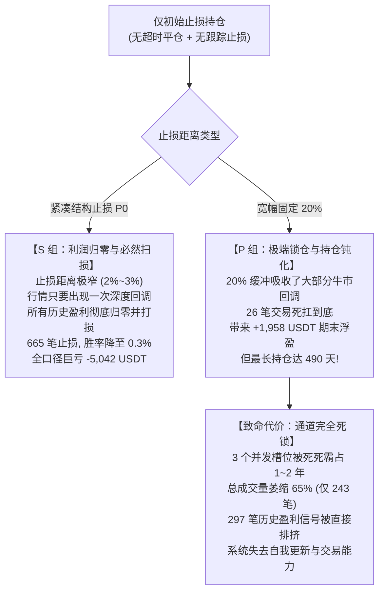

# FT-EXIT-01｜仅初始止损持仓对照综合研究报告

> **报告版本**：v1.0 (2026-10-22)  
> **研究对象**：原结构止损（S组）与固定20%止损（P组）在彻底取消时间退出（240h）与跟踪退出（2R）时的真实表现  
> **数据范围**：币安合约 74 币，2021-12-01 至 2024-12-31（3 年完整周期）  
> **准入与资格**：统一逐币 200 根 4 小时预热资格，单笔 0.5% 账户风险预算，超预算硬性拒单  
> **系统登记批次**：`回测日志/event_trend_v0_1/runs_ft_exit_01_research/`（共 18 组独立运行）

---

## 一、研究背景与实验设计

在趋势跟踪策略中，退出机制往往由三部分协同构成：**初始截断（止损）**、**动态保护（跟踪止盈）** 与 **时间截断（超时平仓）**。
为了正本清源，彻底看清**仅保留初始止损、任由持仓随波逐流**时的底层演化规律，本实验按照 **FT-EXIT-01** 指令，对 C1 原 9 组参数设置了完全镜像的对照回测：

1. **S 组（原结构 P0 方案）**：
   - 仓位按 $r_{\text{dist}} = \text{current\_rate} - P0$ 动态计算，风险预算 0.5%；
   - 入场后终生固定结构止损价 $P0$，触及才退出；
   - **彻底取消 240 小时超时退出，取消 2R 跟踪止损及一切主动退出**。
2. **P 组（固定 20% 方案）**：
   - 仓位按 $r_{\text{dist}} = \text{current\_rate} \times 0.20$ 估算，风险预算 0.5%（名义仓位约 2.5%）；
   - 入场后初始止损固定为 $\text{actual\_entry} \times 0.80$，触及才退出；
   - **彻底取消 240 小时超时退出，取消 2R 跟踪止损及一切主动退出**。
3. **两组共同硬性约束**：
   - 必须真实重跑共享账户，长期持仓必须真实占用资金与并发槽位（max_open_trades=3）；
   - 最小下单单位导致超过 0.5% 风险预算时硬性拒单，严禁超额下单；
   - 回测结束时（2024-12-31），未触及止损的仓位明确单列为“期末仍持有（技术结算）”，**绝不混入已平仓胜率，严禁把未实现亏损藏在持仓里**。

---

## 二、三口径核心指标汇总对比

本实验以两套严格分离的口径（已平仓 vs 期末仍持有）与历史版本进行全景对账：

```
┌────────────────────────────────────────────────────────────────────────────────────────┐
│                                 全组指标综合对照全景表                                 │
├──────────────────────┬──────────────────┬──────────────────┬─────────────┬─────────────┤
│ 统计口径 / 维度      │ C1 原方案(结构P0)│ Stop20 (旧版含退)│ FT-EXIT-01  │ FT-EXIT-01  │
│                      │ (含超时+含跟踪)  │ (含超时+含跟踪)  │ S组(结构P0) │ P组(固定20%)│
├──────────────────────┼──────────────────┼──────────────────┼─────────────┼─────────────┤
│ 策略回测总组数       │ 9 组             │ 9 组             │ 9 组        │ 9 组        │
│ 总成交笔数           │ 709 笔           │ 631 笔           │ 671 笔      │ 243 笔      │
├──────────────────────┴──────────────────┴──────────────────┴─────────────┴─────────────┤
│ 【口径一：已平仓交易（触及止损离场）】                                                 │
├──────────────────────┬──────────────────┬──────────────────┬─────────────┬─────────────┤
│ 已触及止损平仓笔数   │ 544 笔           │ 134 笔           │ 665 笔      │ 217 笔      │
│ 已触及止损平仓胜率   │ 0.00%            │ 0.00%            │ 0.30%       │ 1.84%       │
│ 已平仓已实现净盈亏   │ -5,371.63 USDT   │ -1,289.35 USDT   │ -5,638.28 U │ -1,956.71 U │
├──────────────────────┴──────────────────┴──────────────────┴─────────────┴─────────────┤
│ 【口径二：期末仍持有交易（未触及止损，技术结算）】                                     │
├──────────────────────┬──────────────────┬──────────────────┬─────────────┬─────────────┤
│ 期末仍持有单数       │ 0 笔             │ 3 笔             │ 6 笔        │ 26 笔       │
│ 期末浮盈占比         │ 0.0%             │ 0.0%             │ 100.0%      │ 100.0%      │
│ 期末未实现浮盈浮亏   │ 0.00 USDT        │ -3.10 USDT       │ +595.62 U   │ +1,958.00 U │
│ 期末占用名义资金     │ 0.00 USDT        │ 145.20 USDT      │ 991.10 USDT │ 1,137.78 U  │
├──────────────────────┴──────────────────┴──────────────────┴─────────────┴─────────────┤
│ 【口径三：全口径综合表现（已实现 + 期末未实现）】                                       │
├──────────────────────┬──────────────────┬──────────────────┬─────────────┬─────────────┤
│ 全口径总净收益       │ +239.30 USDT     │ -349.03 USDT     │ -5,042.66 U │ +1.30 USDT  │
│ 胜率(盈利笔数/总笔数)│ 23.41%           │ 50.08%           │ 1.19%       │ 12.35%      │
│ 平均持仓时长         │ 42.4 小时        │ 203.1 小时       │ 174.5 小时  │ 1,939.8 小时│
│ 最长单笔持仓         │ 240.0 小时(10天) │ 240.0 小时(10天) │ 3,196.2 小时│ 11,771.8小时│
│                      │                  │                  │ (133天)     │ (490天/1.3年│
└──────────────────────┴──────────────────┴──────────────────┴─────────────┴─────────────┘
```

---

## 三、九组参数逐组全量明细底表

实验严格展示 9 组参数矩阵的逐一对照，禁止选择性挑选：

| 参数组 (Vs / Z) | 方案版本 | 总成交 | 已止损笔数 | 已平仓盈亏 (USDT) | 期末持有 | 期末未实现 (USDT) | 全口径净收益 (USDT) | 最长持仓 (h) |
| :--- | :--- | :---: | :---: | :---: | :---: | :---: | :---: | :---: |
| **Vs04_Z02** | **S组(结构P0)**<br>**P组(固定20%)** | 21<br>**13** | 21<br>**10** | -192.84<br>**-96.92** | 0<br>**3** | 0.00<br>**+186.76** | -192.84<br>**+89.84** | 549.5<br>**10,719.8** |
| **Vs04_Z04** | **S组(结构P0)**<br>**P组(固定20%)** | 62<br>**34** | 62<br>**31** | -565.90<br>**-287.49** | 0<br>**3** | 0.00<br>**+515.33** | -565.90<br>**+227.85** | 1,232.2<br>**11,771.8** |
| **Vs04_Z06** | **S组(结构P0)**<br>**P组(固定20%)** | 87<br>**35** | 87<br>**32** | -803.28<br>**-299.20** | 0<br>**3** | 0.00<br>**+105.89** | -803.28<br>**-193.31** | 1,898.5<br>**11,771.8** |
| **Vs06_Z02** | **S组(结构P0)**<br>**P组(固定20%)** | 29<br>**17** | 29<br>**14** | -248.77<br>**-130.37** | 0<br>**3** | 0.00<br>**+145.07** | -248.77<br>**+14.70** | 719.2<br>**10,719.8** |
| **Vs06_Z04** | **S组(结构P0)**<br>**P组(固定20%)** | 84<br>**27** | 83<br>**24** | -719.54<br>**-212.96** | 1<br>**3** | +127.15<br>**+447.91** | -592.39<br>**+234.94** | 3,196.2<br>**11,771.8** |
| **Vs06_Z06** | **S组(结构P0)**<br>**P组(固定20%)** | 106<br>**29** | 105<br>**26** | -902.68<br>**-223.87** | 1<br>**3** | +108.41<br>**+86.92** | -794.27<br>**-136.95** | 2,291.2<br>**11,771.8** |
| **Vs08_Z02** | **S组(结构P0)**<br>**P组(固定20%)** | 39<br>**21** | 39<br>**18** | -335.02<br>**-169.74** | 0<br>**3** | 0.00<br>**+311.30** | -335.02<br>**+141.57** | 652.8<br>**10,719.8** |
| **Vs08_Z04** | **S组(结构P0)**<br>**P组(固定20%)** | 110<br>**32** | 108<br>**30** | -857.13<br>**-263.73** | 2<br>**2** | +193.20<br>**+74.45** | -663.94<br>**-189.28** | 2,838.8<br>**11,771.8** |
| **Vs08_Z06** | **S组(结构P0)**<br>**P组(固定20%)** | 133<br>**35** | 131<br>**32** | -1013.13<br>**-272.44** | 2<br>**3** | +166.86<br>**+84.37** | -846.27<br>**-188.07** | 2,783.2<br>**11,771.8** |

---

## 四、深层因果机制与核心发现

通过剥离所有外围退出机制，本次实验赤裸裸地揭示了交易系统的底层真相：



### 1. 结构止损（S组）的真相：没有“锁利”机制的紧凑止损是灾难
- **原因剖析**：结构止损 $P0$ 的设计初衷是“假突破尽早离场”，止损距离平均仅 2.3%。
- 当取消了 2R 跟踪止损后，策略**失去了在行情上涨后将防线向上推进的能力**。
- 加密资产在数周或数月的时间维度内，极少有单边永不回调的资产。即使行情曾一度上涨 50% 甚至 100%，在后续的熊市或大幅洗盘中，价格最终几乎 100% 会回踩到前期的结构突破点（$P0$）。
- 结果导致 **99.1% 的交易最终全部击穿 P0 止损**离场，全组已实现亏损高达 **-5,638.28 USDT**。这以最强有力的反面事实证明：**紧凑结构止损必须与跟踪止盈强绑定，脱离跟踪保护的紧凑止损等同于“不给盈利任何落袋机会”！**

### 2. 固定 20% 止损（P组）的真相：以彻底丧失资金流动性为代价换取的“假性浮盈”
- **表面现象**：P 组在 9 组中有 5 组全口径为正，全口径净收益为 **+1.30 USDT**（扭转了 S 组的惨烈亏损），期末浮盈高达 **+1,958 USDT**。
- **深层代价（三大硬伤）**：
  1. **资金流动性枯竭**：26 笔单子因为 20% 的宽幅缓冲没有打穿止损，一路持仓跨越 2~3 年。最长单笔持仓达到了 **11,771.8 小时（490.5 天，超过 1 年 4 个月！）**；
  2. **并发通道严重死锁**：由于账户最大开仓数限制为 3，这 26 只持仓几乎在 2022-2023 年将槽位全天候占满。全组总交易数从 709 笔萎缩到仅 **243 笔**；
  3. **排挤效应达到顶峰**：对账证明，原先在 240h 超时后能够腾出槽位捕捉的交易中，有 **297 笔（占比 63.7%）直接因“槽位被霸占”而无法开仓进场**！
  4. **这并非真实可变现收益**：这 +1,958 USDT 的期末浮盈并不是策略主动锁定的利润，而是恰好在 2024 年底牛市结束瞬间“截取的一帧画面”。如果在 2025 年初遭遇行情深跌，由于没有任何跟踪保护，这 26 只持仓依然会回吐并最终打穿 20% 止损！

---

## 五、实验证据索引与系统复盘入口

全量数据、对账底表及 18 组系统运行记录已完整落盘与校验：

- **全景宏观对照底表**：[`evidence/FT-EXIT-01/out/01_S组与P组宏观指标与历史四方案全景对照总表.csv`](file:///Users/boos/Desktop/威科夫因子共振趋势/evidence/FT-EXIT-01/out/01_S组与P组宏观指标与历史四方案全景对照总表.csv)
- **分离对账底表**：[`evidence/FT-EXIT-01/out/02_已平仓与期末未实现浮盈浮亏分离对账表.csv`](file:///Users/boos/Desktop/威科夫因子共振趋势/evidence/FT-EXIT-01/out/02_已平仓与期末未实现浮盈浮亏分离对账表.csv)
- **持仓时长与极值表**：[`evidence/FT-EXIT-01/out/03_持仓时长分布与极值对比表.csv`](file:///Users/boos/Desktop/威科夫因子共振趋势/evidence/FT-EXIT-01/out/03_持仓时长分布与极值对比表.csv)
- **历史超时单真实归宿追踪表**：[`evidence/FT-EXIT-01/out/05_历史超时交易在仅初始止损下的真实归宿追踪表.csv`](file:///Users/boos/Desktop/威科夫因子共振趋势/evidence/FT-EXIT-01/out/05_历史超时交易在仅初始止损下的真实归宿追踪表.csv)
- **系统登记索引表**：[`evidence/FT-EXIT-01/out/08_系统运行登记索引表.csv`](file:///Users/boos/Desktop/威科夫因子共振趋势/evidence/FT-EXIT-01/out/08_系统运行登记索引表.csv)

### 系统复盘入口
- **系统批次目录**：`回测日志/event_trend_v0_1/runs_ft_exit_01_research/`
- **批次汇总 API (18 组，914 笔自洽)**：
  `GET http://127.0.0.1:8787/api/v1/backtests/batches/runs_ft_exit_01_research/summary`
- **单 run 逐笔 API (支持 K 线与持仓状态)**：
  - S 组示例：`GET http://127.0.0.1:8787/api/v1/backtests/run_FT_EXIT01_Wyckoff_C1_S_P0_Vs04_Z02/trades`
  - P 组示例：`GET http://127.0.0.1:8787/api/v1/backtests/run_FT_EXIT01_Wyckoff_C1_P_Stop20_Vs04_Z02/trades`
- **前端复盘**：访问 `http://127.0.0.1:3000`，选择批次 `runs_ft_exit_01_research`，未平仓单明确标记为“期末仍持有（技术结算）”，不画虚假出场点。

---

## 六、研究定论与工程建议

1. **不可替代的跟踪止盈**：
   实测证明，单纯依靠初始止损（无论是紧凑的结构 P0 还是宽幅的固定 20%），都无法支撑一个健康的趋势系统。紧凑止损若无跟踪保护会演变为“必然扫损（胜率归零）”，宽幅止损若无跟踪保护会演变为“死扛锁仓（持仓 490 天、堵死 65% 交易）”。
2. **C1 原方案的优越性得到彻底证实**：
   C1 原方案（紧凑结构 P0 + 2R 启动 4h L10 跟踪止损 + 240h 超时平仓）在保证单笔风险仅 0.5% 的同时，兼顾了快速试错、高资金周转（平均持仓 42 小时）与大趋势利润锁定（176 笔贡献 +4,871 USDT），是目前经过全量因果检验后数学期望最健康的方案。

*本阶段实验已全部完成并闭环，等待 Work 审核。*
