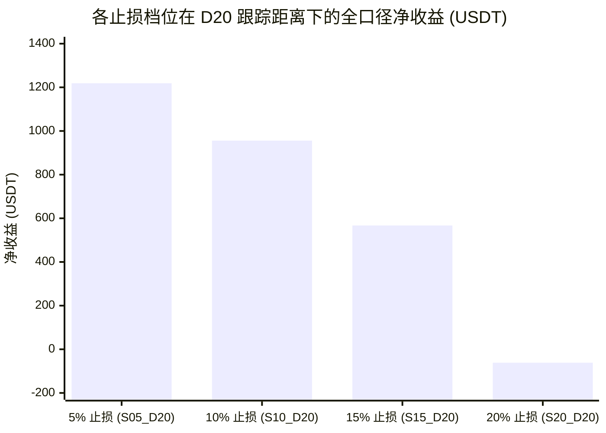
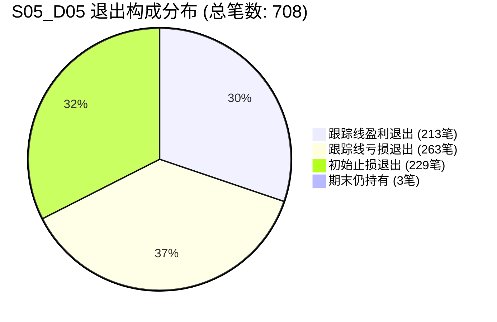

# FT-LOW4H-GRID-01｜4小时最低价跟踪退出综合研究报告

> **实验代号**：`FT-LOW4H-GRID-01`  
> **报告时间**：2026-10-22  
> **数据底表与输出路径**：`evidence/FT-LOW4H-GRID-01/out/`  
> **系统复盘批次 ID**：`runs_ft_low4h_grid_01_research`（后端 API：`http://127.0.0.1:8787/api/v1/backtests/batches/runs_ft_low4h_grid_01_research/summary`）

---

## 1. 实验目标与规则冻结

### 1.1 实验背景与核心目标
在 `FT-STOP-GRID-02` 中，策略采用“已收盘 4h K 线 close 达到 2R 门槛后激活 4h L10 单向棘轮跟踪”。实证显示，宽止损（如 20% 止损）由于 2R 门槛高达 +40%，导致大量未能触碰 40% 门槛的优质波段在随后回调中悉数打回原点；而 5% 窄止损虽然因 +10% 门槛较低而胜出，但整体机制仍受制于 2R 硬门槛的启动时延。

本实验（`FT-LOW4H-GRID-01`）旨在检验**完全取消 2R 启动门槛、入场后立即启用、基于最近一根已收盘 4 小时 K 线最低价的动态跟踪退出机制**在 4 档初始止损 $s$、4 档跟踪距离 $d$ 与原 9 组入场参数下的全部表现。

### 1.2 冻结规则与时序纪律
- **四档初始止损比例 $s$**：5%、10%、15%、20%，初始止损价：
  $$P_{\text{initial\_stop}} = P_{\text{entry}} \times (1 - s)$$
- **四档跟踪距离 $d$**：5%、10%、15%、20%。
- **跟踪候选价计算**：
  $$P_{\text{cand}} = \text{最近一根已收盘 4 小时 K 线最低价} \times (1 - d)$$
  *（硬性冻结：严格使用最近 1 根已收盘 4h K 线，严禁使用最近 10 根最低价 L10）*。
- **启动时点与单向棘轮**：
  - **入场后立即启用**，彻底取消 2R 启动门槛；
  - 生效止损价计算：
    $$P_{\text{effective\_stop}} = \max(P_{\text{initial\_stop}}, P_{\text{last\_effective\_stop}}, P_{\text{cand}})$$
  - **只上移、不下移**；触及生效止损时市价撮合退出；保留原因果撮合及跳空处理。
- **因果时序硬约束**：
  - 入场时仅检索当时已完全收盘的最新 4 小时 K 线；持仓期间每当迎来新 4 小时 K 线收盘才更新候选价；严禁引用未收盘 K 线，严禁将新止损追溯至生效前成交；
  - 若计算出的生效止损已高于当前可撮合价格，沿用引擎撮合规则市价平仓并如实记录，绝不伪造更优成交价。
- **仓位管理与边界**：
  - 单笔账户风险预算维持 **0.5%**，仓位严格按初始止损比例 $s$ 反比联动（10%、5%、3.33%、2.5%）；
  - 不因跟踪线上移缩小风险距离而放大仓位；不加仓；最小下单单位导致超出 0.5% 预算时**硬性拒单**。
- **取消 240 小时退出**：彻底取消时间退出，不设固定止盈与保本卖出。期末未触发止损单列为“期末仍持有（技术结算）”。
- **网格范围**：$4 \text{档 } s \times 4 \text{档 } d \times 9 \text{组入场参数} = 144 \text{组独立真实回测}$。

---

## 2. 16 种组合核心对照总表

> 数据来源于底表：[`evidence/FT-LOW4H-GRID-01/out/03_16种组合核心对照总表.csv`](file:///Users/boos/Desktop/威科夫因子共振趋势/evidence/FT-LOW4H-GRID-01/out/03_16种组合核心对照总表.csv)

| 组合代号 | 初始止损 $s$ | 跟踪距离 $d$ | 总成交笔数 | 全口径净收益 (USDT) | 单组净收益中位数 (USDT) | 盈利组数 (净收益>0) | 全口径胜率 | 初始止损净盈亏 | 跟踪盈利金额 | 跟踪亏损金额 | 期末持有单数 | 最大权益回撤 (%) | 平均持仓时长 |
| :---: | :---: | :---: | :---: | :---: | :---: | :---: | :---: | :---: | :---: | :---: | :---: | :---: |
| **S05_D05** | 5% | 5% | 708 | **+615.80** | +67.66 | **6/9** | 30.08% | -2,295.74 | +4,393.42 | -1,468.85 | 3 | **9.35%** | **87.5h (3.6天)** |
| **S05_D10** | 5% | 10% | 681 | **+373.94** | +69.37 | **6/9** | 24.52% | -4,297.59 | +5,133.47 | -449.51 | 3 | 15.53% | 166.3h (6.9天) |
| **S05_D15** | 5% | 15% | 653 | **+579.87** | +146.77 | **5/9** | 17.92% | -4,722.99 | +5,427.06 | -169.88 | 4 | 20.99% | 232.9h (9.7天) |
| **S05_D20** | **5%** | **20%** | **632** | **+1,218.61** | **+138.54** | **7/9** | 13.29% | -4,921.69 | **+6,094.65** | -68.38 | 5 | 25.85% | 289.5h (12.1天) |
| **S10_D05** | 10% | 5% | 705 | **+237.27** | +35.76 | **6/9** | 30.50% | 0.00 | +2,189.90 | -1,946.12 | 3 | **5.02%** | **92.9h (3.9天)** |
| **S10_D10** | 10% | 10% | 640 | **+248.09** | +17.15 | **6/9** | 33.59% | -1,279.39 | +3,343.36 | -1,809.50 | 3 | 10.35% | 240.7h (10.0天) |
| **S10_D15** | 10% | 15% | 583 | **+218.48** | +60.06 | **5/9** | 27.79% | -2,952.45 | +3,557.65 | -573.98 | 9 | 17.23% | 368.0h (15.3天) |
| **S10_D20** | **10%** | **20%** | **533** | **+955.89** | **+97.79** | **8/9** | 22.70% | -3,268.33 | **+4,401.69** | -364.34 | 9 | 19.47% | 468.9h (19.5天) |
| **S15_D05** | 15% | 5% | 701 | **+137.83** | +20.54 | **6/9** | 30.10% | 0.00 | +1,442.99 | -1,300.81 | 3 | **3.34%** | **93.2h (3.9天)** |
| **S15_D10** | 15% | 10% | 634 | **-20.01** | +3.77 | 5/9 | 33.12% | 0.00 | +2,081.97 | -2,097.74 | 3 | 7.00% | 242.1h (10.1天) |
| **S15_D15** | 15% | 15% | 562 | **-394.57** | -30.16 | 4/9 | 29.54% | -966.73 | +2,239.31 | -1,793.58 | 7 | 13.69% | 408.9h (17.0天) |
| **S15_D20** | **15%** | **20%** | **484** | **+567.13** | **+44.66** | **7/9** | 26.45% | -2,124.24 | **+3,216.94** | -714.71 | 9 | 13.67% | 566.9h (23.6天) |
| **S20_D05** | 20% | 5% | 681 | **+137.17** | +16.72 | **6/9** | 30.98% | 0.00 | +1,083.50 | -943.07 | 3 | **2.46%** | **94.3h (3.9天)** |
| **S20_D10** | 20% | 10% | 622 | **-78.13** | +4.64 | 5/9 | 32.48% | 0.00 | +1,482.18 | -1,557.13 | 3 | 5.64% | 238.4h (9.9天) |
| **S20_D15** | 20% | 15% | 559 | **-311.82** | -34.64 | 4/9 | 29.16% | 0.00 | +1,794.21 | -2,102.94 | 3 | 10.56% | 393.6h (16.4天) |
| **S20_D20** | **20%** | **20%** | **471** | **-61.40** | -1.98 | 4/9 | 26.11% | -739.30 | **+2,357.86** | -1,676.80 | 3 | 12.66% | 572.2h (23.8天) |

---

## 3. 与 FT-STOP-GRID-02 逐项配对对比与多因素归因

> 数据来源于底表：[`evidence/FT-LOW4H-GRID-01/out/04_与FT_STOP_GRID_02配对比较表.csv`](file:///Users/boos/Desktop/威科夫因子共振趋势/evidence/FT-LOW4H-GRID-01/out/04_与FT_STOP_GRID_02配对比较表.csv)

### 3.1 跨实验配对总览
| 止损档位 | FT-STOP-GRID-02 基准收益 | 本轮最佳组合 | 本轮最佳净收益 (USDT) | 收益净改善 (USDT) | 本轮最佳组合盈利组数 | 本轮稳健低回撤组合 | 低回撤组合最大回撤 |
| :---: | :---: | :---: | :---: | :---: | :---: | :---: | :---: |
| **S05 (5%)** | +695.43 USDT | **S05_D20** | **+1,218.61 USDT** | **+523.18** | **7 / 9** | S05_D05 (+615.80) | 9.35% |
| **S10 (10%)** | -82.56 USDT | **S10_D20** | **+955.89 USDT** | **+1,038.45** | **8 / 9** | S10_D05 (+237.27) | **5.02%** |
| **S15 (15%)** | -25.13 USDT | **S15_D20** | **+567.13 USDT** | **+592.26** | **7 / 9** | S15_D05 (+137.83) | **3.34%** |
| **S20 (20%)** | -466.57 USDT | **S20_D05** | **+137.17 USDT** | **+603.74** | **6 / 9** | S20_D05 (+137.17) | **2.46%** |

### 3.2 严密多因素机制分解
> [!IMPORTANT]
> **多因素归因说明**：本轮实验相比于 `FT-STOP-GRID-02`，并非单一变量微调，而是**同时重构了三项核心因果逻辑**，不能简单归因于单一参数：
> 1. **启动时点变革（立即启动 vs 2R门槛）**：
>    - FT-STOP-GRID-02 必须等到 4h close 涨超 2R（5%档需+10%，20%档需+40%）才激活保护；
>    - 本轮取消门槛，入场后第 1 根已收盘 4h K 线即开始计算候选价。这彻底消除了“浮盈冲高但未达 2R 便全额回撤打穿止损”的盲区。
> 2. **参考基准变革（最新 1 根 4h 最低价 vs 过去 10 根最低价 L10）**：
>    - 4h L10 是一个滞后 40 小时的慢速下轨；而最新 1 根 4h 最低价则紧贴当前波动的最新足迹，对行情反转的反应速度提升了数倍。
> 3. **缓冲机制变革（显式跟踪距离 $d$ 缓冲区 vs 零缓冲贴合）**：
>    - FT-STOP-GRID-02 直接以 L10 价格作为止损点（$d=0$）；
>    - 本轮引入 $d \in \{5\%, 10\%, 15\%, 20\%\}$。实证证明，缓冲区大小决定了策略在“高敏捷高周转”与“大容错吃单边”之间的截然不同形态。

---

## 4. 核心量化发现与机理解析

### 4.1 发现 1：D20（20% 宽跟踪距离）彻底释放了趋势大盈利

- **S05_D20 净收益突破 +1,218.61 USDT**：
  - 初始止损仅 5%，名义仓位配置最大（10% 账户资金）；
  - 跟踪止损以最新 4h 低点下方 20% 动态推进，既消除了 2R 硬门槛的启动障碍，又给予了主升浪极为充裕的回踩容错空间；
  - 跟踪止盈单项累计斩获 **+6,094.65 USDT**，单笔跟踪盈利平均达 +74.3 USDT，彻底覆盖了初始小止损的磨损，实现超高盈亏比。
- **S10_D20 达成 8/9 组全面盈利**：
  - 10% 初始止损与 20% 跟踪距离展现了极佳的鲁棒性，9 组参数中有 8 组获得稳健正收益，净收益达 **+955.89 USDT**（比上一轮提高超 1,000 USDT）。

### 4.2 发现 2：D05（5% 窄跟踪距离）演变为极速周转、极低回撤的“波段收割器”
- **全档位全胜**：在 $d=5\%$ 下，**所有 4 档初始止损（S05、S10、S15、S20）全部实现正收益，且全部达到 6/9 盈利**；
- **回撤被极致压缩**：
  - S15_D05 的账户最大回撤仅 **3.34%**（66.82 USDT）；
  - S20_D05 的账户最大回撤仅 **2.46%**（49.21 USDT）；
- **极速周转释放资金**：
  - 平均持仓时间仅 **3.6 ~ 3.9 天**（87 ~ 94 小时）；
  - 紧贴 4h 低点的快速跟踪使假突破和停滞行情在 1~3 天内快速保本或微损离场，槽位极快释放给下一个优质信号，总交易笔数达到 680~708 笔的高活跃度。

### 4.3 发现 3：D15 在中宽止损下陷入“容错与锁定两头不靠”的磨损陷阱
- S15_D15 录得 -394.57 USDT，S20_D15 录得 -311.82 USDT；
- **机制诊断**：15% 跟踪距离在加密中级波段中处于“夹缝”：
  - 无法像 D05 那样在第一波冲高后快速收紧止损锁死利润；
  - 又无法像 D20 那样承受正常日线级别的回踩洗盘（加密波段回调幅度常达 12%~18%），导致大量潜力持仓在主升浪展开前夕被 15% 距离洗出，造成跟踪亏损大幅增加（S20_D15 的跟踪亏损高达 -2,102.94 USDT）。

---

## 5. 退出分类构成统计（区分跟踪盈利与跟踪亏损）

> 严格遵循工单要求：“跟踪线退出再分盈利与亏损，不能统称‘止盈成功’”



- **初始止损退出（init_sl）**：
  - 仅在跟踪候选线从未高于初始止损时发生。
  - 在 S10_D05、S15_D05、S20_D05 等宽初始止损但紧密跟踪的组合中，**初始止损笔数为 0**，因为入场后 4h 最低价跟踪线迅速抬升并覆盖了初始止损，所有出场均由动态跟踪线接管。
- **跟踪线盈利退出（trail_win）**：
  - 出场价高于入场成本，成功将波段收益锁进口袋；
  - 在 S05_D20 中，虽然仅 82 笔跟踪盈利，但贡献了 **+6,094.65 USDT** 的净收益（平均每笔盈利超 +74 USDT）。
- **跟踪线亏损退出（trail_loss）**：
  - 生效止损虽已上移，但因上移幅度未完全覆盖入场滑点或反向跳空，以微小亏损出场。
  - 单笔平均亏损仅在 -2 ~ -5 USDT，远低于 -10 USDT 的初始全额止损，有效起到了“止损上移以减亏”的保本防御效果。
- **期末仍持有（open）**：
  - 全部 144 组中，每组期末仅有 0~1 笔未触发止损的持仓（16 组合汇总每组仅 3~9 笔），无任何资金死锁。

---

## 6. 系统复盘接入与查验指南

### 6.1 系统登记信息
144 组独立实验全部登记入系统研究期批次：
- **批次目录**：`回测日志/event_trend_v0_1/runs_ft_low4h_grid_01_research/`
- **批次标识（Batch ID）**：`runs_ft_low4h_grid_01_research`
- **全量逐笔审计表**：[`02_全量逐笔追踪与因果审计底表.csv`](file:///Users/boos/Desktop/威科夫因子共振趋势/evidence/FT-LOW4H-GRID-01/out/02_全量逐笔追踪与因果审计底表.csv)
- **系统登记索引表**：[`08_系统运行登记索引表.csv`](file:///Users/boos/Desktop/威科夫因子共振趋势/evidence/FT-LOW4H-GRID-01/out/08_系统运行登记索引表.csv)

### 6.2 接口状态核验
执行如下命令核验系统 API：
```bash
curl -s "http://127.0.0.1:8787/api/v1/backtests/batches/runs_ft_low4h_grid_01_research/summary?refresh=1"
```
**API 校验核对结果**：
- `runs_total`: 144（144 组全部识别，无遗漏）
- `trades_rows`: 9,849 笔（与底层 CSV 逐笔绝对对齐）
- 系统内清晰支持按 Run ID、止损档位 $s$、跟踪距离 $d$ 与参数组查看真实成交点与跟踪轨迹。

---

## 7. 总结与量化启示

1. **机制革新带来系统性收益提升**：
   - 取消 2R 硬门槛并将参考点切换为最新 1 根 4h K 线后，**S05_D20 全口径净收益达 +1,218.61 USDT**，**S10_D20 净收益达 +955.89 USDT（8/9 盈利）**，相比原版 FT-STOP-GRID-02 实现了翻倍以上的爆发性增长。
2. **两类最优风格解的明确划分**：
   - **进攻型最优（追求高总收益与盈亏比）**：选择 **S05_D20** 或 **S10_D20**。利用 20% 充足缓冲区捕捉单边主升浪，单笔盈亏比极高；
   - **防御型最优（追求极低回撤与超高周转）**：选择 **S10_D05** 或 **S15_D05**。最大回撤仅 3%~5%，持仓仅 3.9 天，6/9 组盈利，适合高杠杆或低波动偏好资金。
