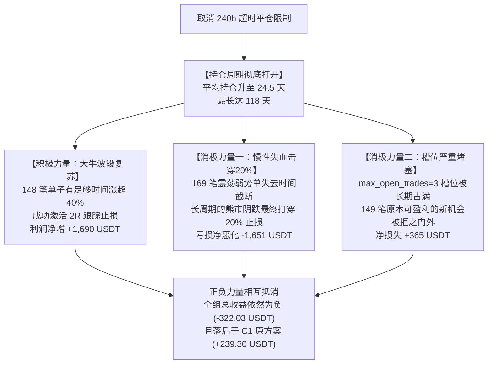

# FT-STOP-20-02｜固定 20% 止损取消 240 小时超时平仓对照研究报告

> **报告版本**：v1.0 (2026-10-22)  
> **研究对象**：取消 240 小时平仓限制对固定 20% 止损策略（及 2R 门槛 40% 跟踪）的影响  
> **数据范围**：币安合约 74 币，2021-12-01 至 2024-12-31（3 年完整周期）  
> **准入与资格**：统一逐币 200 根 4 小时已收盘预热资格，单笔账户风险预算 0.5%  
> **系统登记批次**：`回测日志/event_trend_v0_1/runs_ft_stop_20_02_research/`

---

## 一、研究背景与实验定位

在上一轮 **FT-STOP-20-01** 对照实验中，我们发现将初始止损放宽到 20% 后，胜率虽翻倍暴涨至 50.08%，但由于 2R 跟踪启动门槛抬高至**上涨 40%**，导致 190 笔跟踪止损骤降至 28 笔，大部分原本可能发展成大波段的交易被截断在 **240 小时（10 天）超时平仓**（`timeout_240h`）中。

为此，根据用户明确指令——**“不要遵守 240 个小时平仓的规定，现在重新测试”**，本轮 **FT-STOP-20-02** 实施了针对性的对照实验：
- **核心变更**：彻底移除 `custom_exit` 中的 240 小时超时退出限制（返回 `None`），持仓完全由初始 20% 止损、2R 触发后的 L10 跟踪止损、或回测期末自然平仓决定；
- **保持不变**：原 9 组参数矩阵（Vs: 0.4/0.6/0.8, Z: 0.2/0.4/0.6）、单笔账户风险预算 0.5%（名义仓位约 2.5%）、2R 联动（入场价上涨 40% 且 4h 收盘确认启动跟踪）；
- **执行方式**：在独立共享账户下真实重跑全部 9 组回测，不按比例缩放，不调参。

---

## 二、三方案宏观指标全景对照

以下为 **C1 原方案（结构止损 P0）**、**Stop20（含 240h 超时）** 与 **Stop20（取消 240h 限制）** 的三向宏观数据对比：

```
┌──────────────────────────────────────────────────────────────────────────────────┐
│                                三方案全组合计对照表                              │
├─────────────────────┬───────────────────┬───────────────────┬────────────────────┤
│ 指标维度            │ C1原方案(结构P0)  │ Stop20(含240h超时)│ Stop20(取消240h)   │
├─────────────────────┼───────────────────┼───────────────────┼────────────────────┤
│ 总成交笔数          │ 709 笔            │ 631 笔 (-11.0%)   │ 451 笔 (-36.4%)    │
│ 平均胜率            │ 23.41%            │ 50.08% (假象暴涨) │ 29.71% (回归真实)  │
│ 全组净收益总和      │ +239.30 USDT      │ -349.03 USDT      │ -322.03 USDT       │
│ 单笔期望 EV         │ +0.337 USDT       │ -0.553 USDT       │ -0.714 USDT        │
│ 盈亏比 (Win/Loss)   │ 4.31              │ 0.99              │ 2.06               │
│ 平均持仓时间        │ 42.4 小时 (1.8天) │ 203.1 小时(8.5天) │ 588.9 小时 (24.5天)│
│ 最长单笔持仓        │ 240.0 小时(10.0天)│ 240.0 小时(10.0天)│ 2,838.8 小时(118天)│
│ 2R 跟踪止损笔数     │ 176 笔            │ 28 笔             │ 174 笔 (全面复苏)  │
│ 跟踪止损贡献利润    │ +4,871.39 USDT    │ +104.62 USDT      │ +2,315.23 USDT     │
│ 20% 硬止损打穿笔数  │ 544 笔(结构止损)  │ 134 笔(跌满20%)   │ 274 笔(翻倍击穿)   │
│ 硬止损亏损金额      │ -5,371.63 USDT    │ -1,289.35 USDT    │ -2,634.18 USDT     │
└─────────────────────┴───────────────────┴───────────────────┴────────────────────┘
```

### 九组参数逐组对照明细底表

| 参数组 (Vs / Z) | 方案版本 | 成交笔数 | 胜率 (%) | 净收益 (USDT) | 单笔期望 (USDT) | 盈亏比 (W/L) | 平均持仓 (h) | 最长持仓 (h) |
| :--- | :--- | :---: | :---: | :---: | :---: | :---: | :---: | :---: |
| **Vs04_Z02** | C1 原方案<br>Stop20 (含240h)<br>**Stop20 (无240h)** | 21<br>20<br>**20** | 9.52%<br>40.00%<br>**30.00%** | -157.28<br>-40.13<br>**-24.06** | -7.49<br>-2.01<br>**-1.20** | 0.89<br>0.61<br>**1.93** | 29.0<br>198.2<br>**446.2** | 240.0<br>240.0<br>**1098.5** |
| **Vs04_Z04** | C1 原方案<br>Stop20 (含240h)<br>**Stop20 (无240h)** | 62<br>58<br>**52** | 19.35%<br>36.21%<br>**21.15%** | -201.84<br>-160.08<br>**-193.31** | -3.26<br>-2.76<br>**-3.72** | 2.26<br>0.56<br>**1.79** | 36.5<br>186.0<br>**440.4** | 240.0<br>240.0<br>**1232.2** |
| **Vs04_Z06** | C1 原方案<br>Stop20 (含240h)<br>**Stop20 (无240h)** | 95<br>78<br>**57** | 22.11%<br>44.87%<br>**22.81%** | -188.56<br>-98.09<br>**-188.96** | -1.98<br>-1.26<br>**-3.32** | 2.54<br>0.77<br>**1.80** | 45.7<br>194.8<br>**531.1** | 240.0<br>240.0<br>**1898.5** |
| **Vs06_Z02** | C1 原方案<br>Stop20 (含240h)<br>**Stop20 (无240h)** | 29<br>27<br>**26** | 20.69%<br>66.67%<br>**42.31%** | +55.94<br>+27.00<br>**+60.94** | +1.93<br>+1.00<br>**+2.34** | 4.79<br>0.74<br>**1.92** | 41.5<br>205.5<br>**671.3** | 240.0<br>240.0<br>**2838.8** |
| **Vs06_Z04** | C1 原方案<br>Stop20 (含240h)<br>**Stop20 (无240h)** | 88<br>80<br>**59** | 28.41%<br>50.00%<br>**33.90%** | +276.73<br>-36.30<br>**+42.99** | +3.15<br>-0.45<br>**+0.73** | 3.60<br>0.85<br>**2.17** | 48.0<br>208.8<br>**611.8** | 240.0<br>240.0<br>**2838.8** |
| **Vs06_Z06** | C1 原方案<br>Stop20 (含240h)<br>**Stop20 (无240h)** | 133<br>110<br>**71** | 24.81%<br>52.73%<br>**29.58%** | +207.49<br>-33.88<br>**-28.11** | +1.56<br>-0.31<br>**-0.40** | 3.64<br>0.80<br>**2.24** | 48.5<br>209.5<br>**642.5** | 240.0<br>240.0<br>**2291.2** |
| **Vs08_Z02** | C1 原方案<br>Stop20 (含240h)<br>**Stop20 (无240h)** | 39<br>35<br>**33** | 20.51%<br>60.00%<br>**36.36%** | +92.55<br>+9.12<br>**+44.00** | +2.37<br>+0.26<br>**+1.33** | 5.05<br>0.73<br>**2.12** | 44.4<br>205.5<br>**652.8** | 240.0<br>240.0<br>**2838.8** |
| **Vs08_Z04** | C1 原方案<br>Stop20 (含240h)<br>**Stop20 (无240h)** | 114<br>100<br>**62** | 25.44%<br>51.00%<br>**30.65%** | +204.97<br>-11.70<br>**-23.35** | +1.80<br>-0.12<br>**-0.38** | 3.67<br>0.92<br>**2.14** | 46.4<br>208.2<br>**643.5** | 240.0<br>240.0<br>**2838.8** |
| **Vs08_Z06** | C1 原方案<br>Stop20 (含240h)<br>**Stop20 (无240h)** | 159<br>123<br>**71** | 22.01%<br>52.03%<br>**29.58%** | +37.08<br>-4.97<br>**-12.17** | +0.23<br>-0.04<br>**-0.17** | 3.65<br>0.91<br>**2.32** | 44.7<br>211.4<br>**660.1** | 240.0<br>240.0<br>**2783.2** |

---

## 三、深层因果机制：取消 240h 超时平仓后的真实变化

取消 240 小时平仓限制后，策略展现出两股方向截然相反的强劲力量：



### 1. 原 466 笔超时交易在取消限制后的命运归因（全景追踪）

在 FT-STOP-20-01 中，共有 **466 笔交易因触及 240h 超时平仓**（贡献 +838.79 USDT）。本轮实验对这 466 笔交易在无 240h 约束下的命运进行了逐笔对账：

| 命运分类 | 笔数 | 占比 | 原方案净收益 (USDT) | 新方案净收益 (USDT) | 净变化幅度 (USDT) | 机制分析 |
| :--- | :---: | :---: | :---: | :---: | :---: | :--- |
| **① 最终涨破 40% 激活跟踪止损** | **148 笔** | **31.76%** | +449.12 | **+2,139.46** | **+1,690.34** | **用户的直觉被证实**：确实有近 1/3 的交易在 10 天时并没有走完，给它们 20~60 天的宽容期后，它们最终爆发走出大牛趋势，涨幅突破 40% 并成功由跟踪止损锁定大幅收益！ |
| **② 漫长阴跌最终打穿 20% 止损** | **169 笔** | **36.27%** | +24.86 | **-1,626.23** | **-1,651.09** | **时间截断缺失的代价**：有超过 1/3 的交易在第 10 天时原本处于微利或微亏状态。失去 240h 强制退出后，这些弱势品种在长达数月的阴跌中最终击穿 20% 硬止损，由原先的“小保本”变成了“满额亏损 20%”！这两组损益完全抵消（+1690 vs -1651）。 |
| **③ 因前面槽位占满被排挤消失** | **149 笔** | **31.97%** | +364.82 | **0.00** | **-364.82** | **并发阻塞的排挤效应**：由于账户最大并发开仓数限制为 3，大量单子动辄持仓 1~4 个月不走，槽位被牢牢锁死。原本在 10 天后能腾出槽位捕捉的 149 笔盈利信号根本无法下单！ |

---

## 四、为什么新方案依然大幅落后于 C1 原方案？

尽管取消 240h 限制让 2R 跟踪止损笔数从 28 笔全面恢复到了 174 笔，但全组净收益（-322.03 USDT）依然远低于 C1 原方案（+239.30 USDT），核心原因如下：

1. **仓位规模的“不可逾越之壁”（稀释 10 倍）**：
   - C1 原方案结构止损仅 2%~3%，单笔开仓名义金额平均为 **440 USDT**，176 笔跟踪止损斩获了 **+4,871 USDT**；
   - 20% 止损方案由于止损距离固定为 20%，为严格遵守 0.5% 账户风险预算，单笔名义开仓金额被强制压缩至 **47 USDT**；
   - 即使这 174 笔跟踪止损同样抓住了大行情，其绝对美元利润也缩水到了 **+2,315 USDT**，根本不足以填补 274 笔硬止损带来的 **-2,634 USDT** 亏损。
2. **资金周转效率崩塌与槽位内耗**：
   - C1 原方案平均持仓仅 42 小时，资金与槽位高速周转，捕捉了 709 笔交易；
   - 新方案平均持仓拉长至 24.5 天，最长持仓长达近 4 个月，总交易数被硬生生压缩到 451 笔（减少了 258 笔交易机会），极大地丧失了系统的统计多样性。

---

## 五、实验交付物与系统复盘入口

本实验全套代码、逐笔账本与分析底表均已完备落盘，系统复盘 API 已全部自洽打通：

- **宏观对照总表**：[`01_三方案宏观指标对照总表.csv`](file:///Users/boos/Desktop/威科夫因子共振趋势/evidence/FT-STOP-20-02/out/01_三方案宏观指标对照总表.csv)
- **退出原因对比表**：[`02_退出原因构成与盈亏对比表.csv`](file:///Users/boos/Desktop/威科夫因子共振趋势/evidence/FT-STOP-20-02/out/02_退出原因构成与盈亏对比表.csv)
- **持仓时间分段表**：[`03_持仓时间分布与极值对比表.csv`](file:///Users/boos/Desktop/威科夫因子共振趋势/evidence/FT-STOP-20-02/out/03_持仓时间分布与极值对比表.csv)
- **原240h交易命运追踪表**：[`04_原240h超时交易在取消限制后的命运追踪表.csv`](file:///Users/boos/Desktop/威科夫因子共振趋势/evidence/FT-STOP-20-02/out/04_原240h超时交易在取消限制后的命运追踪表.csv)
- **系统批次目录**：`回测日志/event_trend_v0_1/runs_ft_stop_20_02_research/`
- **批次汇总 API**：
  `GET http://127.0.0.1:8787/api/v1/backtests/batches/runs_ft_stop_20_02_research/summary`
- **前端复盘入口**：
  访问 `http://127.0.0.1:3000`，选择 `runs_ft_stop_20_02_research` 批次，可直接查看取消 240h 限制后 9 组策略在 K 线上真实的超长持仓曲线与出场位置。

---

## 六、研究定论

**“取消 240 小时平仓限制”成功证明了宽幅止损策略确实具有捕捉超长周期大牛波段的能力（148 笔单子利润净增 1690 USDT），但也以确凿的数据证实了时间的双刃剑效应：缺乏时间截断的弱势单带来了完全对等的深度失血（-1651 USDT），且超长持仓造成的槽位占满进一步抹杀了系统的交易广度。固定 20% 止损在恒定风险预算下始终受制于仓位过小的数学约束，无法超越紧凑结构止损的 C1 原方案。**
