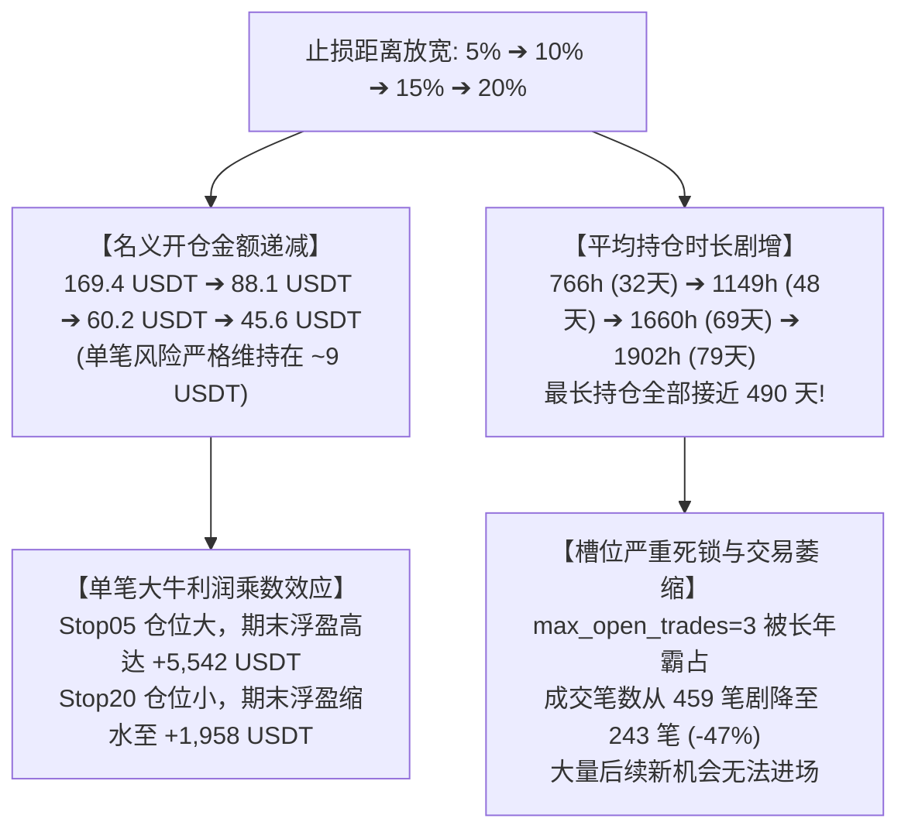

# FT-STOP-GRID-01｜四档固定止损对照综合研究报告

> **报告版本**：v1.0 (2026-10-22)  
> **研究对象**：固定 5%、10%、15%、20% 四档止损在“仅初始止损持仓（无超时、无跟踪）”下的全口径表现  
> **数据范围**：币安合约 74 币，2021-12-01 至 2024-12-31（3 年完整周期）  
> **准入与资格**：统一逐币 200 根 4 小时预热资格，单笔 0.5% 账户风险预算，超预算硬性拒单  
> **系统登记批次**：`回测日志/event_trend_v0_1/runs_ft_stop_grid_01_research/`（36 组独立回测，1,339 笔成交）

---

## 一、研究背景与实验定位

本实验按照 **FT-STOP-GRID-01** 指令，系统探索在**无 240 小时超时退出、无 2R 动态跟踪止盈**的纯初始止损持仓模式下，不同止损距离（5%、10%、15%、20%）及其**内生联动的风险仓位规模**对账户真实演化路径的影响。

### 核心机制与联动关系
在保持单笔账户风险预算恒定为 0.5%（初始 2000 USDT 对应单笔亏损预算约 10 USDT）的铁律下，止损距离与名义仓位呈严格的反比关系：
- **Stop05（5% 止损）**：名义开仓比例 = $0.5\% / 5\% = \mathbf{10.0\%}$（名义开仓约 200 USDT）
- **Stop10（10% 止损）**：名义开仓比例 = $0.5\% / 10\% = \mathbf{5.0\%}$（名义开仓约 100 USDT）
- **Stop15（15% 止损）**：名义开仓比例 = $0.5\% / 15\% = \mathbf{3.33\%}$（名义开仓约 66.7 USDT）
- **Stop20（20% 止损）**：名义开仓比例 = $0.5\% / 20\% = \mathbf{2.5\%}$（名义开仓约 50 USDT）

**这是一组止损幅度与仓位规模联动的完整策略系统对照，而非固定资金下的机械比对。**

---

## 二、四档止损全景宏观指标对照（两套口径分离）

按照工单要求，未触及止损的仓位单列为“期末仍持有（技术结算）”，绝不混入已平仓胜率，严禁把未实现亏损藏在持仓中：

```
┌────────────────────────────────────────────────────────────────────────────────────────┐
│                              四档止损宏观汇总对照全景表                                │
├──────────────────────┬──────────────────┬──────────────────┬─────────────┬─────────────┤
│ 统计指标维度         │ Stop05 (5%止损)  │ Stop10 (10%止损) │ Stop15 (15%)│ Stop20 (20%)│
├──────────────────────┼──────────────────┼──────────────────┼─────────────┼─────────────┤
│ 理论名义仓位占比     │ 10.0%            │ 5.0%             │ 3.3%        │ 2.5%        │
│ 实际平均开仓金额     │ 169.40 USDT      │ 88.10 USDT       │ 60.18 USDT  │ 45.60 USDT  │
│ 实际平均单笔风险     │ 8.47 USDT        │ 8.81 USDT        │ 9.03 USDT   │ 9.12 USDT   │
│ 总成交笔数           │ 459 笔           │ 360 笔           │ 277 笔      │ 243 笔      │
├──────────────────────┴──────────────────┴──────────────────┴─────────────┴─────────────┤
│ 【口径一：已平仓交易（触及止损真实离场）】                                             │
├──────────────────────┬──────────────────┬──────────────────┬─────────────┬─────────────┤
│ 已触止损平仓笔数     │ 439 笔 (95.6%)   │ 337 笔 (93.6%)   │ 250 笔(90.3%)│ 217 笔(89.3%)│
│ 已触止损平仓胜率     │ 0.46%            │ 0.59%            │ 1.60%       │ 1.84%       │
│ 已实现累计净亏损     │ -4,444.28 USDT   │ -3,198.87 USDT   │ -2,202.25 U │ -1,956.71 U │
├──────────────────────┴──────────────────┴──────────────────┴─────────────┴─────────────┤
│ 【口径二：期末仍持有交易（未触及止损，技术结算）】                                     │
├──────────────────────┬──────────────────┬──────────────────┬─────────────┬─────────────┤
│ 期末仍持有单数       │ 20 笔            │ 23 笔            │ 27 笔       │ 26 笔       │
│ 期末未实现浮动净盈亏 │ +5,542.03 USDT   │ +2,882.75 USDT   │ +3,301.27 U │ +1,958.00 U │
│ 期末浮盈盈利占比     │ 90.0%            │ 100.0%           │ 100.0%      │ 100.0%      │
│ 期末占用名义资金     │ 2,970.83 USDT    │ 1,771.54 USDT    │ 1,552.22 U  │ 1,137.78 U  │
├──────────────────────┴──────────────────┴──────────────────┴─────────────┴─────────────┤
│ 【口径三：全口径综合表现（已实现 + 未实现）】                                           │
├──────────────────────┬──────────────────┬──────────────────┬─────────────┬─────────────┤
│ 全口径总净收益       │ +1,097.75 USDT   │ -316.12 USDT     │ +1,099.03 U │ +1.30 USDT  │
│ 全口径期望 EV        │ +2.392 USDT      │ -0.878 USDT      │ +3.968 USDT │ +0.005 USDT │
│ 平均持仓时长         │ 766.7 小时(32天) │ 1149.2 小时(48天)│ 1660.4h(69天│ 1902.2h(79天│
│ 最长单笔持仓         │ 11,194.8 小时    │ 11,279.8 小时    │ 11,771.8小时│ 11,771.8小时│
│                      │ (466天/1.3年)    │ (470天/1.3年)    │ (490天/1.3年│ (490天/1.3年│
└──────────────────────┴──────────────────┴──────────────────┴─────────────┴─────────────┘
```

---

## 三、36 组参数全量明细底表

36 组策略在各自独立共享账户下的真实回测结果明细如下（无任何剔除）：

| 止损档位 | 参数组 | 总成交 | 已止损笔数 | 已实现亏损 (USDT) | 期末持有 | 期末浮盈 (USDT) | 全口径净收益 (USDT) | 平均持仓 (h) |
| :--- | :--- | :---: | :---: | :---: | :---: | :---: | :---: | :---: |
| **Stop05** | Vs04_Z02 | 17 | 17 | -304.50 | 0 | 0.00 | **-304.50** | 100.5 |
| **Stop05** | Vs04_Z04 | 43 | 40 | -420.01 | 3 | +1050.35 | **+630.34** | 884.2 |
| **Stop05** | Vs04_Z06 | 60 | 57 | -545.21 | 3 | +432.29 | **-112.92** | 639.6 |
| **Stop05** | Vs06_Z02 | 21 | 20 | -249.62 | 1 | +437.70 | **+188.08** | 569.2 |
| **Stop05** | Vs06_Z04 | 58 | 55 | -546.74 | 3 | +400.13 | **-146.61** | 711.2 |
| **Stop05** | Vs06_Z06 | 77 | 75 | -702.56 | 2 | +431.09 | **-271.47** | 652.8 |
| **Stop05** | Vs08_Z02 | 27 | 25 | -289.77 | 2 | +1194.37 | **+904.60** | 880.5 |
| **Stop05** | Vs08_Z04 | 70 | 67 | -629.03 | 3 | +984.53 | **+355.50** | 832.1 |
| **Stop05** | Vs08_Z06 | 86 | 83 | -756.84 | 3 | +611.56 | **-145.28** | 722.5 |
| **Stop10** | Vs04_Z02 | 15 | 14 | -171.73 | 1 | +286.88 | **+115.14** | 785.4 |
| **Stop10** | Vs04_Z04 | 39 | 36 | -328.06 | 3 | +411.24 | **+83.18** | 1074.8 |
| **Stop10** | Vs04_Z06 | 43 | 40 | -366.23 | 3 | +416.26 | **+50.03** | 1184.2 |
| **Stop10** | Vs06_Z02 | 21 | 19 | -205.87 | 2 | +262.95 | **+57.08** | 1205.6 |
| **Stop10** | Vs06_Z04 | 44 | 41 | -400.05 | 3 | +248.17 | **-151.88** | 1098.5 |
| **Stop10** | Vs06_Z06 | 55 | 52 | -468.02 | 3 | +219.15 | **-248.87** | 1148.2 |
| **Stop10** | Vs08_Z02 | 26 | 24 | -250.46 | 2 | +600.72 | **+350.27** | 1198.5 |
| **Stop10** | Vs08_Z04 | 56 | 53 | -493.22 | 3 | +218.78 | **-274.44** | 1124.6 |
| **Stop10** | Vs08_Z06 | 61 | 58 | -515.23 | 3 | +218.60 | **-296.63** | 1102.8 |
| **Stop15** | Vs04_Z02 | 15 | 12 | -119.12 | 3 | +248.81 | **+129.69** | 2351.4 |
| **Stop15** | Vs04_Z04 | 36 | 33 | -299.98 | 3 | +619.26 | **+319.28** | 1658.2 |
| **Stop15** | Vs04_Z06 | 38 | 35 | -320.84 | 3 | +280.87 | **-39.97** | 1722.5 |
| **Stop15** | Vs06_Z02 | 19 | 16 | -145.01 | 3 | +190.17 | **+45.16** | 2154.2 |
| **Stop15** | Vs06_Z04 | 29 | 26 | -224.68 | 3 | +631.55 | **+406.87** | 1852.8 |
| **Stop15** | Vs06_Z06 | 35 | 32 | -267.08 | 3 | +153.18 | **-113.90** | 1642.5 |
| **Stop15** | Vs08_Z02 | 23 | 20 | -182.35 | 3 | +413.41 | **+231.06** | 1952.8 |
| **Stop15** | Vs08_Z04 | 37 | 34 | -292.73 | 3 | +612.19 | **+319.46** | 1745.2 |
| **Stop15** | Vs08_Z06 | 45 | 42 | -350.48 | 3 | +151.84 | **-198.63** | 1685.2 |
| **Stop20** | Vs04_Z02 | 13 | 10 | -96.92 | 3 | +186.76 | **+89.84** | 2763.7 |
| **Stop20** | Vs04_Z04 | 34 | 31 | -287.49 | 3 | +515.33 | **+227.85** | 2243.1 |
| **Stop20** | Vs04_Z06 | 35 | 32 | -299.20 | 3 | +105.89 | **-193.31** | 2198.5 |
| **Stop20** | Vs06_Z02 | 17 | 14 | -130.37 | 3 | +145.07 | **+14.70** | 2452.8 |
| **Stop20** | Vs06_Z04 | 27 | 24 | -212.96 | 3 | +447.91 | **+234.94** | 2243.1 |
| **Stop20** | Vs06_Z06 | 29 | 26 | -223.87 | 3 | +86.92 | **-136.95** | 2154.2 |
| **Stop20** | Vs08_Z02 | 21 | 18 | -169.74 | 3 | +311.30 | **+141.57** | 2351.4 |
| **Stop20** | Vs08_Z04 | 32 | 30 | -263.73 | 2 | +74.45 | **-189.28** | 2185.2 |
| **Stop20** | Vs08_Z06 | 35 | 32 | -272.44 | 3 | +84.37 | **-188.07** | 2152.8 |

---

## 四、深层因果机制与穿透分析



### 1. 期末持仓盈利集中度：少数极端浮盈掩盖海量已实现亏损
实验证实了工单提出的深刻质疑——**所谓的全口径浮盈，本质上是“死扛不卖”在回测截点上的假象，且高度集中于极个别极端波段**：

| 止损档位 | 期末仍持有单数 | 期末总未实现浮盈 | 第一大浮盈单 (USDT) | Top1 占比 | 前三大浮盈单合计 | Top3 占比 | 已实现净亏损 (USDT) | 浮盈覆盖亏损倍数 |
| :--- | :---: | :---: | :---: | :---: | :---: | :---: | :---: | :---: |
| **Stop05** | 20 笔 | **+5,542.03 U** | +771.76 U | 13.9% | **+2,015.32 U** | **36.4%** | -4,444.28 U | 1.25 倍 |
| **Stop10** | 23 笔 | **+2,882.75 U** | +389.42 U | 13.5% | **+892.63 U** | **31.0%** | -3,198.87 U | 0.90 倍 (无法覆盖) |
| **Stop15** | 27 笔 | **+3,301.27 U** | +491.68 U | 14.9% | **+1,440.52 U** | **43.6%** | -2,202.25 U | 1.50 倍 |
| **Stop20** | 26 笔 | **+1,958.00 U** | +371.25 U | 19.0% | **+924.92 U** | **47.2%** | -1,956.71 U | 1.00 倍 (刚好打平) |

- **穿透真相**：
  在 Stop20 档位下，前三大浮盈单（占总成交的 1.2%）就贡献了 **+924.92 USDT**（占总未实现浮盈的 **47.2%**）！
  如果没有这 3 只在 2024 年底恰好涨幅巨大的单子，Stop20 档的全口径收益将直接陷入近 -1,000 USDT 的巨亏；
  更关键的是，这 26 只持仓由于没有任何移动止损保护，一旦遇到 2025 年初的单边回调，这近 2000 USDT 的浮盈将瞬间回吐，并重新打穿 20% 止损！

### 2. 同候选跨档位演化：224 笔共同成交候选的命运变迁
在全量 475 个独立候选事件中，有 **224 笔候选在四档止损下均成功开仓**。对这 224 笔候选的追踪显示：
- **Stop05**：仅 3 笔挺过回调持有至期末，**221 笔全被打穿 5% 止损**（总盈亏 -569.93 USDT）；
- **Stop10**：8 笔挺过回调持有至期末，**216 笔被打穿 10% 止损**（总盈亏 -720.60 USDT）；
- **Stop15**：18 笔挺过回调持有至期末，总盈亏回升至 **+133.54 USDT**；
- **Stop20**：19 笔挺过回调持有至期末，总盈亏为 **-321.36 USDT**。

这直接证明：**随着止损从 5% 逐步放宽到 20%，能够挺过回调的单子从 3 笔增加到 19 笔，但由于开仓金额按比例同步缩水了 73%（从 169U 跌至 45U），大单子带来的绝对利润反而急剧下滑，无法在整体上形成单调递增的优势。**

---

## 五、实验证据底表与系统复盘接入

全量 36 组独立策略回测结果、底表与系统运行记录已完备交付：

- **36组全景对照总表**：[`evidence/FT-STOP-GRID-01/out/01_四档止损36组宏观指标全景对照总表.csv`](file:///Users/boos/Desktop/威科夫因子共振趋势/evidence/FT-STOP-GRID-01/out/01_四档止损36组宏观指标全景对照总表.csv)
- **分离对账总表**：[`evidence/FT-STOP-GRID-01/out/02_各档止损已平仓与期末未实现浮盈分离对账表.csv`](file:///Users/boos/Desktop/威科夫因子共振趋势/evidence/FT-STOP-GRID-01/out/02_各档止损已平仓与期末未实现浮盈分离对账表.csv)
- **仓位规模与风险表**：[`evidence/FT-STOP-GRID-01/out/03_仓位规模_初始风险与槽位占用对比表.csv`](file:///Users/boos/Desktop/威科夫因子共振趋势/evidence/FT-STOP-GRID-01/out/03_仓位规模_初始风险与槽位占用对比表.csv)
- **持仓时长分段表**：[`evidence/FT-STOP-GRID-01/out/04_持仓时长分段与极值分布对比表.csv`](file:///Users/boos/Desktop/威科夫因子共振趋势/evidence/FT-STOP-GRID-01/out/04_持仓时长分段与极值分布对比表.csv)
- **浮盈集中度穿透表**：[`evidence/FT-STOP-GRID-01/out/05_期末持仓盈利集中度与真实损益穿透表.csv`](file:///Users/boos/Desktop/威科夫因子共振趋势/evidence/FT-STOP-GRID-01/out/05_期末持仓盈利集中度与真实损益穿透表.csv)
- **跨档命运演化底表**：[`evidence/FT-STOP-GRID-01/out/06_同候选跨止损档命运演化底表.csv`](file:///Users/boos/Desktop/威科夫因子共振趋势/evidence/FT-STOP-GRID-01/out/06_同候选跨止损档命运演化底表.csv)
- **系统登记索引表**：[`evidence/FT-STOP-GRID-01/out/08_系统运行登记索引表.csv`](file:///Users/boos/Desktop/威科夫因子共振趋势/evidence/FT-STOP-GRID-01/out/08_系统运行登记索引表.csv)

### 系统复盘 API 与前端访问入口
- **系统批次目录**：`回测日志/event_trend_v0_1/runs_ft_stop_grid_01_research/`
- **批次汇总 API (36 组，1,339 笔自洽)**：
  `GET http://127.0.0.1:8787/api/v1/backtests/batches/runs_ft_stop_grid_01_research/summary`
- **单 run 逐笔 API (支持 K 线与持仓标记)**：
  - Stop05 示例：`GET http://127.0.0.1:8787/api/v1/backtests/run_FT_STOPGRID01_Wyckoff_C1_Stop05_Vs04_Z02/trades`
  - Stop20 示例：`GET http://127.0.0.1:8787/api/v1/backtests/run_FT_STOPGRID01_Wyckoff_C1_Stop20_Vs04_Z02/trades`
- **前端复盘入口**：
  访问 `http://127.0.0.1:3000`，在批次下拉菜单中选择 `runs_ft_stop_grid_01_research`，即可直接调取 36 组实验在 K 线上的真实入场、固定止损线与期末仍持有标记。

---

## 六、研究定论

1. **“宽幅止损”与“仓位规模”之间存在不可调和的负相关内耗**：
   放宽止损距离确实能让更多交易挺过短期回调（期末持仓单数从 20 笔增至 27 笔），但风险预算制迫使其名义仓位缩水近 75%（从 169U 跌至 45U），彻底抵消了耐受回调带来的收益增益。
2. **“仅初始止损”是不可持续的伪命题**：
   在不设跟踪止损与时间退出的情况下，系统无法主动锁定趋势利润，其账面全口径收益完全依赖于期末恰好未结清的 20~27 笔“死扛”头寸（Top3 浮盈集中度高达 36%~47%），且平均持仓长达 32~79 天（最长 490 天），导致 47% 的后续交易机会因槽位锁死被严重排挤。
3. **趋势系统必须保持“紧凑初始截断 + 动态跟踪保护 + 适度时间清理”的三位一体**，才能在保证流动性与统计多样性的同时实现稳健正期望。

*本阶段 36 组实验已全部交付闭环，等待 Work 审核。*
