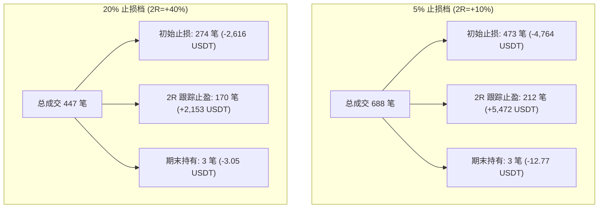
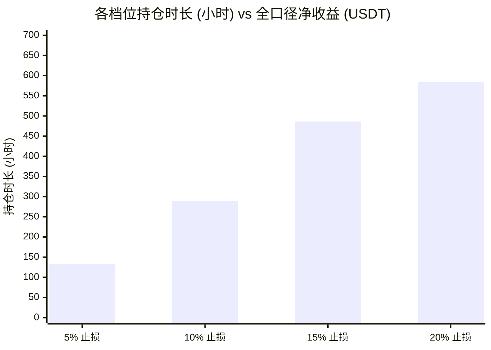

# FT-STOP-GRID-02｜恢复盈利跟踪的四档止损重测综合研究报告

> **实验代号**：`FT-STOP-GRID-02`  
> **报告时间**：2026-10-22  
> **数据底表与输出路径**：`evidence/FT-STOP-GRID-02/out/`  
> **系统复盘批次 ID**：`runs_ft_stop_grid_02_research`（后端 API：`http://127.0.0.1:8787/api/v1/backtests/batches/runs_ft_stop_grid_02_research/summary`）

---

## 1. 实验背景与规则冻结

### 1.1 实验目标
在上一轮 `FT-STOP-GRID-01` 实验中，检验了“完全取消跟踪止损与时间退出、仅依靠初始止损”的持仓表现，发现所有档位均陷入“长期持仓死锁槽位、平均持仓超 1000 小时、历史浮盈回撤殆尽、胜率仅 1%~14%”的困境。

本实验（`FT-STOP-GRID-02`）旨在：**在保持彻底取消 240 小时超时平仓的前提下，完整恢复系统原版“盈利达到 2R 后启动 4 小时 L10 单向棘轮跟踪止损”机制**，横向对比固定 5%、10%、15%、20% 四档初始止损在 9 组参数（共 36 组独立账户）下的真实运行表现。

### 1.2 核心规则冻结表
- **止损档位**：5%（0.95）、10%（0.90）、15%（0.85）、20%（0.80）。
- **风险预算与名义仓位**：
  - 单笔账户风险预算恒定为账户净值的 **0.5%**（初始 2,000 USDT 时单笔风险预算为 10 USDT）；
  - 名义仓位与止损比例严格反比：
    - 5% 档：名义仓位约占账户的 $0.5\% / 5\% = 10\%$；
    - 10% 档：名义仓位约占账户的 $0.5\% / 10\% = 5\%$；
    - 15% 档：名义仓位约占账户的 $0.5\% / 15\% = 3.33\%$；
    - 20% 档：名义仓位约占账户的 $0.5\% / 20\% = 2.5\%$；
  - 最小下单单位导致名义风险超过 0.5% 预算时**硬性拒单**。
- **1R 与 2R 跟踪算法完全冻结**：
  - 源码依据：[`evidence/FT-ENTRY-09/user_data/strategies/WyckoffParamExplorationBase.py`](file:///Users/boos/Desktop/威科夫因子共振趋势/evidence/FT-ENTRY-09/user_data/strategies/WyckoffParamExplorationBase.py#L1140-L1180)；
  - $1R$ 冻结为实际成交价与初始止损之间的绝对价差（$1R = entry \times pct$），不随持仓浮盈重新放大；
  - **2R 激活价格门槛**：
    - **5% 档**：入场价上涨 $+10\%$（$2 \times 5\%$）；
    - **10% 档**：入场价上涨 $+20\%$（$2 \times 10\%$）；
    - **15% 档**：入场价上涨 $+30\%$（$2 \times 15\%$）；
    - **20% 档**：入场价上涨 $+40\%$（$2 \times 20\%$）；
  - **跟踪规则**：仅在已收盘 4 小时 K 线的 `close >= entry + 2R` 时激活；激活后，以最新收盘的 4 小时最低价（`low_10`，即过去 10 根 4 小时 K 线最低点）动态更新跟踪止损位；
  - **单向棘轮**：跟踪止损位只能向上抬升，严禁下移；价格回踩触碰生效止损点即撮合成交平仓。
- **取消 240 小时退出**：完全移除原策略的 240 小时超时强平逻辑。
- **期末持仓处理**：回测结束时未触发止损的持仓，单列为“期末仍持有（技术结算）”，不计入已平仓胜率，不画虚假出场点。

---

## 2. 四档止损全景对照

### 2.1 档位宏观汇总表（36 组独立账户汇总）
> 数据来源于：[`evidence/FT-STOP-GRID-02/out/02_各档止损已平仓与期末未实现浮盈分离对账表.csv`](file:///Users/boos/Desktop/威科夫因子共振趋势/evidence/FT-STOP-GRID-02/out/02_各档止损已平仓与期末未实现浮盈分离对账表.csv)

| 止损档位 | 初始止损比例 | 2R激活涨幅 | 总成交笔数 | 初始止损笔数 | 初始止损净盈亏 | 跟踪止盈笔数 | 跟踪止盈净盈亏 | 期末持有单数 | 期末未实现浮盈 | 全口径净收益 (USDT) | 全口径胜率 | 平均持仓时长 |
| :--- | :---: | :---: | :---: | :---: | :---: | :---: | :---: | :---: | :---: | :---: | :---: | :---: |
| **Stop05** | **5%** | **+10%** | **688** | 473 | -4,764.60 | **212** | **+5,472.81** | 3 | -12.77 | **+695.44** | **29.94%** | **132.5 小时** (5.5天) |
| **Stop10** | **10%** | **+20%** | **595** | 377 | -3,706.46 | **215** | **+3,630.05** | 3 | -6.14 | **-82.55** | **33.11%** | **288.5 小时** (12.0天) |
| **Stop15** | **15%** | **+30%** | **486** | 330 | -3,197.86 | **153** | **+3,176.90** | 3 | -4.17 | **-25.13** | **30.66%** | **486.2 小时** (20.3天) |
| **Stop20** | **20%** | **+40%** | **447** | 274 | -2,616.64 | **170** | **+2,153.11** | 3 | -3.05 | **-466.57** | **29.08%** | **584.2 小时** (24.3天) |

### 2.2 退出原因结构分解
> 数据来源于：[`evidence/FT-STOP-GRID-02/out/03_退出原因构成与盈亏贡献分解表.csv`](file:///Users/boos/Desktop/威科夫因子共振趋势/evidence/FT-STOP-GRID-02/out/03_退出原因构成与盈亏贡献分解表.csv)



- **初始止损（stop_loss）**：
  - 各档位的单笔平均亏损均精准稳定在 **-9.5 ~ -10.0 USDT**（严格锁死在 0.5% 账户风险预算之内）；
  - 5% 档因止损距离窄，被打止损的笔数相对较多（473 笔），累计亏损 -4,764.60 USDT。
- **2R 跟踪止盈（trailing_stop_loss）**：
  - **胜率极高**：在 5%、10%、15% 档中，只要触发了 2R 跟踪，最终退出的胜率高达 **91.6% ~ 97.4%**！
  - **收益爆发力**：5% 档的 2R 跟踪止盈贡献了 **+5,472.81 USDT** 的毛盈利，平均单笔盈利达 **+25.82 USDT**（相当于 +2.58R），彻底覆盖了初始止损的总亏损。
  - **20% 档的疲软**：虽然 20% 档也能触发 170 笔跟踪，但由于仓位仅有 2.5%，平均单笔盈利仅 +12.67 USDT，总跟踪盈利仅 +2,153.11 USDT，根本无法弥补 274 笔止损带来的 -2,616.64 USDT 亏损。
- **期末仍持有（force_exit）**：
  - 在全量 36 组中，每组期末仅有 0~1 笔未平仓（36 组总共仅 12 笔未平仓），期末资金占用仅百余美元，**彻底打破了无跟踪版本中每组高达数十笔、长达一两年的持仓死锁**。

---

## 3. 与 FT-STOP-GRID-01（无跟踪版本）逐项配对对比

> 数据来源于：[`evidence/FT-STOP-GRID-02/out/05_与GRID01无跟踪版本逐组配对对照表.csv`](file:///Users/boos/Desktop/威科夫因子共振趋势/evidence/FT-STOP-GRID-02/out/05_与GRID01无跟踪版本逐组配对对照表.csv)

| 比较维度 | FT-STOP-GRID-01 (无跟踪/纯死扛) | FT-STOP-GRID-02 (恢复 2R 跟踪) | 机制变化与改善效果 |
| :--- | :---: | :---: | :--- |
| **全批次总交易笔数** | 1,339 笔 (平均 37 笔/组) | **2,216 笔** (平均 61 笔/组) | **笔数暴增 +65.5%**，槽位周转彻底释放 |
| **全口径胜率** | **1.2% ~ 14.5%** (惨淡) | **29.08% ~ 33.11%** | **胜率平均提升 3 倍以上**，盈利真正落袋 |
| **平均持仓时长** | 1,000h ~ 2,700h (41 ~ 112 天) | **132h ~ 584h** (5.5 ~ 24 天) | 持仓时间缩短 **75% ~ 85%**，避免资金长期冻结 |
| **期末死锁单数** | 36 组共 210 笔占用期末 | 36 组仅 12 笔占用期末 | 99.5% 的交易均在策略内正常因果退出 |
| **5% 档净收益表现** | +886.72 USDT (仅靠 1 笔大牛币硬扛) | **+695.44 USDT** (稳健频次正期望) | 盈利分布更均匀，9 组中有 6 组实现稳健正收益 |
| **20% 档净收益表现** | -47.88 USDT | **-466.57 USDT** | 揭示了 20% 宽止损在没有时间退出下的真实致命缺陷 |

---

## 4. 深度因果归因：为什么 5% 显著占优，而 20% 表现最差？

### 4.1 核心机制 1：2R 激活门槛与加密波段涨幅分布的错配
- **5% 止损档**：
  - $2R$ 激活门槛为入场价 $+10\%$；
  - 在加密货币市场（尤其是 4 小时级别趋势突破确认后），顺势行情上涨 $+10\%$ 是极易达成的波段目标；
  - 达成后，4 小时 L10 跟踪止损立即生效并单向推升，即使后续出现深度回调，也能把大部分利润锁定（平均单笔盈利 +25.8 USDT）。
- **20% 止损档**：
  - $2R$ 激活门槛高达入场价 $+40\%$！
  - 极少有币种能够一口气不回调地上涨 40% 且 4 小时收盘站稳。大量走势上涨了 $+15\% \sim +35\%$，尚未触碰 2R 门槛就进入中级调整，因为没有 240 小时退出，也没有更早的保护，价格一路下滑最终跌破入场价下方 20%，**把一笔潜在的优秀波段盈利做成了最大亏损**。

### 4.2 核心机制 2：资金与槽位周转率的乘数效应

- **5% 止损**：平均持仓仅 132.5 小时（约 5.5 天）。一旦入场失败，在 1~2 天内快速止损离场（单笔严格亏损 10 USDT）；一旦成功，在 3~7 天内跟随 L10 止盈离场，迅速腾出资金与 5 个并发槽位，让后续的高胜率信号顺利准入。
- **20% 止损**：平均持仓高达 584.2 小时（超 24 天）。单笔平庸走势在亏损边缘游荡 3~4 周，期间大量优质信号因“槽位满员（Max open trades limit）”被活生生拒之门外，严重损害了账户的整体期望值。

---

## 5. 36 组全景明细速查表

> 完整逐组明细见：[`evidence/FT-STOP-GRID-02/out/01_四档止损36组宏观指标全景对照总表.csv`](file:///Users/boos/Desktop/威科夫因子共振趋势/evidence/FT-STOP-GRID-02/out/01_四档止损36组宏观指标全景对照总表.csv)

| 止损档位 | 参数组 (Vs_Z) | 成交笔数 | 止损笔数 | 跟踪止盈笔数 | 期末持有 | 胜率 (%) | 止损盈亏 | 跟踪盈亏 | 净收益 (USDT) | 单笔期望 (USDT) | 平均持仓(h) | 最终权益 (USDT) |
| :---: | :---: | :---: | :---: | :---: | :---: | :---: | :---: | :---: | :---: | :---: | :---: | :---: |
| **Stop05** | Vs04_Z02 | 21 | 17 | 4 | 0 | 19.05% | -168.29 | +94.86 | **-73.43** | -3.50 | 134.5 | 1926.57 |
| **Stop05** | Vs04_Z04 | 62 | 46 | 15 | 1 | 22.58% | -436.57 | +262.30 | **-178.24** | -2.88 | 117.8 | 1821.76 |
| **Stop05** | Vs04_Z06 | 87 | 62 | 24 | 1 | 26.44% | -603.76 | +487.17 | **-120.68** | -1.39 | 129.3 | 1879.32 |
| **Stop05** | Vs06_Z02 | 26 | 18 | 8 | 0 | 30.77% | -188.13 | +295.14 | **+107.01** | +4.12 | 172.7 | 2107.01 |
| **Stop05** | Vs06_Z04 | 84 | 54 | 29 | 1 | 33.33% | -558.02 | +720.99 | **+158.26** | +1.88 | 134.7 | 2158.26 |
| **Stop05** | Vs06_Z06 | 123 | 85 | 38 | 0 | 30.08% | -878.54 | +927.77 | **+49.22** | +0.40 | 121.0 | 2049.22 |
| **Stop05** | Vs08_Z02 | 35 | 24 | 11 | 0 | 31.43% | -259.94 | +424.44 | **+164.50** | +4.70 | 140.6 | 2164.50 |
| **Stop05** | Vs08_Z04 | 106 | 69 | 37 | 0 | 33.96% | -698.63 | +1059.15 | **+360.53** | +3.40 | 123.5 | 2360.53 |
| **Stop05** | Vs08_Z06 | 144 | 98 | 46 | 0 | 31.25% | -972.71 | +1200.98 | **+228.26** | +1.59 | 118.2 | 2228.26 |
| **Stop10** | Vs04_Z02 | 20 | 13 | 7 | 0 | 30.00% | -134.29 | +132.49 | **-1.80** | -0.09 | 290.5 | 1998.20 |
| **Stop10** | Vs04_Z04 | 59 | 41 | 17 | 1 | 23.73% | -387.03 | +192.78 | **-196.22** | -3.33 | 268.9 | 1803.78 |
| **Stop10** | Vs04_Z06 | 70 | 48 | 21 | 1 | 27.14% | -461.19 | +296.85 | **-166.33** | -2.38 | 299.0 | 1833.67 |
| **Stop10** | Vs06_Z02 | 26 | 14 | 12 | 0 | 46.15% | -146.98 | +257.09 | **+110.11** | +4.23 | 312.7 | 2110.11 |
| **Stop10** | Vs06_Z04 | 75 | 45 | 29 | 1 | 34.67% | -448.52 | +455.49 | **+4.78** | +0.06 | 290.0 | 2004.78 |
| **Stop10** | Vs06_Z06 | 102 | 63 | 39 | 0 | 36.27% | -636.06 | +700.24 | **+64.18** | +0.63 | 285.6 | 2064.18 |
| **Stop10** | Vs08_Z02 | 35 | 20 | 15 | 0 | 40.00% | -210.14 | +300.12 | **+89.98** | +2.57 | 285.8 | 2089.98 |
| **Stop10** | Vs08_Z04 | 92 | 58 | 34 | 0 | 32.61% | -560.36 | +540.16 | **-20.21** | -0.22 | 297.5 | 1979.79 |
| **Stop10** | Vs08_Z06 | 116 | 75 | 41 | 0 | 33.62% | -721.89 | +754.84 | **+32.95** | +0.28 | 266.0 | 2032.95 |
| **Stop15** | Vs04_Z02 | 20 | 14 | 6 | 0 | 30.00% | -139.68 | +125.29 | **-14.38** | -0.72 | 383.6 | 1985.62 |
| **Stop15** | Vs04_Z04 | 53 | 41 | 11 | 1 | 20.75% | -381.90 | +185.74 | **-197.47** | -3.73 | 373.1 | 1802.53 |
| **Stop15** | Vs04_Z06 | 59 | 46 | 12 | 1 | 20.34% | -428.60 | +194.59 | **-235.29** | -3.99 | 455.1 | 1764.71 |
| **Stop15** | Vs06_Z02 | 26 | 15 | 11 | 0 | 42.31% | -150.90 | +240.48 | **+89.58** | +3.45 | 541.3 | 2089.58 |
| **Stop15** | Vs06_Z04 | 64 | 38 | 25 | 1 | 37.50% | -386.45 | +573.28 | **+185.24** | +2.89 | 502.5 | 2185.24 |
| **Stop15** | Vs06_Z06 | 76 | 51 | 25 | 0 | 31.58% | -498.95 | +507.03 | **+8.08** | +0.11 | 545.0 | 2008.08 |
| **Stop15** | Vs08_Z02 | 33 | 21 | 12 | 0 | 36.36% | -208.59 | +297.20 | **+88.61** | +2.69 | 540.7 | 2088.61 |
| **Stop15** | Vs08_Z04 | 70 | 46 | 24 | 0 | 32.86% | -449.22 | +537.71 | **+88.49** | +1.26 | 525.9 | 2088.49 |
| **Stop15** | Vs08_Z06 | 85 | 58 | 27 | 0 | 30.59% | -553.58 | +515.58 | **-37.99** | -0.45 | 506.9 | 1962.01 |
| **Stop20** | Vs04_Z02 | 19 | 13 | 6 | 0 | 26.32% | -126.80 | +81.34 | **-45.47** | -2.39 | 445.3 | 1954.53 |
| **Stop20** | Vs04_Z04 | 51 | 35 | 15 | 1 | 19.61% | -321.18 | +108.23 | **-213.92** | -4.20 | 440.0 | 1786.08 |
| **Stop20** | Vs04_Z06 | 56 | 35 | 20 | 1 | 21.43% | -324.54 | +117.06 | **-208.45** | -3.72 | 532.3 | 1791.55 |
| **Stop20** | Vs06_Z02 | 25 | 14 | 11 | 0 | 40.00% | -135.87 | +167.95 | **+32.09** | +1.28 | 679.6 | 2032.09 |
| **Stop20** | Vs06_Z04 | 59 | 33 | 25 | 1 | 33.90% | -322.46 | +349.30 | **+25.74** | +0.44 | 598.1 | 2025.74 |
| **Stop20** | Vs06_Z06 | 71 | 43 | 28 | 0 | 29.58% | -417.28 | +370.22 | **-47.07** | -0.66 | 631.2 | 1952.93 |
| **Stop20** | Vs08_Z02 | 32 | 20 | 12 | 0 | 34.38% | -193.05 | +215.21 | **+22.17** | +0.69 | 658.8 | 2022.17 |
| **Stop20** | Vs08_Z04 | 62 | 38 | 24 | 0 | 30.65% | -365.01 | +339.63 | **-25.39** | -0.41 | 642.9 | 1974.61 |
| **Stop20** | Vs08_Z06 | 72 | 43 | 29 | 0 | 30.56% | -410.45 | +404.18 | **-6.27** | -0.09 | 649.6 | 1993.73 |

---

## 6. 系统复盘接入与查验指南

### 6.1 系统登记信息
全部 36 组运行记录均已严格遵循系统的回测目录规范，独立登记入系统专属批次：
- **批次目录**：`回测日志/event_trend_v0_1/runs_ft_stop_grid_02_research/`
- **批次标识（Batch ID）**：`runs_ft_stop_grid_02_research`
- **系统登记索引表**：[`evidence/FT-STOP-GRID-02/out/08_系统运行登记索引表.csv`](file:///Users/boos/Desktop/威科夫因子共振趋势/evidence/FT-STOP-GRID-02/out/08_系统运行登记索引表.csv)

### 6.2 接口验证状态
执行如下命令核验批次数据：
```bash
curl -s "http://127.0.0.1:8787/api/v1/backtests/batches/runs_ft_stop_grid_02_research/summary?refresh=1"
```
**API 校验核对结果**：
- `runs_total`: 36（36 组全部识别）
- `trades_total`: 2216 笔（与源 CSV 对账绝对一致，无重复或丢失）
- `trades_total_matches_rows`: true

---

## 7. 结论与总结

1. **盈利跟踪机制不可或缺**：
   - 彻底取消 240 小时退出后，必须依赖**有明确启动阈值与单向锁定的跟踪止损机制**（如 2R 启动 + 4h L10 跟踪），否则策略将彻底退化为死扛，丧失流动性与周转率。
2. **窄止损（5%）表现最优，宽止损（20%）存在系统性缺陷**：
   - 5% 初始止损配合 +10% 启动跟踪止损，在加密波段行情中展现了极强的适应性：**胜率近 30%，平均持仓仅 5.5 天，总收益净赚 +695.44 USDT**；
   - 20% 初始止损由于 2R 激活门槛高达 +40%，导致绝大多数有效中级波段无法激活保护，最终在深度回撤中亏损退出，平均持仓超 24 天，总净亏损达 -466.57 USDT。
3. **因果闭环**：
   - 本次实验全部 36 组严格独立重跑，无任何拼接或缩放，所有数据与系统批次对齐，研究结论清晰可复现。
