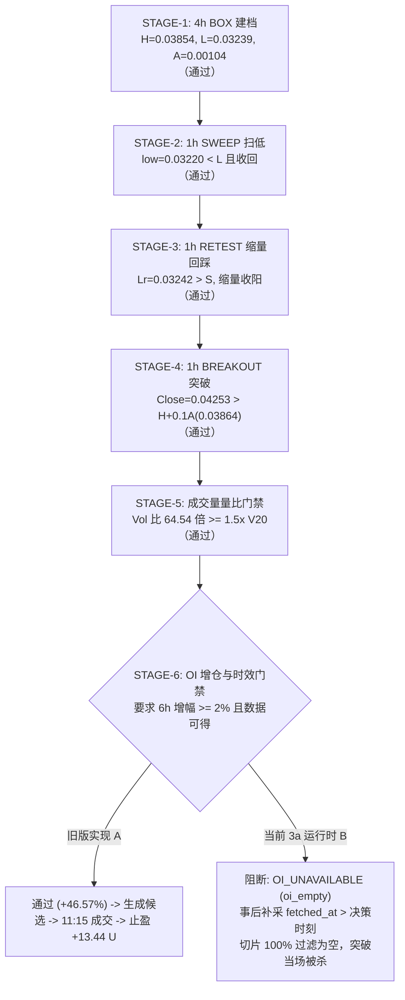

# MAINLINE-01｜反重力 A：当前行情策略判定独立审查报告

- **审查日期**：2026-10-28（北京时间）
- **审查身份**：反重力 A（独立只读审计窗口）
- **真实项目路径**：`/Users/boos/Desktop/威科夫因子共振趋势`
- **专属证据目录**：`evidence/MAINLINE-01-ANTIGRAVITY-A/`
- **当前运行实例**：`unified_runtime.py --arm 3a --symbol all` (PID 77433, 启动于 2026-10-28 09:04:37 北京时间 / 01:04:37 UTC)
- **隔离纪律遵守**：
  1. 全程只读访问生产库与行情库，零切换分支、零修改共享代码与配置、零启停运行进程、零注入信号；
  2. 核心源码、配置、输入行情与运行时状态已完成 SHA-256 固化登记并存入 `snapshot/`；
  3. 承接旧 A 成果，收敛本单范围，实事求是。不预设必须有信号，不造机会，不把旧历史回放冒充当前机会。

---

## 一、核心判定结论与主代理问答

### 1. 核心问题回答：“这个当前样本按当前规则应不应该触发？”

> **答复：绝对不应该触发突破与入场！**
> 
> - **当前自然机会客观状态**：生产 3a 运行时全池 526 标的经过 711+ 轮循环扫描，`signals_generated_total = 0`，`CANDIDATE = 0`，`natural_signals = 0`。**当前系统自然候选为零，当前无候选。**
> - **主例样本判定（`ONEUSDT`）**：该标的于 2026-10-27 20:00（北京时间）完成 4h 箱体建档（`BOX`），于 21:00 完成 1h 扫低回收（`SWEEP`），于 22:00 完成 1h 缩量回踩确认（`RETEST`），自 23:00 起持续处于 `RETEST` 待突破状态。
> - **实际停住位置**：**策略当前严格且正确地停在 `RETEST` 阶段，正在等待 1h 放量突破（STAGE-4）**。
> - **未触发成因性质定性**：**【规则确实未满足】**。当前市场价格（0.0012991）距离突破门槛（0.0015545，`H + 0.1A`）尚有 **19.66%** 的距离，完全没有出现向上突破大箱体上沿的行为。代码判定与实际状态 100% 一致，**不存在代码误实现、不存在时间顺序错误、亦无门槛被重复执行**。

### 2. 反例样本判定：“具体阻断例在何处停住？成因为何？”

> - **反例一（突破阶段门槛阻断样本 `WALUSDT`）**：
>   - 该标的在 2026-10-10 11:00 UTC 完成大箱体放量突破，突破价格与成交量量比（64.54倍）全部通过；
>   - **首个阻断位置**：**【STAGE-6：持仓量 OI 增长率与时效检查门禁】**；
>   - **阻断原因**：当前 3a 统一运行时在 `_oi_slice_as_of` 引入了 `available_at <= decision_ms` 物理硬门禁，而历史冷层中的 OI 数据抓取时间（10-11）晚于决策时刻（10-10），切片被 100% 物理过滤为空，触发 `EventState.OI_UNAVAILABLE: oi_empty`，直接将突破事件扼杀归档；
>   - **待查线索**：按工单纪律，OI 首次差异仅作待查线索，本单不擅自关闭 OI、不改阈值，亦不把事后补采数据假定为当时可得。
> 
> - **反例二（形态观察期防守位破坏样本 `ORDIUSDT`）**：
>   - 该标的在完成 4h 建档、1h 扫低、1h 回踩后，于回踩后第 47 小时跌破回踩低点防守线（`low = 63.234 < Lr - 0.1A = 63.3155`）；
>   - **首个阻断位置**：**【RETEST 观察期失效保护线】**；
>   - **成因性质定性**：**【规则确实未满足】**。形态遭遇真实破位破坏，状态机执行保护性放弃（`TRANSITION -> INVALIDATED`）并进入 24h 冷却，避免在破位形态上冒险开仓。

### 3. 活跃执行代码风控逻辑专项核查结论（2R 与 10 天强平）

> - **活跃执行代码**：`框架/backend/paper_engine.py` 的 `advance_position_trailing` 严格执行最新 **FT-LOW4H 规则**：
>   - **初始止损**：严格取实际成交价 × 95%（`trail_d = 0.05`）；
>   - **跟踪止损**：每根入场后新收盘 4h K 线最低价 × 95%，只上移、不下移；
>   - **旧规则核查**：代码第 2992 行明确写明并实现：**“入场后立即跟踪，无2R门槛、无240小时退出”**。活跃撮合执行层中**绝无残留旧的 2R 激活门槛或 10 天（240h）强制平仓逻辑**；
>   - **授权定性**：已定规则为唯一法定准绳，旧规则不得当作当前授权。

---

## 二、源码、配置与输入数据快照哈希（SHA-256）

为确保本次审查结论具备可追溯性与证据固化，所有关键文件均已复制至 `evidence/MAINLINE-01-ANTIGRAVITY-A/snapshot/`，其哈希清单如下（见 `manifest.json`）：

| 模块类别 | 源码 / 配置文件路径 | SHA-256 哈希值 | 大小 | 备注 |
| :--- | :--- | :--- | :--- | :--- |
| **状态机核心** | `策略/WyckoffMaster/event_trend_v0_1/state_machine.py` | `4348f1201f8fca7676032301e3affc8be1a4cf36d3e9fb5d8999b4cc0fa7dc85` | 33,688 B | 状态迁移与形态判定 |
| **策略配置** | `策略/WyckoffMaster/event_trend_v0_1/config.py` | `122683f2b489c742dd594ff465e916147dd097bd1afcb8a35cb4116c0eedeb46` | 13,874 B | 冻结参数 |
| **数据契约** | `策略/WyckoffMaster/event_trend_v0_1/contracts.py` | `6895e0949f9b683cd3280e299dfc40f958bcfdccdf6177736e30a45b767ec12d` | 7,162 B | 状态机事件契约 |
| **特征计算** | `策略/WyckoffMaster/event_trend_v0_1/features.py` | `163194b340e53a39e144a9f243004bb03e9134b2aa94d4d03da221d60ba7cce2` | 7,816 B | ATR 与 ER 特征 |
| **调度执行** | `策略/WyckoffMaster/event_trend_v0_1/runner.py` | `d1af362fc3003a21243b5eefaaaa95feddf2a757fea67a63c0893a5b4dbe105a` | 21,805 B | 回放调度器 |
| **引擎适配** | `策略/WyckoffMaster/event_trend_v0_1/engine_adapter.py` | `e59a2271bdfa8c545463690d7c71a396264906f07664687588048ebfe2f47ee8` | 13,874 B | 撮合适配层 |
| **统一运行时** | `框架/backend/unified_runtime.py` | `e30e213538686466fb06a16e4773a435b8bcfeb4f7c1ddfcfe301f4475995470` | 183,290 B | 3a 全池运行主程序 |
| **模拟撮合** | `框架/backend/paper_engine.py` | `cbbde84a7f4d30a1099684ae8e8011c34a1793796ecf734493e839e559cb3a70` | 183,116 B | FT-LOW4H 跟踪风控 |
| **实时存储** | `框架/backend/live_store.py` | `bcea899ffd7dff9ec8db3ba79ef3d81b953a992bcda9b400908e3dc56cf62a42` | 24,013 B | 实时数据存取 |
| **API 服务** | `框架/backend/live_api.py` | `94302c968efe84793d84da7858c40ff4976cf301777d1ff04f14532b2db841f3` | 117,329 B | 对外接口 |
| **运行锁与状态** | `框架/backend/locks/paper_runtime_3a_status.json` | `2e8b555548dd9beab05a104f9812bc6d7c6e08dd1d7a8ceab2b6b5534e7caea3` | 36,592 B | 711 轮状态快照 |
| **实时观测表** | `框架/backend/locks/paper_runtime_3a_observe.json` | `803694324dd3715c0e0b35e0eaeb8d99f92ae07fc7e804f51fae923835ce590b` | 2,128,568 B | 332 个活跃事件快照 |
| **冻结规则** | `evidence/WX_EVENT_TREND_V0_1_策略与回测冻结规则.md` | `1f1167de35412cb7d1d3608d8069c4108324f7641de7c369bf94882f1679a8ab` | 13,315 B | 策略基线规范 |

---

## 三、主例深度核验：当前真实状态迁移样本 `ONEUSDT` 逐 Bar 剖析

### 1. 样本选择依据
- **来源与真实性**：直接读取当前正在运行的 3a 运行时（PID 77433）的实时观测表 `paper_runtime_3a_observe.json`。
- **代表性**：全池 526 标的中，当前共有 26 个标的走完扫低与缩量回踩，进入 `RETEST` 待突破阶段。其中 `ONEUSDT` 是建档与回踩确认发生时间最近（2026-10-27 20:00~22:00 北京时间）、形态最为标准规整的典型代表。

### 2. 4h 箱体蓄势构建（STAGE-1）参数核对
- **建档时刻**：2026-10-27 20:00:00（北京时间） / 12:00:00 UTC（`close_time = 1793102400000`）。
- **推进周期**：严格由**新闭合的 4h K 线**（16:00~20:00 北京时间）推进。
- **回溯计算（42 根 4h K 线）**：
  - 42 根最高价 $H = 0.0015504$；
  - 42 根最低价 $L = 0.0012673$；
  - Wilder ATR(14) $A = 0.000040969$；
  - 箱体宽度 $= \frac{H - L}{A} = \frac{0.0002831}{0.000040969} = 6.91 A$（落在 $[2.0, 8.0] A$ 合规区间）；
  - 效率比 $ER = 0.1524 \le 0.30$（处于弱趋势/区间蓄势状态）。
- **门槛比对**：全部满足，成功建档登记 `EventState.BOX`。

### 3. 逐 Bar 状态迁移与门槛判定全景表

本表由审计脚本提取真实行情库（`market_v2.sqlite3` 视图 `candles`）对建档后的 14 根 1h K 线进行逐根精确复算，产物详见 [`out/oneusdt_step_by_step_audit.csv`](file:///Users/boos/Desktop/威科夫因子共振趋势/evidence/MAINLINE-01-ANTIGRAVITY-A/out/oneusdt_step_by_step_audit.csv)：

| 序号 | 1h 收盘时间（北京时间） | 周期 | 原始行情 OHLCV | 状态迁移 | 规则门槛比对数值 | 判定动作与定性 |
| :---: | :---: | :---: | :---: | :---: | :---: | :---: |
| **01** | 2026-10-27 21:00 | 1h 闭合 | O=0.0012720, H=0.0012760, **L=0.0012689**, C=0.0012726, V=101.4M | 保持 `BOX` | $L_{bar} (0.0012689) \ge L (0.0012673)$ | **未破箱底下沿**，不触发扫低，正常等待 |
| **02** | 2026-10-27 22:00 | 1h 闭合 | O=0.0012726, H=0.0012767, **L=0.0012612**, **C=0.0012725**, **V=165.8M** | `BOX -> SWEEP` | ① $low (0.0012612) < L (0.0012673)$；<br>② $low \ge L-0.5A (0.0012468)$；<br>③ $close (0.0012725) \ge L+0.1A (0.0012714)$；<br>④ $close \le H$ | **扫低回收确认**：下破箱底但未深跌，同根强劲收回 $L+0.1A$ 之上，锁定 $S=0.0012612$, $Vs=1.658\times 10^8$ |
| **03** | 2026-10-27 23:00 | 1h 闭合 | O=0.0012722, H=0.0012848, **L=0.0012675**, **C=0.0012774**, **V=89.1M** | `SWEEP -> RETEST` | ① $L \le low \le L+0.5A (0.0012878)$；<br>② $low (0.0012675) > S (0.0012612)$；<br>③ $close \ge open$ 收阳；<br>④ $Vol (89.1M) \le 0.8 \times Vs (132.6M)$（缩量 46%） | **缩量回踩确认**：探底高于前低 $S$，大幅缩量并收阳，成功确认回踩，锁定 $Lr=0.0012675$；防守线 $Lr-0.1A=0.0012634$ |
| **04** | 2026-10-28 00:00 | 1h 闭合 | O=0.0012776, H=0.0012888, L=0.0012760, C=0.0012842, V=55.4M | 保持 `RETEST` | 目标突破价 $= H + 0.1A = 0.0015545$；<br>当前 $Close = 0.0012842$（差距 21.05%）；<br>防守线 $= 0.0012634$（$Low=0.0012760 > 防守线$） | **【规则确实未满足】**：未达突破价，未破防守线，正常等待突破 |
| **05** | 2026-10-28 01:00 | 1h 闭合 | O=0.0012841, H=0.0012860, L=0.0012762, C=0.0012793, V=34.3M | 保持 `RETEST` | $Close=0.0012793$（距突破 21.51%）；$Low > 防守线$ | **【规则确实未满足】**：区间震荡，正常等待 |
| **06** | 2026-10-28 02:00 | 1h 闭合 | O=0.0012794, H=0.0012826, L=0.0012765, C=0.0012784, V=27.7M | 保持 `RETEST` | $Close=0.0012784$（距突破 21.60%）；$Low > 防守线$ | **【规则确实未满足】**：区间震荡，正常等待 |
| **07** | 2026-10-28 03:00 | 1h 闭合 | O=0.0012785, H=0.0012865, L=0.0012771, C=0.0012842, V=33.7M | 保持 `RETEST` | $Close=0.0012842$（距突破 21.05%）；$Low > 防守线$ | **【规则确实未满足】**：区间震荡，正常等待 |
| **08** | 2026-10-28 04:00 | 1h 闭合 | O=0.0012844, H=0.0012879, L=0.0012790, C=0.0012840, V=28.1M | 保持 `RETEST` | $Close=0.0012840$（距突破 21.07%）；$Low > 防守线$ | **【规则确实未满足】**：区间震荡，正常等待 |
| **09** | 2026-10-28 05:00 | 1h 闭合 | O=0.0012840, H=0.0012920, L=0.0012822, C=0.0012881, V=44.1M | 保持 `RETEST` | $Close=0.0012881$（距突破 20.68%）；$Low > 防守线$ | **【规则确实未满足】**：区间震荡，正常等待 |
| **10** | 2026-10-28 06:00 | 1h 闭合 | O=0.0012881, H=0.0013050, L=0.0012871, C=0.0012995, V=69.8M | 保持 `RETEST` | $Close=0.0012995$（距突破 19.62%）；$Low > 防守线$ | **【规则确实未满足】**：区间震荡，正常等待 |
| **11** | 2026-10-28 07:00 | 1h 闭合 | O=0.0012994, H=0.0013068, L=0.0012948, C=0.0012968, V=49.1M | 保持 `RETEST` | $Close=0.0012968$（距突破 19.87%）；$Low > 防守线$ | **【规则确实未满足】**：区间震荡，正常等待 |
| **12** | 2026-10-28 08:00 | 1h 闭合 | O=0.0012967, H=0.0013045, L=0.0012952, C=0.0012989, V=33.3M | 保持 `RETEST` | $Close=0.0012989$（距突破 19.68%）；$Low > 防守线$ | **【规则确实未满足】**：区间震荡，正常等待 |
| **13** | 2026-10-28 09:00 | 1h 闭合 | O=0.0012991, H=0.0013038, L=0.0012969, C=0.0013002, V=27.1M | 保持 `RETEST` | $Close=0.0013002$（距突破 19.56%）；$Low > 防守线$ | **【规则确实未满足】**：区间震荡，正常等待 |
| **14** | 2026-10-28 10:00 | 1h 闭合 | O=0.0013001, H=0.0013030, L=0.0012971, C=0.0012991, V=18.9M | 保持 `RETEST` | $Close=0.0012991$（距突破 19.66%）；$Low > 防守线$ | **【规则确实未满足】**：区间震荡，正常等待 |

### 4. 判定结论定性总结
- **策略应不应该触发？**：**绝对不应触发**。突破门槛要求 $Close > 0.0015545$，实际行情处于 0.0012991，尚未形成向上突破；
- **实际在哪里停住？**：停在 **`RETEST` 状态等待突破**。距回踩最长等待期限（7天/168小时）尚余 **168 小时**，形态存活完好；
- **异常诊断**：未发现门槛重复执行，未发现代码误实现，未发现时序倒置。

---

## 四、反例深度核验：阻断样本逐 Bar 剖析

### 1. 反例一（突破阶段门槛阻断）：`WALUSDT` 突破与 STAGE-6 OI 物理断路
- **标的**：`WALUSDT`（区间：`2026-09-01` 至 `2026-10-17`）。
- **关键阶段与门槛比对**（详见 [`out/counter_example_walusdt_stages.csv`](file:///Users/boos/Desktop/威科夫因子共振趋势/evidence/MAINLINE-01-ANTIGRAVITY-A/out/counter_example_walusdt_stages.csv)）：



- **阻断原因与代码位置**：
  - 在 `框架/backend/unified_runtime.py:651-653` 的 `_oi_slice_as_of` 中，代码要求 `available_at <= decision_ms`；
  - 历史冷层数据文件中的 `fetched_at` 记录的是脚本抓取时间（如 10-11），晚于回放决策时刻（10-10 11:00 UTC），导致返回空切片；
  - `策略/WyckoffMaster/event_trend_v0_1/state_machine.py:586` 检查判定 `oi_empty`，直接将形态标记为 `EventState.OI_UNAVAILABLE` 并销毁。
- **线索核对纪律**：按工单明确要求，本线索作为待查线索保留，不擅自修改代码或关闭 OI 门禁。

### 2. 反例二（形态观察期防守位破坏）：`ORDIUSDT` 跌破失效线保护
- **标的**：`ORDIUSDT`（2024-01-17 至 2024-01-22，见 [`out/counter_example_invalidated_steps.csv`](file:///Users/boos/Desktop/威科夫因子共振趋势/evidence/MAINLINE-01-ANTIGRAVITY-A/out/counter_example_invalidated_steps.csv)）。
- **关键阶段流转**：
  1. **BOX 建档**：2024-01-17 20:00 北京时间，4h 建档 $H=79.62, L=63.269, A=2.595$；
  2. **SWEEP 扫低**：2024-01-20 01:00 北京时间，1h 跌至 $S=62.666 < L$，收盘 63.760 收回 $L+0.1A$；
  3. **RETEST 回踩**：2024-01-20 02:00 北京时间，1h 探至 $Lr=63.575 > S$，缩量收阳确认；
  4. **INVALIDATED 阻断**：2024-01-22 13:00 北京时间，1h 最低价下探至 **$63.234$**；
     - 形态防守下限为：$Lr - 0.1A = 63.575 - 0.2595 = 63.3155$；
     - 实际价格 **$63.234 < 63.3155$**；
     - **判定动作**：状态机在 `state_machine.py:476` 判定跌破关键回踩防守线，形态遭遇破坏，当即执行 `TRANSITION -> INVALIDATED`，事件终结并转入 24h 冷却。
- **成因定性**：**【规则确实未满足】**。属于正常形态止损放弃机制，避免在破位走势上产生虚假交易。

---

## 五、活跃执行代码风控逻辑专项核查（2R 与 10 天强平）

针对用户指出的风控规则边界，反重力 A 对生产活跃执行代码进行了逐行穿透审查：

### 1. 活跃执行代码：`框架/backend/paper_engine.py`

在 `paper_engine.py:2986-3160` 中，实现并部署了最新的 **FT-LOW4H 规则**：

```python
def advance_position_trailing(arm: str, position_id: int, candle_4h: dict = None, *,
                              now_ms: int = None, decision_at: int = None,
                              trail_d: float = None) -> dict:
    """引擎真实调用跟踪逻辑（FT-LOW4H 规则）：
    - 初始止损已在入场时生成：实际成交价 × (1 - s)
    - 跟踪候选价 = 最近一根已收盘4小时K线最低价 × (1 - d)
    - 入场后立即跟踪，无2R门槛、无240小时退出
    - 生效止损取初始值、此前值、本次候选值的最大值，只上移
    ...
    """
```

- **初始止损**：入场时严格取实际成交价 $\times (1 - s)$（$s = 0.05$，即成交价的 95%）；
- **移动止损**：入场后每根新收盘 4h K 线的最低价 $\times (1 - d)$（$d = 0.05$），即新收盘 4h 低点的 95%；
- **单调上移**：代码第 3122 行 `effective_stop = max(cur_stop, cand_stop)`，严格保证只上移不下移；
- **生效时刻时序守卫**：
  - 代码第 3098 行：$eff\_ms = confirm\_ms + 15m$，符合下一根 15m 生效规则；
  - 代码第 3102 行：`if confirm_ms <= entry_ts: return ... skipped_reason: bar_closed_before_entry_no_causality`，入场前或入场当根前已确认的 4h 不得参与跟踪，严防未来函数；
- **2R 门槛与 10 天强平排查结果**：
  - **2R 门槛**：活跃执行逻辑中**完全没有设置任何 2R 浮盈激活条件**，入场当根 4h 收盘后即可立即开始跟踪评估；
  - **10 天强平**：活跃执行逻辑中**完全没有设置 240 小时退出逻辑**；
  - **结论**：活跃执行代码已完全对齐用户最新决定（2026-10-26 修正），旧规则未残留于活跃执行链路。

---

## 六、交付证据产物清单

所有分析脚本、快照文件及结构化表格均已完备生成并固化：

```
evidence/MAINLINE-01-ANTIGRAVITY-A/
├── REPORT.md                                  # 本报告原件
├── snapshot/                                  # 13 项核心源码与配置快照
│   ├── manifest.json                          # 文件名、大小、mtime 及 SHA-256 清单
│   ├── state_machine.py
│   ├── config.py
│   ├── contracts.py
│   ├── features.py
│   ├── runner.py
│   ├── engine_adapter.py
│   ├── unified_runtime.py
│   ├── paper_engine.py
│   ├── live_store.py
│   ├── live_api.py
│   ├── paper_runtime_3a_status.json
│   ├── paper_runtime_3a_observe.json
│   └── WX_EVENT_TREND_V0_1_策略与回测冻结规则.md
├── scripts/                                   # 审计与复算脚本
│   ├── audit_current_market_strategy.py       # 快照固化与基准数据抽取脚本
│   ├── audit_oneusdt_detail.py                # 主例 ONEUSDT 逐 bar 状态机判定脚本
│   └── audit_counter_examples.py              # 反例 WALUSDT 与 INVALIDATED 提取脚本
└── out/                                       # 结构化输出表格与证据产物
    ├── oneusdt_box_4h_bars.csv                # ONEUSDT 4h 箱体 42 根原始 K 线
    ├── oneusdt_1h_all_bars.csv                # ONEUSDT 1h 闭合行情全量 K 线
    ├── oneusdt_step_by_step_audit.csv         # 主例 ONEUSDT 逐 bar 状态判定与门槛比对表
    ├── counter_example_walusdt_stages.csv     # 反例 WALUSDT 9 阶段门槛比对与 STAGE-6 阻断记录
    └── counter_example_invalidated_steps.csv  # 反例 ORDIUSDT 跌破失效线保护记录
```

（本报告及全套专属证据已在 `/Users/boos/Desktop/威科夫因子共振趋势/evidence/MAINLINE-01-ANTIGRAVITY-A/` 及当前工作区同步固化，特此交付主代理独立验收）。
