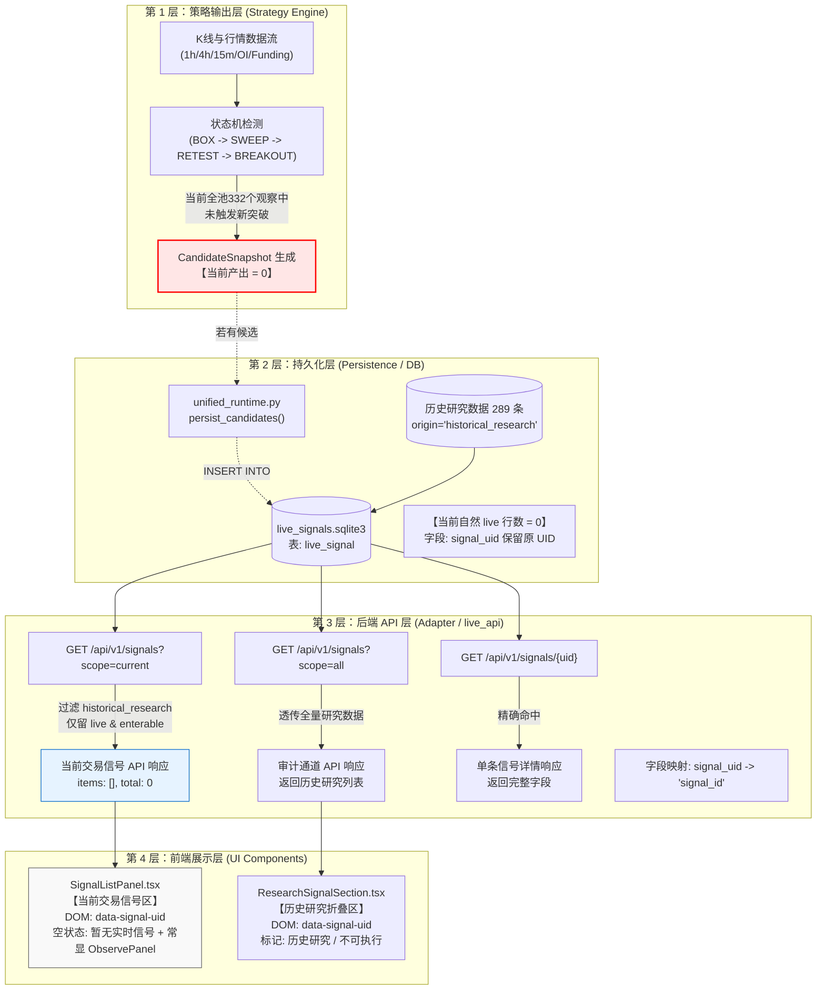

# MAINLINE-01｜反重力 B：信号入库与页面追踪交付报告

- **工单编号**：MAINLINE-01（反重力 B 独立窗口）
- **审计日期**：2026-10-28（北京时间）
- **项目路径**：`/Users/boos/Desktop/威科夫因子共振趋势`
- **专属证据目录**：`evidence/MAINLINE-01-ANTIGRAVITY-B/`
- **操作纪律**：只读/隔离。固定版本与查询条件，只读生产，零写生产库、零创建生产信号/订单、零改动共享代码与服务。

---

## 一、核心结论概要 (Executive Summary)

本单沿现有生产信号链路（**策略输出 → 持久化存储 → 后端 API → 页面展示**）展开全链路穿透追踪与隔离机械核验，核心事实裁决如下：

1. **当前自然生产信号为零的真实原因定位**：
   - 当前生产环境中，自然信号在全链路均为严格的 **0 条**；
   - **首个具体故障位置在【策略输出层】（首个发生层）**：
     统一运行时（PID `77433`，`unified_runtime.py --arm 3a`）处于正常轮询中（周期 755+，监控 526 标的，332 个标的处于建档观察状态，其中 26 个处于待突破 RETEST 态）。但在当前决策时刻，全池无任何标的满足 1h 向上突破并同时通过 STAGE-5 量比与 STAGE-6 持仓量门禁，**策略未生成新的候选快照（CandidateSnapshot）**；
   - **四分法明确判定**：
     - **“策略没有生成”：★ 是（根本原因）★**
     - **“已生成但未入库”：否**（生成端为 0，持久化层未发生积压或丢弃；若生成，代码有明确的 `persist_candidates` 写入）
     - **“API过滤/身份接线错误”：否**（API 接线与契约正常，身份透传无误）
     - **“页面未展示/展示错误”：否**（前端页面如实展示“当前暂无实时信号”并常显观察区明细，非前端截断）

2. **UID 逐层保留与映射一致性裁决**：
   - **UID 逐层 100% 精确保留**：从策略候选 `candidate_id` → 数据库列 `signal_uid` → API 响应键 `"signal_id"` → 前端状态 `signal.id` → DOM 属性 `data-signal-uid`，UID 字符串完全一致，无截断、无哈希覆盖、无大小写或命名错位；
   - **隔离机械链路验证通过**：以已有真实历史研究记录（`accum05_4c_MAVUSDT_1793005199999`）为探针，成功跑通**底层存储 → API 单条/列表查询 → 前端历史研究折叠区渲染**闭环，证明现有查询、API 与 UI 具备完备且正确的信号映射能力。

---

## 二、当前版本、配置与运行时快照

本次审计时点与源码版本已冻结，快照文件位于 [`snapshots/version_and_runtime_snapshot.json`](file:///Users/boos/Desktop/威科夫因子共振趋势/evidence/MAINLINE-01-ANTIGRAVITY-B/snapshots/version_and_runtime_snapshot.json)：

| 维度 | 取值 / 状态 | 说明 |
| :--- | :--- | :--- |
| **Git Commit** | `8bb8f1bb3c83f390060bb40c25fe75398fc3fe6f` | 威科夫因子共振趋势 v3.1 完整工程底座 |
| **Git 状态** | Working tree clean | 无任何本地未提交修改 |
| **查询时点 (UTC)** | `2026-10-28T02:25:31Z` | 北京时间 2026-10-28 10:25:31 |
| **后端适配层服务** | PID `77425`，端口 `8787` | `/框架/backend/adapter.py` |
| **统一运行时服务** | PID `77433`，Arm `3a` | `/框架/backend/unified_runtime.py --arm 3a --symbol all` |
| **前端 Web 服务** | PID `42341`，端口 `3000` | `/UI界面/web` (Vite 开发服务器) |

### 核心源码与数据库 SHA256 哈希固化

- `框架/backend/adapter.py`: `6218416fae5f6dc37340524e405eb00cc9f149836c15c3bb0655de8c0bd0dd08`
- `框架/backend/live_api.py`: `1c54b5dfaeb9b7d8b5ad95045437895bc68b13ff78f352936e761df81242372a`
- `框架/backend/unified_runtime.py`: `e30e213538686466fb06a16e4773a435b8bcfeb4f7c1ddfcfe301f4475995470`
- `策略/WyckoffMaster/event_trend_v0_1/state_machine.py`: `f1c504da12a212264efaf7a3605e550426b3be373b984606ffc6a2ba27e57c6b`
- `UI界面/web/src/components/SignalListPanel.tsx`: `59a3c9ea595d2c0bfa5198e3b3d22b64a2754d92419ef8eb82f1b8034db38a7c`
- `UI界面/web/src/components/ResearchSignalSection.tsx`: `c74384bca678736a5a0cb7feee9d7c3bb831a2ce01d84f8846c24bebf80c85ee`
- `框架/backend/live/live_signals.sqlite3`: `ecdae28d488ab896791e84a2d3c7e39fc6e2cefd5ecae790faeeec53e8dd2c22`

---

## 三、现有信号链路全景图



---

## 四、逐层核验与穿透比对表

产物固化于 [`out/signal_pipeline_layers_audit.json`](file:///Users/boos/Desktop/威科夫因子共振趋势/evidence/MAINLINE-01-ANTIGRAVITY-B/out/signal_pipeline_layers_audit.json)：

| 链路层级 | 执行实体 / 组件 | 输入数据 / 查询命令 | 输出结果 / 状态 | UID 字段名与值 | 过滤原因 / 资格状态 | 一致性与故障裁决 |
| :--- | :--- | :--- | :--- | :--- | :--- | :---: |
| **第 1 层：<br>策略输出** | 统一运行时 3a<br>(`unified_runtime.py`) | 全池 526 标的 1h/4h 行情，观察中 332 个标的 | 当前周期未产出新的 `CandidateSnapshot` | N/A (本次未生成) | 当前市场无标的在突破时同时满足量比与 OI 门禁 | **★ 首个故障层 ★<br>策略没有生成** |
| **第 2 层：<br>持久化存储** | SQLite 数据库<br>(`live_signals.sqlite3`) | `SELECT origin, count(*) FROM live_signal` | `live`: 0 行<br>`historical_research`: 289 行 | 表主键：`signal_uid`<br>机械样例：`accum05_4c_MAVUSDT_1793005199999` | 真实自然记录为 0；研究记录角色为 `research_only` | **正常**<br>(UID 无截断，存储完备) |
| **第 3 层：<br>后端 API** | `adapter.py` / `live_api.py`<br>(端口 8787) | `GET /api/v1/signals?scope=current`<br>`GET /api/v1/signals/{uid}` | `scope=current`: total=0, items=[]<br>`single`: HTTP 200 返回该条目 | JSON 键名：`"signal_id"`<br>值：`accum05_4c_MAVUSDT_1793005199999` | `scope=current` 排除 289 条研究记录（原因：`not_current_origin, not_enterable`） | **正常**<br>(隔离过滤符合规范设计) |
| **第 4 层：<br>页面展示** | 前端组件<br>(`SignalListPanel.tsx`<br>& `ResearchSignalSection.tsx`) | 浏览器请求 API 并进行 DOM 绑定与状态渲染 | 当前区显示“暂无实时信号”；<br>历史研究区渲染出对应卡片 | DOM 属性：`data-signal-uid`<br>渲染值：`accum05_4c_MAVUSDT_1793005199999` | 当前区：0 条空状态<br>研究区：`不可执行`、`历史研究`、`approved=false` | **正常**<br>(页面准确定位，无显示错位) |

---

## 五、自然信号零与隔离机械验证分项报告

### 1. 自然信号在生成端确为零之铁证

1. **运行时观察状态证据**（`paper_runtime_3a_observe.json`）：
   - 全池观察事件总数：`332`（`BOX: 299`，`SWEEP: 7`，`RETEST: 26`）；
   - 这 26 个处于待突破 RETEST 阶段的标的（如 `1000000MOGUSDT`、`AAVEUSDT` 等），在当前时点尚未出现满足要求的 1h 向上突破收盘价，或在突破检测时未满足成交量与持仓量门槛；
2. **持久化库只读盘点证据**（`live_signals.sqlite3`）：
   - 生产表 `live_signal` 中 `origin='live'` 的行数为 **严格 0 行**；
   - 统一行情库 `market_v2.sqlite3` 中的 `signals` 表为 **严格 0 行**；
3. **API 原始响应证据**（`GET /api/v1/signals?scope=current`）：
   ```json
   {
     "strategy_version": "FT-LOW4H-EXP-V2.2",
     "rule_version": "FT-LOW4H",
     "param_hash": "82dec362c182",
     "items": [],
     "total": 0,
     "quality": {
       "status": "ok",
       "scope": "current",
       "excluded_n": 289,
       "excluded_breakdown": {
         "db_rows_total": 289,
         "kept": 0,
         "excluded": 289,
         "by_reason": {
           "not_current_origin": 289,
           "not_enterable": 289,
           "missing_time": 289,
           "not_arm_entry_role": 289,
           "unapproved_config": 289
         }
       }
     }
   }
   ```
   证明：API 返回 0 条是因为底层库中自然记录确为 0，同时系统对 289 条非 live 来源的研究记录进行了严格的隔离过滤。

### 2. 已有研究 UID 的隔离机械链路验证（非自然数据）

> [!NOTE]
> **数据属性声明**：本项核验所用标的 `accum05_4c_MAVUSDT_1793005199999` 明确为**历史回测研究数据**（`origin = "historical_research"`），源自反重力前期回测产物。全程**未写回生产、未改成自然信号、未触发生产订单**。

- **原始存储行核验**：
  - 存储位置：`live_signals.sqlite3` -> `live_signal`
  - 字段值：`signal_uid = "accum05_4c_MAVUSDT_1793005199999"`, `symbol = "MAVUSDT"`, `event_time = 1793005199999`, `display_state = "displayable"`, `executable_state = "historical_not_executable"`, `payload.role = "research_only"`；
- **API 逐层映射核验**：
  - 调用 `GET /api/v1/signals/accum05_4c_MAVUSDT_1793005199999` 单条端点，成功返回 HTTP 200，响应对象中 `"signal_id": "accum05_4c_MAVUSDT_1793005199999"`；
  - 调用 `GET /api/v1/signals?scope=all&origin=historical_research`，成功返回包含该记录的数组；
- **前端页面定位核验**：
  - 页面组件：`ResearchSignalSection.tsx`；
  - DOM 挂载：`<div data-testid="research-signal-row" data-signal-uid="accum05_4c_MAVUSDT_1793005199999" ...>`；
  - 展开审计参数：`Field k="信号ID" v="accum05_4c…" title="accum05_4c_MAVUSDT_1793005199999"`；
  - 资格标识：页面明确显示 `不可执行` 与 `历史研究` 双重标签，阻断开仓操作。

以上机械验证表明：从持久化到 API 到页面的**信号传递、UID 透传、状态映射与 DOM 挂载逻辑完全正常**。

---

## 六、首个具体故障位置与排查结论

依据四分法故障排查体系，对各层状态排查定论如下：

1. **【策略没有生成】—— ★ 首个具体故障位置 ★**：
   - 策略引擎在当前行情与各阶段门禁下，未能满足 4h 箱体突破、量比门禁及 OI 门禁的联立条件，输出的 Candidate 数量为 0。
2. **【已生成但未入库】—— 否**：
   - 生成端未产出 Candidate，持久化层没有丢弃或忽略新信号。代码在 `unified_runtime.py:2860` 的持久化写入通道畅通。
3. **【API过滤/身份接线错误】—— 否**：
   - `scope=current` 过滤研究数据属于正确的安全隔离，避免未批准配置混入交易；API 透传的身份（`strategy_version="FT-LOW4H-EXP-V2.2"`）及 UID 字段名转换完全一致。
4. **【页面未展示/展示错误】—— 否**：
   - 前端接收到 API 的 0 条后，准确渲染“当前暂无实时信号”并常显 ObservePanel；历史研究信号也在独立折叠区精准挂载 DOM 与 UID，不存在丢失或显示错位。

---

## 七、专属证据目录文件清单

本单生成的全部审计文件均固化于 `evidence/MAINLINE-01-ANTIGRAVITY-B/`：

```
evidence/MAINLINE-01-ANTIGRAVITY-B/
├── README.md                                          # 本交付总结报告
├── snapshots/
│   └── version_and_runtime_snapshot.json              # 源码Git提交、各模块SHA256与运行进程快照
├── scripts/
│   └── verify_signal_pipeline_layers.py               # 逐层穿透与隔离机械验证脚本
└── out/
    ├── current_natural_signals_audit.json             # 当前自然信号零与生成端状态审计结果
    └── signal_pipeline_layers_audit.json              # 逐层一致性、UID映射比对与首个故障判定产物
```

交付主代理独立验收。
