# PARALLEL-STRATEGY-01｜反重力 A：策略状态迁移独立审查报告

- **审查日期**：2026-10-28（北京时间）
- **审查身份**：反重力 A（独立只读审计窗口）
- **工作区路径**：`/Users/boos/.gemini/antigravity/worktrees/威科夫因子共振趋势/strategy_state_transition_audit`
- **真实项目路径**：`/Users/boos/Desktop/威科夫因子共振趋势`
- **证据目录**：`evidence/PARALLEL-STRATEGY-01-ANTIGRAVITY-A/`
- **本单纪律遵守**：执行前已对策略源码与配置做只读快照固定；独立隔离复算；不改共享代码、不改 OI 阈值或风控配置、不调用外部路由服务。

---

## 一、审查总览与核心结论

本次审查针对威科夫低频事件趋势主策略（`WX_EVENT_TREND_V0_1` 及 `EventStateMachine`）进行逐 bar 数据还原与状态迁移全链路独立复算。选取真实全周期历史完整标的 **`ORDIUSDT`**（覆盖 2024-01-01 至 2024-06-30，包含 1306 根 4h、4344 根 1h、17376 根 15m、311,594 条真实 5m OI 记录），逐 bar 跟踪了从 **4h箱体构建（BOX）→ 1h扫低回收（SWEEP）→ 1h缩量回踩（RETEST）→ 1h放量突破与OI确认（BREAKOUT/CANDIDATE）→ 15m开盘撮合入场（EXECUTION）** 的完整判定过程。

### 核心结论摘要：

1. **周期推进机制确认（符合预期，未见错误等待）**：
   - **4h 箱体构建（BOX）**：严格由**新闭合的 4h K 线**在每个整 4 小时收盘整点（UTC 00:00, 04:00, 08:00, 12:00, 16:00, 20:00）推进；
   - **扫低（SWEEP）、回踩（RETEST）、突破（BREAKOUT）**：严格由**每根新闭合的 1h K 线**即时推进（`sm.process_1h_bar`）。**代码中每根 1h 均独立评估，不存在“应每根 1h 判断却错误等待 4h”的缺陷**；
   - **执行与撮合（ENTRY/EXECUTION）**：严格由**新闭合的 15m K 线**推进，候选于整点 1h 收盘确认后，最早在**下一根 15m 开盘**（例如 21:00 突破确认，最早 21:15 开盘）撮合执行。

2. **时序因果与同刻到达保护（因果严格）**：
   - 当 4h 收盘与 1h 收盘在同一时刻到达（例如 12:00:00），`unified_runtime` 按 `(close_ms, kind)` 排序确保 4h 先执行 `check_and_form_box`，1h 紧随其后；
   - `state_machine.py:330` 设置了硬时序守卫：`if close_time_ms <= event.created_at_ms: return None`。这确保了在 12:00 刚建档的 4h 箱体，同在 12:00 收盘的 1h K 线（本身属于该 4h 箱体的一部分）**绝不会被误当作“未来的扫低事件”**，而是从 13:00 收盘的下一根 1h K 线开始识别，时序逻辑完全自洽。

3. **规则误实现与历史/用户约定差异定位（重大事实发现）**：
   - **差异点 A（观察期失效线 vs 持仓后止损混淆）**：代码中的“失效线”（破 L-0.5A、破 S-0.1A、破 Lr-0.1A、连续 2 根破 L）完全属于**事件观察阶段的形态放弃机制**（尚未入场、无资金风险）；而**持仓止损**属于开仓后的资金风控。在 `event_trend_v0_1` 旧回测实现中，持仓初始止损曾取 `Lr - 0.1A` 且包含了 2R 激活门槛与 10 天强制平仓（本案真实 trade 中正是因 10 天超时被平仓），**这与用户 2026-10-26 确定的最新决策（初始止损＝实际成交价 × 95%，入场后每根新 4h 收盘最低价 × 95% 上移止损，不设 2R 门槛，不设 10 天平仓）存在版本差异**；
   - **差异点 B（4h 箱体预热窗口口径）**：在早期部分运行配置中，曾要求“回放窗口内也必须满 200 根 4h 才允许建档”（`window_bars` 口径），导致有效事件窗口缩短。正如 `SIGNAL-ZERO-CAUSE-05` 诊断，规范要求的是 Wilder ATR(14) 序列有 200 根预热即可建档（`atr_warmup` 口径），最近 42 根满足 ER<=0.30 与 2A~8A 即可建档。当前最新代码已默认采用规范的 `atr_warmup` 口径。

4. **历史结构参与当前判断的现实衔接边界**：
   - 4h 箱体、扫低和回踩结构完全可以形成于系统启动前或历史时间段中，属于合法的前置结构；
   - 但**突破确认与入场信号必须由当前现实时间最新收盘的 1h K 线触发**；历史已经突破并终结的事件，在当前恢复或重启时**不得补发订单或伪造成当前成交**。

---

## 二、源码、配置与输入数据快照哈希

为保证本单分析证据完全固化，不随后续代码变动漂移，已在 `evidence/PARALLEL-STRATEGY-01-ANTIGRAVITY-A/snapshot/` 完成完整快照与指纹登记：

### 1. 核心策略源码哈希（SHA-256）
| 文件路径 | 对应快照文件名 | SHA-256 哈希值 |
| :--- | :--- | :--- |
| `策略/WyckoffMaster/event_trend_v0_1/state_machine.py` | `state_machine.py` | `4348f1201f8fca7676032301e3affc8be1a4cf36d3e9fb5d8999b4cc0fa7dc85` |
| `策略/WyckoffMaster/event_trend_v0_1/config.py` | `config.py` | `122683f2b489c742dd594ff465e916147dd097bd1afcb8a35cb4116c0eedeb46` |
| `策略/WyckoffMaster/event_trend_v0_1/contracts.py` | `contracts.py` | `6895e0949f9b683cd3280e299dfc40f958bcfdccdf6177736e30a45b767ec12d` |
| `策略/WyckoffMaster/event_trend_v0_1/features.py` | `features.py` | `83ef5723b7b41e3d368097b6a6552bb7eb954316c3971da2ea4626127bcfb95e` |
| `策略/WyckoffMaster/event_trend_v0_1/runner.py` | `runner.py` | `d1af362fc3003a21243b5eefaaaa95feddf2a757fea67a63c0893a5b4dbe105a` |
| `策略/WyckoffMaster/event_trend_v0_1/engine_adapter.py` | `engine_adapter.py` | `1944d18ecf0d049f57ebbf71bc97c3666d3a958e4e941198e09e3e7f6e271607` |
| `策略/WyckoffMaster/event_trend_v0_1/pit_bridge.py` | `pit_bridge.py` | `5ea657faeafe1f253a903225980dd728c60c41022c2cb5d56c9d9d87b6fee79f` |
| `策略/WyckoffMaster/trading_core/engine.py` | `engine.py` | `68ba2f308339dcf4603096057db34e4028302f3bb447be07f1521a084c8d20ae` |
| `框架/backend/unified_runtime.py` | `unified_runtime.py` | `be45dc9359e1c312788c919736cbbbe9928feffeb519443cfa5e2d6b35ee7dcf` |
| `evidence/WX_EVENT_TREND_V0_1_策略与回测冻结规则.md` | `WX_EVENT_TREND_V0_1_策略与回测冻结规则.md` | `1f1167de35412cb7d1d3608d8069c4108324f7641de7c369bf94882f1679a8ab` |

### 2. 策略配置与参数指纹
- **策略名称与版本**：`WX_EVENT_TREND_V0_1` / `v0.1.0`
- **核心判定参数**：
  - `box_bars_4h = 42`（箱体回溯 42 根 4h，即 7 天）
  - `atr_period_4h = 14`，`atr_warmup_bars = 200`
  - `er_threshold = 0.30`（ER 效率比上限）
  - `box_min_width_atr = 2.0`，`box_max_width_atr = 8.0`
  - `sweep_max_hours = 168`（建档后最长扫低等待 7 天）
  - `sweep_max_overshoot_atr = 0.5`（最大跌破 L 深度）
  - `sweep_min_recovery_atr = 0.1`（收盘收回 L 缓冲）
  - `retest_max_hours = 72`（扫低后最长回踩等待 72 小时）
  - `retest_max_zone_atr = 0.5`，`retest_vol_multiplier = 0.8`（成交量 <= 0.8 Vs）
  - `breakout_max_hours_after_retest = 168`，`breakout_max_total_hours = 336`（全事件上限 14 天）
  - `breakout_vol_multiplier = 1.5`（成交量 >= 1.5 V20）
  - `oi_lookback_hours = 6`，`oi_min_growth_pct = 0.02`（OI 6h 增幅 >= 2.0%）
  - `cooling_hours = 24`（事件完结后冷却 24 小时）

### 3. 输入样本与数据指纹（ORDIUSDT 2024-01-01 至 2024-06-30）
| 数据类型 | 周期/粒度 | 记录行数 | 数据文件路径与 SHA-256 哈希 |
| :--- | :--- | :--- | :--- |
| **4h K线** | 4h | 1,306 根 | `数据/市场数据/parquet/candles/binance/um/ORDIUSDT/4h/` `ca411a1349adc7e3322e42aa37ec61ab8cbef461e80b97b1cabcb4c42c19da5e` |
| **1h K线** | 1h | 4,344 根 | `数据/市场数据/parquet/candles/binance/um/ORDIUSDT/1h/` `ffd9bbeeef2eb878ba076b2da861a46898ee43425ba41af3bb74dc79902fccb7` |
| **15m K线** | 15m | 17,376 根 | `数据/市场数据/parquet/candles/binance/um/ORDIUSDT/15m/` `2be9956af10b0004b0b8d640021a31319fbcab4e5e6b47e9c7dedf4847d66b2c` |
| **OI 持仓量** | 5m | 311,594 条 | `数据/市场数据/parquet/oi/binance/um/ORDIUSDT/` `17bdac53247725a451d4bbb5c4edbb134f02224ce9d29fc83be5992ca0b74d98` |

---

## 三、三类典型案例逐 Bar 状态迁移与决策证据

复算过程中共识别 26 次独立箱体建立（BOX）。从中抽取支持样例、反对样例与未触发样例各一例进行逐 bar 剖析：

```mermaid
flowchart TD
    subgraph S1["支持样例 ev_...1716364800000"]
        B1["4h BOX 建档<br>2024-05-22 16:00<br>H=45.0, L=35.785<br>A=1.547, ER=0.237"] --> SW1["1h SWEEP 扫低<br>2024-05-24 05:00<br>low=35.641<br>close=37.396"]
        SW1 --> RT1["1h RETEST 缩量回踩<br>2024-05-24 16:00<br>low=36.344 > S<br>Vol=0.45 Vs"]
        RT1 --> BO1["1h BREAKOUT 突破<br>2024-05-30 21:00<br>close=47.254 > H+0.1A<br>Vol=5.8 V20, OI=+4.94%"]
        BO1 --> EX1["15m ENTRY 撮合成交<br>2024-05-30 21:15 开盘<br>fill=47.79 (市价+滑点)"]
    end

    subgraph S2["反对/失败样例 ev_...1705492800000"]
        B2["4h BOX 建档<br>2024-01-17 20:00<br>H=79.62, L=63.269"] --> SW2["1h SWEEP 扫低<br>2024-01-20 01:00<br>S=62.666"]
        SW2 --> RT2["1h RETEST 缩量回踩<br>2024-01-20 02:00<br>Lr=63.575"]
        RT2 --> IV2["1h INVALIDATED 失效<br>2024-01-22 13:00<br>low=63.234 < Lr-0.1A(63.315)<br>跌破回踩低点缓冲位阻断"]
    end

    subgraph S3["未触发样例 ev_...1704081600000"]
        B3["4h BOX 建档<br>2024-01-01 12:00<br>H=84.50, L=55.052"] --> EXP3["1h EXPIRED 7天超时<br>2024-01-08 13:00<br>7天168根1h内价格未破L<br>行情高位运行未扫低过期"]
    end
```

### 1. 支持样例（全链路走通并生成候选、发单成交）
- **事件标识**：`ev_WX_EVENT_TREND_V0_1_binance_ORDIUSDT_1716364800000`
- **候选标识**：`cand_ev_WX_EVENT_TREND_V0_1_binance_ORDIUSDT_1716364800000_1717074000000`
- **全生命周期逐 bar 表**：详见证据文件 `support_sample_all_198_bars.csv`（共 198 根 1h K 线完整记录）
- **关键阶段判定表**：

| 阶段 | 触发时间（北京时间） | 触发周期 | 原始行情 OHLCV | 状态迁移 | 关键条件与门槛比对 | 判定原因 |
| :--- | :--- | :--- | :--- | :--- | :--- | :--- |
| **BOX 建档** | 2024-05-22 16:00 | 4h 闭合 | O=42.995, H=43.156, L=42.722, C=42.898, V=219577 | `NONE -> BOX` | 42 根最高 45.0，最低 35.785；A=1.54685；宽度=5.957A（门槛 2~8A）；ER=0.2372（门槛 <=0.30） | 4h 区间蓄势特征成立，成功建档锁定 H=45.0, L=35.785, A=1.547 |
| **SWEEP 扫低** | 2024-05-24 05:00 | 1h 闭合 | O=37.485, H=37.585, **L=35.641**, **C=37.396**, **V=965620.6** | `BOX -> SWEEP` | ① low (35.641) < L (35.785)；② low >= L-0.5A (35.012)；③ close (37.396) >= L+0.1A (35.940)；④ close <= H (45.0) | 空头下破下沿但未深跌，同根强劲收回 L+0.1A 之上，有效登记 S=35.641, Vs=965620.6 |
| **RETEST 回踩** | 2024-05-24 16:00 | 1h 闭合 | O=36.589, H=37.146, **L=36.344**, **C=37.093**, **V=436628.7** | `SWEEP -> RETEST` | ① L (35.785) <= low (36.344) <= L+0.5A (36.558)；② low > S (35.641)；③ close (37.093) >= open 收阳；④ volume (436628) <= 0.8*Vs (772496) | 二次探底未破前低 S，缩量 55% 且收阳，确认缩量回踩，登记 Lr=36.344 |
| **BREAKOUT 突破** | 2024-05-30 21:00 | 1h 闭合 | O=44.224, H=47.770, L=44.017, **C=47.254**, **V=2856764.9** | `RETEST -> CANDIDATE` | ① 前根 close 44.225 <= H+0.1A (45.155)，本根 close 47.254 > 45.155（首次穿越）；② 成交量 285.6万 >= 1.5*V20 (73.8万，量比 5.81 倍)；③ OI(T)=194.6万, OI(T-6h)=185.4万, 增幅 +4.94% >= 2.0% | 放量突破大箱体上沿，量能与持仓量同步暴增，生成不可变候选快照，转入冷却 |
| **EXECUTION 执行** | 2024-05-30 21:15 | 15m 开盘 | Open=47.165 | `ORDER -> FILLED` | ① 距突破 15 分钟（21:15:00）；② open 47.165 <= close+0.5A (48.027) 未过度跳空；③ open >= H (45.0) 未跌回箱体；④ 名义金额未超前 15m 成交额 0.1% | 真实撮合成交，开仓价 47.79，开立多头多仓，初始止损 36.1893 |

---

### 2. 反对/失败样例（推进至回踩但因跌破关键防守位而失效）
- **事件标识**：`ev_WX_EVENT_TREND_V0_1_binance_ORDIUSDT_1705492800000`
- **详细记录文件**：`failure_sample_key_steps.csv`
- **关键阶段判定表**：

| 阶段 | 触发时间（北京时间） | 触发周期 | 原始行情 OHLCV | 状态迁移 | 关键条件与门槛比对 | 判定原因 |
| :--- | :--- | :--- | :--- | :--- | :--- | :--- |
| **BOX 建档** | 2024-01-17 20:00 | 4h 闭合 | O=73.836, H=74.098, L=73.429, C=73.679, V=181028 | `NONE -> BOX` | H=79.62, L=63.269, A=2.595, ER=0.211 | 4h 箱体建立 |
| **SWEEP 扫低** | 2024-01-20 01:00 | 1h 闭合 | O=67.359, H=67.639, **L=62.666**, **C=63.760**, V=2682271 | `BOX -> SWEEP` | low (62.666) < L (63.269)，close (63.760) >= L+0.1A (63.528) | 满足扫低回收，S=62.666 |
| **RETEST 回踩** | 2024-01-20 02:00 | 1h 闭合 | O=63.765, H=65.987, **L=63.575**, **C=65.801**, V=991758 | `SWEEP -> RETEST` | low (63.575) > S (62.666)，收阳，V <= 0.8*Vs | 满足缩量回踩，Lr=63.575 |
| **INVALIDATED 失效** | 2024-01-22 13:00 | 1h 闭合 | O=64.283, H=64.432, **L=63.234**, C=63.379, V=398664 | `RETEST -> INVALIDATED` | **防守下限**：`Lr - 0.1A = 63.575 - 0.2595 = 63.3155`；**实际 low = 63.234 < 63.3155** | 结构遭到破位破坏，触发失效线保护，事件立即终结并转入 24h 冷却，杜绝在破位形态上冒险开仓 |

---

### 3. 未触发样例（箱体建立后行情高位震荡，7天未发生扫低超时）
- **事件标识**：`ev_WX_EVENT_TREND_V0_1_binance_ORDIUSDT_1704081600000`
- **详细记录文件**：`untriggered_sample_key_steps.csv`
- **关键阶段判定表**：

| 阶段 | 触发时间（北京时间） | 触发周期 | 原始行情 OHLCV | 状态迁移 | 关键条件与门槛比对 | 判定原因 |
| :--- | :--- | :--- | :--- | :--- | :--- | :--- |
| **BOX 建档** | 2024-01-01 12:00 | 4h 闭合 | O=79.144, H=79.373, L=74.11, C=75.213, V=1394578 | `NONE -> BOX` | H=84.50, L=55.052, A=4.8256, ER=0.153 | 4h 箱体建立，L=55.052 |
| **EXPIRED 超时** | 2024-01-08 13:00 | 1h 闭合 | O=65.157, H=65.850, L=63.70, C=65.278, V=733155 | `BOX -> EXPIRED` | 距建档已过 169 小时（> 168 小时 / 7天），期间最低价始终在 63.0 以上，从未跌破 L (55.052) | 市场未形成向下跌破诱空的扫低动作，条件不满足自然过期作废 |

---

## 四、重点核查问题专项深度答复

### 问题一：箱体构建、扫低、回踩、突破究竟由哪个周期的新闭合K线推进？是否存在“每根1h却错误等待4h”？
- **代码与执行依据对照**：
  - **箱体（BOX）**：在 `runner.py:348` 与 `unified_runtime.py:539` 中，通过 `t_close % (4 * 3600 * 1000) == 0` 控制，每当一根新的 4h K 线完全闭合时，取最近 42 根 4h K 线计算 H、L、A 与 ER。**由此证明：箱体构建由且仅由 4h 新闭合 K 线推进**。
  - **扫低（SWEEP）、回踩（RETEST）、突破（BREAKOUT）**：在 `runner.py:365` 与 `unified_runtime.py:568` 中，每次循环取出的是已闭合的 1h K 线，直接调用 `sm.process_1h_bar()`。在 `state_machine.py` 内部，每一个 1h bar 到达即刻完成失效检查与状态升级判定。**由此证明：扫低、回踩、突破均由每根新闭合的 1h K 线即时推进，完全没有等待 4h 的错误实现**。

### 问题二：失效线与持仓止损是否存在混淆？
- **边界划分与事实定位**：
  - **事件失效线（形态判断层）**：
    - 定义在 `state_machine.py`：`low < L - 0.5A`、`low < S - 0.1A`、`low < Lr - 0.1A` 以及 `consecutive_closes_below_l >= 2`。
    - **性质**：属于**未入场前**对威科夫形态有效性的证伪机制。触发后不涉及任何仓位清算，仅标记事件为 `INVALIDATED` 并进入 24h 冷却期。
  - **持仓止损（账户风控层）**：
    - 定义在执行撮合层（`engine_adapter.py` / `policy.py` / `paper_engine.py`）。
    - **差异发现**：旧版回测代码中使用了 `initial_stop = Lr - 0.1A`，并设有“浮盈达到 2R 后开启移动跟踪止损”以及“持仓达到 10 天强平”。
    - **与用户最新决定的对照**：用户已于 2026-10-26 明确纠正：“初始止损＝实际成交价 × 95%，入场后每根新收盘 4h 最低价 × 95% 上移止损，不设 2R 门槛，不设 10 天平仓”。
    - **审查结论**：在概念与代码逻辑上，形态失效线与持仓止损互不重叠。但需注意，在旧版回测中使用的退役参数（2R 门槛、10天平仓）不得被误认为是用户认可的正式风控规则。

### 问题三：历史结构参与当前判断时，当前现实确认与执行时序如何衔接？
- **时序衔接与防未来函数审查**：
  - **结构合法性**：4h 箱体蓄势（跨越 7 天 42 根 4h）、扫低、回踩本身需要历史时间积累。它们作为“前置状态”存在于状态机内部或断点快照中，完全合理合规；
  - **现实确认硬约束**：
    - 状态机中对于 BREAKOUT 的判定，要求的是“前一根 1h 收盘 <= H+0.1A，且**当前新闭合 1h 收盘 > H+0.1A**”的首次向上穿越动作；
    - 当系统处于实时运行（如 2026-10-28 运行）时，只有在**当前现实时刻闭合的那根 1h K 线**产生首次穿越，才能生成当下的 `CandidateSnapshot`；
    - **杜绝历史补单**：如果在启动恢复时读取历史行情，历史已经走完突破并结束的事件，其 `ended_at_ms` 属于历史时间，状态机将其归档在 `completed_events` 中，**绝不会把历史突破再次推送给当前撮合引擎补发订单**；
    - **15m 执行衔接**：候选生成时明确记录 `execution_earliest_ms = close_time_ms + 15 * 60 * 1000`。例如 21:00 闭合确认突破，撮合引擎最早在 21:15:00（下一根 15m 开盘时刻）才允许撮合成交，并检查当根 15m 开盘价是否跳空超额或跌回箱体，时序因果完全符合无未来函数的实盘逻辑。

---

## 五、交付证据清单与可复跑说明

所有证据文件均已生成并就位：

1. **快照目录**：`evidence/PARALLEL-STRATEGY-01-ANTIGRAVITY-A/snapshot/`
   - `manifest.json`：包含 18 个核心源码与规则文件的 SHA-256 清单及文件大小；
2. **复算脚本**：`evidence/PARALLEL-STRATEGY-01-ANTIGRAVITY-A/audit_state_machine.py`
   - 可一键复跑：`python3 evidence/PARALLEL-STRATEGY-01-ANTIGRAVITY-A/audit_state_machine.py`；
3. **逐 Bar 复算证据表**：
   - `target_event_step_audit.csv`：目标区段逐 bar 判定明细；
   - `support_sample_all_198_bars.csv`：支持样例从 BOX 建档到 CANDIDATE 的全部 198 根 1h K 线完整流水；
   - `support_sample_key_steps.csv`：支持样例 4 大关键迁移步骤精简表；
   - `failure_sample_key_steps.csv`：失败样例 4 大关键迁移步骤精简表；
   - `untriggered_sample_key_steps.csv`：未触发样例 2 大关键节点表；
   - `all_transitions.json`：状态机运行产生的全部 64 次状态迁移原始 JSON 快照。

（本报告及全套证据产物已完整同步至 `/Users/boos/Desktop/威科夫因子共振趋势/evidence/PARALLEL-STRATEGY-01-ANTIGRAVITY-A/`，供主代理与用户独立验收）。
