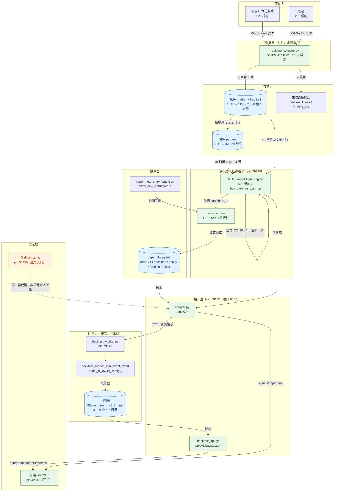
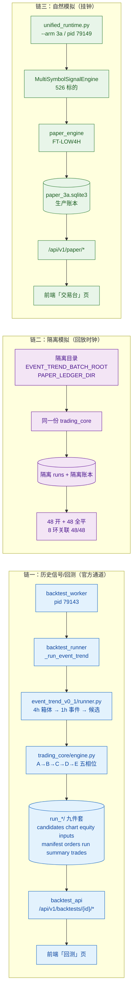
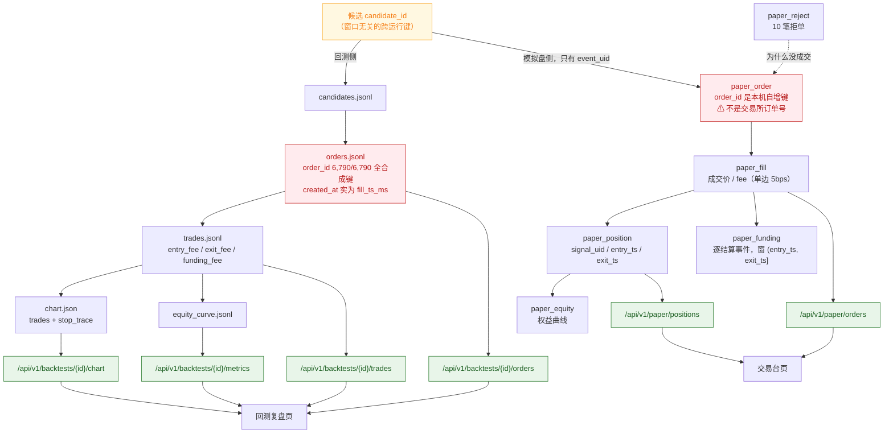
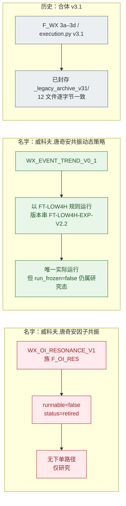

# PROJECT-REVIEW-07｜真实数据流与运行关系图

- 出单：2026-10-25｜依据：本单实测进程、API 响应、目录盘点（不是照着设计文档画的）。
- 读法：先看**图一**（谁在跑、数据怎么流），再看**图二**（三条链别混着看），最后看**图三**（一笔交易怎么串起来）。
- 所有节点都在右侧标了「实证落点」，没标的一律不画。

---

## 图一｜当前真实运行关系（2026-10-25 13:38 实测）

**读图要点（三句话）**

1. **采集器是唯一的入口**，pid 42278 从 10-23 17:00 起没重启过；后端重启时按「防误停策略」不动它。
2. **信号引擎同时读冷库和热库**（`data_source=merged_cold_hot`），4h 冷 538,104 行 + 热 142,944 行、重叠 121,904 行、**重叠值不一致 0 行**，最终 materialize 559,144 行。
3. **回测完全独立**：走 `backtest_worker` → `backtest_runner` → 写盘，**不经过信号引擎、不碰账本**。这是好事，但也意味着回测与模拟盘不是同一条路（见缺陷 D-02）。

---

## 图二｜三条链，别混着看

| 链 | 谁触发 | 用什么时钟 | 落盘在哪 | 现在什么状态 |
|---|---|---|---|---|
| 一 历史信号/回测 | 人点「跑回测」 | 历史 K 线时间 | `回测日志/<family>/<batch>/run_*/` | 2,284 组；**1,197 组跑旧规则** |
| 二 隔离模拟 | 人跑隔离脚本 | 回放时钟 | 隔离 runs + 隔离账本 | 已验证 48 开 + 48 平 |
| 三 自然模拟 | 进程常驻自己走 | **真实挂钟** | `数据/paper/paper_3a.sqlite3` | 在跑，**零自然成交** |

**隔离链的两个必踩坑（已实证）**

1. 必须**显式设 `EVENT_TREND_BATCH_ROOT`**。只设 `RUNS_DIR` 时，`/batches` 会**回落到读生产**——你以为在隔离，其实在看生产。
2. `PAPER_LEDGER_DIR` 必须在 **import 后端模块之前**设好。晚一步，模块已经绑死生产路径。

---

## 图三｜一笔交易怎么串起来（候选 → 订单 → 成交 → 费用/资金费 → 复盘）

**串链时的四条硬事实（都已复核，可复用）**

1. **交易所订单号不存在**。7 个 token 后端 0 命中；`paper_order.order_id` 和回测 `orders.jsonl` 的 `order_id` 都是**本机合成键**，不得当交易所订单号用。
2. **`candidate_id` 是窗口无关的跨运行键**。旧结论「换窗口就变」已作废。
3. **回测 4h 出场路径里的 `bar_open_time` 是 4h bar 的起点**，48 笔里有 14 笔早于入场时刻。算持有期一律用 `paper_position.entry_ts / exit_ts`，不要用它。
4. **`paper_order` / `paper_blocked` 只有 `event_uid`，没有 `signal_uid`**。所以「候选→订单」只能按字符串匹配，**不是外键**——这是当前关联链最弱的一环。

---

## 图四｜三处「同名不同物」的落点（最容易认错的地方）

**一句话记住**：说「因子共振」= 已退役的研究分支；说「共振动态策略」= 现在跑的那一个；说「v3.1」= 已经封存不许碰的旧实盘。

---

## 附：本图用到的实证落点

| 节点 | 证据 |
|---|---|
| 进程与 PID | 本单 13:38 实测（`lsof -nP -i:8787 -sTCP:LISTEN -t` + `psutil` 取启动时刻/命令行） |
| 冷热合并统计 | `/api/v1/paper/status` → `signal_engine.bootstrap.history` |
| 526 标的 / 活状态 | `locks/paper_runtime_3a_status.json`（cycle 960） |
| 开闸状态 | `paper_new_entry_gate.json` → `allow_new_entries=true`、`reason=user_ui_resumed` |
| 3,989 个 run 目录 | `out/03_回测可追溯性.json` |
| 数组格式 375 个 | `out/06_图表格式冲突.json` |
| 同币多笔 859 组 | `out/08_同币多笔暴露面.json` |
| 账本逐行 | `数据/paper/paper_3a.sqlite3`（13 单 / 6 成交 / 3 持仓 / 10 拒单） |
