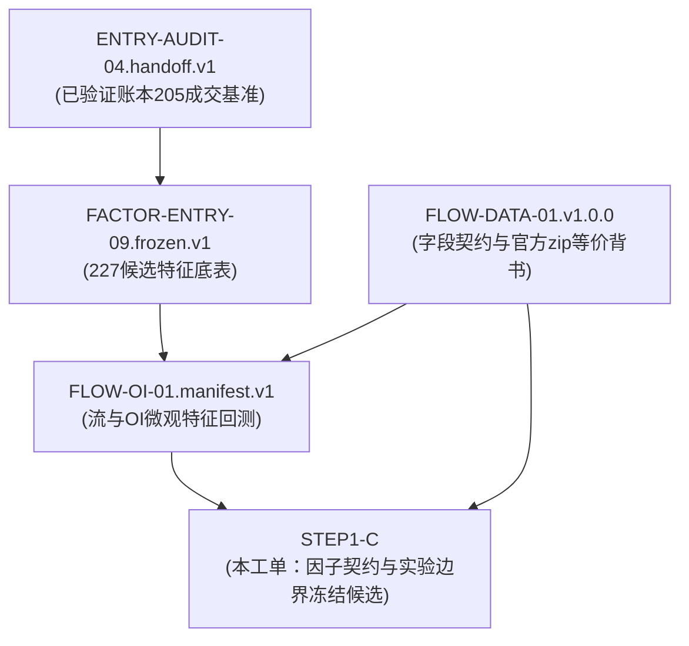

# STEP1-C 产物测试盲区与版本绑定关系

**工单编号**：STEP1-C  
**关联工单**：ENTRY-AUDIT-04、FACTOR-ENTRY-09、FLOW-DATA-01、FLOW-OI-01  

---

## 一、输入输出版本全链路绑定拓扑

### 明确输入版本清单与哈希绑定：
1. **ENTRY-AUDIT-04 交接包**：
   - 版本：`ENTRY-AUDIT-04.handoff.v1`
   - 主数据：`evidence/ENTRY-AUDIT-04/handoff/ledger_handoff.parquet` (`93abe58a9b25b95060e30ecc2d4d684f5500e67acc9772201230b3149cee5054`)
   - 作用：锁定 205 笔已成交的毛利、手续费、资金费及校正净盈亏 (+101.531971 USDT)。
2. **FACTOR-ENTRY-09 冻结底表**：
   - 版本：`FACTOR-ENTRY-09.frozen.v1`
   - 底表：`evidence/FACTOR-ENTRY-09/reconstructed_candidate_features_08.parquet` (`6e1b9369cca29cba4c8c6064cd11b90a4961f1adcd917aef7dffb7ce5d456849`)
   - 作用：提供全量 227 笔候选样本身份 `candidate_id`、快照时间 `snapshot_time_ms` 及原始三套分类标签。
3. **FLOW-DATA-01 机器可读契约**：
   - 版本：`FLOW-DATA-01.v1.0.0`
   - 契约文件：`evidence/FLOW-DATA-01/contract/flow_fields.contract.json`
   - 作用：提供 252 个官方 zip 档案核验通过的字段定义、时间可用性与无前视要求。
4. **FLOW-OI-01 产物**：
   - 审查产物：`candidate_flow_oi_features.parquet` (`71f76fde38681e03d3cf7661735d46c615d24384f3233421b8e614bb35cc4c9f`)
   - 作用：登记其实际计算逻辑与四组回测结果，标定其 PIT 缺陷。

---

## 二、FLOW-OI-01 已执行测试与测试盲区对照表

| 序号 | 测试维度 | `test_flow_oi_consistency.py` 实际断言 | 真实工程盲区 / 漏检漏洞 | 危害程度 |
| :---: | :--- | :--- | :--- | :---: |
| **1** | **时间轴前视测试** | 仅检查了输入样本行数与快照 ID 是否对齐 | **完全未检验 `close_time < ts`**！放过了全部 227 笔当根 K 线长达 60 分钟的未来数据泄露！ | 🔴 **严重漏洞** |
| **2** | **覆盖率真伪测试** | 只断言 `df["coverage_status"] == "COMPLETE"` | 代码在生成时硬编码赋了 `"COMPLETE"`，测试未逐行检验字段级空值，漏掉了 2022 年大户指标 28 行真实空值！ | 🟡 **中度漏洞** |
| **3** | **时间口径一致性** | 未对 `snapshot_time_ms` 与 `datetime_utc` 进行比对 | 漏检了窗口代际 42 笔中两者相差 15 分钟的口径错位问题 | 🟡 **轻度口径** |
| **4** | **数值物理边界** | 检查了买入占比在 [0,1]、归一化 CVD 在 [-1,1]、主动买卖恒等式 | 仅做了基本数学有效性检验，未核实数据源是否被篡改 | 🟢 **通过但浅层** |
| **5** | **嵌套逻辑与代际** | 检查了 G1>=G2>=G3>=G4 逻辑与两代际收益守恒 | 逻辑层完整，但建立在包含前视偏差的输入上 | ⚠️ **输入污染** |

---

## 三、待修复、待复测与仅计划未实施项全景清单

### 1. 待修复项（Code / Logic Bug）
- **Bug 1（前视偏差必修）**：
  - 当前代码：`bar = df_c[df_c["open_time"] <= ts].iloc[-1]`
  - 修复要求：必须改为 `bar = df_c[df_c["close_time"] < ts].iloc[-1]`（或当 $ts$ 为整点时取 `open_time < ts`），确保决策所用 K 线在当下已完全收盘；
  - Metrics 桶同理：改为 `df_m[df_m["ts"] + 300_000 <= ts].iloc[-1]`。
- **Bug 2（覆盖状态分级必改）**：
  - 修复要求：取消全表一律标记 `COMPLETE` 的做法，改为字段级（`COMPLETE` / `PARTIAL`），并明确暴露 2022 年缺失大户指标的 28 行样本。
- **Bug 3（时间口径对齐）**：
  - 修复要求：明确 42 笔窗口代际中 15 分钟差异的物理归因，统一对齐基准。

### 2. 待复测项（Re-evaluation Required）
- 在上述前视偏差修复后，**必须全量重新计算 227 笔候选特征，并重跑四组对照回测**！
- 重新检验：在剥离未来 60 分钟前视信息后，前 24h 的 CVD 与持仓增减是否仍然具有减少早期走弱的能力？少亏与错失大赢家的比例如何变动？

### 3. 仅计划未实施项（Planned but Deferred）
- **5 分钟精细化流拆解**：原计划用 5m K 线拆解突破前夕的主动成交，但因本机 5m 数据仅覆盖 2025 年 10 月起（历史仅 1 年），无法覆盖 2021—2025 年早期样本，故未实施；
- **聪明钱历史跟踪**：确认仅有当前 11 天快照日志，无历史时序，已主动放弃纳入历史回测；
- **多空持仓均价**：确认官方无历史数据，已主动放弃接入。
