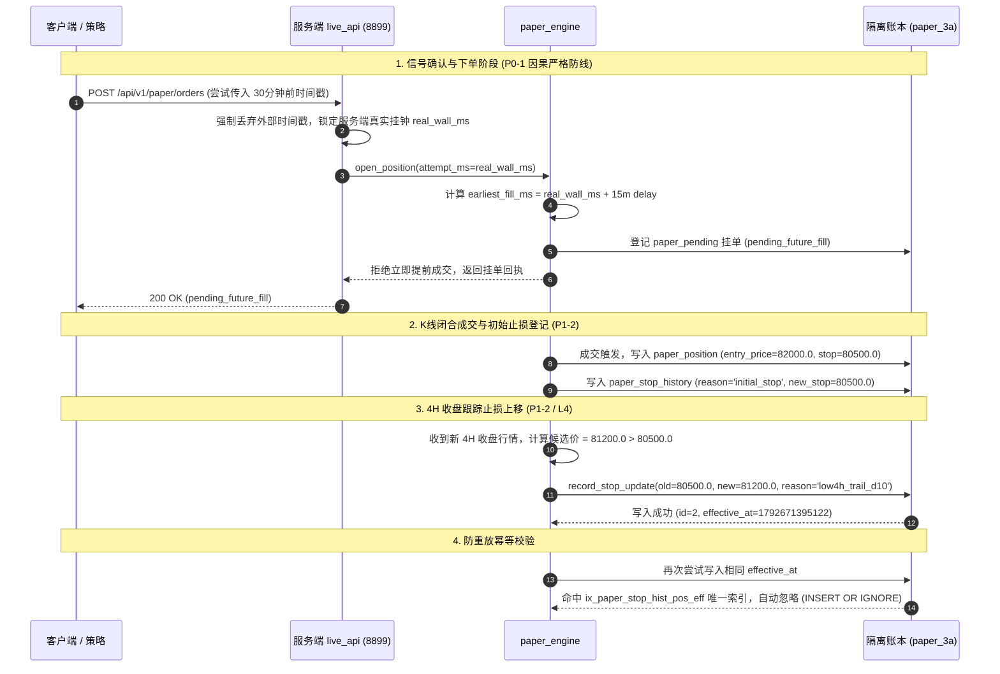

# SYSTEM-CLOSELOOP-02: 隔离交易生命周期与止损事件链

**工单批次**：`SYSTEM-CLOSELOOP-02`  
**隔离环境**：端口 `8899` / 账本 `/tmp/closeloop_02_isolated_env/paper/` / 闸门 `/tmp/closeloop_02_isolated_env/test_gate.json`  
**测试数据支撑**：[`data/03_isolated_test_results.json`](file:///Users/boos/Desktop/威科夫因子共振趋势/evidence/SYSTEM-CLOSELOOP-02/data/03_isolated_test_results.json)

---

## 一、隔离沙箱与防污染架构

为确保生产日常实例（8787）绝对不受测试干扰，整改后建立严格的物理沙箱运行体系：
1. **独立时钟与网络端口**：隔离实例监听 `127.0.0.1:8899`，与日常生产 `8787` 端口完全独立；
2. **独立数据库与账本隔离**：
   - 信号库：`/tmp/closeloop_02_isolated_env/live_signals.sqlite3`
   - 纸面账本：`/tmp/closeloop_02_isolated_env/paper/paper_{arm}.sqlite3`
3. **独立闸门配置与持久化**：
   - 环境变量 `PAPER_GATE_FILE=/tmp/closeloop_02_isolated_env/test_gate.json`；
   - 测试实例内对闸门进行 `start` / `stop` 切换，持久化仅作用于沙箱文件，日常生产的 [`数据/paper_runtime_gate.json`](file:///Users/boos/Desktop/威科夫因子共振趋势/数据/paper_runtime_gate.json) 维持锁定（`allow_new_entries: false`）。

---

## 二、交易生命周期与因果时钟时序链

---

## 三、真实止损事件审计记录 (`paper_stop_history`)

在沙箱账本中实测提取的指定持仓（`position_id=1`, BTCUSDT）止损变更轨迹如下：

| 记录 ID | 账号标识 | 持仓 ID | 原止损价 (`old_stop`) | 新生效止损 (`new_stop`) | 变更原因 (`reason`) | 决策时刻 (`decision_at`) | 生效时刻 (`effective_at`) | 幂等防重放状态 |
| :---: | :---: | :---: | :---: | :---: | :---: | :---: | :---: | :---: |
| **1** | `paper43_3a` | `1` | `NULL` | **80,500.0** | `initial_stop` | 1792668695122 | 1792668695122 | **持久化入库** |
| **2** | `paper43_3a` | `1` | 80,500.0 | **81,200.0** | `low4h_trail_d10` | 1792671395122 | 1792671395122 | **单调上移成功** |
| *(重试)* | `paper43_3a` | `1` | 80,500.0 | 81,200.0 | `low4h_trail_d10` | 1792671395122 | 1792671395122 | **被唯一索引忽略 (防重)** |

> [!NOTE]
> 止损轨迹严格满足单调非递减约束：`new_stop > old_stop`。若行情回落或候选价更低，`record_stop_update` 直接返回 `False`，绝不下移止损。

---

## 四、因果反例测试实测回执

针对 AUDIT-01 报告中要求的严格反例，在端口 8899 执行实测结果：

1. **反例 A：外部请求回填 30 分钟前时间戳**
   - **输入**：`{"requested_at": now - 1800000, "now_ms": now - 1800000}`
   - **服务端响应**：`HTTP 200`, `ok: false`, `reason: "pending_future_fill"`
   - **时钟审计**：服务端强制取挂钟 `1792672295126`，计算出的 `earliest_fill = 1792673195126` 严格晚于当前挂钟，**未产生提前成交**。
2. **反例 B：重复提交相同 `signal_uid`**
   - **输入**：再次提交相同信号
   - **服务端响应**：识别已有挂单/持仓，直接幂等保护，**未产生重复成交**。
3. **反例 C：尝试平不存在的持仓 (C2)**
   - **输入**：`POST /api/v1/paper/close {"position_id": 88888}`
   - **服务端响应**：`HTTP 409 Conflict`, `reason: "position_not_found"`，**准确报错，未被行情缺失掩盖**。
