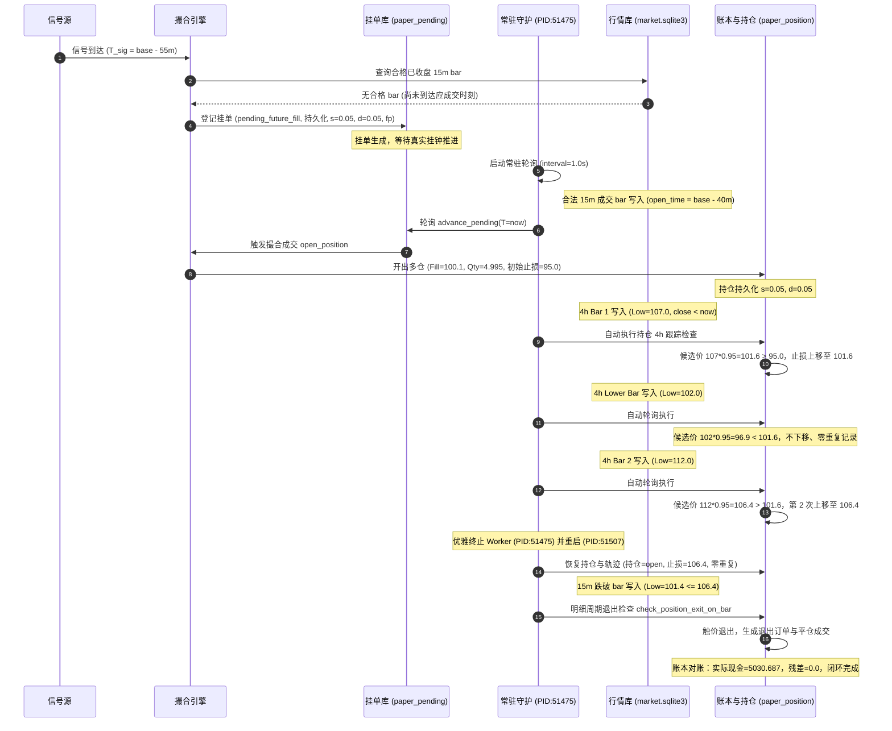

# SYSTEM-CLOSELOOP-05｜自动运行启动命令、进程状态及完整事件时间线

## 1. 自动运行启动与单实例机制

### 启动命令与独立执行入口
模拟执行由独立常驻守护进程入口驱动，禁止测试脚本直接调用 `execute_cycle` 或手动推送成交：
```bash
python -u 框架/backend/workers/paper_execution_worker.py --arm 3a --interval 1.0
```

### 单实例文件锁与同源隔离
- **锁路径**：`/tmp/wx_closeloop05/locks/paper_daemon_3a.lock`（由 `PAPER_LOCK_DIR` 隔离，默认跟随 `PAPER_LEDGER_DIR.parent / locks`）；
- **锁机制**：启动时通过 `fcntl.flock(fd, LOCK_EX | LOCK_NB)` 获取独占排他锁，启动失败显式置 `failed_lock_occupied` 并退出，杜绝重复多进程推进；
- **状态落盘**：守护在运行期间将真实进程信息（PID、启动时间、轮询统计、健康状态）落盘至 `/tmp/wx_closeloop05/locks/paper_daemon_3a_status.json`，供 API 跨进程精准读取。

---

## 2. 真实守护进程执行状态与存活探测

```json
{
  "arm": "3a",
  "pid": 51575,
  "status": "running",
  "running": true,
  "started_at": 1792688308587,
  "last_cycle_ms": 1792688336000,
  "cycle_count": 28,
  "pending_matched_count": 1,
  "trailing_checked_count": 0,
  "stops_updated_count": 2,
  "exits_triggered_count": 1,
  "last_error": null,
  "health": "healthy"
}
```
API 接口在返回时调用 `os.kill(pid, 0)` 核验真实存活，防止孤儿文件导致的假状态。

---

## 3. 完整事件生命周期时间线（以 GROUP 1 为例）



---

## 4. 详细执行事件时序记录

| 事件发生时间 (挂钟) | 事件主体 | 动作与处理机制 | 关键输出 / 状态变化 | 状态机判定 |
| :--- | :--- | :--- | :--- | :--- |
| `00:57:41` | 信号登记 | 接收 `sig_GROUP1_01` 信号，因无成交 bar 挂起 | 登记挂单 `pending_id=1`，落盘 `s=0.05, d=0.05` | `pending_future_fill` |
| `00:57:42` | 守护启动 | 拉起 `paper_execution_worker.py` (PID: 51475) | 获取独占文件锁，状态文件落盘 | `running (healthy)` |
| `00:57:49` | 自动撮合 | 真实进程时钟推进检测到合格 15m bar 闭合 | 自动成交建仓：`Fill=100.1, 初始止损=95.0` | `open` |
| `00:57:53` | 止损上移 ① | 守护轮询读取到最新已收盘 4h bar (Low=107.0) | 计算候选价 101.6 > 95.0，止损自动上移至 101.6 | `stop_updated=True` |
| `00:57:56` | 候选较低 | 守护轮询读取较低候选 4h bar (Low=102.0) | 计算候选价 96.9 < 101.6，保持 101.6 不变，零记录 | 单调性成立 |
| `00:58:00` | 止损上移 ② | 守护轮询读取突破 4h bar (Low=112.0) | 计算候选价 106.4 > 101.6，第 2 次上移至 106.4 | `stop_updated=True` |
| `00:58:01` | 优雅关停 | 对守护发送 SIGTERM，等待正常释放锁与状态 | 记录当前账本快照（持仓 1，成交 1，轨迹 3） | `stopped` |
| `00:58:05` | 重启恢复 | 启动新守护 (PID: 51507)，自动读取账本接管 | 持仓保持 `open`，止损仍为 106.4，无任何重复数据 | `recovered` |
| `00:58:09` | 触价平仓 | 守护轮询检测到 15m 价格跌破生效止损 (101.4 <= 106.4) | 自动平仓，生成卖出订单与平仓成交 | `closed` |
| `00:58:09` | 账本闭合 | 现金重算：$5000 + (106.35 - 100.1)\times 4.995 - \text{费用}$ | 理论与实际现金完全吻合，残差精确为 $\mathbf{0.0}$ | `closed_balanced` |
