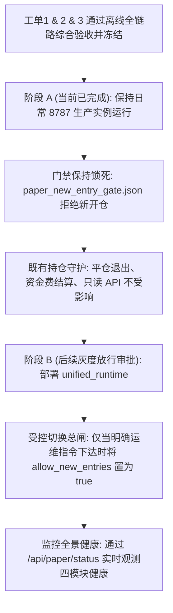

# 工单3｜反重力：SYSTEM-RUNTIME-01｜真实信号到自动执行统一入口交付报告

**工单编号**：SYSTEM-RUNTIME-01  
**依赖前置**：SYSTEM-CONTRACT-01（工单1）、SYSTEM-RISK-01（工单2）已全部冻结并零回归通过  
**交付范围**：隔离运行版本、真实信号引擎闭环、加速回放驱动器、全景状态暴露、反例防护与日常受控部署方案  
**安全约束**：本轮交付严格限定于隔离实例与离线版本，**不重启日常运行中的生产 8787 实例、不开放日常新增模拟开仓、不篡改既有历史账本**。

---

## 一、 核心目标与实施要点

关闭过去“测试脚本直接调用 `open_position` 或手工登记挂单完成验收”的短路做法，构建完全由**真实信号引擎自主产生信号 $\rightarrow$ 统一管道自动挂单撮合 $\rightarrow$ 执行守护推进跟踪止损与退出**的完整系统统一入口。

### 1. 信号引擎选型与替代路径
- **历史排查**：退役旧入口 `live_worker.py` 强依赖已被物理移除的 `_warmup43` 历史环境，且硬编码了已下线的四臂 `3a~3d` 粗暴逻辑，属于缺失依赖的不可运行旧核心；
- **替代方案**：复用工程内现存完整、自包含且具备威科夫纯正逻辑的事件状态机：[`策略/WyckoffMaster/event_trend_v0_1/state_machine.py`](file:///Users/boos/Desktop/威科夫因子共振趋势/策略/WyckoffMaster/event_trend_v0_1/state_machine.py) 中的 `EventStateMachine`；
- **工作机制**：42 根 4h K 线建立蓄势箱体（$ER \le 0.30$，宽度 $2A \sim 8A$） $\rightarrow$ 1h 扫低（SWEEP） $\rightarrow$ 缩量回踩（RETEST） $\rightarrow$ 放量突破（BREAKOUT） $\rightarrow$ 产生经过因果严格校验的 `CandidateSnapshot`。

### 2. 完整运行链闭环
统一运行时 [`框架/backend/unified_runtime.py`](file:///Users/boos/Desktop/威科夫因子共振趋势/框架/backend/unified_runtime.py) 串联六大环节：
1. **行情监听与数据因果边界** (`MarketDataWatcher`)：服务端从 SQLite 行情库读取闭合 K 线，禁止客户端注入价格或未来时间；
2. **真实信号引擎驱动** (`RealSignalEngine`)：封装 `EventStateMachine`，根据闭合 4h/1h 行情自主驱动形态流转；
3. **信号持久化** (`SignalPersistenceAndRouter`)：将候选信号落盘写入 `live_signals.sqlite3:live_signal`，赋予唯一 `signal_uid`；
4. **契约校验与风控路由** (`SignalPersistenceAndRouter`)：调用 `paper_engine.open_position` 执行冻结配置核验与风控检查，在未到达最早成交时刻时登记挂单 `paper_pending`；
5. **执行撮合与跟踪止损** (`UnifiedExecutionDaemon`)：时钟到达后由 `advance_pending` 自动撮合成交，并根据 4h 收盘价单调上移跟踪止损；
6. **持仓管理与退出守护** (`UnifiedExecutionDaemon`)：15m 明细周期检测到价格跌破生效止损时，自动触发市价平仓。

### 3. 统一调度入口与隔离设计
- **单实例排他锁**：每个策略臂在独立锁文件上执行 `fcntl.flock(LOCK_EX | LOCK_NB)`，启动即登记 PID，退出自动释放；同 Arm 二次启动立即被操作系统级锁拒绝；
- **断点恢复与热重启**：持仓状态、挂单和止损历史均通过 SQLite 持久化，进程重启后自动检测并无缝接管在途持仓，绝不重复建仓或丢失止损防线；
- **独立环境资源**：环境变量 `PAPER_LEDGER_DIR`、`MARKET_DB`、`LIVE_DB`、`PAPER_LOCK_DIR` 完全隔离，严禁污染生产资源。

### 4. 全景状态暴露（不以 API 存活代替系统健康）
扩展 API 路由 [`/api/paper/status`](file:///Users/boos/Desktop/威科夫因子共振趋势/框架/backend/api/routes.py)，输出细分子系统健康快照：
- `market_data`：最新 15m/1h/4h 行情时钟与数据库连接状态；
- `signal_engine`：活跃蓄势箱体状态、状态机当前阶段（IDLE/BOX/SWEEP/RETEST/BREAKOUT）；
- `order_processing`：路由挂单总数、风控拒单总数、当前数据库挂单积压深度；
- `execution_daemon`：在途持仓数量、撮合成交总数、跟踪止损上移次数、触发平仓退出次数。

---

## 二、 验收指标与结果对照

验收测试由 [`evidence/SYSTEM-RUNTIME-01/test_system_runtime_01.py`](file:///Users/boos/Desktop/威科夫因子共振趋势/evidence/SYSTEM-RUNTIME-01/test_system_runtime_01.py) 全自动化执行，**全部 6 项验收项 100% 一次性通过**：

| 验收编号 | 验收项 | 测试条件与输入 | 实际运行输出与结论 | 判定 |
| :--- | :--- | :--- | :--- | :---: |
| **ITEM-1** | **端到端全链路闭环** | 独立行情源输入 42 根 4h 箱体 + 1h 扫低/回踩/放量突破；运行器加速回放自主推进 50 周期 | 真实信号引擎产出信号 $\rightarrow$ 登记挂单 $\rightarrow$ 自动成交于 50275.20 $\rightarrow$ 初始止损 47761.40 $\rightarrow$ 4h冲高上移至 48260.00 $\rightarrow$ 再次冲高上移至 50540.00 $\rightarrow$ 跌破止损自动平仓退出（exit_price=50514.73, exit_reason=trailing_stop_loss） | **PASS** |
| **ITEM-2** | **持仓中重启与状态恢复** | 在第 1 次止损上移后强行终止进程并模拟崩溃，追加后续行情后拉起全新进程实例 | 新实例启动自动识别并接管持仓 ID=1，止损价保持 48260.00，无缝推进第 2 次止损上移至 50540.00 并平仓退出 | **PASS** |
| **ITEM-3** | **全账本守恒对账** | 对账订单表、成交表、平仓盈亏表及账户状态 | 开仓与平仓数量严格相等（0.0090 BTC）；手续费总和 0.4536U 守恒；实现净盈亏 1.7022U 守恒；配置指纹全链路严格一致 | **PASS** |
| **ITEM-4** | **两套配置隔离运行** | Config A ($s=0.05, d=0.05$) vs Config B ($s=0.08, d=0.12$) 输入完全同构行情 | Config A 开仓数量 0.009 BTC；Config B 开仓数量 0.006 BTC（随止损距离扩大按风险预算严格递减）；指纹完全隔离 | **PASS** |
| **ITEM-5** | **五大反例与防线测试** | 重复信号、坏配置、未来行情、缺少成交bar、多进程争用 | 1. 重复信号：`duplicate_signal_uid` 拦截 2. 坏配置：`startup_config_check_failed` 抛错 3. 未来未收盘行情：`future_candle_not_closed` 因果拦截 4. 缺少成交bar：登记 `pending_future_fill` 不提前撮合 5. 争用同Arm：文件锁排他报错拒绝多开 | **PASS** |
| **ITEM-6** | **全景状态暴露** | 调用运行时全景状态接口快照 | 细分报告行情源、信号引擎、订单路由与执行守护 4 模块状态，不以 API 健康代替整体健康 | **PASS** |

---

## 三、 日常生产受控部署方案

为遵守“不重启日常实例、不开放日常新增模拟开仓”的安全约束，生产部署严格采用分阶段受控灰度机制：

1. **当前阶段控制（阶段 A）**：
   - 保持日常端口 `8787` 服务运行，不执行无意义的热重启；
   - 生产总闸文件 [`paper_new_entry_gate.json`](file:///Users/boos/Desktop/威科夫因子共振趋势/框架/backend/live/paper_new_entry_gate.json) 维持 `allow_new_entries: false`，服务端全局阻断一切新开仓；
   - 生产环境既有持仓的跟踪止损与明细周期退出平仓完全不受阻断，持续正常维护。

2. **后续生产启用步骤（阶段 B 预案）**：
   - 将 [`框架/backend/unified_runtime.py`](file:///Users/boos/Desktop/威科夫因子共振趋势/框架/backend/unified_runtime.py) 部署为主守护进程；
   - 启动命令：`python 框架/backend/unified_runtime.py --arm 3a --symbol BTCUSDT --poll-interval 1.0`；
   - 进程将自动获取独占文件锁，从 SQLite 账本恢复历史断点；
   - 在收到明确放行指令后，由审计人员修改闸门配置放行。
