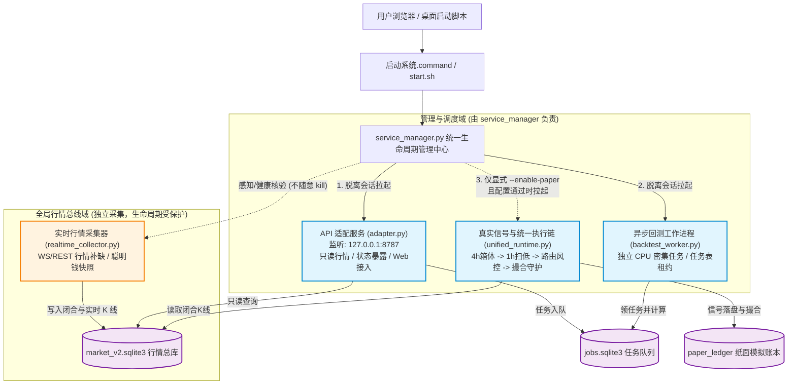
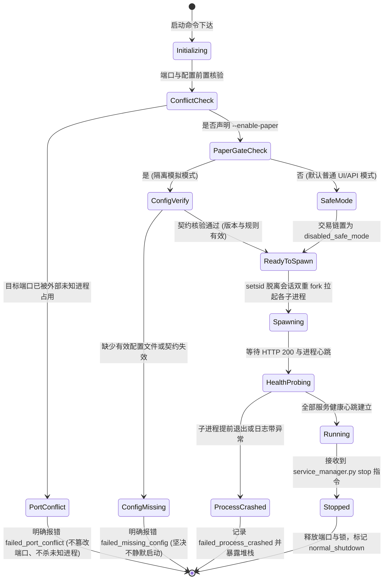

# SYSTEM-STARTUP-01 ｜ 进程拓扑与生命周期流转规范

## 1. 架构与进程拓扑图

系统分为用户层、接入与路由层、计算与执行层、数据存储层。各进程各司其职，生命周期独立隔离：

---

## 2. 各进程身份判据与生命周期矩阵

| 组件名称 | 启动脚本 | 真实监听/特征 | PID 文件 | 身份核验判据 | 停止行为 |
| :--- | :--- | :--- | :--- | :--- | :--- |
| **API 服务** | `adapter.py` | 端口 (如 `:8787`) | `backend-<port>.pid` | 监听目标端口 + CWD 在工程内 + 命令行含 `adapter.py` | 发送 SIGTERM，至多等 10s，释放端口 |
| **回测 Worker** | `workers/backtest_worker.py` | 领任务表计算 | `worker-<port>.pid` | 进程存活 + CWD 在工程内 + 命令行含 `backtest_worker.py` | 发送 SIGTERM，等待当前任务完成或超时优雅退出 |
| **真实运行链** | `unified_runtime.py` | 事件状态机推进 | `runtime-<arm>-<port>.pid` | 进程存活 + CWD 在工程内 + 命令行含 `unified_runtime.py` + 持有文件锁 | 发送 SIGTERM，释放文件锁，退出原因记为 `normal_shutdown` |
| **实时采集器** | `realtime_collector.py` | 行情入库心跳 | `logs/realtime.pid` | 进程存活 + CWD 在工程内 + 命令行含 `realtime_collector.py` | **防误停保护**：常规 stop 绝不杀采集器；必须传 `--stop-collector` 且由本环境发起时才操作 |

---

## 3. 运行状态流转图

---

## 4. 采集器防误停隔离机制
1. **启动阶段**：
   - 如果系统已存在一个健康采集器（`realtime_collector.py --health` 正常），启动器只**感知并报告复用**，绝不重复拉起第二实例。
2. **停止阶段**：
   - 采集器负责全盘 500+ 合约的历史与实时行情持续同步，关系到行情库一致性。
   - `service_manager.stop()` 与 `start.sh stop` 默认将 `stop_collector=False`。
   - 停止扫描列表中只包含当前端口绑定的 API、Worker 和 Runtime，**任何常规服务停止操作均不会误碰采集器**。
