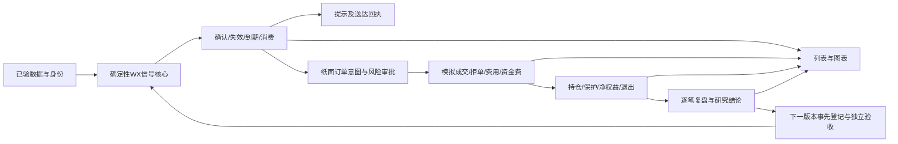

# 项目闭环审查与优化结论

2026-10-11，北京时间。结论：当前行情采集与查询有可用证据；最新唐奇安/威科夫到提示、纸面成交、风险退出和复盘之间尚未闭合。未启动回测或模拟、未下真钱订单、未修改业务代码。Codex负责规则、派工和独立验收，具体实现仍由Work负责。

用户已确认跨所共用10000USDT虚拟研究本金：每组独立对照回放同一本金，各组和各所不叠加起始余额或收益。原百分比风控不变，10为唯一合成生效参数视图。

本轮只保留F_WX 3a–3d和18个已登记研究配置。旧A/B、OI策略和_S不参与运行；已有其他行情/界面数据保留。当前数据门禁仍优先，施工按下表串行，不能把本次审查接收当成开跑授权。

| 功能 | 当前核验结果 | 闭环要求 | 当前判定 |
|---|---|---|---|
| 历史数据与血缘 | 63来源/122543行量修复逐值PASS，旧版本含available_at冻结；549/549在固定cutoff前有行 | 全周期/用途/历史PIT/实际fee与mark另验，113 OPEN仍保留 | 部分通过，G01/G02未过 |
| 采集与运行健康 | realtime running；8787健康200；历史paused_no_space，阈值30GiB；修复预留门禁12GiB | 状态分开，不能把实时运行叫历史全完成，不下调阈值绕过保护 | 实时有证据；历史受限 |
| 页面可用性 | Chrome实际出现Vite ECONNREFUSED临时broker.sock覆盖层；/返回500，模块和同源API仍200 | 修复生命周期原因并真实刷新验证，不能隐藏overlay假装恢复 | 当前失败 |
| 行情列表与身份 | 可复用API/采集/表格；前端按显示symbol关联信号会丢exchange与原合约 | 全链路exchange+contract_id/generation+原market_id匹配，展示简称不作键 | 身份风险，待整改 |
| 策略规则/管理 | v2规格存在；运行注册表和接口仍旧A/B待配置；strategy_configs=0 | 明确当前WX四组、规则冻结和run冻结两种状态，未实现/数据未过诚实显示 | 文档存在，运行未接线 |
| 信号与当前方向 | signals=0、signal_conditions=0；前后端状态枚举不一致；过期/失效可能仍返回当前方向 | 同一状态契约、有效期/失效/版本/消费筛选，历史方向单列 | 代码风险已证，无真实信号可验 |
| 图表与信号列表 | 列表500行截断并has_more=false；图表先取最早500；前端signalTag恒undefined | 窗口过滤后分页，真实游标，按event_id/确认时刻落图 | 接线未闭合 |
| 提示与送达 | 未找到生产outbox/送达/重试/取消链路 | 持久化一次消费，提示失败与订单失败分别记录，通知不隐式下单 | 尚未实现 |
| 纸面开平仓 | 按钮源码可达；React临时0.1数量/10倍/做空/2%止损/5%目标；刷新丢失 | 后台dry-run意图、成交、规则和账本，前端只显示回执 | 假持仓路径须封住 |
| 账户/保护/风险/权益 | accounts stub；风险/订单空，没有完整账本 | 费用、资金费、未实现、固定止损、720h、回撤锁止及重启恢复逐笔可查 | 尚未实现 |
| 回测与模拟复盘 | backtests/reviews stub；页签与表格未连真实记录，有旧资金和1m文字 | mode/run分账、追溯到源bar/拒单/成交、完整净权益与各阶段结论 | 尚未实现 |
| 配置/版本/幂等 | NULL data_version同事件重复写入隔离复现；源集合hash不识别同源值改动 | 非空稳定ID、消费值修订/掩码/快照绑定，配置hash读回验证 | P1规则阻塞 |

这些判定描述当前事实，不表示所有字段/全部币种都已端到端验收。行情细字段此前验收不能替代当前信号/执行验收。没有真实信号和账本，因此不声称已有错误实盘交易，也不把空API200当闭环通过。

优化方向是做一条可核账的纵向链路，再扩展示内容。前端不另算策略、不自造持仓；提示、模拟和复盘读取相同event_id/intent_id/fill_id及配置和输入快照。零信号、拒绝交易、没有增益都是合法结果。复盘改进只能形成下一版本预登记，不能自动训练后改当前参数或重复看最终段。

复用选择：保留现有collector、只读API、组件、信号追加表与隔离测试；用已装Freqtrade dry-run的持久化订单/Trade/保护骨架，按项目规格做隔离适配。默认资金费、盘口撮合、钱包净权益和启动止损行为已发现差异，必须通过反例和逐笔对账；不从零另写整套撮合框架，也不直接改全局vendor。[官方dry-run说明](https://www.freqtrade.io/en/stable/configuration/#considerations-for-dry-run)；[官方lookahead检查](https://www.freqtrade.io/en/stable/lookahead-analysis/)。后者仅作辅助，不能替代逐事件因果时钟与前缀一致性。

Work执行顺序与交付标准在07：当前只接收审查、完善契约、复核113 OPEN已有证据并继续暂停补写；G01独立通过后才另开窗口修入口与版本/状态；其后WX确定性核心→隔离回放与对拍→研究验收→纸面执行与恢复→图表提示复盘整链验收。每阶段由Codex独立接受后进下一阶段，不同时改多个链路。

证据：01实时API；02前端HTTP/实际UI错误；03信号和界面审查；04账户与复盘；05/06规则补充及10生效视图；数据独立核验/04限定数据终验。数据43中的46394140等全池统计仍属Work声明，本轮独立549存在性不能证明全量历史无缺口/语义完整。

辅助界面源码覆盖补充见14：主导航已挂四视图；顶部数据时刻未显示/失败只写控制台；8h资金费均值已有已证周期子样本过滤，不能误报为全池8h；草图组件未挂App，仅保留设计依据。完整交互验收仍受首页500阻塞。

本轮审查、规则收口及Work文档整改已完成并独立验收。首轮数据产物非递归50/50 SHA通过；排期成环按15退回后已更正，资本输入G02与执行/共享协调G03明确分开；后续旧派工SHA绑定也已在12:42新窗口更正，旧记录和两轮备份保留。最终文档18/18检查通过：当前交付15/15 SHA、上游9/9绑定、修订前6/6备份及回执14/14 SHA匹配，第二独立语义复核通过；见[19_Work最终文档验收与项目状态.json](/Users/boos/.codex/worktrees/c9d7/加密货币趋势判断系统/项目闭环审查_2026-10-11/19_Work最终文档验收与项目状态.json)。16/18保留退回证据，17为派工记录。结论仅为规则与文档接受，系统运行闭环尚未完成，数据/施工/回测/纸面模拟尚未放行。
